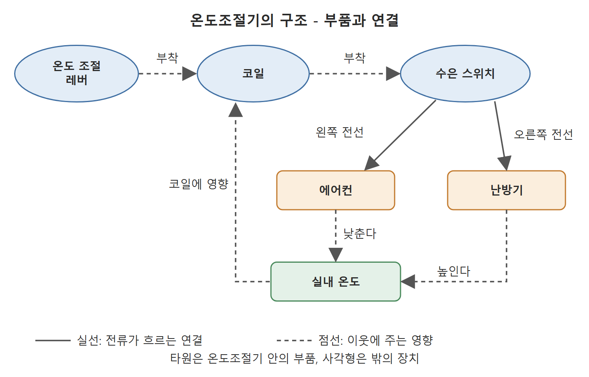
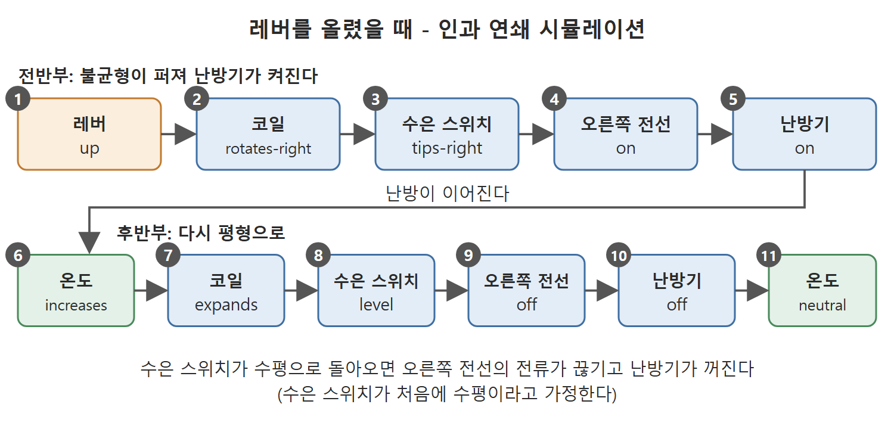

# 온도조절기의 인과 모델과 시뮬레이션

이 문서는 "내부 연결" 소절의 나머지, 곧 전기기계식 온도조절기(thermostat) 사례를 다룬다. 그림과 설명문으로 장치를 이해시키는 방법에서 출발해, 구성요소와 연결을 보여 주는 개념 모델, IF-THEN 규칙으로 쓴 인과 모델, 그리고 그 모델을 돌려서 얻는 사건의 연쇄까지 차례로 살핀다. 논지는, 멘탈 모델을 모호하게 두지 않고 명시적인 형식으로 적으면 시스템의 행동을 설명하고 예측할 수 있으며 비판하고 개선하는 것도 가능하다는 것이다.

---

## 1. 블랙박스로서의 온도조절기

저자는 더 현실적이고 친숙한 장치로 가정용 온도조절기를 든다. 이 장치는 설정한 기준보다 온도가 내려가면 난방기를 켜고, 기준보다 올라가면 에어컨을 켜서 실내 온도를 유지한다.

멘탈 모델이 없으면 이 장치는 블랙박스여서 아주 겉핥기로만 이해할 수 있다. 하지만 대부분의 최종 사용자는 장치가 기대한 대로 작동하는 한 이 정도 이해에 만족한다. 이들에게는 사용자 행동(온도 올리기, 내리기)이 시스템 행동(난방기 켜짐, 에어컨 켜짐)과 어떻게 대응하는지만 알아도 대개 충분하다.

---

## 2. 분해해 보기와 그 한계

호기심 많은 사용자는 더 깊이 이해하고 싶어 한다. 첫 단계로 장치를 뜯어서 속을 들여다볼 수 있다. 원문 그림 2.3은 전기기계식 온도조절기의 주요 부분 세 가지를 보여 준다. 설명에 따르면 덮개 아래 윗층에는 수은 스위치와 온도계 코일이 있고, 아랫층에는 회로 카드가 있다.

그러나 비슷한 장치와 부품에 관한 사전 지식이 없으면, 뜯어 봐도 작동 원리를 추론하기가 몹시 어렵다. 기계에 밝고 재주가 있는 사람이라면 설정을 바꿔 가며 어떤 일이 생기는지 실험해 볼 수 있다. 그러나 그런 지식이 없는 대부분의 사람은 스스로 실험하고 관찰하는 것만으로 알맞은 멘탈 모델을 얻기가 불가능에 가깝다.

---

## 3. 그림과 설명문의 결합

그림이나 도식은 이해에 큰 도움이 될 수 있다. 그러나 그림만으로는 이해하기 어려운 경우가 많다. 저자는 그림 한 장이 천 마디 말을 대신하지는 않는다고 꼬집는다. 더 효과적인 전략은 그림과 설명을 함께 주는 것이다. 한 가지 기법은 그림에 설명을 주석으로 달아서 설명문을 그림 위의 위치와 연결하는 것이다. 원문 그림 2.4가 이 기법의 예다.

이 그림에서 장치의 주요 구성요소는 A, B, C로 표시된다. 설명은 여섯 개의 말풍선(callout)으로 나뉘는데, 각 말풍선은 그림의 다른 부분을 가리키며 이야기의 한 대목을 들려준다. 말풍선은 장치에 관한 하나의 연속된 이야기로서, 1번부터 6번까지 시계 방향으로 차례로 읽도록 만들었다. 여섯 대목의 내용은 다음과 같다.

1. 온도 조절 레버(A)는 가운데에서 코일(B)에 연결되어 있다. 레버를 위로 올리면(온도 상승 설정) 코일이 오른쪽으로 회전한다.
2. 수은 스위치(C)는 소량의 수은이 든 유리병이다. 병 안에는 전선 세 개가 있다. 하나는 병 바닥을 가로질러 뻗어 수은이 항상 닿아 있고, 다른 하나는 왼쪽 끝에서, 또 다른 하나는 오른쪽 끝에서 끝난다.
3. 코일이 오른쪽으로 회전하면 코일에 붙은 수은 스위치가 오른쪽으로 기울고, 수은이 오른쪽 전선에 닿는다. 수은은 전기를 통하는 액체 금속이어서 오른쪽 전선과 바닥 전선 사이로 전류가 흐른다.
4. 전류가 오른쪽 전선을 따라 내려가 릴레이를 작동시키고 난방기를 가동한다.
5. 난방기가 돌면 실내 온도가 오르고, 이것이 코일을 팽창시켜 풀리게 한다. 그러면 수은 스위치가 다시 수평으로 돌아와 전류가 끊기고 난방기가 꺼진다.
6. 수은 스위치가 왼쪽으로 기울면 에어컨이 켜진다. 앞서 설명한 과정의 정반대다.

---

## 4. 설명문의 두 종류: 인과 지식과 원리 지식

설명문의 상당 부분은 한 구성요소의 작용이 이웃 구성요소에 어떤 영향을 주는지 말해 준다. 예를 들어 1번은 온도 설정을 올리는 행동이 코일에 미치는 영향을, 3번은 코일의 회전이 이웃인 수은 스위치에 미치는 영향을 서술한다. 결국 이 글은 레버를 조절하는 행동 하나가 인과 사건을 연쇄적으로 일으켜 마침내 난방기가 켜지기까지의 과정을 그린다.

그러나 모든 설명이 "A가 일어나면 B가 일어난다"는 형태의 인과 지식은 아니다. 일부는 순전히 서술적이다. 이런 설명은 초심자가 장치의 바탕에 깔린 물리를 이해하고, 장치가 왜 그렇게 작동하는지 근거를 알도록 돕는 용도다.

- 2번은 수은 스위치를 서술한다. 이 부품은 수은과 전선 셋, 곧 네 구성요소를 가진 장치로 모델링할 수 있으며, 더 큰 장치 속의 더 작은 장치다.
- 3번에서 사용자는 수은이 전기를 통하는 액체 금속임을 배운다. 덕분에 유리병이 오른쪽으로 기울면 수은이 오른쪽 전선과 바닥 전선에 동시에 닿아 두 전선으로 전류가 흐른다는 멘탈 모델을 갖게 된다.

---

## 5. 형식의 필요성

지금까지 사람이 온도조절기에 대해 갖게 될 멘탈 모델은 다소 느슨하고 비형식적으로 서술되었다. 저자는 내부 연결과 인과성이라는 발상을 여러 대상에 일반화해서 적용하려면 형식(formalism)이 필요하다고 말한다. 여기서 형식이란 멘탈 모델을 포착하고 문서화하는 규칙과 지침을 가리킨다. 적용 대상은 단순한 장치, 복잡한 장치, 추상적 시스템이다. 추상적 시스템의 예로는 어떤 거시경제 힘이 인플레이션에 영향을 주는지를 나타내는 인과 모델이 있다. 이런 형식이 없으면 사람의 멘탈 모델은 쉽게 모호하고 흐릿해진다. 반대로 멘탈 모델을 최대한 명시적으로 만들면, 그것을 공개적으로 비판하고 더 정확하고 완전하게 다듬을 방법을 고안할 수 있다.

---

## 6. 시스템 구조와 개념 모델

먼저 시스템 구조(시스템 토폴로지)를 다룬다. 시스템 구조는 보통 어떤 구성요소가 있고 그것들이 어떻게 연결되는지를 보여 주는 다이어그램 형태의 개념 모델로 그린다. 저자는 드 클레르와 브라운(De Kleer and Brown)이 기계의 토폴로지를 설명한 내용을 인용한다.

- 기계는 구성체(constituent)들로 이루어진다.
- 일부 구성체는 그 자체로 더 작은 기계로 볼 수 있는 부품(저항기, 밸브, 보일러 등)이다.
- 다른 구성체는 부품들이 정보를 전달하며 소통하는 연결(파이프, 전선, 케이블 등)이다.
- 이런 연결은 "무언가"가 흐르는 도관(conduit)으로 볼 수 있고, 그 흐름은 도관 법칙(conduit laws)으로 포착된다.

온도조절기의 개념 모델은 원문 그림 2.5에 있다. 본문이 설명하는 내용은 다음과 같다.

- 구성요소 부품은 다섯이다. 온도 조절 레버, 코일, 수은 스위치, 에어컨, 난방기다.
- 타원은 온도조절기 자체의 구성요소를, 직사각형은 온도조절기 밖의 구성요소(에어컨과 난방기)를 나타낸다. 구성요소 유형에 따라 다른 모양을 쓸 수 있다.
- 연결은 둘이다. 수은 스위치와 에어컨을 잇는 왼쪽 전선, 수은 스위치와 난방기를 잇는 오른쪽 전선이다.
- 온도도 모델에 넣는다. 이 변수가 코일의 상태에 영향을 주기 때문이다. 온도는 온도계 아이콘으로 표시한다.
- 실선은 전류가 흐르는 도관을 나타낸다. 점선은 물리적 도관이 아니다. 무언가가 흐르는 것이 아니라 한 구성요소가 이웃에 영향을 준다는 표시다. 예를 들어 레버는 코일에 부착되어 있고, 에어컨과 난방기는 실내 온도를 바꿔서 코일에 영향을 준다(그림에는 "Attached to", "Decreases", "Increases"라는 표지가 있다).



그림은 다섯 부품과 두 전선, 온도의 연결을 한 장에 모은 것이다. 실선은 전류가 흐르는 전선이고 점선은 이웃 부품에 영향을 주는 관계이며, 실내 온도가 코일로 되돌아가는 점선이 이 장치를 되먹임 구조로 만든다(원서 그림 2.5 참조).

각주에서 저자는 이 개념 모델이 실제 물리적 구성을 단순하게 줄인 것임을 밝힌다. 이 모델은 수은 스위치가 어떻게 작동하는지 보여 주지 않는다(그 부품만의 개념 모델을 따로 만들 수 있다). 또 전선이 회로 카드, 릴레이 등 난방기와 에어컨을 켜는 데 관여하는 다른 부품과 어떻게 이어지는지도 보여 주지 않는다.

---

## 7. 인과 모델: 구성요소의 정의 방식

개념 모델은 장치의 물리적 구성을 보여 주지만, 장치의 행동까지 정해 주지는 않는다. 행동을 알려면 구성요소들이 인과적으로 어떻게 상호작용해서 장치의 행동을 만드는지 나타내는 인과 모델(causal model)이 필요하다. 구조에서 행동을 알아내려면 각 구성요소가 개별적으로 어떻게 작용하는지 이해해야 한다. 이 지식으로 각 부품의 국소적 행동과 이웃 부품과의 상호작용을 이어 붙이면, 우리의 멘탈 모델은 구성요소 상호작용이 이어지는 연쇄가 된다.

구성요소를 기술하는 표기법은 다음 형태를 띤다.

```
<component>
  <state 1>: <rule A>
             <rule B> ...
  <state 2>: <rule A>
             <rule B> ...
  ...
  <state n>: <rule A> ...
```

정의의 첫 단계는 그 부품이 취할 수 있는 모든 상태를 정하는 것이다. 여기서 다루는 것은 멘탈 모델이므로 상태는 증가, 감소, 높음, 보통, 낮음 같은 정성적(qualitative) 값이어야 한다. 정밀한 수치나 복잡한 수학 계산은 쓰지 않는다. 마음의 눈으로 쉽게 돌려 볼 수 있어야 하기 때문이다. 단기 기억 용량에는 한계가 있어서, 세밀하게 구분하는 모델은 가장 숙련된 사람도 쉽게 지치게 만든다.

온도조절기에서 코일은 네 상태(rotates-left, rotates-right, expands, contracts)를, 수은 스위치는 세 상태(level, tips-left, tips-right)를 가진다.

---

## 8. 규칙의 형식과 국소성 원리

규칙 부분은 부품이 그 상태에 이르는 방법을 지정하는 IF-THEN 규칙이다. IF 부분(선행 조건, antecedent)은 부품이 해당 상태에 이르는 조건을 주고, THEN 부분(후행 결과, consequent)은 그 상태 자체를 지정한다. 조건과 결과는 `<구성요소 상태>` 형태로 쓴다. 예를 들어 레버가 아래로 조절되면 코일이 왼쪽으로 돈다는 규칙은 다음과 같다.

```
IF temperature-adjustment-lever down
THEN coil rotates-left
```

이 규칙에서 중요한 점은 이웃 구성요소의 상태를 기준으로 표현한다는 것이다. 인과 모델 명세의 핵심 개념인 **국소성의 원리(principle of locality)**는, 모델 속의 구성요소가 이웃하는 구성요소와만 인과적으로 상호작용할 수 있다는 뜻이다. 예컨대 코일이 왼쪽 전선의 상태에 영향을 준다는 규칙은 쓸 수 없다. 둘이 직접 연결되어 있지 않기 때문이다. 선행 조건은 반드시 이웃 구성요소만 가리켜야 한다.

이 표기법에는 예외가 하나 있는데, 온도 조절 레버의 규칙이다. 레버는 **능동 장치 구성요소(active device component)**, 즉 사람 사용자가 조작할 때만 상태가 바뀌는 구성요소다. 사용자는 레버를 위나 아래로 조절해서 상태를 바꾼다. 나머지 구성요소는 모두 **수동(passive)** 이어서 상태가 언제나 이웃 구성요소의 상태로 결정된다.

---

## 9. 온도조절기의 전체 인과 모델

전체 인과 모델은 구성요소 일곱 개로 이루어진다. 부품 다섯에 연결 둘이다. 온도도 장치에 영향을 주므로 인과 모델에 포함한다. 아래는 구성요소별 규칙이다.

```
Temperature-adjustment-lever
  up:   IF (user adjusts lever upwards) THEN lever up
  down: IF (user adjusts lever downwards) THEN lever down
Coil
  rotates-left:  IF lever down THEN coil rotates-left
  rotates-right: IF lever up THEN coil rotates-right
  expands:       IF temperature increases THEN coil expands
  contracts:     IF temperature decreases THEN coil contracts
```

레버 규칙의 선행 조건은 사용자의 개입을 가리킨다. 레버의 상태를 바꿀 수 있는 것은 사람이 위나 아래로 조절하는 것뿐이기 때문이다.

수은 스위치는 다음 규칙을 가진다.

```
Mercury-switch
  tips-left:  IF level AND coil contracts
              IF level AND coil rotates-left
  tips-right: IF level AND coil expands
              IF level AND coil rotates-right
  level:      IF tips-left AND coil contracts
              IF tips-left AND coil rotates-right
              IF tips-right AND coil expands
              IF tips-right AND coil rotates-left
```

각 줄은 조건이 만족되면 해당 상태에 이른다는 규칙이다. 전선, 에어컨, 난방기, 온도의 규칙은 다음과 같다.

```
Left-wire:  on  IF mercury-switch tips-left
            off IF mercury-switch level OR tips-right
Right-wire: on  IF mercury-switch tips-right
            off IF mercury-switch level OR tips-left
Air-conditioner: on IF left-wire on / off IF left-wire off
Heater:          on IF right-wire on / off IF right-wire off
Temperature: increases IF heater on
             decreases IF air-conditioner on
             neutral   IF heater off / IF air-conditioner off
```

온도의 neutral 규칙에는, 바깥 공기 온도가 실내 온도에 영향을 주지 않는다는 가정이 붙는다.

---

## 10. 수은 스위치 규칙의 해석

저자는 수은 스위치를 가장 흥미롭고 복잡한 구성요소로 꼽는다. 상태는 level, tips-right, tips-left 셋이다. 이 모델은 수은 스위치가 level 상태일 때만 좌우로 기울 수 있다고 가정한다. 즉 tips-right에서 tips-left로 곧바로 갈 수 없고, 먼저 level로 간 뒤에 tips-left로 가야 한다.

- tips-left 규칙이 둘이라는 것은, level 상태에서 왼쪽으로 기울 수 있는 경우가 두 가지라는 뜻이다. 코일이 수축하는 경우와 코일이 왼쪽으로 회전하는 경우다.
- tips-right 규칙이 둘인 것은, 코일이 팽창하는 경우와 오른쪽으로 회전하는 경우, 두 가지가 있다는 뜻이다.
- level로 돌아오는 규칙은 넷이다. 원문 표기대로 옮기면, `tips-left`일 때는 코일이 수축하거나 오른쪽으로 회전하면, `tips-right`일 때는 코일이 팽창하거나 왼쪽으로 회전하면 수평으로 돌아온다. 회전 조건은 기울어진 방향과 반대 방향의 회전이므로 직관과 맞는다. 다만 `tips-left`와 수축, `tips-right`와 팽창의 조합은 해당 방향으로 기울게 만든 조건과 겹쳐 보인다. 이는 원문 규칙 표기를 그대로 따른 것이며, 이 노트에서는 따로 해석을 덧붙이지 않는다.

---

## 11. 모델 실행: 레버를 올렸을 때

인과 모델을 정해진 표기와 형식으로 명세했으니, 이제 여러 상황에서 장치가 어떻게 작동할지 시뮬레이션할 수 있다. 과정은 장치에 불균형(disequilibrium)을 일으키는 입력에서 시작한다. 그다음 그 입력이 인과 모델 속에서 어떻게 전파되는지 관찰한다. 입력 가운데 하나로 온도 레버를 위로 올려 본다. 수은 스위치가 처음에 수평이라고 가정하고 모델을 돌리면 다음과 같은 사건 연쇄를 얻는다.

1. 레버 up
2. 코일 rotates-right
3. 수은 스위치 tips-right
4. 오른쪽 전선 on
5. 난방기 on

이 다섯 사건은 온도 설정을 높일 때 일어나는 일을 설명한다. 이야기를 난방기가 켜진 뒤로 이어 갈 수도 있다.

6. 온도 increases
7. 코일 expands
8. 수은 스위치 level
9. 오른쪽 전선 off
10. 난방기 off
11. 온도 neutral

뒷부분은 시스템이 다시 평형 상태에 이르는 과정이다. 난방기가 켜져 온도가 오르고 코일이 충분히 팽창하면, 수은 스위치가 수평이 되어 오른쪽 전선의 전류가 끊기고 난방기가 꺼진다.



그림은 위 열한 단계를 두 줄로 나눠 보여 준다. 위 줄은 레버 입력이 이웃 부품으로 차례로 전달되어 난방기가 켜지는 과정이고, 아래 줄은 오른 온도가 코일과 수은 스위치를 거쳐 난방기를 다시 끄는 과정이다. 각 단계가 바로 앞 부품의 상태에만 기대고 있어 국소성 원리가 지켜진다(원서 본문의 11단계 사건 연쇄 설명 참조).

---

## 12. 시뮬레이션의 의미와 멘탈 모델의 구성 요소 요약

저자는 이렇게 만든 것이, 레버를 높게 설정했을 때 장치가 어떻게 동작하는지에 대한 일종의 이야기라고 말한다. 장치 안에서 인과 상호작용이 연쇄적으로 일어나는 것을 시뮬레이션했고, 그 결과가 장치가 왜 그렇게 행동했는지에 대한 일관된 설명이 된다. 또 이 인과 모델로 앞으로의 행동도 예측할 수 있다. 온도를 낮게 설정하면 어떻게 되는가, 실내 온도가 오르거나 내리면 어떻게 되는가 같은 질문에 답하는 식이다.

이어서 저자는 멘탈 모델의 구성요소와 문제 해결에서의 유용성을 네 가지로 요약한다.

1. **개념 모델**: 적절한 멘탈 모델을 얻으려면 흔히 그래픽 다이어그램으로 그린 개념 모델이 필요하다. 다이어그램은 시스템 구성요소와 그 상호 연결을 보여 주어 시스템 구조를 알려 준다.
2. **영역 원리(domain principles)**: 시스템이 왜 그렇게 되어 있는지 근거를 알려 주는 정보가 있으면 좋다. 장치의 물리일 수도 있고 시스템 행동을 설명하는 이론일 수도 있다. 온도조절기에서는 그림과 구성요소별 설명 말풍선을 함께 썼다. 수은이 전기를 통하는 액체 금속이므로 두 전선에 동시에 닿으면 전류가 흐른다는 설명이 그 예다.
3. **인과 모델**: 구성요소들이 인과적으로 어떻게 상호작용하는지에 대한 기술이다. 이 책의 형식에서는 구성요소가 여러 상태에 이르는 방법을 서술한 IF-THEN 규칙의 모음으로 만든다.
4. **모델 실행**: 시스템에 불균형을 일으키는 입력을 넣고, 인과 모델로 그 불균형이 인과 사건을 연쇄적으로 일으키는 과정을 따라가면, 그것이 곧 시스템의 행동이다.

한편 저자는 각주에서 영역 원리가 꼭 필요하지는 않다고 밝힌다. 다만 원리가 있으면 사용자가 시스템을 더 깊이 이해한다. 인과 모델만으로는 한 구성요소가 다른 구성요소의 행동을 일으키는 방식, 곧 기계적 멘탈 모델은 얻지만, 그 구성요소가 왜 그렇게 행동했는지는 답하지 못한다.

---

## 13. 적용 범위의 일반성

저자는 여기서 설명한 멘탈 모델의 처리 방식이 매우 다양한 응용과 시스템에 일반화된다고 강조한다. 전기기계식 온도조절기 같은 물리 장치에만 한정되지 않고, 더 추상적인 시스템의 멘탈 모델에도 똑같이 쓸 수 있다. 예로 든 것은 두 가지다. 하나는 연방 법안이 의회를 거쳐 법이 되는 과정과 그 통과 가능성을 나타내는 개념 모델이고, 다른 하나는 제조 공정이 어떻게 작동하며 무엇이 잘못될 수 있는지를 나타내는 개념 모델이다. 저자는 이 절에서 설명한 표기법이 두 상황 모두에 똑같이 잘 맞는다고 말한다.

<br>
<br>
<br>

[Diagrammatic Reasoning in AI](../)
