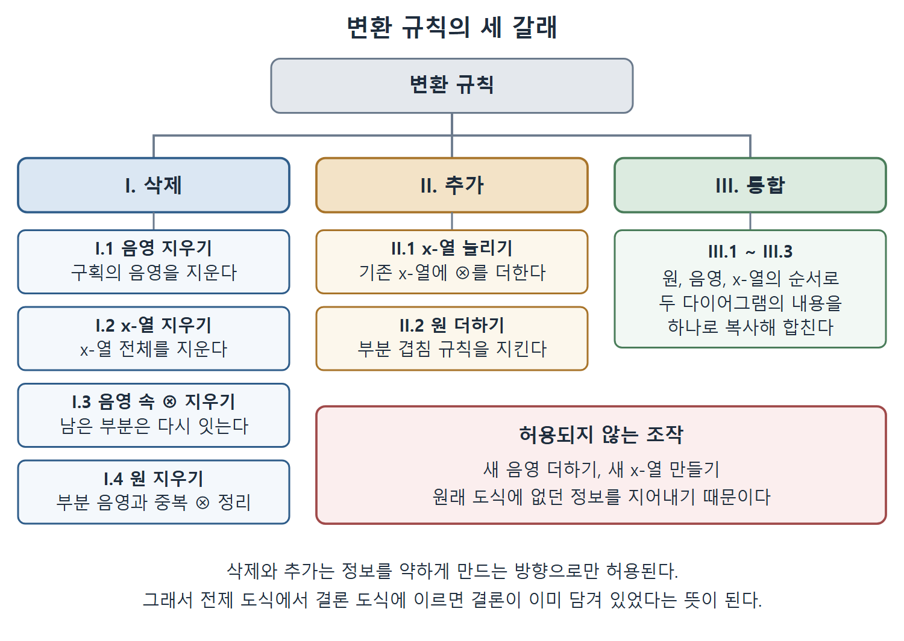

# 벤 다이어그램의 변환 규칙

이 문서는 "변환 규칙(Rules of Transformation)" 절을 다룬다. 앞 절에서 구획을 눈으로 따져 가며 하던 판정을 정밀하게 만들기 위해, 벤 다이어그램을 한 단계씩 합법적으로 바꾸는 규칙을 세 범주로 정리한다. 곧 객체의 삭제, 객체의 추가, 두 다이어그램의 통합이다. 규칙이 엄밀해지면 알고리즘과 컴퓨터 프로그램으로 삼단논법 추론을 자동화할 수 있다는 것이 이 절의 요점이다.

---

## 1. 변환 규칙이 필요한 이유

앞 절의 예에서는 다이어그램을 합치고 지우는 일을 직관에 의존해 설명했다. 이를 정밀하게 하려면 다이어그램에 담긴 정보를 결합하고 조작하는 규칙이 있어야 한다. 이 규칙은 한 다이어그램을 그와 동등한 다른 다이어그램으로 올바르게 바꾸는 방법을 알려 주어야 한다.

저자는 대수학의 규칙에 비유한다. 대수 방정식은 분배법칙, 덧셈 교환법칙, 곱셈 교환법칙 같은 규칙으로 변형한다.

```
A*(B + C) = A*B + A*C   (분배법칙)
          = A*C + A*B   (덧셈 교환법칙)
          = C*A + B*A   (곱셈 교환법칙)
```

변환 규칙도 마찬가지로, 한 다이어그램을 다른 다이어그램으로 단계별로 바꿀 때 어떤 방법이 허용되는지 알려 준다.

규칙을 쓰면 "읽어 낸다"는 개념도 엄밀해진다. 다이어그램 `D1`을 변환 규칙만으로 `D2`로 바꿀 수 있으면 `D1`에서 `D2`를 읽어 낼 수 있다. 여기서 `D1`이 전제이고 `D2`가 결론이라면 그 삼단논법은 타당하다. 그러므로 규칙은 삼단논법의 타당성을 판정하는 절차를 세우는 토대가 된다. 규칙이 정확하면 이를 구현해 삼단논법 추론을 대신 수행하는 알고리즘과 프로그램도 개발할 수 있다.

---

## 2. 규칙의 분류와 대상 객체

규칙은 세 범주로 분류한다.

- **I. 객체의 삭제(Erasure of an object)**
- **II. 객체의 추가(Addition of an object)**
- **III. 두 다이어그램의 통합(Unification of two diagrams)**

여기서 객체(object)란 벤 다이어그램에 있는 세 종류의 구성 요소를 가리킨다.

1. 원(집합)
2. x-열(비어 있지 않음, 즉 존재)
3. 음영(비어 있음)



위 그림은 변환 규칙을 삭제, 추가, 통합의 세 갈래로 나누고, 각 갈래에 속한 규칙과 허용되지 않는 조작을 한눈에 보여 준다. 원서에서 규칙을 설명하는 여러 예시 그림을 이 노트의 구조에 맞게 다시 정리한 것이다 (원서 4장 변환 규칙 절의 그림 참조).

---

## 3. 범주 I: 객체의 삭제

타당한 삭제는 먼저 세 가지가 있다. 구획의 음영 전체, x-열 전체, 그리고 음영 구역에 걸친 x-열의 일부이다. 그다음으로 다이어그램에서 원 하나를 통째로 지우는 경우를 다룬다.

### 3.1 규칙 I.1과 I.2

- **규칙 I.1 구획 음영의 삭제**: 구획에 칠한 음영을 지울 수 있다.
- **규칙 I.2 x-열 전체의 삭제**: x-열 하나를 통째로 지울 수 있다.

예로 다이어그램 `D`에서 `D1`은 한 구획의 음영 전체를 지운 변환(규칙 I.1)이고, `D2`는 x-열 전체를 지운 변환(규칙 I.2)이다. 두 경우 모두 정보가 줄어드는 방향이다. 음영을 지우면 그 구획이 비어 있다는 주장을 철회하는 것이고, x-열을 지우면 존재 주장을 철회하는 것이므로, 원래 도식이 말하던 것의 일부만 말하게 되어 항상 안전하다.

### 3.2 규칙 I.3 음영 구획에 있는 x-열 일부의 삭제

음영이 칠해진 구역에 있는 ⊗는 x-열에서 지울 수 있다. 지운 ⊗가 x-열의 중간에 있었다면 남은 양쪽 부분을 다시 이어서 하나의 x-열로 만들어야 한다. 이 과정에서 다이어그램 안의 x-열 개수는 바뀌지 않는다.

예에서는 다이어그램 `D`에서 음영 구획에 놓인 ⊗를 먼저 지운 뒤 남은 두 ⊗를 이어서 `D1`을 얻는다. 이유는 간단하다. 음영 구획은 비어 있다고 선언되었으므로, 선언 x-열에서 그 구획에 존재한다는 선택지는 거짓이다. 따라서 그 선택지를 빼도 선언의 의미가 바뀌지 않는다. 앞 절의 예 1에서 ⊗를 음영으로 대체한 것이 바로 이 규칙의 적용이다.

### 3.3 규칙 I.4 원의 삭제

원 하나를 통째로 지울 수 있다. 이때 두 가지 상황이 생길 수 있다.

1. 결과 도식에 구획 안의 부분 음영이 남는다.
2. 결과 도식에 한 구획에 ⊗가 둘 이상 있는 x-열이 생긴다.

**규칙 I.4.a 구획 안의 부분 음영**: 원을 지운 결과 어떤 구획에 부분 음영이 생기면 그 구획의 음영을 지워야 한다. 예로 `D`에서 원 R을 지우면 `D1`이 되는데, 구획 1과 2에 부분 음영이 남는다. 이를 지워 얻은 `D2`가 올바른 변환이다. 원 하나가 사라지면 두 구획이 하나로 합쳐지는데, 둘 중 한쪽만 비어 있다는 사실로는 합쳐진 구획이 비어 있다고 할 수 없기 때문이다.

**규칙 I.4.b 한 구획에 ⊗가 둘 이상인 x-열**: 원을 지운 뒤 x-열에서 한 구획 안에 ⊗가 둘 이상 놓이게 되면, 그 부분을 하나의 ⊗로 바꾸고 x-열의 나머지와 이어야 한다. 예에서 `D`의 원 R을 지우자 두 구획에 ⊗가 둘씩 놓인 `D1`이 되었다. 이 규칙을 구획마다 한 번씩 두 번 적용해 `D2`를 얻었고, `D2`가 올바른 변환이다.

---

## 4. 범주 II: 객체의 추가

추가할 수 있는 객체는 두 종류이다. 기존 x-열에 ⊗ 기호를 몇 개든 덧붙이는 것과, 다이어그램에 원을 추가하는 것이다. 음영을 새로 추가하거나 새 x-열을 만드는 것은 합법적인 변환이 아니다. 새 음영이나 새 존재 주장은 원래 도식에 없던 정보를 지어내는 일이기 때문이다.

### 4.1 규칙 II.1 x-열 늘리기

기존 x-열에 ⊗를 몇 개든 더할 수 있다. 다이어그램 안의 x-열 개수는 바뀌지 않는다. 예에서 `D1`과 `D2`는 모두 규칙에 따라 `D`에서 얻은 올바른 변환이다. x-열은 선언이어서 선택지가 늘어날수록 주장이 약해지고, 원래 주장은 약해진 주장을 여전히 함축하기 때문이다.

### 4.2 규칙 II.2 원 추가

다이어그램에 원을 추가할 수 있으되, 부분 겹침 규칙을 지켜야 한다. 새 원은 기존 모든 구획과 각각 한 번씩만 겹쳐야 한다. 두 집합 P, Q를 그린 다이어그램에 세 번째 원 R을 더하는 경우를 보자.

- **잘못된 추가**: 저자는 세 개의 도식을 보여 주며, 모두 R이 기존 구획을 전부 가로지르지 못해서 무효라고 설명한다.
- **올바른 추가**: R이 네 구획 모두를 정확히 한 번씩 가로지르게 그린 도식이다. 저자는 이런 올바른 도식 두 개를 제시한다.

### 4.3 규칙 II.2.a x-열에 한 영역의 모든 구획 포함하기

원을 더하면 이전에는 없던 구획이 생긴다. 원래 도식에 x-열이 있었다면, 원래 ⊗가 있던 영역에 속하면서 새로 생긴 모든 구획에 ⊗를 더해야 한다. 이 ⊗들을 이어 하나의 x-열로 만들어야 하며, x-열의 개수는 변하지 않는다.

예에서는 집합 P 안에 ⊗가 하나 있는 도식 `D`에서 시작한다.

1. 원 Q를 추가해 `D1`을 얻는다. 영역 P가 두 구획으로 나뉘므로 이어진 ⊗ 두 개가 필요하다.
2. `D1`에 원 R을 추가해 `D2`를 얻는다. 영역 P가 네 구획으로 구성되므로 이어진 네 ⊗가 "영역 P 어딘가에 무언가 존재한다"는 주장을 나타내는 x-열이 된다.

이 규칙이 필요한 이유는 원래 "P에 무언가 있다"는 말이 새 원이 생긴 뒤에는 P를 이루는 모든 구획 중 어딘가에 있다는 말이 되기 때문이다. 이전 위치에만 ⊗를 두면 주장이 더 강해져 버린다.

---

## 5. 범주 III: 두 다이어그램의 통합

삼단논법에서는 결론이 따라 나오는지 판단하기 전에 두 전제를 결합해야 한다. 두 다이어그램 `D1`, `D2`를 하나로 합친 것을 `D1 + D2`라 한다. 합치는 규칙은 세 가지이다.

- **규칙 III.1 원 복사**: 먼저 `D1`의 원을 복사한다. `D2`에 있고 `D1`에 없는 원이 있으면 그것도 복사하되 부분 겹침 규칙(규칙 II.2)을 지킨다.
- **규칙 III.2 음영 복사**: `D1`이나 `D2`에서 음영이 칠해진 영역은 `D1 + D2`의 대응 영역에도 음영을 칠한다.
- **규칙 III.3 x-열 복사**: `D1`이나 `D2`에 x-열이 있는 영역에는 `D1 + D2`의 대응 구획에 x-열을 그리되, x-열을 추가하는 규칙(규칙 II.2.a)을 만족해야 한다.

### 5.1 통합 예 1

`D1`과 `D2`에서 원 P, Q, R이 나온다. 규칙 III.1에 따라 `D1`과 `D2`에 있는 원 P, Q, R을 모두 복사하되 부분 겹침 규칙을 지켜 그린다. 규칙 III.2에 따라 `D1`과 `D2`에서 음영이 칠해진 영역에 대응하는 영역에 음영을 칠한다. 이 예에는 x-열이 없다.

### 5.2 통합 예 2

규칙 III.1로 `D1`의 원 P, Q, R을 먼저 복사한다. `D2`의 원 중 R은 이미 있으므로 새로 추가할 원이 없다. 규칙 III.2로 음영을 옮긴다. 규칙 III.3으로 R에 걸린 x-열을 복사하는데, 통합 도식에서 R이 네 구획을 포함하므로 하나의 x-열로 이어진 네 개의 ⊗가 필요하다(규칙 II.2.a). 마지막으로 규칙 I.3에 따라 음영 구획에 놓인 x-열의 부분을 지울 수 있으므로, 그 ⊗를 지운 도식이 최종 결과가 된다. 그림상 최종 도식에는 ⊗가 두 개 남는 것으로 보인다.

### 5.3 통합 예 3

규칙 III.1로 원 P, Q, R을 부분 겹침 규칙에 맞게 통합 도식에 복사한다. 규칙 III.2로 이 예에서는 `D1`에 있는 음영만 복사한다. 규칙 III.3으로 `D1`의 x-열과 `D2`의 x-열을 하나씩 복사한다. 규칙 II.2.a에 따라 관련된 모든 구획을 포함해야 하므로, 첫째 x-열에는 ⊗가 두 개, 둘째 x-열에도 ⊗가 두 개 들어간다. 마지막으로 규칙 I.3에 따라 음영 구획에 있는 ⊗를 지운다. 그림상 최종 통합 도식 `D1 + D2`에는 ⊗가 세 개 남는 것으로 보인다.

---

## 6. 규칙의 요약표와 이 절의 의의

저자는 위 규칙들을 표 4.1에 요약해 두었다. 표의 내용은 위에서 설명한 규칙 I.1부터 III.3까지이며, 부분 겹침 규칙의 정의도 함께 실려 있다. 규칙을 한눈에 정리하면 다음과 같다.

| 범주 | 규칙 | 한 줄 요약 |
|---|---|---|
| 삭제 | I.1, I.2 | 음영 또는 x-열 전체를 지운다 |
| 삭제 | I.3 | 음영 구획의 ⊗를 지우고 남은 부분을 잇는다 |
| 삭제 | I.4, I.4.a, I.4.b | 원을 지우되 부분 음영 삭제, 중복 ⊗ 하나로 합침 |
| 추가 | II.1 | 기존 x-열에 ⊗를 더한다 |
| 추가 | II.2, II.2.a | 부분 겹침 규칙을 지켜 원을 더하고 새 구획에 ⊗를 보충한다 |
| 통합 | III.1~III.3 | 원, 음영, x-열을 순서대로 복사한다 |

원서 표 4.1의 규칙을 하나씩 풀어 쓰면 다음과 같다.

| 범주 | 규칙 | 이름 | 내용 |
|---|---|---|---|
| I. 객체의 삭제 | I.1 | 구획 음영의 삭제 | 구획에 칠한 음영을 지울 수 있다. |
| I. 객체의 삭제 | I.2 | x-열 전체의 삭제 | x-열 하나를 통째로 지울 수 있다. |
| I. 객체의 삭제 | I.3 | 음영 구획에 있는 x-열 일부의 삭제 | 음영 영역 안에 있는 ⊗는 x-열에서 지울 수 있다. |
| I. 객체의 삭제 | I.4 | 원의 삭제 | 원 하나를 통째로 지울 수 있다. |
| I. 객체의 삭제 | I.4.a | 구획 안의 부분 음영 | 원을 지운 결과 어떤 구획에 부분 음영이 생기면 그 구획의 음영을 지운다. |
| I. 객체의 삭제 | I.4.b | 한 구획에 ⊗가 둘 이상인 x-열 | 원을 지운 뒤 x-열의 한 구획에 ⊗가 둘 이상 놓이면, 그 부분을 ⊗ 하나로 바꾸고 x-열의 나머지와 잇는다. |
| II. 객체의 추가 | II.1 | x-열 늘리기 | 기존 x-열에 ⊗를 몇 개든 더할 수 있다. |
| II. 객체의 추가 | II.2 | 원 추가 | 부분 겹침 규칙을 지키면서 원을 더할 수 있다. |
| II. 객체의 추가 | 부분 겹침 규칙 | (정의) | 새 원은 기존 다이어그램의 모든 구획과 각각 한 번씩만 겹쳐야 한다. |
| II. 객체의 추가 | II.2.a | 한 영역의 모든 구획을 x-열에 포함 | 원래 ⊗가 있던 영역에 속하면서 새로 생긴 모든 구획에 ⊗를 더하고, 이를 이어 하나의 x-열로 만든다. |
| III. 두 다이어그램의 통합 | III.1 | 원 복사 | `D1`의 원을 먼저 복사하고, `D2`에만 있는 원도 부분 겹침 규칙을 지켜 복사한다. |
| III. 두 다이어그램의 통합 | III.2 | 대응 음영 복사 | `D1`이나 `D2`에서 음영이 칠해진 영역은 `D1 + D2`의 대응 영역에도 음영을 칠한다. |
| III. 두 다이어그램의 통합 | III.3 | 대응 x-열 복사 | `D1`이나 `D2`에 x-열이 있는 영역에는 `D1 + D2`의 대응 구획에 x-열을 그린다. 이때 x-열 추가 규칙을 만족해야 한다. |

이 표는 규칙마다 무엇을 해도 되는지를 한 줄씩 보여 준다. 삭제 규칙과 추가 규칙은 정보를 줄이거나 약하게 만들 뿐이고, 통합 규칙은 두 전제의 정보를 한 장으로 옮기는 데만 쓰인다는 점을 함께 읽으면 된다.

원서의 주석에 따르면, 이 규칙 구성은 이해하기 쉽도록 Shin의 원래 배열과 다르게 재편한 것이며 규칙 내용은 같다. 다만 Shin이 두었던 충돌 정보 규칙(rule of conflicting information)은 여기서 생략되었다. 구획이 비었다는 정보와 비지 않았다는 정보가 충돌하는 상황은 앞 절에서 이미 모순으로 언급되었다.

정리하면 규칙의 설계 원리는 삭제와 추가가 정보를 더하지 않는 방향으로만 허용된다는 것이다. 음영과 새 x-열을 마음대로 더할 수 없고, 지우거나 약화하는 것만 허용된다. 그래서 `D_P`에 이 규칙을 적용해 `D_C`를 얻을 수 있으면 `D_C`는 `D_P`가 이미 함축하던 내용일 수밖에 없고, 이것이 타당성 판정의 근거가 된다. 이 규칙을 이용한 완성된 판정 절차는 다음 절인 삼단논법 추론 재검토에서 다룬다.

<br>
<br>
<br>

[Diagrammatic Reasoning in AI](../)
