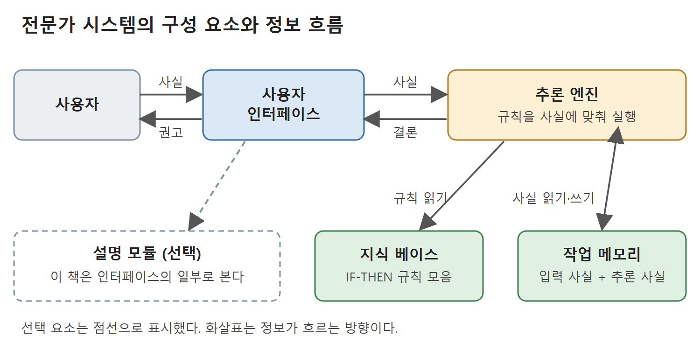

# 규칙 표현과 전문가 시스템의 구성 요소

이 문서는 5장 "규칙 기반 추론(Rule-Based Reasoning)" 절의 앞부분을 다룬다. 여기서는 IF-THEN 규칙의 형태, 객체-값 쌍 표기, 변수와 연산자, 규칙 기반 시스템을 이루는 구성 요소를 설명한다. 저자의 논지는 두 가지다. 전문가의 지식을 규칙이라는 일정한 형식으로 적으면 컴퓨터가 그 지식을 체계적으로 처리할 수 있다. 그리고 시스템은 지식 베이스와 추론 엔진이라는 두 축을 중심으로 돌아간다.

---

## 1. IF-THEN 규칙의 기본 형태

전문가 시스템이 지식을 표현하는 방식 가운데 하나는 `IF (조건) THEN (행동)` 형태의 규칙을 모아 두는 것이다.

- 조건 부분은 선행부(antecedent), LHS(왼쪽), 전제(premise)라고도 부른다.
- 행동 부분은 이에 짝을 이루어 후행부(consequent), RHS(오른쪽), 결론(conclusion)이라고도 부른다.

## 2. 신호등 예: 운전자의 규칙

사람 전문가의 지식이 규칙으로 어떻게 옮겨지는지 감을 잡도록, 교차로에서 신호등에 다가가는 운전자가 가질 법한 규칙 여섯 개를 든다.

1. 신호등이 녹색이면 행동은 진행이다.
2. 신호등이 빨강이면 행동은 정지이다.
3. 신호등이 노랑이고 교차로를 통과할 시간이 충분하면 행동은 진행이다.
4. 신호등이 노랑이고 통과할 시간이 부족하면 행동은 정지이다.
5. 행동이 진행이면 가속 페달을 밟는다.
6. 행동이 정지이면 브레이크를 밟는다.

이 규칙들에는 눈여겨볼 구조가 있다. 규칙 1~4는 입력 상황에서 중간 결론인 "행동"을 만든다. 규칙 5~6은 그 중간 결론을 조건으로 받아 실제 동작을 내놓는다. 곧 한 규칙의 결론이 다른 규칙의 조건이 되는 연쇄가 가능하다.

## 3. 객체-값 쌍 표기

영어 문장으로 쓴 규칙은 이해하기 쉽다. 하지만 각 절을 객체-값 쌍(object-value pair)으로 바꾸면 절마다 두 부분만 남아서 더 간결하다. 또 뒤에서 다룰 전문가 시스템 개발 도구 CLIPS의 문법으로 옮기기에도 좋다. 같은 규칙들을 객체-값 쌍으로 쓰면 다음과 같다.

```
1. IF (light green)  THEN (action go)
2. IF (light red)    THEN (action stop)
3. IF (light yellow) AND (enough-time true)
   THEN (action go)
4. IF (light yellow) AND (enough-time false)
   THEN (action stop)
5. IF (action go)    THEN (gas-pedal press)
6. IF (action stop)  THEN (brake press)
```

- **객체(object)**: 절의 첫 부분이다. 신호등(`light`) 같은 물리적 대상일 수도 있고, 통과 시간이 충분한지를 나타내는 `enough-time` 같은 속성일 수도 있으며, `action` 같은 상태나 조건일 수도 있다.
- **값(value)**: 절의 둘째 부분으로, 객체가 가지는 구체적인 값이다.
- **표기 규약**: 이 장에서는 객체를 하나의 기호로 쓰고, 두 단어 이상이면 하이픈으로 이어 붙인다. 예를 들어 "enough time"은 `enough-time`이 된다.

## 4. 관계 객체와 변수

객체는 둘 이상의 개체 사이의 관계를 나타낼 수도 있다.

- `(father-of Bill Sarah)`는 빌이 세라의 아버지라는 사실이다. `father-of`가 관계 객체이고, 값은 아버지와 자식 둘이다.
- `(gives John Mary car)`는 값이 셋인 관계다. 첫째 값은 주는 사람, 둘째는 받는 사람, 셋째는 주는 물건이다. 존이 메리에게 자동차를 준다는 사실을 뜻한다.

두 사람 y와 z가 형제자매인지 판정하는 규칙에는 변수를 쓴다.

```
IF (father-of ?x ?y) AND (father-of ?x ?z)
THEN (siblings ?y ?z)
```

- 변수 표기는 CLIPS에서 빌려 왔다. 일반 기호와 구별하려고 변수 이름 앞에 물음표(`?`)를 붙인다.
- 이 규칙의 뜻은 `?x`가 `?y`의 아버지이고 `?x`가 `?z`의 아버지이면 `?y`와 `?z`는 형제자매라는 것이다.
- 변수를 쓰면 특정 값에 매이지 않고 규칙을 일반적인 형태로 쓸 수 있다. 그래서 `?x`, `?y`, `?z`가 어떤 값이든 규칙을 적용할 수 있다.

## 5. 조건식: 연산자와 논리

조건 부분은 늘 참 또는 거짓으로 판정되어야 한다. 그래서 여러 관계 연산자와 논리 연산자를 이용해 복합 불리언 식을 만들 수 있다.

| 연산자 | 의미 |
|---|---|
| `=` | 같다 |
| `<` | 작다 |
| `>` | 크다 |
| `<=` | 작거나 같다 |
| `>=` | 크거나 같다 |
| `<>` | 같지 않다 |

`<>`는 CLIPS 문법이며, C++나 Java에서는 `!=`를 쓴다.

- 45세 이상 65세 이하이면 중년으로 분류하는 규칙은 `IF (age >= 45) AND (age <= 65) THEN (person middle-aged)`로 쓴다.
- 연산자가 `=`일 때는 객체-값 표기에서 흔히 생략한다. 예를 들어 `age 45`, `sex male`, `height 5'7"`처럼 쓴다.
- 논리 연산자 AND, OR, NOT으로 더 복잡한 식을 만든다. 아래 규칙은 형제자매 판정을 OR로 넓힌 것으로, 두 사람이 같은 아버지 `?f`를 두었거나 같은 어머니 `?m`을 두었으면 참이 된다.

```
IF ((father-of ?f ?y) AND (father-of ?f ?z)) OR
   ((mother-of ?m ?y) AND (mother-of ?m ?z))
THEN (siblings ?y ?z)
```

---

## 6. 더 현실적인 규칙: MYCIN의 예

지금까지 본 규칙은 실제 전문성을 담기에는 단순하다. 현실의 전문가 시스템에는 규칙이 수백, 수천 개 있을 수 있고, 일부는 상당히 복잡하다. 저자는 세균 감염의 원인을 판정하는 MYCIN의 규칙 하나를 소개한다.

- 조건은 네 가지이며 AND로 묶여 있다. 치료가 필요한 감염이 수막염이고, 환자에게 심각한 피부 또는 연조직 감염의 증거가 있으며, 배양 검사의 염색에서 균이 보이지 않았고, 감염 유형이 세균성이라는 것이다.
- 결론은 감염의 원인균일 수 있는 것이 포도상구균(Staphylococcus, 0.75) 또는 연쇄상구균(Streptococcus, 0.25)이라는 증거가 있다는 내용이다.
- 이 규칙은 읽기 쉽도록 문장으로 적었을 뿐이며, 각 절은 위에서 본 객체-값 표기로 쉽게 바꿀 수 있다.
- MYCIN에는 이런 규칙이 약 500개 있었다.

이 규칙의 특징은 불확실한 결론을 다룰 수 있다는 점이다. 행동 부분의 두 수치는 확신도(certainty factor)로, 감염이 각 균 때문일 가능성을 나타낸다. 전문성의 상당 부분은 확정적인 결론이 아니라 주관적인 판단에 바탕을 두므로, 이 점은 중요하다. 불확실성과 부정확 추론은 8장에서 더 자세히 다룬다.

---

## 7. 규칙 기반 전문가 시스템의 구성 요소

그림 5.1은 기본적인 규칙 기반 전문가 시스템의 주요 구성 요소 네 가지를 보여 준다. 그림에서 사용자는 사용자 인터페이스로 시스템과 주고받는다. 지식 베이스, 추론 엔진, 작업 메모리가 이를 뒷받침하며, 사용자가 사실(facts)을 넣으면 시스템이 권고(recommendations)를 돌려준다. 사용자는 문제 해결 상황에 관한 사실을 입력하고, 시스템은 그 입력을 바탕으로 전문가다운 권고나 결론을 낸다.



사용자는 인터페이스를 통해 사실을 넣고 권고를 받으며, 추론 엔진은 지식 베이스에서 규칙을 읽고 작업 메모리에서 사실을 읽고 쓰며 결론을 만든다. 점선 상자는 선택 요소인 설명 모듈이다(원서 그림 5.1 참조).

- **지식 베이스(knowledge base)**: 도메인 지식을 규칙으로 표현해 담은 것이다. 사실상 IF-THEN 규칙의 데이터베이스, 곧 규칙 모음이다. 지식 베이스만으로는 사용자에게 아무것도 해 줄 수 없다.
- **추론 엔진(inference engine)**: 규칙을 처리해서 전문가다운 권고를 내는 능력을 시스템에 주는 두 번째 핵심 요소이다. 전문가 시스템의 중앙 처리 장치에 해당하므로, 시스템이 어떻게 작동하는지 이해하려면 추론 엔진부터 이해해야 한다. 사용자가 입력한 문제 사실과 지식 베이스의 규칙을 어떻게 엮어 권고를 만드는지는 다음 절에서 논한다.
- **작업 메모리(working memory)**: 시스템의 단기 기억이다. 사용자가 처음 입력한 사실과, 추론 엔진이 새로 추론해 낸 사실을 모두 담는다.
- **사용자 인터페이스(user interface)**: 사용자가 시스템과 주고받는 수단이다.

### 7.1 사용자 인터페이스의 변천

- 초기 기술에서는 단순한 텍스트 인터페이스로 사용자와 시스템이 대화를 주고받았다. 시스템이 문제에 관한 사실을 물으면 사용자가 입력하고, 시스템이 텍스트로 권고를 출력하는 식이었다.
- 오늘날에는 고해상도 그래픽 화면이 보편적이어서 인터페이스도 다양해졌다. 예컨대 원자력 발전소를 운영하는 전문가 시스템은 다이얼, 스위치, 경보, 그래프 등을 갖춘 그래픽 제어판을 두어 운전원의 감시를 도울 수 있다.
- 또 다른 선택지는 사용자가 직접 탐색하고 조작할 수 있는 다이어그램 표현을 만드는 것이다. 다이어그램을 바탕으로 한 인터페이스는 전문가 시스템을 더 투명하고 유연하게 쓰도록 도와주며, 이는 다음 장에서 본다.

### 7.2 설명 모듈

논의에 따라 선택 사항인 다섯째 구성 요소로 설명 모듈(explanation module)을 넣기도 한다.

- 설명 모듈의 목적은 시스템이 왜 그런 권고를 했는지 설명하고 정당화하는 것이다.
- 전통적으로 설명 모듈은 사용자가 특정 결론에 어떻게 이르렀는지 물을 수 있게 해 주었다. 예를 들어 권고에 이르기까지 실행된 규칙의 순서, 곧 규칙 추적(rule trace)을 요청할 수 있다.
- 이 책은 설명 모듈을 별도의 구성 요소로 세우지 않고 사용자 인터페이스의 일부로 취급한다. 다음 장의 중심 주장이 바로, 사용자 인터페이스의 핵심이 될 수 있는 다이어그램이 전문가 시스템의 설명력을 더 높여 줄 수 있다는 것이기 때문이다.

<br>
<br>
<br>

[Diagrammatic Reasoning in AI](../)
