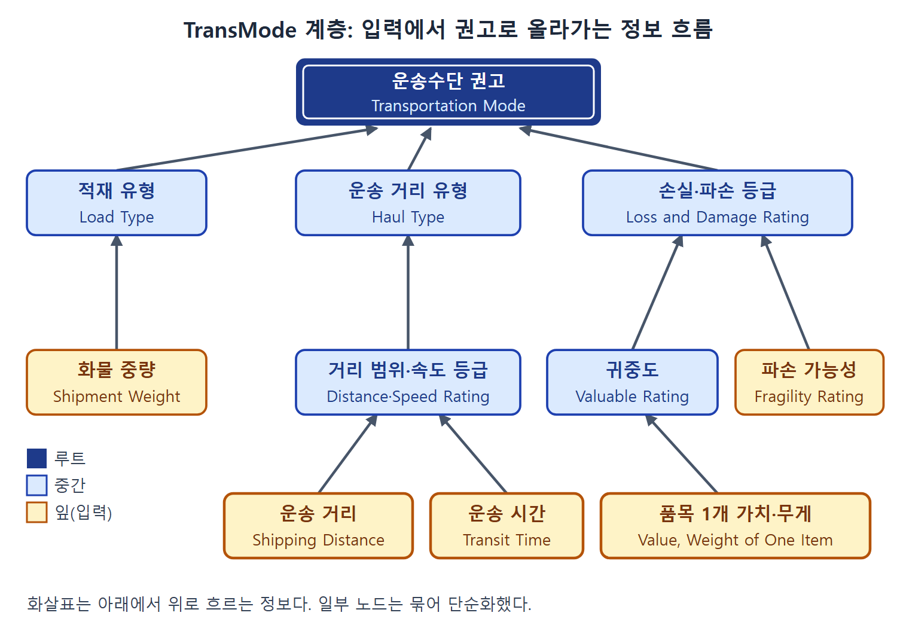

# TransMode 계층 모델과 객체지향의 이점

이 문서는 TransMode의 지식 베이스를 노드의 계층으로 그린 TransMode Hierarchy(그림 6.4~6.6)를 다룬다. 계층은 지식 베이스를 다루기 쉬운 덩어리로 나누고 덩어리 사이의 관계를 드러내므로, 규칙에 구조가 없고 평평하다는 비판에 대한 하나의 답이다. 저자는 이렇게 노드로 나누면 객체지향 설계의 세 가지 이점, 곧 추상화, 캡슐화, 상속을 그대로 얻는다고 설명한다.

---

## 1. 지식 베이스를 계층으로 그리기

그림 6.4는 TransMode 지식 베이스를 노드의 계층으로 나타낸다. 텍스트 문답 방식과 구별하기 위해 이후 이 시스템을 TransMode Hierarchy라 부른다. 계층의 목적은 지식 베이스를 다루기 쉬운 덩어리로 나누고, 그것을 그래픽으로 표현해 덩어리 사이의 관계를 분명히 하는 것이다. 규칙은 본래 평평하고 구조가 없어서 추론 엔진이 규칙을 모두 똑같이 취급한다는 비판이 있는데, 계층은 이 비판을 넘어서려는 시도다.

### 1.1 노드의 세 종류

계층은 노드(사각형)와 노드 사이의 연결로 이루어지며, 노드에는 세 종류가 있다.

- **루트 노드(root node)**: 맨 위에 있는 노드로, 의사결정 문제의 최상위 목표를 나타낸다. 여기서는 운송수단 권고가 이에 해당한다. 이중 사각형으로 그린다.
- **잎 노드(leaf node)**: 계층의 맨 아래에 있으며 가공하지 않은 원자료 입력을 나타낸다. 굵은 사각형으로 그린다. 화물 중량, 운송 거리, 운송 시간 등이 잎 노드다.
- **중간 노드(intermediate node)**: 루트와 잎 사이에 있다. 바로 아래에 붙은 자식 노드의 값을 읽어 처리한 뒤 출력을 만들고, 이를 바로 위의 부모 노드에 넘긴다. 예컨대 `Load Type` 노드는 자식인 화물 중량이 넘긴 값을 읽고, 그 출력은 부모인 운송수단 노드로 간다.

그림 6.4의 노드 라벨과 부록의 규칙 입력 표기를 맞춰 보면 노드는 다음처럼 나뉜다.

| 종류 | 노드 |
|---|---|
| 루트 | `Transportation Mode` |
| 잎 | `Shipment Weight`, `Shipping Distance`, `Transit Time`, `Special Products`, `Perishable`, `Weight of One Item`, `Value of One Item`, `Fragility Rating`, `Door-to-Door Service`, `Frequency of Service` |
| 중간 | `Load Type`, `Distance Range`, `Speed Rating`, `Haul Type`, `Modes Capable`, `Value:Weight Ratio`, `Valuable Rating`, `Loss and Damage Rating`, `Flexibility Rating` |

잎 노드가 열 개인 것은 TransMode의 입력 변수가 열 개인 것과 일치한다. 선과 연결의 세부 배치는 그림으로만 확인할 수 있으므로, 여기서는 본문과 부록이 말하는 입력 관계(예컨대 `Haul Type`은 `Distance Range`와 `Speed Rating`에서 값을 받는다)만 근거로 삼는다.

이 그림에서는 모든 자식 노드가 부모를 하나만 가지지만, 꼭 그래야 하는 것은 아니다. 모든 노드의 부모가 하나 이하인 다이어그램을 형식적으로 트리(tree)라 부른다. 그림 6.4의 값은 모두 `null`인데, 아직 데이터를 입력하지 않았다는 뜻이다.

### 1.2 추론 경로의 추적

사용자는 계층을 따라 추론 경로를 눈으로 쫓을 수 있다. 위로 향한 화살표는 정보가 아래에서 위로 흐른다는 뜻이다. 전향 추론(forward chaining) 엔진이 입력에서 시작해 권고까지 올라간다는 의미다. 그림 6.5는 앞의 텍스트 대화와 똑같은 데이터를 계층에 직접 입력한 모습이다.

루트, 중간, 잎 노드가 어떻게 이어지고 정보가 아래에서 위로 흐르는지 단순화해 그렸다. 본문과 부록의 입력 관계만 근거로 삼았고 일부 노드는 묶어 표시했다(원서 그림 6.4, 6.5 참조).

1. 화물 중량 10,000을 넣으면 `Load Type`이 `large-shipment`로 정해진다.
2. 품목 무게 10.0과 가치 500을 넣으면 `Value:Weight Ratio`가 50.0이 되고, 이 값이 `Valuable Rating`을 `high`로 만든다.
3. 파손 가능성이 `high`이면 `Loss and Damage Rating`이 `important`가 된다.
4. 거리 2,500과 시간 14가 각각 거리 범위와 속도 등급을 거쳐 `Haul Type`을 정한다. 그림에서 거리 범위는 long, 속도 등급은 slow다.

일부 노드는 `null`로 남는다. 해당 정보를 입력하지 않았고, 입력할 필요도 없을 수 있다는 뜻이다. TransMode Hierarchy는 판단에 충분한 정보가 모이는 즉시 권고를 낸다. `Load Type`, `Haul Type`, `Loss and Damage Rating` 세 값이 있으면 권고를 낼 수 있으며, 이 예에서는 트럭이 선택된다. 따라서 모든 입력이 필요한 것은 아니며, 때로는 계층의 작은 부분만 권고에 쓰이는 성긴(sparse) 계층이 되기도 한다. 활성화된 노드는 음영으로, 연결된 링크는 굵은 선으로 표시해서 계층의 어느 부분이 작동했는지 보여 준다.

---

## 2. 객체지향 설계의 이점

지식 베이스를 객체 노드로 나누면 객체지향 설계(object-oriented design)의 이점을 여러 가지 얻는다. 노드는 그 자체로 완결된 객체로 볼 수 있다. 객체지향은 부품을 다양한 구성으로 섞어 쓸 수 있도록 모듈화와 표준화를 중시하는 설계 철학이다. 저자는 이점을 세 가지로 든다.

### 2.1 추상화(abstraction)

- 계층의 객체 노드는 사용자에게 의미 있는 추상 개념을 담는다. 구체적 데이터나 개별 규칙 같은 낮은 수준의 세부가 아니라, 사용자에게 더 친숙한 상위 개념을 나타낸다.
- TransMode에서는 `Load Type`, `Loss and Damage Rating`, `Flexibility Rating` 같은 노드가 운송수단을 판단할 때 작용하는 상위 요인을 가리킨다.
- 상업 대출 승인 전문가 시스템을 만든다면 기업의 재무 건전성, 경영진의 성품, 담보, 업계의 경쟁 환경 같은 노드가 신용도를 결정하는 상위 요인이 될 수 있다.
- 구현 세부까지 보고 싶어 하지 않는 비전문가도 쓸 수 있게 시스템을 개발해야 한다. 계층 모델은 지식 베이스를 높은 수준에서 보여 주므로, 사용자가 덜 복잡하고 더 쉽게 다룰 수 있다.

### 2.2 캡슐화(encapsulation)

- 개별 객체의 구현 세부를 다른 객체에서 숨기는 성질이다. 한 노드는 다른 노드의 내부 구조, 곧 규칙의 구체적 내용을 알 필요가 없다. 또 노드는 직접 연결된 노드에서만 입력을 받으므로 노드 사이의 상호작용이 더 줄어든다.
- 설계가 모듈식이라 사용자와 개발자 모두 시스템을 이해하기 쉽다. 개발자는 지식 베이스를 주기적으로 유지하고 갱신해야 하는데, 한 노드의 규칙을 고쳐도 규칙이 그 노드 안에 갇혀 있으므로 시스템의 다른 부분이 뜻하지 않게 영향받는 일이 없다. 저자는 이 이점은 아무리 강조해도 지나치지 않다고 쓴다.
- 그림 6.6은 `Haul Type`, `Distance Range`, `Speed Rating` 세 노드를 계층에서 떼어 보여 주며, 각 사각형 안에 그 노드의 규칙이 들어 있다. `Haul Type`은 앞의 두 노드가 어떻게 값을 정하는지 신경 쓸 필요가 없고, 넘어온 값을 입력으로 읽기만 하면 된다. 이처럼 노드와 노드가 맞닿는 지점이 분명하게 정의된다.

그림 6.6에 나온 규칙을 요약하면 다음과 같다.

| 노드 | 규칙의 요지 |
|---|---|
| `Distance Range` | 50마일 이하 local, 50 초과 400 이하 short, 400 초과 1,000 이하 medium, 1,000 초과 long |
| `Speed Rating` | 2일 이하 express, 2일 초과 5일 이하 quick, 5일 초과 10일 이하 average, 10일 초과 slow |
| `Haul Type` | 거리 범위와 속도 등급의 조합으로 long-fast, long-slow, medium-fast, medium-slow, local을 정한다 |

`Haul Type`에서 long-fast는 거리가 long이고 속도가 express 또는 quick일 때, long-slow는 거리가 long이고 속도가 average 또는 slow일 때다. medium-fast는 거리가 medium이고 속도가 express일 때다. 거리가 medium 또는 short이고 속도가 quick, average, slow 중 하나면 medium-slow이며, 거리 범위가 local이면 `Haul Type`도 local이다.

### 2.3 상속과 재사용(inheritance and reuse)

- 지식 베이스를 객체로 나누면 상속과 재사용이 쉬워진다. 객체 노드를 복사해서 새 전문가 시스템에 쓸 수 있고, 복사본은 원본의 속성을 물려받으므로 노드를 처음부터 만들 필요가 없다.
- 계층 모델 전체나 큰 부분을 재사용해서 비슷한 문제 상황에 맞는 변형을 만들 수도 있다. 예컨대 상업 대출 승인 계층 모델을 만든 뒤 개인 대출 승인용 변형을 만들 수 있다. 원본 계층을 재사용하고, 새 맥락의 영향을 받는 노드만 고치면 된다. 지식 베이스가 나뉘어 있어서 수정하기 쉽고, 캡슐화 덕분에 수정이 나머지 지식 베이스에 뜻하지 않은 영향을 주지 않는다.

 
 
 

[Diagrammatic Reasoning in AI](../)
