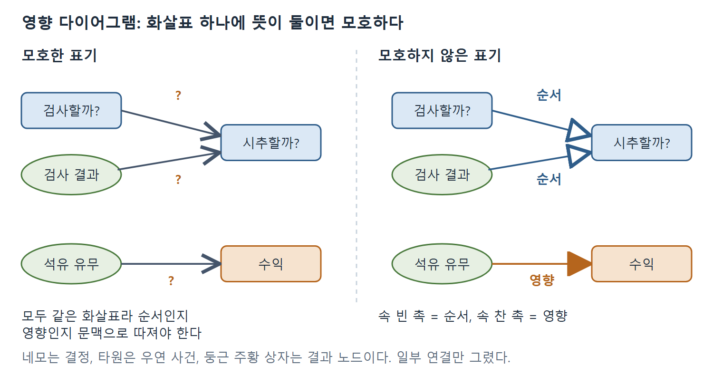
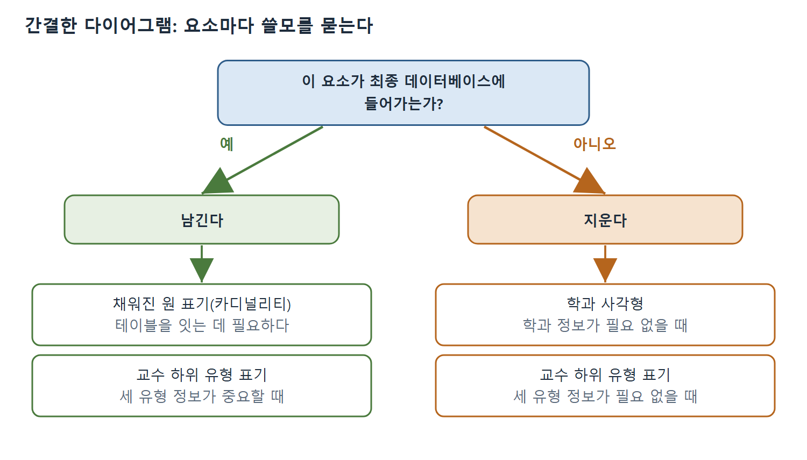
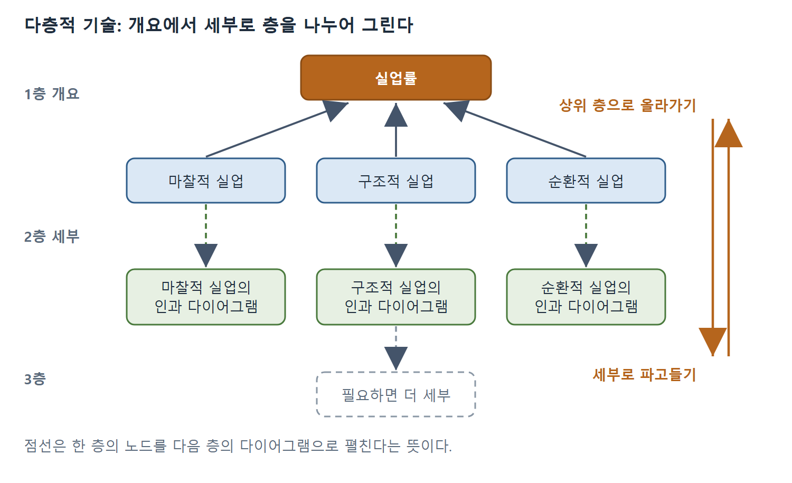

# 다이어그램의 공통 원리와 좋은 다이어그램의 기준

이 장은 책 전체를 마무리하는 결론 장으로, 지금까지 살핀 여러 표기법과 추론 기법을 한 걸음 물러서서 정리한다. 이 문서는 그 앞부분으로, 다이어그램(diagram)에 공통으로 깔린 기본 원리와 좋은 다이어그램을 가르는 다섯 가지 기준을 다룬다. 저자는 다이어그램이 본질적으로 단순한 구조(도형과 선)이면서도 용도에 따라 무수한 형태로 바뀐다고 본다. 그리고 다이어그램의 가치는 이해를 돕는지, 모호하지 않은지, 군더더기가 없는지, 과제에 맞는지, 계층적으로 펼칠 수 있는지로 판단해야 한다고 주장한다.

---

## 1. 장의 목적과 던지는 질문

저자는 앞선 장에서 다양한 표기법과 응용 분야를 살펴보았고, 다이어그램으로 문제의 해를 추론하는 여러 방식도 훑어보았다고 돌아본다. 이제는 그 밑바닥에 흐르는 주제를 정리할 시점이라고 본다. 이를 위해 이 장은 다음 질문에 답하려 한다.

- 다이어그램을 그릴 때 공통으로 따르는 원리는 무엇인가.
- 다이어그램의 질을 무엇으로 판단하며, 그 과정에서 드러나는 한계와 함정은 무엇인가.
- 다이어그램의 효과를 어떻게 평가하는가.
- 책에서 배운 다이어그램 추론 기법들을 더 큰 유형으로 분류할 수 있는가.

이 질문에 답하고 나면 다이어그램 추론을 더 넓게 보게 되고, 그에 얽힌 더 큰 쟁점도 알게 된다. 이것이 이 결론 장의 취지이다.

---

## 2. 다이어그램의 공통 특성

- **시각적 그래픽(visual graphic)**: 모든 다이어그램은 문장(언어)으로 된 표현과 달리 시각적 그래픽이다. 그래서 평면 위의 위치로 정보를 찾아볼 수 있게 할 수 있다. 관련된 정보를 한곳에 묶고 주제별로 배치할 수 있으며, 시스템의 구성요소가 서로 어떻게 연결되는지도 눈에 보이게 그릴 수 있다.
- **시각 정보 처리의 활용**: 다이어그램은 인간의 시각 정보 처리 체계를 이용한다. 이 체계는 지각적 추론을 별 노력 없이 해낸다. 같은 추론을 문장 표현으로 하려면 훨씬 어렵거나 아예 할 수 없다.
- **도형과 연결선**: 다이어그램은 대체로(항상은 아니다) 기하학적 도형을 선이나 화살표로 이은 것이다. 대표적인 예외가 벤 다이어그램(Venn diagram)으로, 집합 사이의 관계를 선으로 잇지 않고 겹치는 원으로 보여 준다.
- **도형의 의미**: 도형은 사람, 사물, 개념, 사건, 활동, 의사결정 지점, 집합, 행동, 단계 등 거의 무엇이든 나타낼 수 있다. 한 다이어그램 안에서도 도형마다 다른 대상을 뜻할 수 있다. 의사결정 트리에서는 사각형이 결정 지점, 원이 우연 사건이다. 기본 순서도에서는 사각형이 행동, 마름모가 결정 지점이다.
- **관례 존중**: 도형의 의미는 대개 오랜 세월 다이어그램 작성자들이 받아들여 온 관례이다. 따라서 자기만의 표기를 만들기보다 표준적이고 관습적인 표기를 따르는 편이 낫다.

---

## 3. 연결선의 여섯 가지 의미

3장에서 다룬 대로 선은 두 대상 사이의 연결을 나타내며, 다이어그램 종류에 따라 다음 여섯 의미 중 하나를 가진다.

| 번호 | 연결 유형 | 대응하는 다이어그램 성격 |
|---|---|---|
| 1 | 연결됨(connected to) | 위상(topology) |
| 2 | 시간상 앞섬(precedes in time) | 순서와 흐름 |
| 3 | ~의 한 종류(a type of) | 분류 |
| 4 | ~의 일부(a part of) | 구성 |
| 5 | ~와 관련됨(related to) | 연관 |
| 6 | 원인이 됨/영향을 줌(causes/influences) | 인과 |

선은 방향이 있을 수도 없을 수도 있고, 방향은 보통 화살표로 표시한다. 2번(앞섬), 3번(한 종류), 4번(일부), 6번(인과)은 언제나 방향이 있는 관계이다. 인과 연결에서는 선의 화살촉이 없는 쪽이 원인이고, 화살촉이 있는 쪽이 결과이다.

1번(연결됨)은 방향이 있을 수도 없을 수도 있다. 수력 시스템에서는 배관이 펌프, 저수조, 밸브 같은 부품을 잇는데, 물이 한 방향으로만 흐르면 연결에 방향이 생긴다. 반면 다른 물리 시스템에서는 부품이 특별한 방향 없이 서로 붙어 있다. 컴퓨터 네트워크(그림 3.3)가 그 예이다. 정보가 모든 방향으로 오가므로 어떤 연결에도 방향이 없다.

5번(관련됨)도 방향이 있을 수도 없을 수도 있다. 햄릿 등장인물의 관계를 보인 의미망(semantic network, 그림 3.14의 일부가 그림 9.1)을 보자. "형제"와 "결혼" 관계는 양방향이고, "살해"(클로디어스가 선왕 햄릿을 죽임)와 "경멸"(햄릿이 클로디어스를 경멸함)은 단방향이다. 양방향 관계는 방향 없는 관계와 같으므로 화살촉을 빼도 무방하다.

---

## 4. 한 다이어그램, 한 가지 연결, 그리고 화살표 생략

일반적으로 한 다이어그램에는 한 종류의 연결만 담긴다. 인과 다이어그램에는 원인과 결과의 그물이, 시스템 위상 다이어그램에는 구성요소가 연결된 방식이, 순서도에는 사건의 시간 순서가 담긴다. 그러나 한 다이어그램에 여러 연결 유형이 필요하면 표기로 구분해야 한다. 그림 3.16의 개체-관계 다이어그램은 두 종류의 선을 쓴다. 하나는 카디널리티(cardinality)를 나타내고, 다른 하나는 "한 종류" 연결을 나타낸다. 혼동을 막기 위해 후자에는 속이 빈 화살촉을 쓴다.

방향은 있으나 화살표를 생략하는 경우도 있다.

1. 의사결정 트리(그림 3.24, 3.26)는 거의 언제나 왼쪽에서 오른쪽으로 읽으므로 화살표가 필요 없다.
2. 조직도, 상속 계층, 구성 모델 같은 계층 구조는 위에서 아래로 읽으므로 화살표를 지워도 명확성이 유지된다.
3. 다만 방향이 모호하면 반드시 화살표를 넣는다. 안전을 위해 계층 관계에도 항상 화살표를 넣는 작성자도 있다.

저자는 이것이 기본 다이어그래밍에서 알아야 할 전부라고 정리한다. 개념은 단순하다. 다이어그램은 방향이 있거나 없는 선으로 도형을 이은 것이며(약간의 예외가 있다), 힘은 이 단순한 구조가 수많은 형태로 바뀌어 여러 응용에 쓰인다는 데서 나온다.

---

## 5. 내부 표현과 외부 표현

다이어그램은 때로 현실을 이해하려고 즉석에서 만드는 내부 표현이다. 2장에서 보았듯 사람은 머릿속에 다이어그램 같은 멘탈 모델(mental model)을 만든다. 시스템 구성요소가 서로 어떻게 연결되는지 이해하려고 만들 수도 있고(내부 연결), 새로운 시스템이 익숙한 무엇과 어떻게 닮았는지 짝지어 보려고 만들 수도 있다(외부 연결).

내부 표현은 인간의 정신과 단기 기억이 가진 한계에 묶여 있다. 그래서 부정확하고, 불완전하고, 일관성이 없고, 시간이 지나면 불안정해지며, 미신과 편견이 끼어들기 쉽다.

이 한계 때문에 다이어그램을 종이나 컴퓨터 파일 같은 외부 표현으로 옮긴다. 그러면 내부 표현보다 더 정확한 다이어그램을 만들 수 있고, 시간이 지나면서 대상 시스템을 더 완전하고 정확하고 일관되게 기술하도록 다듬을 수 있다. 외부 매체에 저장해 두면 단기 기억에 기대지 않고 나중에 참조할 수 있다. 컴퓨터에 저장하면 프로그램이 다이어그램을 여러 방식으로 수정하고 조작하게 할 수도 있다. 저자는 다이어그램 표현의 미래가 이렇게 동적이고 강력하게 쓰이는 지능형 사용자 인터페이스(intelligent user interface)에 있다고 본다.

---

## 6. 좋은 다이어그램의 다섯 가지 기준

어떤 다이어그램은 그림을 하나 얹는 데 그쳐서 이해를 거의 늘려 주지 못한다. 어떤 다이어그램은 매우 어려운 문제의 해를 추론하게 해 준다. 저자는 효과적인 다이어그램의 성질을 다섯 가지로 든다.

1. 시스템 이해를 돕는다.
2. 모호하지 않다.
3. 간결하다(parsimonious).
4. 과제와 관련이 있다(relevant).
5. 다층적 기술(multitiered description)을 할 수 있게 해 준다.

---

## 7. 기준 1: 시스템 이해를 돕는다

다이어그램을 그리는 주된 이유는 시스템을 더 잘 이해하기 위해서이다. 전기기계식 온도조절기의 개념 모델(그림 2.5)이 좋은 예이다. 단순한 그림이지만 부품들의 위상을 보여 주므로, 장치가 어떻게 작동하는지 이해하고 머릿속에 그려 볼 수 있다. 2장의 인과 모델과 함께 보면 부품들이 일련의 사건으로 이어지며 서로 어떻게 원인과 결과가 되는지도 볼 수 있다. 예를 들어 설정 온도를 올릴 때 일어나는 일을 순서대로 따라가려면, 머릿속에서 다이어그램을 "돌려" 보면 된다. 같은 장치를 말로만 설명하면 시스템의 행동이 훨씬 덜 전달된다.

반대로 아무것도 더해 주지 못하는 다이어그램도 있다. 그림 9.2의 자동차 시동 순서도가 그렇다. 열쇠를 꽂고, 가속 페달에 발을 올리고, 열쇠를 오른쪽으로 돌린 뒤 시동이 걸렸는지를 묻는 단순한 흐름이어서, 번호를 붙인 문장으로 쓴 것과 다를 바 없다. 이런 다이어그램은 말로 쓴 설명보다 나은 점이 없어서 별로 유용하지 않다.

---

## 8. 기준 2: 모호하지 않다

다이어그램의 표기 요소는 하나의 표기가 여러 뜻을 떠안는 과적(overloaded) 상태가 되어서는 안 된다. 다이어그램의 모든 구성 요소는 하나의 의미만 가져야 한다는 뜻이다. 3장에서 다룬 영향 다이어그램(influence diagram)이 과적의 예이다. 표준 표기에서는 방향이 있는 연결이 순서를 뜻할 수도 있고 영향을 뜻할 수도 있다.

그림 9.3(그림 3.28을 수정)은 석유 시추 문제를 다룬 모호한 영향 다이어그램이다. 노드는 "Run test?"(검사를 할지 결정), "Drill?"(시추할지 결정), "Test"(검사 결과, 우연 노드), "Oil"(석유 유무, 우연 노드), "Payoff"(결과 노드)이다. 화살표에는 두 가지 의미가 섞여 있다.

- 영향: Oil에서 Payoff로 가는 화살표는 석유 유무가 수익에 영향을 준다는 뜻이다.
- 순서: Run test?에서 Drill?로 가는 화살표는 검사 여부를 먼저 결정한 뒤 시추를 결정한다는 뜻이다. Test에서 Drill?로 가는 화살표도 순서를 뜻한다. 검사 결과를 알고 나서 시추 여부를 정한다는 것이다.

그림 9.4는 이 모호함을 없앤다. 속이 빈 화살촉은 순서, 속이 찬 화살촉은 영향을 뜻하게 했다. 사실 대다수 영향 다이어그램은 이렇게 구분하지 않고, 문맥으로 구분할 수 있다고 본다. 앞선 노드(결정이든 우연 사건이든)가 결정 노드로 이어질 때는 항상 순서라는 식이다. 그러나 이 방식은 독자가 머릿속에서 그 추론 단계를 직접 수행해 화살표 종류를 가려내야 하므로 부담이 크다. 그래서 저자는 명확성과 사용 편의를 위해 모든 표기 요소가 하나의 의미만 갖는다는 원칙을 택한다.

왼쪽은 같은 화살표로 순서와 영향을 모두 나타내 독자가 문맥으로 뜻을 가려야 하는 모호한 표기이고, 오른쪽은 속 빈 촉을 순서에, 속 찬 촉을 영향에 배정해 모호함을 없앤 표기이다. 그림에는 본문에서 설명한 연결 일부만 그렸다(원서 그림 9.3, 9.4 참조).

---

## 9. 기준 3: 간결하다

모든 다이어그램은 현실을 추상화한 것이므로, 대상 영역의 모든 것을 모델링하려는 것이 아니다. 좋은 추상화는 무엇을 모델링할지 골라서 필요한 것만 담는다. 가능한 한 포괄적이고 완전하게 그리고 싶은 욕구에는 어긋나지만, 이 욕구를 참아야 하는 이유가 두 가지 있다.

- **초점 상실**: 정보가 너무 많으면 다이어그램은 목적과 메시지를 잃고 개념이 뒤범벅된 그림이 된다. 다이어그램을 그리는 핵심 이유는 영역의 본질을 포착하는 것이지 전부를 재현하는 것이 아니기 때문이다.
- **처리 부담**: 아이디어와 표기가 지나치게 얹히면 사용자가 처리하기 어렵다. 가장 효과적인 다이어그램은 시스템을 이해하거나 해를 추론하는 데 필요한 것에만 주의를 모은다. 불필요한 부분을 걸러 내야 한다면 사용자는 대개 그 수고를 하지 않는다.

예로 대학 데이터베이스의 개체-관계 다이어그램(그림 9.5, 그림 3.16에서 가져옴)을 든다. 이 다이어그램은 데이터베이스 응용을 설계하는 청사진으로, 어떤 테이블이 있고 어떻게 연결되는지를 명세한다. 간결하려면 모든 사각형과 표기 요소가 데이터베이스를 만들고 구조를 짜는 데 의미가 있어야 한다. 설계자는 사각형마다 별도의 테이블을 만든다. 그림에는 학생, 과목, 교수, 학과 개체가 있고 등록(M:N), 포함(1:M), 가르침(1:M), 지도(1:M) 같은 관계가 있다. 교수는 종신, 비종신, 시간제 하위 유형을 가진다.

- 학과 정보가 필요 없다면 그 사각형은 지워야 한다.
- 채워진 원이 달린 선은 카디널리티를 나타낸다. 이는 관계형 데이터베이스 설계 규칙에 따라 테이블을 잇는 데 필요하므로 지우지 않는다.
- 속이 빈 화살촉으로 나타낸 상위/하위 유형 관계는 교수(상위 유형)가 세 하위 유형 중 하나일 수 있음을 뜻한다. 세 교수 유형의 정보를 따로 담는 것이 중요하면 남기고, 그렇지 않으면 영역을 과잉 모델링한 것이므로 지운다.

결국 최종 데이터베이스 산출물에 포함될 부분만 다이어그램에 남아야 한다.

요소마다 "최종 데이터베이스에 들어가는가"를 물어 예이면 남기고 아니오이면 지운다. 같은 하위 유형 표기도 세 교수 유형의 정보가 필요한지에 따라 남기기도, 지우기도 한다(원서 그림 9.5 참조).

---

## 10. 기준 4: 과제와 관련이 있다

다이어그램은 사용자가 풀려는 문제 해결 과제를 뒷받침해야 한다. 과제에 맞지 않으면 다시 구상해야 한다. 정보를 얻으려고 사용자가 지나치게 애써야 한다면, 그 과제에 맞는 다이어그램이 아닐 수 있다.

첫 단계는 알맞은 유형을 고르는 것이다. 위상, 순서와 흐름, 분류, 구성, 연관, 인과, 논리 추론 중 무엇을 그릴지 정해야 한다. 같은 유형 안에서도 부적절한 선택이 있을 수 있다.

- 순서와 흐름: 기본 순서도는 기본적인 순서 개념을 나타내기에 좋다. 프로젝트 관리자처럼 활동을 병행해 일정을 짜야 하면 활동 다이어그램(그림 3.8)이 낫다. 누가 어떤 일을 맡는지 보여야 하면 스윔레인(swimlane, 그림 3.9)을 만들어 책임을 표시한다.
- 인과: 기본 방향 그래프(그림 3.18)부터 피시본 다이어그램(fishbone, 그림 3.21), 결함 트리(fault tree, 그림 3.23, 3.24)까지 폭이 넓다. 각각 특정 과제에는 적합하지만 다른 과제에는 전혀 맞지 않는다.

---

## 11. 기준 5: 다층적 기술을 할 수 있게 해 준다

다이어그램을 한 페이지에 담기가 어려운 경우가 흔하다. 어떤 표기법은 공간을 많이 차지한다. 활동 다이어그램은 병행 동작을 그려야 해서 한 페이지에 넣을 수 있는 병렬 경로 수가 한정된다. 계층 다이어그램도 여러 층의 노드가 한 화면에 들어가지 않을 수 있다. 그래서 둘째, 셋째 페이지로 이어 그릴 수 있어야 한다.

이를 해결하는 한 방법이 다층적 기술이다. 다이어그램을 별도의 "층"으로 나누어 만드는 것이다. 최상위 다이어그램은 모델링할 시스템의 개요를 보여 주고, 아래 층은 세부를 담는다. 그림 9.6은 미국 실업률에 영향을 주는 요인을 나타낸 최상위 인과 다이어그램이다. 실업에는 마찰적 실업, 구조적 실업, 순환적 실업이라는 세 요인이 영향을 주며, 각 요인은 다시 별도의 인과 다이어그램으로 표현된다(순환적 실업은 그림 3.18). 필요하면 둘째 층의 세부를 셋째 층으로 더 내릴 수 있다.

1층은 실업에 영향을 주는 세 요인을 보여 주는 개요이고, 2층은 요인마다 별도의 인과 다이어그램으로 세부를 펼치며, 필요하면 3층으로 더 내려간다. 사용자는 이 층을 오르내리며 원하는 상세 수준을 고른다(원서 그림 9.6 참조).

이 기법을 쓰면 한 페이지에 들어가지 않는 정교한 다이어그램을 그릴 수 있다. 뿐만 아니라 사용자는 더 상세한 근거를 보려고 아래 층으로 파고들 수도(drill down) 있고, 더 집약된 관점을 원하면 한 층 올라갈 수도 있다. 즉 사용자가 필요한 상세 수준을 조절할 수 있다. 저자는 복잡한 시스템의 다이어그램에 이 방식을 특히 강하게 권한다. 여러 페이지로 잇는 다른 방법으로는 페이지 밖 참조(off-page reference)가 있다. 그림 3.22와 3.23의 결함 트리가 두 페이지에 걸쳐 이를 쓴 예이다.

 
 
 

[Diagrammatic Reasoning in AI](../)
