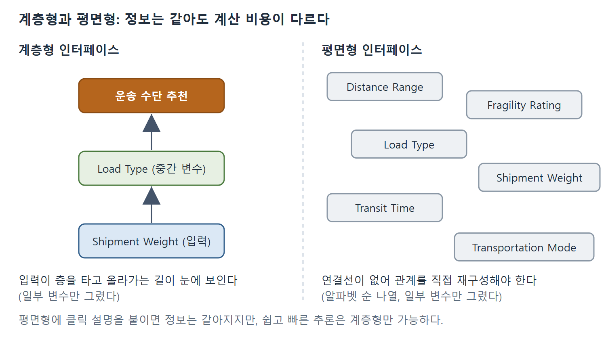
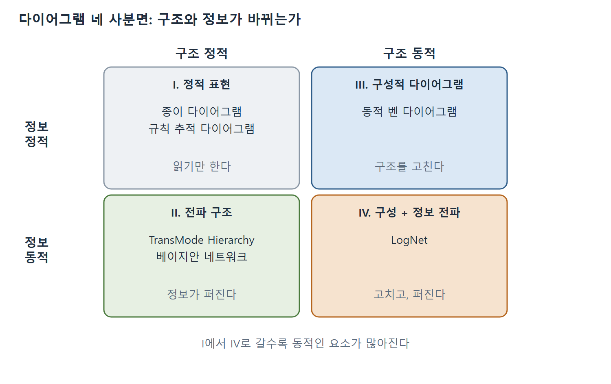

# 정보력과 계산력 비교 및 동적 다이어그램과 맺음말

이 문서는 9장의 후반부를 다룬다. 먼저 두 다이어그램을 비교하는 틀로서 정보력(informational power)과 계산력(computational power)을 설명하고, TransMode Hierarchy 실험으로 이를 확인한다. 이어 다이어그램을 정적 표현, 전파 구조, 구성적 다이어그램 등으로 나누는 표를 소개하고, 책 전체를 AI의 한계와 연결해 매듭짓는 후기를 정리한다. 저자의 논지는 다음과 같다. 다이어그램의 진짜 힘은 정보를 더 많이 담는 데 있지 않고 추론에 드는 계산 비용을 크게 낮추는 데 있다. 앞으로의 가치는 동적 기법에 있다.

---

## 1. 설명력의 두 면: 투명성과 유연성

1장에서 설명력(explanatory power)을 다루었다. 자기 행동을 설명할 수 있는 지능형 사용자 인터페이스는 설명력을 갖췄다고 하며, 설명력에는 두 면이 있다.

- **시스템 투명성(system transparency)**: 사용자가 시스템이 어떻게 작동하는지 이해하도록 돕는 성질이다.
- **시스템 유연성(system flexibility)**: 인터페이스를 쓰기 쉽게 하는 특성이다. 피드백을 주는 기능, 변경을 되돌리는 기능, 여러 수준의 세부를 쉽게 보여 주는 기능, 불확실한 데이터와 정보를 처리하는 능력이 여기에 해당한다.

둘을 구분하는 것이 중요한 이유는 투명성만으로는 설명력이 충분하지 않기 때문이다. 사용자는 필요에 따라, 문제 해결 상황의 맥락에 따라 여러 방식으로 정보와 설명을 요청할 수 있어야 한다. 시스템에서 더 많은 정보를 얻을 수 있어도(투명성은 있어도) 변경을 되돌릴 수 없거나, 입력한 가정을 처음부터 다시 하지 않고는 쉽게 고칠 수 없다면, 사용자는 굳이 그 투명성을 찾아 쓰려 하지 않는다. 인터페이스가 경직되어 있으면 탐색하려는 의욕이 꺾이고, 그러면 투명성이 사용자에게 쓸모없어진다.

---

## 2. 정보력과 계산력

저자는 설명력을 정보력과 계산력의 두 요소로 나누어 본다.

- **정보력**: 오로지 내용에만 관계한다. 내용이 더 우수한 인터페이스가 정보력이 크다.
- **계산력**: 효율과 사용성까지 평가한다. 내용에 더 효율적이고 효과적으로 접근해서 쓸 수 있는 인터페이스가 계산력이 크다.

이 정의에 따르면 투명성은 정보력을 높이고, 유연성은 계산력을 높인다.

라킨(Larkin)과 사이먼(Simon)은 두 다이어그램 표현을 비교하는 방식으로 이를 더 엄밀하게 정의했다. 두 표현이 정보적으로 동등(informationally equivalent)하다는 것은 한쪽의 모든 정보를 다른 쪽에서도 추론할 수 있고 그 반대도 성립한다는 뜻이다. 계산적으로 동등(computationally equivalent)하다는 것은 정보적으로 동등하면서, 한쪽에 명시된 정보에서 쉽고 빠르게 끌어낼 수 있는 추론을 다른 쪽에서도 쉽고 빠르게 할 수 있고 그 반대도 성립하는 경우이다. 계산적 동등은 정보적 동등을 포함한다. 따라서 설명력 면에서 두 인터페이스가 같으려면 계산적으로 동등해야 한다.

---

## 3. 예시: 계층형 인터페이스와 평면형 인터페이스

이 차이를 보이기 위해 6장의 TransMode Hierarchy를 예로 든다. 이 다이어그램은 운송 수단을 추천하는 전문가 시스템(expert system)의 사용자 인터페이스로 만든 것이다.

- **그림 9.7a(다이어그램 인터페이스)**: 지식 베이스(knowledge base)를 다루기 쉬운 덩어리로 나누고 계층 구조로 표현하므로, 덩어리 사이의 상호 관계가 명시적으로 드러난다.
- **그림 9.7b(평면형 인터페이스)**: 같은 전문가 시스템이지만 노드 사이의 연결을 지워 구조 정보가 없다. 변수는 알파벳 순으로 늘어놓았다. 다이어그램의 이점 하나는 관련 변수를 평면 위의 위치로 묶는 것인데, 위치로 찾아볼 수 있는 이점을 없애려고 알파벳 순으로 나열한 것이다. 그림은 입력 변수, 중간 변수, 추천을 구분해 보여 준다(그림 내용 자체는 텍스트로 확인되지 않는다).

두 인터페이스는 정보적으로 동등하지 않다. 평면형은 변수들이 어떻게 연결되는지에 관한 구조 정보가 없으므로 정보적으로 열등하다. 둘을 정보적으로 동등하게 만들려면 평면형에 내용을 더해야 한다. 예컨대 각 노드에 다른 노드와의 관계를 설명하는 텍스트를 붙이고, 사용자가 노드를 클릭하면 부모 노드를 알려 주게 한다. Shipment Weight를 누르면 "Shipment Weight의 부모는 Load Type이다"라고 알려 주는 식이다. 이렇게 하면 정보적으로는 동등해진다.

그러나 계산적으로는 분명히 동등하지 않다. 계층형은 효율과 사용 편의에서 여러 이점이 있다. 한 노드가 바뀔 때 정보가 노드마다 층을 타고 올라가며 퍼지는 모습을 쉽게 볼 수 있다. 평면형 사용자는 영향받는 변수의 사슬을 직접 재구성해야 한다. 텍스트 설명으로 계층 구조를 복원할 수는 있지만, 인지적 노력과 시간이 훨씬 많이 든다. 따라서 정보적으로 동등해도 평면형은 유연성과 계산력이 크게 떨어진다.

왼쪽 계층형은 입력 변수에서 중간 변수를 거쳐 추천으로 이어지는 길이 눈에 보인다. 오른쪽 평면형은 같은 변수가 알파벳 순으로 흩어져 있어 연결을 직접 재구성해야 한다. 그림에는 본문에 나온 변수 일부만 그렸다(원서 그림 9.7a, 9.7b 참조).

---

## 4. 다이어그램의 진짜 힘

저자는 여기서 일반적인 결론을 끌어낸다. 다이어그램 표현의 진짜 힘은 정보를 더 많이 담는 데 있지 않고 계산력을 극적으로 높이는 데 있다. 인간의 시각 정보 체계는 다이어그램 위의 모든 지각적 추론을 거의 비용 없이 해낸다. (안타깝게도 이런 시각 인식 능력을 AI 프로그램으로 흉내 내기는 매우 어렵다.) 반면 같은 사람이 평면형 인터페이스를 쓰면 이 지각적 추론을 힘들여 재구성해야 한다. 텍스트 설명으로 계층 관계를 복원할 수 있어도 인지적 비용이 크다. 다이어그램은 이 모든 요소를 공짜로 제공한다. 다이어그램이 강력하고 유용한 것은 그 때문이다.

---

## 5. 두 인터페이스를 비교 평가하는 실험 설계

라킨과 사이먼의 틀은 서로 다른 두 사용자 인터페이스를 비교하는 데 쓸 수 있다. 예컨대 다이어그램 인터페이스와 비다이어그램 인터페이스를 비교할 수 있다. 사과와 사과를 비교하려면 먼저 두 인터페이스의 정보력을 같게 맞춰야 한다. 그런 다음 통제된 실험을 한다. 참가자에게 여러 문제를 풀게 하되, 한 집단에는 첫째 인터페이스(다이어그램형)를, 다른 집단에는 둘째 인터페이스(비다이어그램형)를 쓰게 한다. 참가자는 두 집단에 무작위로 배정한다. 이때 다이어그램 집단이 다음 지표에서 더 나은 성과를 내리라고 기대한다.

- 문제를 정확히 푸는 능력(정확도)
- 정답에 이르기까지 걸린 시간(효율)
- 새롭거나 어려운 문제의 해를 추론하는 능력
- 설문으로 평가한 사용자 만족도

---

## 6. TransMode Hierarchy 실험과 결과

실제로 이 인터페이스의 효과를 평가하는 실험이 있었다. 참가자 40명은 그림 9.7a 같은 계층형을, 다른 40명은 정보적으로 동등한 그림 9.7b 같은 평면형을 썼다. 한 과제는 전문가 시스템이 틀린 결론에 이르렀을 때 그 원인인 잘못된 규칙 두 개를 찾는 것이었다. 상황은 이렇다. 철도 운송업체가 매우 깨지기 쉬운 화물을 수송한 실적이 나빠서, 파손 위험도(fragility rating)가 높으면 철도(RAIL)를 절대 고르지 않기로 했다. 참가자에게 시스템이 정말 그렇게 결론 내리는지 묻고, 아니라면 실행되어 잘못된 결과(운송 수단 = RAIL)를 낳는 결함 규칙을 가능한 한 정확히 짚어 내게 했다.

표 9.1(찾은 결함 규칙 수)에서 확실히 읽히는 값은 다음과 같다. 평면형 집단은 0개 17명, 1개 17명, 2개 6명으로 합계 40명이다. 계층형 집단의 값은 추출본이 깨져 있다. 그러나 본문의 "40명 중 34명이 적어도 한 규칙을 찾았다"는 서술과 합계 40명에 맞추면 0개 6명, 1개 31명, 2개 3명으로 읽힌다.

| 집단 | 0개 찾음 | 1개 찾음 | 2개 찾음 | 합계 |
|---|---|---|---|---|
| 평면형 인터페이스 | 17명 | 17명 | 6명 | 40명 |
| 계층형 인터페이스 | 6명(추정) | 31명(추정) | 3명(추정) | 40명 |

계층형 줄은 추출이 깨져 본문의 34명(85%)과 합계 40명에 맞춰 복원한 값이다. 평면형은 2개를 찾은 사람이 6명인 반면 계층형은 대부분 1개 이상을 찾았음을 읽을 수 있다.

| 집단 | 한 개 이상 찾은 사람 | 비율 |
|---|---|---|
| 계층형 인터페이스 | 34 / 40 | 85% |
| 평면형 인터페이스 | 23 / 40 | 58% |

문제를 0~10점으로 채점한 평균은 평면형 4.0점, 계층형 5.65점이었고, 이 차이는 유의했다(F = 5.85, p = .018). 따라서 계층형 인터페이스가 문제 해결 성과를 높여 주었다고 결론 내렸다.

사용자 만족도에서도 계층형이 압도적이었다. 77명이 계층형을 선호했고 평면형을 선호한 사람은 3명뿐이었다. 장점으로 꼽힌 응답은 다음과 같다.

- 변수 사이의 관계를 눈으로 볼 수 있다: 57명
- 논리적으로 구성되어 있어 이해하기 쉽다: 36명
- 사용이 쉽다: 10명
- 문제 해결을 돕는다: 4명

약점으로는 계층형이 더 복잡해서 배우고 쓰는 데 훈련이 더 필요하다는 응답이 가장 많았다(28명). 흥미롭게도 6명은 계층형이 사용자를 특정한 방식으로 쓰도록 이끌어서 해로울 수 있다고 보았다. 평면형 사용자는 변수 관계를 이해하려고 능동적으로 애쓰는 반면, 계층형 사용자는 시스템이 시키는 대로 수동적으로 받아들일 가능성이 크다는 지적이다. 그래도 전반적으로 계층형이 평면형보다 훨씬 바람직하다는 점은 분명했다.

---

## 7. 정적 다이어그램을 넘어서: 네 가지 사분면

책에 나온 다이어그램 중에는 사용자가 수정하거나 갱신하지 않게 만든 정적인 것도 있고, 더 동적으로 쓰이게 만든 것도 있다. 표 9.2는 두 축으로 이를 분류한다. 하나는 다이어그램의 구조를 수정할 수 있는가이고, 다른 하나는 다이어그램 위의 정보를 갱신하는가이다.

| 구분 | 구조 정적 | 구조 동적 |
|---|---|---|
| 정보 정적 | I. 정적 표현 (종이 다이어그램, 규칙 추적 다이어그램) | III. 구성적 다이어그램 (동적 벤 다이어그램) |
| 정보 동적 | II. 전파 구조 (TransMode Hierarchy, 베이지안 네트워크) | IV. 정보 전파가 있는 구성적 다이어그램 (LogNet) |

I사분면은 구조와 정보가 모두 정적이다. II, III, IV사분면은 더 동적이어서, 다이어그램 사용자 인터페이스를 만들 수 있고 때로는 어려운 문제의 해를 추론하는 데도 쓸 수 있다.

가로는 구조를 고칠 수 있는지, 세로는 정보가 갱신되는지를 나타낸다. 각 칸에 본문의 예를 넣었으며 오른쪽 아래 IV사분면이 두 면에서 모두 동적이다(원서 표 9.2를 그림으로 정리한 것이다).

---

## 8. 사분면별 설명

- **I. 정적 표현(static representation)**: 오늘날 쓰이는 다이어그램 대부분이 여기에 속한다. 조직도, 기본 순서도, 의미망, 개체-관계 다이어그램은 주로 정보를 주어 시스템 이해를 돕지만, 보통 사용자가 수정하도록 만들어지지 않았다. 6장의 규칙 추적 다이어그램(조건과 행동의 상호 관계를 보임, 그림 6.8)과 전략적 지식을 모델링한 다이어그램(그림 6.14)도 정적이다. 이들은 전문가 시스템이 작동하는 방식을 보여 주고 깊은 이해를 돕지만 동적이지는 않다. 정적이므로 책, 읽기 전용 화면, 정적 웹 페이지 같은 정적 매체에 쉽게 넣을 수 있다.
- **II. 전파 구조(propagation structure)**: 지능형 시스템의 사용자 인터페이스로 만든 다이어그램으로, 그 위의 정보를 사용자가 수정하고 갱신할 수 있다. TransMode Hierarchy와 8장의 베이지안 네트워크(Bayesian network)가 예이다. TransMode Hierarchy는 잎 노드에 입력 정보를 넣으면 그 정보가 다이어그램 구조를 따라 위로 전파되므로, 사용자가 지식 베이스를 통과하는 추론의 흐름을 눈으로 따라갈 수 있다. 베이지안 네트워크는 인과 다이어그램으로 원인과 결과의 연관망을 보여 주고(그림 8.14), 각 노드에 확률을 부여해서 새 증거와 데이터가 들어오면 갱신한다. 전파 구조는 구조 자체는 정적이지만 정보는 동적이다.
- **III. 구성적 다이어그램(constructive diagram)**: 사용자가 구조 자체를 수정하도록 만든 다이어그램이다. 4장의 동적 벤 다이어그램이 좋은 예이다. 벤 다이어그램의 대상을 결합하고 조작하는 일은 변환 규칙(rules of transformation)이 정한다. 이 규칙은 대수학 규칙처럼 어떤 변환이 허용되는지, 곧 벤 다이어그램을 한 단계씩 동등한 다른 벤 다이어그램으로 바꾸는 방법을 알려 준다. 목적은 삼단논법의 타당성을 검증하거나 논리 정리를 증명하는 것이다. 구성적 다이어그램은 논리 정리 증명 같은 어려운 문제를 푸는 강력한 기법이 될 수 있다.
- **IV. 정보 전파가 있는 구성적 다이어그램**: 구조를 수정할 수 있고 정보도 구조를 따라 갱신되고 전파되므로, 두 가지 면에서 동적이다. 7장의 LogNet이 예로, 사업 물류 네트워크 설계를 지원한다. 과제는 공장, 창고, 고객 구역을 운송 링크로 이은 네트워크를 구성하는 것이다(그림 7.10). 이 설계는 통합(창고 둘 이상을 합쳐 비용 절감)과 분산(창고를 나누어 고객에게 더 잘 봉사) 사이에서 절충해야 한다. 이 다이어그램이 구성적인 이유는 사용자가 능동적으로 고치도록 만들어졌기 때문이다. 사용자는 노드를 추가하거나 삭제하고 운송 링크를 이어 붙이거나 끊어서 여러 네트워크 구성을 그릴 수 있다. 요청하면 비용과 고객 서비스 수준 같은 벤치마크가 계산된다. 또 구성 방식에 따라 정보가 전파된다. 창고의 재고 유지 비용은 재고가 통합된 정도에 따라 갱신되어, 통합이 많이 될수록 단위당 재고 유지 비용이 줄고 분산될수록 늘어난다.

---

## 9. 장의 결론

저자는 다이어그램 추론이 본질적으로 동적 기법을 활용하는 것이라고 정리한다. 정보 전파(II, IV사분면)를 쓰든 구성적 다이어그래밍(III, IV사분면)을 쓰든 마찬가지이다. 이 책은 전통적이고 정적인 쓰임을 넘어 이런 흥미로운 용법을 보이려는 책이다. 저자는 다이어그램 추론이 AI 분야와 만나는 미래가 이 기법으로 까다롭고 난해해 보이는 문제를 푸는 데 있다고 말한다. 책에 소개한 응용은 시작이자 가능성의 단서일 뿐이라고 덧붙인다.

---

## 10. 후기: AI와 그 너머의 다이어그램 사용자 인터페이스

1장에서 저자는 AI를 과도한 기대와 비현실적인 목표의 분야로 묘사했다. 특히 초기의 과대 선전 때문에 생각하는 기계라는 목표를 이루지 못했고, 이것이 많은 사람에게 실망을 안겼다. 그래서 저자는 더 실용적인 접근을 주장했다. AI의 한계를 받아들이고 그것을 우회하는 해법을 찾는 설계이다. 한 방법은 AI의 한계와 결함을 고려해서 그래픽 사용자 인터페이스를 다시 설계하는 것이다. 다양한 기법과 응용을 훑어본 지금은 처음의 생각으로 돌아가, AI의 한계를 되돌아보고 다이어그램으로 그것을 어떻게 다룰 수 있는지 비판적으로 따져 볼 수 있다.

다시 살펴볼 한계는 상식 추론(commonsense reasoning)의 부재이다. 앞서 제시한 상식 추론의 네 구성요소는 다음과 같다.

1. 같은 문제에 여러 표현을 쓰는 능력
2. 오류를 다루는 능력
3. 더 높은 수준의 자기 성찰
4. 효율적인 지식 검색

저자는 이 영역들을 책에서 어떤 형태로든 다루었고 다이어그램을 이용한 해법도 제안했다고 본다. 해결할 일이 많고 다이어그램 추론만이 답은 아니지만, 다이어그램 추론이 AI 시스템을 크게 보강할 수 있다고 강하게 주장할 수 있다는 것이다. 각 영역의 내용은 다음과 같다.

- **다중 표현**: 책 전체에서 여러 형태의 다이어그램을 제안했다. 이 다이어그램들이 서로 다른 표현을 만들고, 문제 해결 상황의 서로 다른 측면을 부각할 수 있음은 분명하다. 다층적 기술을 만들 수 있으면 사용자가 원하는 상세 수준을 요청할 수 있으므로, 쓸모 있고 쓰기 쉬운 AI 시스템을 만드는 데 크게 기여한다.
- **오류 처리**: 미래의 AI 인터페이스는 오류와 다양한 사용자 상호작용에 대응할 만큼 유연해야 한다. TransMode Hierarchy의 인터페이스는 데이터를 어떤 순서로든 입력하고, 되돌아가고, 시나리오를 시험하고(다이어그램 위에서 직접 가정 분석, What if? analysis), 제약 없이 쉽게 탐색하도록 설계되었다. 또 많은 AI 응용은 취약해서(brittle) 문제가 조금만 다르게 주어져도 무너진다. 베이지안 네트워크는 일부 증거가 없거나 확신 없이 단정할 수 없을 때도 작동하도록 설계되었다. 인과 다이어그램은 정보를 유연하게 입력하고 확률이 전파되는 모습을 시각화하는 편리한 구조를 준다. 요컨대 다이어그램 구조를 사용자 인터페이스로 쓰면 시스템과 더 유연하게 상호작용할 수 있고, 일이 틀어질 때 그 이유도 이해할 수 있다.
- **고수준 자기 성찰**: AI 시스템이 쓰는 문제 해결 전략을 깊이 이해하고 성찰하는 일에는 다이어그램 표현이 크게 도움이 된다. 6장에서 전략적 지식을 그래픽으로 보여 주는 방법(그림 6.14~6.16)으로 이를 다루었다. 우리는 시스템이 어떻게 작동하는지, 그 영역에서 문제를 푸는 방법이 무엇인지에 대해 깊은 멘탈 모델(mental model)을 갖지 못하는 경우가 많다. 이 지식을 분명히 드러내야 시스템을 쓸 자신감과 추천을 받아들일 신뢰가 생긴다. 그렇지 않으면 문제가 생길 때 길을 잃고 맹신에 기대게 된다.
- **효율적 지식 검색**: 많은 다이어그램은 복잡한 시스템을 조직하는 비계(scaffold) 구실을 하여 정보를 더 효율적으로 찾게 해 준다. 6장의 TransMode 지식 베이스는 규칙이 50개뿐이어도 규칙들이 어떻게 상호작용해 추천을 만드는지 이해하기 어렵다. 계층 구조 같은 다이어그램으로 복잡한 시스템을 나누고 조직할 수 있으며, 다이어그램이나 다층적 기술이 있으면 특정 규칙을 짚어 내기가 지식 베이스를 처음부터 차례로 훑는 것보다 훨씬 쉽다. 나중에 쉽게 찾으려면 지식을 조직하는 데 다이어그램이 필요하다.

---

## 11. 책 전체의 맺음

저자는 이 책의 논의가 AI 사용자 인터페이스에 맞추어져 있지만, 다이어그램 추론은 더 넓은 의미에서 모든 종류의 기술과 삶의 모든 영역에 쓸 수 있다고 말한다. 새 천년이 깊어질수록 시스템 투명성과 유연성을 제공하는 다이어그램 사용자 인터페이스의 필요가 그 어느 때보다 절실해진다. 기술과 정보 과부하가 사방에서 쏟아지고 사람들이 끊임없이 연결되어 있는 사회가 되었으며, 기술 혁신 속도가 빨라서 따라가기도 어렵다. 앞으로 사람들이 이런 복잡함과 기술의 마법 같은 면 속에서 헤쳐 나가려면 도움이 필요하다.

아서 C. 클라크가 1962년에 쓴 "충분히 발전한 기술은 마법과 구별되지 않는다"라는 말은 오늘 우리가 맞은 곤경을 예언한 듯하다고 저자는 말한다. 인터넷, 스마트폰, GPS 장치까지 기술 혁명을 직접 겪는 일은 흥미롭다. 그러나 물건을 작동시키는 방법을 알아내야 하는 사용자에게는 헛수고로 끝나기도 해서, 몹시 답답한 시대이기도 하다. 기술이 협조하지 않는 이유는 흔히 그것이 블랙박스, 곧 신비하고 이해할 수 없고 고칠 수 없는 대상이기 때문이다. 이상적인 기술은 투명하고, 들여다볼 수 있고, 유연하고, 매끄럽고, 쓰기 쉬워야 한다. 다이어그램은 블랙박스를 유리 상자(glass box)로 바꾸는 강력하고 편리한 방법의 하나이다. 저자의 마지막 말은 기술이 마법과 구별되지 않아서는 안 된다는 것이다.

 
 
 

[Diagrammatic Reasoning in AI](../)
