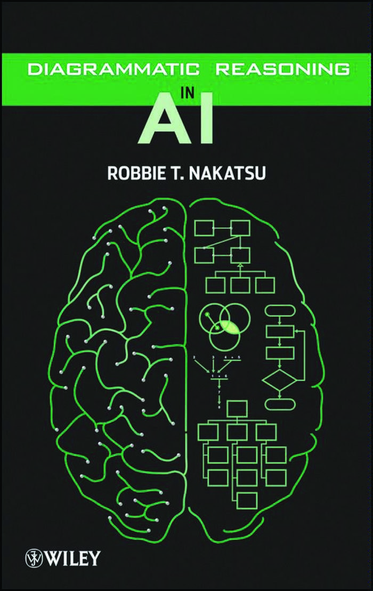
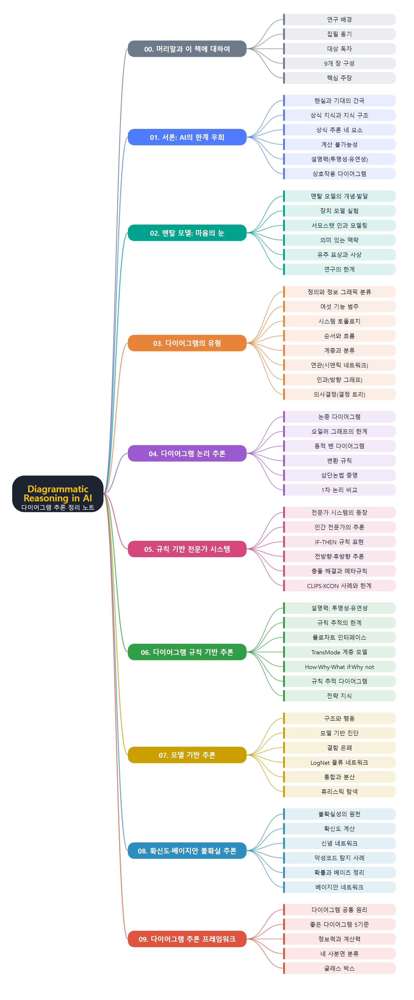

# **Diagrammatic Reasoning in AI**
(AI의 다이어그램 추론)
 

 
 

이 문서는 Robbie T. Nakatsu가 쓴 『Diagrammatic Reasoning in AI』(Wiley)를 장별로 정리한 한국어 학습 노트입니다. 원문을 그대로 번역한 것이 아니라 핵심 개념을 요약해 다시 정리했습니다. AI가 가진 상식 추론과 설명력의 한계에서 출발해, 사람이 마음속에 그리는 멘탈 모델과 다이어그램의 여러 유형을 살펴봅니다. 이어서 논리 추론, 규칙 기반 전문가 시스템, 모델 기반 추론, 확신도와 베이지안 네트워크를 이용한 불확실 추론에서 다이어그램이 추론을 어떻게 돕는지 다루고, 마지막으로 다이어그램 추론을 이해하는 프레임워크로 마무리합니다.
 
 
 

---

- [00. 머리말과 이 책에 대하여](00.%20%EB%A8%B8%EB%A6%AC%EB%A7%90%EA%B3%BC%20%EC%9D%B4%20%EC%B1%85%EC%97%90%20%EB%8C%80%ED%95%98%EC%97%AC/Readme.md)
- [01. 서론 - AI의 한계 우회하기](01.%20%EC%84%9C%EB%A1%A0%20-%20AI%EC%9D%98%20%ED%95%9C%EA%B3%84%20%EC%9A%B0%ED%9A%8C%ED%95%98%EA%B8%B0/Readme.md)
  - [AI의 현실과 기대의 간극](01.%20%EC%84%9C%EB%A1%A0%20-%20AI%EC%9D%98%20%ED%95%9C%EA%B3%84%20%EC%9A%B0%ED%9A%8C%ED%95%98%EA%B8%B0/AI%EC%9D%98%20%ED%98%84%EC%8B%A4%EA%B3%BC%20%EA%B8%B0%EB%8C%80%EC%9D%98%20%EA%B0%84%EA%B7%B9.md)
  - [상식 지식과 지식 구조](01.%20%EC%84%9C%EB%A1%A0%20-%20AI%EC%9D%98%20%ED%95%9C%EA%B3%84%20%EC%9A%B0%ED%9A%8C%ED%95%98%EA%B8%B0/%EC%83%81%EC%8B%9D%20%EC%A7%80%EC%8B%9D%EA%B3%BC%20%EC%A7%80%EC%8B%9D%20%EA%B5%AC%EC%A1%B0.md)
  - [상식 추론의 네 가지 요소](01.%20%EC%84%9C%EB%A1%A0%20-%20AI%EC%9D%98%20%ED%95%9C%EA%B3%84%20%EC%9A%B0%ED%9A%8C%ED%95%98%EA%B8%B0/%EC%83%81%EC%8B%9D%20%EC%B6%94%EB%A1%A0%EC%9D%98%20%EB%84%A4%20%EA%B0%80%EC%A7%80%20%EC%9A%94%EC%86%8C.md)
  - [계산 불가능성](01.%20%EC%84%9C%EB%A1%A0%20-%20AI%EC%9D%98%20%ED%95%9C%EA%B3%84%20%EC%9A%B0%ED%9A%8C%ED%95%98%EA%B8%B0/%EA%B3%84%EC%82%B0%20%EB%B6%88%EA%B0%80%EB%8A%A5%EC%84%B1.md)
  - [설명력과 시스템 투명성](01.%20%EC%84%9C%EB%A1%A0%20-%20AI%EC%9D%98%20%ED%95%9C%EA%B3%84%20%EC%9A%B0%ED%9A%8C%ED%95%98%EA%B8%B0/%EC%84%A4%EB%AA%85%EB%A0%A5%EA%B3%BC%20%EC%8B%9C%EC%8A%A4%ED%85%9C%20%ED%88%AC%EB%AA%85%EC%84%B1.md)
  - [시스템 유연성과 상호작용 다이어그램](01.%20%EC%84%9C%EB%A1%A0%20-%20AI%EC%9D%98%20%ED%95%9C%EA%B3%84%20%EC%9A%B0%ED%9A%8C%ED%95%98%EA%B8%B0/%EC%8B%9C%EC%8A%A4%ED%85%9C%20%EC%9C%A0%EC%97%B0%EC%84%B1%EA%B3%BC%20%EC%83%81%ED%98%B8%EC%9E%91%EC%9A%A9%20%EB%8B%A4%EC%9D%B4%EC%96%B4%EA%B7%B8%EB%9E%A8.md)
- [02. 멘탈 모델 - 마음의 눈으로 보는 다이어그램](02.%20%EB%A9%98%ED%83%88%20%EB%AA%A8%EB%8D%B8%20-%20%EB%A7%88%EC%9D%8C%EC%9D%98%20%EB%88%88%EC%9C%BC%EB%A1%9C%20%EB%B3%B4%EB%8A%94%20%EB%8B%A4%EC%9D%B4%EC%96%B4%EA%B7%B8%EB%9E%A8/Readme.md)
  - [멘탈 모델의 개념과 발달](02.%20%EB%A9%98%ED%83%88%20%EB%AA%A8%EB%8D%B8%20-%20%EB%A7%88%EC%9D%8C%EC%9D%98%20%EB%88%88%EC%9C%BC%EB%A1%9C%20%EB%B3%B4%EB%8A%94%20%EB%8B%A4%EC%9D%B4%EC%96%B4%EA%B7%B8%EB%9E%A8/%EB%A9%98%ED%83%88%20%EB%AA%A8%EB%8D%B8%EC%9D%98%20%EA%B0%9C%EB%85%90%EA%B3%BC%20%EB%B0%9C%EB%8B%AC.md)
  - [내부 연결 - 장치 모델과 학습 효과](02.%20%EB%A9%98%ED%83%88%20%EB%AA%A8%EB%8D%B8%20-%20%EB%A7%88%EC%9D%8C%EC%9D%98%20%EB%88%88%EC%9C%BC%EB%A1%9C%20%EB%B3%B4%EB%8A%94%20%EB%8B%A4%EC%9D%B4%EC%96%B4%EA%B7%B8%EB%9E%A8/%EB%82%B4%EB%B6%80%20%EC%97%B0%EA%B2%B0%20-%20%EC%9E%A5%EC%B9%98%20%EB%AA%A8%EB%8D%B8%EA%B3%BC%20%ED%95%99%EC%8A%B5%20%ED%9A%A8%EA%B3%BC.md)
  - [서모스탯 사례와 인과 모델링](02.%20%EB%A9%98%ED%83%88%20%EB%AA%A8%EB%8D%B8%20-%20%EB%A7%88%EC%9D%8C%EC%9D%98%20%EB%88%88%EC%9C%BC%EB%A1%9C%20%EB%B3%B4%EB%8A%94%20%EB%8B%A4%EC%9D%B4%EC%96%B4%EA%B7%B8%EB%9E%A8/%EC%84%9C%EB%AA%A8%EC%8A%A4%ED%83%AF%20%EC%82%AC%EB%A1%80%EC%99%80%20%EC%9D%B8%EA%B3%BC%20%EB%AA%A8%EB%8D%B8%EB%A7%81.md)
  - [외부 연결 - 의미 있는 맥락과 유추](02.%20%EB%A9%98%ED%83%88%20%EB%AA%A8%EB%8D%B8%20-%20%EB%A7%88%EC%9D%8C%EC%9D%98%20%EB%88%88%EC%9C%BC%EB%A1%9C%20%EB%B3%B4%EB%8A%94%20%EB%8B%A4%EC%9D%B4%EC%96%B4%EA%B7%B8%EB%9E%A8/%EC%99%B8%EB%B6%80%20%EC%97%B0%EA%B2%B0%20-%20%EC%9D%98%EB%AF%B8%20%EC%9E%88%EB%8A%94%20%EB%A7%A5%EB%9D%BD%EA%B3%BC%20%EC%9C%A0%EC%B6%94.md)
  - [유추를 통한 문제 해결과 논의](02.%20%EB%A9%98%ED%83%88%20%EB%AA%A8%EB%8D%B8%20-%20%EB%A7%88%EC%9D%8C%EC%9D%98%20%EB%88%88%EC%9C%BC%EB%A1%9C%20%EB%B3%B4%EB%8A%94%20%EB%8B%A4%EC%9D%B4%EC%96%B4%EA%B7%B8%EB%9E%A8/%EC%9C%A0%EC%B6%94%EB%A5%BC%20%ED%86%B5%ED%95%9C%20%EB%AC%B8%EC%A0%9C%20%ED%95%B4%EA%B2%B0%EA%B3%BC%20%EB%85%BC%EC%9D%98.md)
- [03. 다이어그램의 유형](03.%20%EB%8B%A4%EC%9D%B4%EC%96%B4%EA%B7%B8%EB%9E%A8%EC%9D%98%20%EC%9C%A0%ED%98%95/Readme.md)
  - [01. 다이어그램의 정의와 분류](03.%20%EB%8B%A4%EC%9D%B4%EC%96%B4%EA%B7%B8%EB%9E%A8%EC%9D%98%20%EC%9C%A0%ED%98%95/01.%20%EB%8B%A4%EC%9D%B4%EC%96%B4%EA%B7%B8%EB%9E%A8%EC%9D%98%20%EC%A0%95%EC%9D%98%EC%99%80%20%EB%B6%84%EB%A5%98.md)
  - [02. 시스템 토폴로지](03.%20%EB%8B%A4%EC%9D%B4%EC%96%B4%EA%B7%B8%EB%9E%A8%EC%9D%98%20%EC%9C%A0%ED%98%95/02.%20%EC%8B%9C%EC%8A%A4%ED%85%9C%20%ED%86%A0%ED%8F%B4%EB%A1%9C%EC%A7%80.md)
  - [03. 순서와 흐름](03.%20%EB%8B%A4%EC%9D%B4%EC%96%B4%EA%B7%B8%EB%9E%A8%EC%9D%98%20%EC%9C%A0%ED%98%95/03.%20%EC%88%9C%EC%84%9C%EC%99%80%20%ED%9D%90%EB%A6%84.md)
  - [04. 계층과 분류](03.%20%EB%8B%A4%EC%9D%B4%EC%96%B4%EA%B7%B8%EB%9E%A8%EC%9D%98%20%EC%9C%A0%ED%98%95/04.%20%EA%B3%84%EC%B8%B5%EA%B3%BC%20%EB%B6%84%EB%A5%98.md)
  - [05. 연관](03.%20%EB%8B%A4%EC%9D%B4%EC%96%B4%EA%B7%B8%EB%9E%A8%EC%9D%98%20%EC%9C%A0%ED%98%95/05.%20%EC%97%B0%EA%B4%80.md)
  - [06. 인과관계](03.%20%EB%8B%A4%EC%9D%B4%EC%96%B4%EA%B7%B8%EB%9E%A8%EC%9D%98%20%EC%9C%A0%ED%98%95/06.%20%EC%9D%B8%EA%B3%BC%EA%B4%80%EA%B3%84.md)
  - [07. 의사결정 다이어그램](03.%20%EB%8B%A4%EC%9D%B4%EC%96%B4%EA%B7%B8%EB%9E%A8%EC%9D%98%20%EC%9C%A0%ED%98%95/07.%20%EC%9D%98%EC%82%AC%EA%B2%B0%EC%A0%95%20%EB%8B%A4%EC%9D%B4%EC%96%B4%EA%B7%B8%EB%9E%A8.md)
  - [08. 연결선의 의미와 장 정리](03.%20%EB%8B%A4%EC%9D%B4%EC%96%B4%EA%B7%B8%EB%9E%A8%EC%9D%98%20%EC%9C%A0%ED%98%95/08.%20%EC%97%B0%EA%B2%B0%EC%84%A0%EC%9D%98%20%EC%9D%98%EB%AF%B8%EC%99%80%20%EC%9E%A5%20%EC%A0%95%EB%A6%AC.md)
- [04. 다이어그램을 이용한 논리 추론](04.%20%EB%8B%A4%EC%9D%B4%EC%96%B4%EA%B7%B8%EB%9E%A8%EC%9D%84%20%EC%9D%B4%EC%9A%A9%ED%95%9C%20%EB%85%BC%EB%A6%AC%20%EC%B6%94%EB%A1%A0/Readme.md)
  - [01. 논리 추론과 논증의 기초](04.%20%EB%8B%A4%EC%9D%B4%EC%96%B4%EA%B7%B8%EB%9E%A8%EC%9D%84%20%EC%9D%B4%EC%9A%A9%ED%95%9C%20%EB%85%BC%EB%A6%AC%20%EC%B6%94%EB%A1%A0/01.%20%EB%85%BC%EB%A6%AC%20%EC%B6%94%EB%A1%A0%EA%B3%BC%20%EB%85%BC%EC%A6%9D%EC%9D%98%20%EA%B8%B0%EC%B4%88.md)
  - [02. 논증 다이어그램](04.%20%EB%8B%A4%EC%9D%B4%EC%96%B4%EA%B7%B8%EB%9E%A8%EC%9D%84%20%EC%9D%B4%EC%9A%A9%ED%95%9C%20%EB%85%BC%EB%A6%AC%20%EC%B6%94%EB%A1%A0/02.%20%EB%85%BC%EC%A6%9D%20%EB%8B%A4%EC%9D%B4%EC%96%B4%EA%B7%B8%EB%9E%A8.md)
  - [03. 오일러 그래프와 벤 다이어그램 표기](04.%20%EB%8B%A4%EC%9D%B4%EC%96%B4%EA%B7%B8%EB%9E%A8%EC%9D%84%20%EC%9D%B4%EC%9A%A9%ED%95%9C%20%EB%85%BC%EB%A6%AC%20%EC%B6%94%EB%A1%A0/03.%20%EC%98%A4%EC%9D%BC%EB%9F%AC%20%EA%B7%B8%EB%9E%98%ED%94%84%EC%99%80%20%EB%B2%A4%20%EB%8B%A4%EC%9D%B4%EC%96%B4%EA%B7%B8%EB%9E%A8%20%ED%91%9C%EA%B8%B0.md)
  - [04. 변환 규칙과 삼단논법 증명](04.%20%EB%8B%A4%EC%9D%B4%EC%96%B4%EA%B7%B8%EB%9E%A8%EC%9D%84%20%EC%9D%B4%EC%9A%A9%ED%95%9C%20%EB%85%BC%EB%A6%AC%20%EC%B6%94%EB%A1%A0/04.%20%EB%B3%80%ED%99%98%20%EA%B7%9C%EC%B9%99%EA%B3%BC%20%EC%82%BC%EB%8B%A8%EB%85%BC%EB%B2%95%20%EC%A6%9D%EB%AA%85.md)
  - [05. 언어적 표현과 다이어그램 표현의 비교](04.%20%EB%8B%A4%EC%9D%B4%EC%96%B4%EA%B7%B8%EB%9E%A8%EC%9D%84%20%EC%9D%B4%EC%9A%A9%ED%95%9C%20%EB%85%BC%EB%A6%AC%20%EC%B6%94%EB%A1%A0/05.%20%EC%96%B8%EC%96%B4%EC%A0%81%20%ED%91%9C%ED%98%84%EA%B3%BC%20%EB%8B%A4%EC%9D%B4%EC%96%B4%EA%B7%B8%EB%9E%A8%20%ED%91%9C%ED%98%84%EC%9D%98%20%EB%B9%84%EA%B5%90.md)
- [05. 규칙 기반 전문가 시스템](05.%20%EA%B7%9C%EC%B9%99%20%EA%B8%B0%EB%B0%98%20%EC%A0%84%EB%AC%B8%EA%B0%80%20%EC%8B%9C%EC%8A%A4%ED%85%9C/Readme.md)
  - [01. 전문가 시스템의 등장과 인간 전문성](05.%20%EA%B7%9C%EC%B9%99%20%EA%B8%B0%EB%B0%98%20%EC%A0%84%EB%AC%B8%EA%B0%80%20%EC%8B%9C%EC%8A%A4%ED%85%9C/01.%20%EC%A0%84%EB%AC%B8%EA%B0%80%20%EC%8B%9C%EC%8A%A4%ED%85%9C%EC%9D%98%20%EB%93%B1%EC%9E%A5%EA%B3%BC%20%EC%9D%B8%EA%B0%84%20%EC%A0%84%EB%AC%B8%EC%84%B1.md)
  - [02. 규칙 기반 추론과 규칙 표현](05.%20%EA%B7%9C%EC%B9%99%20%EA%B8%B0%EB%B0%98%20%EC%A0%84%EB%AC%B8%EA%B0%80%20%EC%8B%9C%EC%8A%A4%ED%85%9C/02.%20%EA%B7%9C%EC%B9%99%20%EA%B8%B0%EB%B0%98%20%EC%B6%94%EB%A1%A0%EA%B3%BC%20%EA%B7%9C%EC%B9%99%20%ED%91%9C%ED%98%84.md)
  - [03. 시스템 구성요소와 추론 엔진](05.%20%EA%B7%9C%EC%B9%99%20%EA%B8%B0%EB%B0%98%20%EC%A0%84%EB%AC%B8%EA%B0%80%20%EC%8B%9C%EC%8A%A4%ED%85%9C/03.%20%EC%8B%9C%EC%8A%A4%ED%85%9C%20%EA%B5%AC%EC%84%B1%EC%9A%94%EC%86%8C%EC%99%80%20%EC%B6%94%EB%A1%A0%20%EC%97%94%EC%A7%84.md)
  - [04. 충돌 해결과 제어 전략](05.%20%EA%B7%9C%EC%B9%99%20%EA%B8%B0%EB%B0%98%20%EC%A0%84%EB%AC%B8%EA%B0%80%20%EC%8B%9C%EC%8A%A4%ED%85%9C/04.%20%EC%B6%A9%EB%8F%8C%20%ED%95%B4%EA%B2%B0%EA%B3%BC%20%EC%A0%9C%EC%96%B4%20%EC%A0%84%EB%9E%B5.md)
  - [05. CLIPS 기초 문법](05.%20%EA%B7%9C%EC%B9%99%20%EA%B8%B0%EB%B0%98%20%EC%A0%84%EB%AC%B8%EA%B0%80%20%EC%8B%9C%EC%8A%A4%ED%85%9C/05.%20CLIPS%20%EA%B8%B0%EC%B4%88%20%EB%AC%B8%EB%B2%95.md)
  - [06. CLIPS 규칙 확장과 주식 선정 구현](05.%20%EA%B7%9C%EC%B9%99%20%EA%B8%B0%EB%B0%98%20%EC%A0%84%EB%AC%B8%EA%B0%80%20%EC%8B%9C%EC%8A%A4%ED%85%9C/06.%20CLIPS%20%EA%B7%9C%EC%B9%99%20%ED%99%95%EC%9E%A5%EA%B3%BC%20%EC%A3%BC%EC%8B%9D%20%EC%84%A0%EC%A0%95%20%EA%B5%AC%ED%98%84.md)
  - [07. 효과와 한계 - XCON 사례](05.%20%EA%B7%9C%EC%B9%99%20%EA%B8%B0%EB%B0%98%20%EC%A0%84%EB%AC%B8%EA%B0%80%20%EC%8B%9C%EC%8A%A4%ED%85%9C/07.%20%ED%9A%A8%EA%B3%BC%EC%99%80%20%ED%95%9C%EA%B3%84%20-%20XCON%20%EC%82%AC%EB%A1%80.md)
- [06. 다이어그램을 이용한 규칙 기반 추론](06.%20%EB%8B%A4%EC%9D%B4%EC%96%B4%EA%B7%B8%EB%9E%A8%EC%9D%84%20%EC%9D%B4%EC%9A%A9%ED%95%9C%20%EA%B7%9C%EC%B9%99%20%EA%B8%B0%EB%B0%98%20%EC%B6%94%EB%A1%A0/Readme.md)
  - [01. 전문가 시스템의 투명성](06.%20%EB%8B%A4%EC%9D%B4%EC%96%B4%EA%B7%B8%EB%9E%A8%EC%9D%84%20%EC%9D%B4%EC%9A%A9%ED%95%9C%20%EA%B7%9C%EC%B9%99%20%EA%B8%B0%EB%B0%98%20%EC%B6%94%EB%A1%A0/01.%20%EC%A0%84%EB%AC%B8%EA%B0%80%20%EC%8B%9C%EC%8A%A4%ED%85%9C%EC%9D%98%20%ED%88%AC%EB%AA%85%EC%84%B1.md)
  - [02. 단순한 전문가 시스템의 다이어그램화](06.%20%EB%8B%A4%EC%9D%B4%EC%96%B4%EA%B7%B8%EB%9E%A8%EC%9D%84%20%EC%9D%B4%EC%9A%A9%ED%95%9C%20%EA%B7%9C%EC%B9%99%20%EA%B8%B0%EB%B0%98%20%EC%B6%94%EB%A1%A0/02.%20%EB%8B%A8%EC%88%9C%ED%95%9C%20%EC%A0%84%EB%AC%B8%EA%B0%80%20%EC%8B%9C%EC%8A%A4%ED%85%9C%EC%9D%98%20%EB%8B%A4%EC%9D%B4%EC%96%B4%EA%B7%B8%EB%9E%A8%ED%99%94.md)
  - [03. TransMode와 계층 모델](06.%20%EB%8B%A4%EC%9D%B4%EC%96%B4%EA%B7%B8%EB%9E%A8%EC%9D%84%20%EC%9D%B4%EC%9A%A9%ED%95%9C%20%EA%B7%9C%EC%B9%99%20%EA%B8%B0%EB%B0%98%20%EC%B6%94%EB%A1%A0/03.%20TransMode%EC%99%80%20%EA%B3%84%EC%B8%B5%20%EB%AA%A8%EB%8D%B8.md)
  - [04. 유연성과 규칙 추적 다이어그램](06.%20%EB%8B%A4%EC%9D%B4%EC%96%B4%EA%B7%B8%EB%9E%A8%EC%9D%84%20%EC%9D%B4%EC%9A%A9%ED%95%9C%20%EA%B7%9C%EC%B9%99%20%EA%B8%B0%EB%B0%98%20%EC%B6%94%EB%A1%A0/04.%20%EC%9C%A0%EC%97%B0%EC%84%B1%EA%B3%BC%20%EA%B7%9C%EC%B9%99%20%EC%B6%94%EC%A0%81%20%EB%8B%A4%EC%9D%B4%EC%96%B4%EA%B7%B8%EB%9E%A8.md)
  - [05. 전략 지식과 논의](06.%20%EB%8B%A4%EC%9D%B4%EC%96%B4%EA%B7%B8%EB%9E%A8%EC%9D%84%20%EC%9D%B4%EC%9A%A9%ED%95%9C%20%EA%B7%9C%EC%B9%99%20%EA%B8%B0%EB%B0%98%20%EC%B6%94%EB%A1%A0/05.%20%EC%A0%84%EB%9E%B5%20%EC%A7%80%EC%8B%9D%EA%B3%BC%20%EB%85%BC%EC%9D%98.md)
- [07. 모델 기반 추론](07.%20%EB%AA%A8%EB%8D%B8%20%EA%B8%B0%EB%B0%98%20%EC%B6%94%EB%A1%A0/Readme.md)
  - [01. 모델 기반 추론의 개념](07.%20%EB%AA%A8%EB%8D%B8%20%EA%B8%B0%EB%B0%98%20%EC%B6%94%EB%A1%A0/01.%20%EB%AA%A8%EB%8D%B8%20%EA%B8%B0%EB%B0%98%20%EC%B6%94%EB%A1%A0%EC%9D%98%20%EA%B0%9C%EB%85%90.md)
  - [02. 모델 기반 진단](07.%20%EB%AA%A8%EB%8D%B8%20%EA%B8%B0%EB%B0%98%20%EC%B6%94%EB%A1%A0/02.%20%EB%AA%A8%EB%8D%B8%20%EA%B8%B0%EB%B0%98%20%EC%A7%84%EB%8B%A8.md)
  - [03. 물류 네트워크 설계와 LogNet](07.%20%EB%AA%A8%EB%8D%B8%20%EA%B8%B0%EB%B0%98%20%EC%B6%94%EB%A1%A0/03.%20%EB%AC%BC%EB%A5%98%20%EB%84%A4%ED%8A%B8%EC%9B%8C%ED%81%AC%20%EC%84%A4%EA%B3%84%EC%99%80%20LogNet.md)
  - [04. 통합과 분산 절차](07.%20%EB%AA%A8%EB%8D%B8%20%EA%B8%B0%EB%B0%98%20%EC%B6%94%EB%A1%A0/04.%20%ED%86%B5%ED%95%A9%EA%B3%BC%20%EB%B6%84%EC%82%B0%20%EC%A0%88%EC%B0%A8.md)
  - [05. 휴리스틱 탐색과 논의](07.%20%EB%AA%A8%EB%8D%B8%20%EA%B8%B0%EB%B0%98%20%EC%B6%94%EB%A1%A0/05.%20%ED%9C%B4%EB%A6%AC%EC%8A%A4%ED%8B%B1%20%ED%83%90%EC%83%89%EA%B3%BC%20%EB%85%BC%EC%9D%98.md)
- [08. 확신도와 베이지안 네트워크를 이용한 불확실 추론](08.%20%ED%99%95%EC%8B%A0%EB%8F%84%EC%99%80%20%EB%B2%A0%EC%9D%B4%EC%A7%80%EC%95%88%20%EB%84%A4%ED%8A%B8%EC%9B%8C%ED%81%AC%EB%A5%BC%20%EC%9D%B4%EC%9A%A9%ED%95%9C%20%EB%B6%88%ED%99%95%EC%8B%A4%20%EC%B6%94%EB%A1%A0/Readme.md)
  - [01. 불확실성과 확신도 기초](08.%20%ED%99%95%EC%8B%A0%EB%8F%84%EC%99%80%20%EB%B2%A0%EC%9D%B4%EC%A7%80%EC%95%88%20%EB%84%A4%ED%8A%B8%EC%9B%8C%ED%81%AC%EB%A5%BC%20%EC%9D%B4%EC%9A%A9%ED%95%9C%20%EB%B6%88%ED%99%95%EC%8B%A4%20%EC%B6%94%EB%A1%A0/01.%20%EB%B6%88%ED%99%95%EC%8B%A4%EC%84%B1%EA%B3%BC%20%ED%99%95%EC%8B%A0%EB%8F%84%20%EA%B8%B0%EC%B4%88.md)
  - [02. 확신도 계산과 신념 네트워크](08.%20%ED%99%95%EC%8B%A0%EB%8F%84%EC%99%80%20%EB%B2%A0%EC%9D%B4%EC%A7%80%EC%95%88%20%EB%84%A4%ED%8A%B8%EC%9B%8C%ED%81%AC%EB%A5%BC%20%EC%9D%B4%EC%9A%A9%ED%95%9C%20%EB%B6%88%ED%99%95%EC%8B%A4%20%EC%B6%94%EB%A1%A0/02.%20%ED%99%95%EC%8B%A0%EB%8F%84%20%EA%B3%84%EC%82%B0%EA%B3%BC%20%EC%8B%A0%EB%85%90%20%EB%84%A4%ED%8A%B8%EC%9B%8C%ED%81%AC.md)
  - [03. 악성코드 탐지 시스템 사례](08.%20%ED%99%95%EC%8B%A0%EB%8F%84%EC%99%80%20%EB%B2%A0%EC%9D%B4%EC%A7%80%EC%95%88%20%EB%84%A4%ED%8A%B8%EC%9B%8C%ED%81%AC%EB%A5%BC%20%EC%9D%B4%EC%9A%A9%ED%95%9C%20%EB%B6%88%ED%99%95%EC%8B%A4%20%EC%B6%94%EB%A1%A0/03.%20%EC%95%85%EC%84%B1%EC%BD%94%EB%93%9C%20%ED%83%90%EC%A7%80%20%EC%8B%9C%EC%8A%A4%ED%85%9C%20%EC%82%AC%EB%A1%80.md)
  - [04. 확률 이론과 베이즈 정리](08.%20%ED%99%95%EC%8B%A0%EB%8F%84%EC%99%80%20%EB%B2%A0%EC%9D%B4%EC%A7%80%EC%95%88%20%EB%84%A4%ED%8A%B8%EC%9B%8C%ED%81%AC%EB%A5%BC%20%EC%9D%B4%EC%9A%A9%ED%95%9C%20%EB%B6%88%ED%99%95%EC%8B%A4%20%EC%B6%94%EB%A1%A0/04.%20%ED%99%95%EB%A5%A0%20%EC%9D%B4%EB%A1%A0%EA%B3%BC%20%EB%B2%A0%EC%9D%B4%EC%A6%88%20%EC%A0%95%EB%A6%AC.md)
  - [05. 베이지안 네트워크의 구조와 증거 전파](08.%20%ED%99%95%EC%8B%A0%EB%8F%84%EC%99%80%20%EB%B2%A0%EC%9D%B4%EC%A7%80%EC%95%88%20%EB%84%A4%ED%8A%B8%EC%9B%8C%ED%81%AC%EB%A5%BC%20%EC%9D%B4%EC%9A%A9%ED%95%9C%20%EB%B6%88%ED%99%95%EC%8B%A4%20%EC%B6%94%EB%A1%A0/05.%20%EB%B2%A0%EC%9D%B4%EC%A7%80%EC%95%88%20%EB%84%A4%ED%8A%B8%EC%9B%8C%ED%81%AC%EC%9D%98%20%EA%B5%AC%EC%A1%B0%EC%99%80%20%EC%A6%9D%EA%B1%B0%20%EC%A0%84%ED%8C%8C.md)
  - [06. 두 접근의 비교와 논의](08.%20%ED%99%95%EC%8B%A0%EB%8F%84%EC%99%80%20%EB%B2%A0%EC%9D%B4%EC%A7%80%EC%95%88%20%EB%84%A4%ED%8A%B8%EC%9B%8C%ED%81%AC%EB%A5%BC%20%EC%9D%B4%EC%9A%A9%ED%95%9C%20%EB%B6%88%ED%99%95%EC%8B%A4%20%EC%B6%94%EB%A1%A0/06.%20%EB%91%90%20%EC%A0%91%EA%B7%BC%EC%9D%98%20%EB%B9%84%EA%B5%90%EC%99%80%20%EB%85%BC%EC%9D%98.md)
- [09. 다이어그램 추론 이해를 위한 프레임워크](09.%20%EB%8B%A4%EC%9D%B4%EC%96%B4%EA%B7%B8%EB%9E%A8%20%EC%B6%94%EB%A1%A0%20%EC%9D%B4%ED%95%B4%EB%A5%BC%20%EC%9C%84%ED%95%9C%20%ED%94%84%EB%A0%88%EC%9E%84%EC%9B%8C%ED%81%AC/Readme.md)
  - [01. 다이어그램의 공통 원리](09.%20%EB%8B%A4%EC%9D%B4%EC%96%B4%EA%B7%B8%EB%9E%A8%20%EC%B6%94%EB%A1%A0%20%EC%9D%B4%ED%95%B4%EB%A5%BC%20%EC%9C%84%ED%95%9C%20%ED%94%84%EB%A0%88%EC%9E%84%EC%9B%8C%ED%81%AC/01.%20%EB%8B%A4%EC%9D%B4%EC%96%B4%EA%B7%B8%EB%9E%A8%EC%9D%98%20%EA%B3%B5%ED%86%B5%20%EC%9B%90%EB%A6%AC.md)
  - [02. 좋은 다이어그램의 다섯 가지 기준](09.%20%EB%8B%A4%EC%9D%B4%EC%96%B4%EA%B7%B8%EB%9E%A8%20%EC%B6%94%EB%A1%A0%20%EC%9D%B4%ED%95%B4%EB%A5%BC%20%EC%9C%84%ED%95%9C%20%ED%94%84%EB%A0%88%EC%9E%84%EC%9B%8C%ED%81%AC/02.%20%EC%A2%8B%EC%9D%80%20%EB%8B%A4%EC%9D%B4%EC%96%B4%EA%B7%B8%EB%9E%A8%EC%9D%98%20%EB%8B%A4%EC%84%AF%20%EA%B0%80%EC%A7%80%20%EA%B8%B0%EC%A4%80.md)
  - [03. 정보력과 계산력 및 실험 평가](09.%20%EB%8B%A4%EC%9D%B4%EC%96%B4%EA%B7%B8%EB%9E%A8%20%EC%B6%94%EB%A1%A0%20%EC%9D%B4%ED%95%B4%EB%A5%BC%20%EC%9C%84%ED%95%9C%20%ED%94%84%EB%A0%88%EC%9E%84%EC%9B%8C%ED%81%AC/03.%20%EC%A0%95%EB%B3%B4%EB%A0%A5%EA%B3%BC%20%EA%B3%84%EC%82%B0%EB%A0%A5%20%EB%B0%8F%20%EC%8B%A4%ED%97%98%20%ED%8F%89%EA%B0%80.md)
  - [04. 정적 다이어그램을 넘어서](09.%20%EB%8B%A4%EC%9D%B4%EC%96%B4%EA%B7%B8%EB%9E%A8%20%EC%B6%94%EB%A1%A0%20%EC%9D%B4%ED%95%B4%EB%A5%BC%20%EC%9C%84%ED%95%9C%20%ED%94%84%EB%A0%88%EC%9E%84%EC%9B%8C%ED%81%AC/04.%20%EC%A0%95%EC%A0%81%20%EB%8B%A4%EC%9D%B4%EC%96%B4%EA%B7%B8%EB%9E%A8%EC%9D%84%20%EB%84%98%EC%96%B4%EC%84%9C.md)
  - [05. 맺음말 다이어그램 사용자 인터페이스](09.%20%EB%8B%A4%EC%9D%B4%EC%96%B4%EA%B7%B8%EB%9E%A8%20%EC%B6%94%EB%A1%A0%20%EC%9D%B4%ED%95%B4%EB%A5%BC%20%EC%9C%84%ED%95%9C%20%ED%94%84%EB%A0%88%EC%9E%84%EC%9B%8C%ED%81%AC/05.%20%EB%A7%BA%EC%9D%8C%EB%A7%90%20%EB%8B%A4%EC%9D%B4%EC%96%B4%EA%B7%B8%EB%9E%A8%20%EC%82%AC%EC%9A%A9%EC%9E%90%20%EC%9D%B8%ED%84%B0%ED%8E%98%EC%9D%B4%EC%8A%A4.md)
