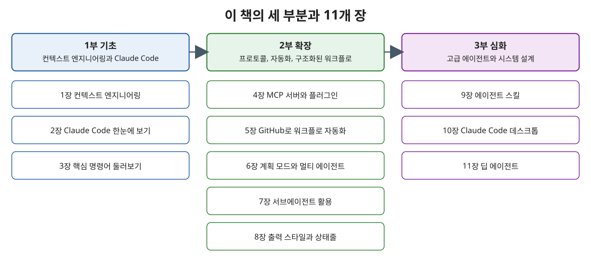

# 머리말과 이 책에 대하여

이 문서는 Eden Marco가 쓴 'Agentic Coding with Claude Code'(Packt, 부제 'The everyday developer's guide to agentic coding with Claude Code')의 저자 소개, 기술 감수자 소개, 머리말(Preface), 책의 구성, 준비물, 표기 규칙을 정리한 것이다. 본문에 들어가기 전에 이 책이 누구를 위한 책인지, 11개 장이 어떤 순서로 이어지는지, 따라 하려면 무엇이 필요한지를 먼저 훑어 둔다.

이 책은 에이전트형 코딩(Agentic Coding, 코딩 에이전트가 파일을 읽고 도구를 부르며 여러 단계 작업을 스스로 이어 가는 개발 방식)을 Claude Code로 익히는 안내서다. 중심 주제는 컨텍스트 엔지니어링(Context Engineering, 모델에 어떤 정보를 언제 보낼지 설계하는 일)이다. 책에서 만드는 HookHub 프로젝트가 2장부터 끝까지 이어지는 공통 실습 재료다.

---

## 1. 책의 목적과 대상 독자

머리말은 요즘 코딩 에이전트가 단순한 프롬프트 주고받기를 넘어섰다는 말로 시작한다. Claude Code, Cursor, LangChain 딥 에이전트 같은 도구는 코드베이스 전체를 다루고, 외부 도구와 연결되며, 오래 걸리는 여러 단계 작업을 실행한다. 도구가 강해질수록 어떻게 동작하고 어떻게 통제하는지 이해하는 일이 필수가 된다는 것이 저자의 출발점이다.

그래서 책은 두 가지를 함께 노린다. 하나는 Claude Code를 일상 업무에 쓰는 실용 기술이고, 다른 하나는 에이전트가 왜 그렇게 행동하는지에 대한 설계 수준의 이해다. 컨텍스트를 제대로 다루는 일은 성능, 비용, 신뢰성, 일관성에 직접 영향을 준다고 머리말은 말한다. 분야가 계속 바뀌므로 도구 사용법만 아니라 바뀐 뒤에도 적응할 이해를 주는 것이 목표다.

책에서 다루는 주제는 다음과 같다.

- Claude Code가 코드베이스와 상호작용하는 방식과 일상용 설정
- 모델 컨텍스트 프로토콜(MCP, 에이전트를 외부 도구와 연결하는 표준 규약)을 통한 확장
- GitHub Actions 자동화, 구조화된 계획, 멀티 에이전트 워크플로
- 서브에이전트, 출력 스타일, 에이전트 스킬
- 딥 에이전트의 동작 방식과 장기 작업이 구현되는 방법

대상 독자는 채팅형 AI를 넘어 에이전트형 자동화 개발 워크플로를 만들고 싶은 개발자와 엔지니어다. 터미널과 IDE에 컨텍스트를 아는 AI 에이전트를 붙이고, 복잡한 코딩 작업을 자동화하고, 확장 가능한 멀티 에이전트 시스템을 설계하려는 애플리케이션 개발자를 겨냥한다. 현대적인 개발 워크플로와 가까이 일하는 AI 엔지니어와 생성형 AI 실무자에게도 도움이 된다고 한다.

선수 지식은 분명하게 못 박혀 있다. 저자는 이것이 입문서가 아니라고 반복해서 말한다.

- Python이나 TypeScript로 코드를 쓰고 디버깅한 경험
- Git(저장소 복제, 커밋)과 개발 환경에 익숙할 것
- 가상 환경과 환경 변수를 이해할 것
- LLM, RAG, 에이전트, ReAct 같은 생성형 AI 핵심 개념을 알 것. LLM과 대화해 본 적이 있고 간단한 에이전트라도 만들어 본 경험이 필요하다.

## 2. 저자와 기술 감수자

저자 Eden Marco는 Google Cloud의 LLM 전문가이자 LangChain 앰배서더다. 소프트웨어 엔지니어링과 클라우드 아키텍처 경력이 여러 해이고, Orca Security의 초기 엔지니어 중 한 명이었다. 이스라엘 Technion에서 컴퓨터과학 학사 학위를 받았고 Reichman University에서 강의했다. 실제 경험에 바탕을 둔 실무형 강의를 만든다고 소개된다.

기술 감수자는 두 명이다.

| 감수자 | 소개 |
|---|---|
| Pablo Garner | 영국 Champions (UK) plc의 IT·AI 책임자. 인프라를 맡고 AI 기반 사내 플랫폼을 개발한다. IT와 컴퓨팅 경력 8년 이상, 응용 AI·자동화·클라우드 아키텍처가 전문이다. NVIDIA AI Engineer Level 6 과정을 수료하는 중이며 Anthropic의 AI 안전 연구 프로그램에 외부 레드팀 연구자로 기여했다 |
| Iago Cavalcante | 브라질 벨렝에 사는 소프트웨어 개발자. Elixir, React, React Native, Vue.js, TypeScript를 다루며 확장성과 코드 품질에 집중한다. 지역 기술 커뮤니티 DevsNorte를 공동 설립했고 오픈소스와 기술 글쓰기로 지식을 나눈다 |

감수자 소개에는 가족에 대한 감사 인사도 들어 있지만 학습 내용과는 관계가 없어 생략한다.

머리말 끝의 면책 문구도 짚어 둘 만하다. 이 책은 독립 출판물이어서 Anthropic과 제휴, 후원, 공식 관계가 없다. 저자는 Google 직원이지만 책은 개인 프로젝트이며 Google의 입장을 대변하지 않는다. 내용은 저자의 개인 경험, 독자적 조사, 공개 문서에 바탕을 둔다. AI 도구와 API는 빠르게 바뀌므로 출판 뒤에는 낡을 수 있고, 가장 최신의 공식 정보는 Anthropic 공식 문서를 보라고 권한다. 책 곳곳의 스크린샷과 예제는 저자의 강의 자료에서 가져왔다고도 밝힌다.

## 3. 책의 구성

책은 세 부분, 11개 장이다. 뒤 장이 앞 장에서 만든 설정과 프로젝트 위에 쌓이므로 순서대로 읽는 것이 가장 자연스럽다. 각 장이 다루는 내용은 머리말의 소개(What this book covers)에 따른다.

| 부 | 장 | 한 줄 요약 |
|---|---|---|
| 1부 기초 | 1장 컨텍스트 엔지니어링 | 컨텍스트가 어디서 오고 왜 커지는지, 프롬프트 엔지니어링에서 어떻게 발전했는지, 시스템 프롬프트를 어떻게 쓰는지 |
| 1부 기초 | 2장 Claude Code 한눈에 보기 | 프로젝트 초기화, CLAUDE.md, 권한, 컨텍스트 관리. MCP와 스펙 주도 설계를 맛보고 HookHub를 만들기 시작한다 |
| 1부 기초 | 3장 Claude Code 시작하기 핵심 명령어 둘러보기 | 가격과 인증, 슬래시 명령, 사용자·프로젝트 수준 설정, Cursor 연동, 훅, 체크포인트, 사용자 정의 명령, 언어 서버 프로토콜 |
| 2부 확장 | 4장 MCP 서버와 플러그인으로 Claude Code 확장하기 | MCP 구조(호스트, 클라이언트, 서버), 로컬·원격 MCP 서버 설정, 컨텍스트 관리와 성능, 플러그인 |
| 2부 확장 | 5장 Claude Code와 GitHub로 개발 워크플로 자동화 | 저장소 설정, 풀 리퀘스트와 이슈 자동화, GitHub Actions, YAML 워크플로 파일 |
| 2부 확장 | 6장 Claude Code 계획 모드와 멀티 에이전트 워크플로 | 계획과 조율된 멀티 에이전트 실행, 스펙 주도 개발이 예측 가능성을 높이는 이유 |
| 2부 확장 | 7장 Claude Code 서브에이전트 활용 | 서브에이전트 설정, 컨텍스트 흐름, 무한 에이전트 루프 패턴으로 동시 실행 |
| 2부 확장 | 8장 출력 스타일과 상태줄 사용자 지정 | 출력 스타일 작성과 적용 범위, YAML 같은 구조화 형식, 역할과 세션 설정 |
| 3부 심화 | 9장 에이전트 스킬 이해하기 | 스킬 개념, Claude Code와 LangChain 딥 에이전트에서의 사용, 스킬 호출 때의 내부 컨텍스트 흐름, 구현 예 |
| 3부 심화 | 10장 Claude Code 데스크톱 활용 | 로컬과 클라우드 모드 전환, 깃 워크트리로 병렬 에이전트 실행, 환경 간 기능 브랜치 조율 |
| 3부 심화 | 11장 딥 에이전트 이해하기 | 딥 에이전트의 특징, LangChain 딥 에이전트 하네스의 구조와 실행 모델 |

참고(노트 작성자): 이 책에는 12장 '혜택 받기'와 색인이 더 있지만, 구매자 혜택 안내이므로 이 노트는 다루지 않는다. 8장의 제목은 목차에 '출력 스타일과 상태줄'이 들어 있는데 머리말 소개는 출력 스타일만 언급한다. 이 노트는 목차의 제목을 따른다.

## 4. 읽는 순서

저자는 단계별로 따라 하고 설정을 실험해 보라고 권한다. 책이 점진적으로 쌓이는 구조라서, 여러 장이 앞서 만든 HookHub 프로젝트와 설정에 기대기 때문이다. 이 노트가 권하는 순서는 다음과 같다.

- 처음부터 모두 익히려는 독자: 1장부터 11장까지 순서대로 읽는다. 1장으로 개념 틀을 잡고 2장에서 HookHub를 직접 만들어 본다.
- Claude Code를 이미 쓰는 독자: 1장의 네 가지 컨텍스트 전략만 훑고 3장 이후로 간다. 2장의 memory 폴더 구성은 이후 장이 계속 기대므로 한 번은 확인한다.
- 확장 기능이 궁금한 독자: 4장(MCP), 5장(GitHub), 9장(스킬)을 먼저 본다.
- 구조 이해가 목적인 독자: 6장, 7장, 11장이 멀티 에이전트와 딥 에이전트의 설계를 다룬다.

## 5. 실습 준비물

머리말 'To get the most out of this book'에 따른 준비물은 다음과 같다. 모든 것은 책이 쓰인 시점 기준이다.

| 준비물 | 용도 |
|---|---|
| Node.js와 간단한 Next.js 환경 | 초반 장의 실습 프로젝트(HookHub)를 돌린다 |
| Claude Code 사용 권한 | 인증과 요금제 설정이 필요하다(3장에서 다룸) |
| 터미널, Git 환경 | 저장소 복제, 커밋, 명령 실행. 책의 터미널 명령은 macOS 기준이고 Windows는 WSL 같은 유닉스형 셸에서 실행하라고 안내한다 |
| GitHub CLI, 저장소, GitHub Actions | 5장 등 일부 장에서 필요하다 |
| MCP 서버 설정, Cursor, Claude 데스크톱 앱 | 뒤쪽 장에서 로컬·원격 MCP 서버를 설정하고 Cursor와 데스크톱 앱에서 Claude Code를 돌린다 |

예제 코드는 완전한 코드 묶음(code bundle)으로 내려받을 수 있다. Packt에서 직접 샀다면 packtpub.com에서 프로필의 'Your Orders'로 들어가 'Download Code'를 누르고, 다른 경로로 샀다면 packtpub.com/unlock에서 책을 검색해 구매 증빙을 올리면 된다. 컬러 스크린샷과 도표가 담긴 PDF도 따로 내려받을 수 있다. 코드는 개인 학습과 비상업적 프로젝트에서 자유롭게 쓰고 고칠 수 있다.

## 6. 책의 표기 규칙과 이 노트의 읽는 법

원서의 표기 규칙은 간단하다. 코드 단어, 폴더·파일 이름, 경로, 사용자 입력은 코드 글꼴로 쓴다. 새 용어와 화면에 보이는 메뉴 글자는 굵게 쓴다. 코드 블록은 별도 블록으로 나오며, 명령 입력과 출력도 구분한다. 경고와 중요 사항은 Note, 요령은 Tip 상자로 표시한다.

이 노트는 원서를 장별 폴더로 나누어 한국어로 새로 풀어 쓴 학습 노트다. 번역서가 아니므로 원문 문장을 그대로 옮기지 않고, 개념과 절차와 수치와 사례와 주의점을 같은 정보량으로 다시 구성한다.

- 각 장 폴더의 Readme.md에 핵심 요점과 문서 목록이 있다. 장에 들어가면 Readme.md를 먼저 읽고 필요한 문서로 이동한다.
- 영어 용어는 처음 나올 때 한국어 풀이를 붙이고, 제품 이름과 명령어와 경로는 영어 그대로 둔다.
- 서브에이전트, 에이전트 스킬, MCP 서버, 훅, 슬래시 명령, 출력 스타일, 상태줄, 계획 모드, 깃 워크트리, 딥 에이전트, 컨텍스트 윈도우 같은 용어는 노트 전체에서 같은 말로 통일한다.
- 원서의 스크린샷은 싣지 않고 글과 표와 그림으로 설명한다.
- 원문에 없는 보충은 '참고(노트 작성자):'로 표시하고, PDF 추출이 깨진 곳은 문맥으로 복원하되 불확실하면 그렇게 밝힌다.
- 가격, 모델 이름, 화면 문구처럼 쉽게 바뀌는 정보는 책이 쓰인 시점 기준이다. 실제로 쓸 때는 공식 문서를 다시 확인한다.

이 문서를 읽었으면 다음은 1장 '컨텍스트 엔지니어링'이다. 이 책의 모든 기능은 결국 같은 문제, 곧 모델에 어떤 정보를 보낼지를 다루므로 1장의 틀을 먼저 잡으면 이후 장이 쉬워진다.

 
 
 

[Agentic Coding with Claude Code](../)
