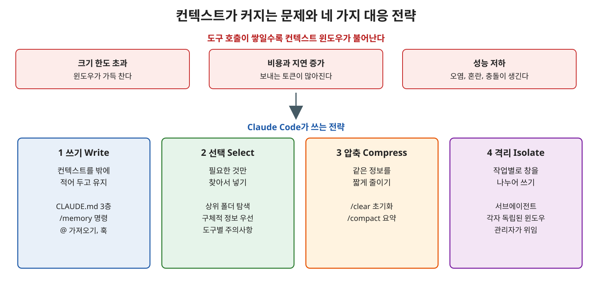

# Claude Code의 네 가지 컨텍스트 전략

이 문서는 1장에서 가장 분량이 큰 절을 다룬다. Claude Code는 컨텍스트가 커지는 문제에 네 가지 접근을 모두 구현했다고 원서는 말한다. 쓰기, 선택, 압축, 격리다. 원서는 이 분류를 LangChain이 논의한 컨텍스트 엔지니어링 범주에서 가져온 것으로 밝힌다.

비유하면 책상 정리법이다. 중요한 메모는 포스트잇으로 붙여 두고(쓰기), 지금 필요한 서류만 꺼내 놓고(선택), 다 쓴 서류는 요약본으로 줄이고(압축), 일이 다르면 책상을 따로 쓴다(격리).



---

## 1. 전략 1: 컨텍스트 쓰기와 영속 메모리

Claude는 다층 메모리 시스템을 가지며, Claude Code는 세션이 끝나도 컨텍스트가 남도록 3층 메모리 계층을 구현한다. 원서가 든 세 층은 다음과 같다.

| 층 | 위치 | 성격 |
|---|---|---|
| 프로젝트 메모리 | 프로젝트 안의 CLAUDE.md | 팀이 공유하는 아키텍처와 표준. 버전 관리되며 모든 팀원이 쓴다 |
| 사용자 메모리 | 사용자 홈 폴더의 .claude/CLAUDE.md | 모든 프로젝트에 걸친 개인 선호와 단축 방식. 깃허브에 올리지 않고 모든 세션에 유지된다 |
| 동적 메모리 가져오기 | CLAUDE.md 안의 @ 경로 | 다른 메모리 파일을 불러온다. 특정 정보만 담은 전용 파일을 참조할 수 있다 |

프로젝트 메모리 예시로 원서는 Node.js와 Express API, TypeScript를 쓰는 React 프런트엔드, Prisma를 쓰는 PostgreSQL, 캐시용 Redis 같은 아키텍처 개요와 '함수형 컴포넌트와 훅을 쓴다', '비즈니스 로직에는 단위 테스트를 쓴다' 같은 코딩 표준을 보인다. 사용자 메모리 예시는 'TypeScript에서는 반환 타입을 명시한다', '테스트는 Jest와 React Testing Library로 쓴다', '커밋 전에 린트를 돌린다', '상속보다 합성을 선호한다' 같은 개인 선호다.

동적 가져오기는 CLAUDE.md 안에 절대 경로, 상대 경로, 홈 폴더 기준 경로를 @로 적는 방식이다.

```markdown
# CLAUDE.md 안에서
@path/to/memory/file.md
@./relative/path/context.md
```

### 깃 브랜치에 맞춰 컨텍스트를 바꾸는 스크립트

저자는 한 걸음 더 나아가 깃 브랜치에 따라 컨텍스트를 동적으로 바꾸는 스크립트를 보인다. 이 스크립트를 컨텍스트 전환 훅(hook, 특정 시점에 자동 실행되는 사용자 명령)에 연결하면 적응형 워크플로가 된다. 핵심 주의점은 같은 참조를 CLAUDE.md에 반복해서 덧붙이지 않는 것이다. 스크립트가 매번 단순히 `>>`로 추가하면 파일이 중복 항목으로 끝없이 커진다. 그래서 추가하기 전에 이미 있는지 검사한다.

```bash
CLAUDE_MD="CLAUDE.md"
touch "$CLAUDE_MD"
add_context() {
  local context_ref="$1"
  grep -qxF "$context_ref" "$CLAUDE_MD" || echo "$context_ref" >> "$CLAUDE_MD"
}
branch=$(git branch --show-current 2>/dev/null)
case $branch in
  "feature/auth-"*)    add_context "@./context/auth-system.md" ;;
  "feature/payment-"*) add_context "@./context/payment-flow.md" ;;
  "hotfix/"*)          add_context "@./context/production-hotfix.md" ;;
esac
```

원서의 전체 스크립트에는 사용자 입력에 'database', 'migration', 'API', 'endpoint', 'frontend', 'component' 같은 낱말이 있는지 보고 관련 컨텍스트 파일을 붙이는 분기도 들어 있다. 핵심은 `add_context` 도우미 함수가 `grep -qxF`로 이미 있는 줄인지 확인한다는 점이다. 이 덕분에 스크립트가 멱등(idempotent, 여러 번 실행해도 결과가 같음)이 되어 프롬프트를 낼 때마다 안전하게 실행할 수 있다.

원서는 이 스크립트를 UserPromptSubmit 훅에 연결하는 설정 예도 보여 준다. 프롬프트를 제출할 때마다 스크립트를 실행하는 구조다. 참고(노트 작성자): 원서의 훅 설정 JSON은 쉼표가 빠져 있는 등 개념을 보이는 예시이며, 실제 훅 설정 형식은 3장 이후와 공식 문서로 확인해야 한다. 이렇게 하면 컨텍스트 전환이 동적이면서도 시간이 지나도 안정적이다.

## 2. 전략 2: 지능적 컨텍스트 검색

두 번째 전략은 동적 컨텍스트 탐색으로 구현되는 지능적 컨텍스트 검색이다. Claude는 폴더를 자동으로 훑어 도움이 될 컨텍스트 파일을 찾는다. 하위 폴더에 있으면 상위 폴더의 컨텍스트도 끌어오되, 더 구체적인 정보가 있으면 그것을 우선한다. 최근에 쓰거나 자주 접근한 정보도 우선시한다. 이것은 애플리케이션 수준의 컨텍스트 엔지니어링으로 Claude Code 개발자가 구현한 로직이다.

사용자도 /memory 명령으로 영속 컨텍스트를 직접 추가할 수 있다.

```text
/memory add Always use descriptive variable names
```

Claude가 이 메모리를 프로젝트 수준에 둘지 사용자 수준에 둘지 묻고, 알맞은 CLAUDE.md를 자동으로 고친다. 사용자는 컨텍스트 파일을 손으로 편집하지 않고도 이후 행동에 영향을 줄 수 있다.

또 하나의 특징은 사용 중인 도구에 따라 서로 다른 컨텍스트가 모델에 전달된다는 점이다. 예를 들어 파일을 편집하려 할 때는 기존 코드 스타일을 먼저 확인하고, 새 함수를 만들기 전에 이미 있는 함수를 찾는다는 사항을 기억한다. 터미널 명령을 실행하려 할 때는 실행 전에 기존 npm 스크립트가 있는지, 파일 경로가 존재하는지 확인한다는 사항을 기억한다. 도구마다 알맞은 주의사항이 따라붙는 것이다.

## 3. 전략 3: 컨텍스트 압축

세 번째 전략은 효율적인 컨텍스트 표현, 곧 압축이다. Claude Code에는 압축용 내장 명령이 있다.

- /clear는 현재 컨텍스트 윈도우의 대화 기록을 초기화하되 프로젝트 메모리와 사용자 메모리는 유지한다. 대화가 엉뚱한 방향으로 흘렀거나, 시스템이 이미 배운 프로젝트 정보를 잃지 않고 새로 시작하고 싶을 때 쓴다.
- /compact는 기존 대화를 더 짧게 요약한다. 모두 버리지 않고 핵심 결정과 중요한 정보는 남기고 사소한 세부는 덜어 낸다. 요약된 기록은 컨텍스트 윈도우를 덜 차지하므로 비용과 지연이 줄고 새 입력을 위한 여유가 생긴다.

예를 들어 한 시간 동안 로그인 기능을 구현한 뒤 전혀 다른 결제 기능으로 넘어갈 때는 /clear가 알맞고, 같은 기능을 이어 가되 대화가 너무 길어졌다면 /compact가 알맞다. 이 사용 예는 노트 작성자가 든 것이다.

## 4. 전략 4: 서브에이전트로 컨텍스트 격리

네 번째 전략은 컨텍스트 격리이며 Claude Code는 서브에이전트(Subagent, 독립된 컨텍스트 윈도우에서 일하는 전문 보조 에이전트)를 쓴다. 각 서브에이전트는 자기만의 격리된 컨텍스트 윈도우에서 돌고, 메인 에이전트의 전체 대화 기록을 물려받지 않는다. 작업별로 전문화된 Claude Code를 따로 두고, 각자 좁고 집중된 지식을 갖게 하는 전략이다.

구성은 이렇다. 메인 에이전트가 관리자 역할로 작업을 위임한다. 코드 품질과 보안에 집중하는 코드 리뷰 에이전트, 테스트 작성과 실행에 집중하는 테스트 에이전트, 정보와 모범 사례를 찾는 리서치 에이전트를 둘 수 있다. 원서의 예시는 Task 호출 형식으로, 코드 리뷰 에이전트에는 '보안과 성능만 보며 이 PR을 검토하라'는 좁은 지시를, 리서치 에이전트에는 'OAuth2 구현의 모범 사례를 찾으라'는 넓은 지시를 준다.

격리가 없으면 Claude Code가 가능한 모든 정보를 한꺼번에 들고 모든 일을 하려다 혼란에 빠진다. 격리하면 전문가마다 정해진 지식 범위만 가지고 일을 효과적으로 해낸다.

원서는 이 호출 형식이 설명용으로 단순화한 것이라고 명시한다. 현재 Claude Code가 이 형식 그대로 쓰는 것은 아니며, 실제 서브에이전트 정의에는 프런트매터(frontmatter, 문서 맨 앞의 설정 영역)가 있는 YAML 설정이 필요하다. 원서 2장 본문은 서브에이전트를 3장에서 다룬다고 말하지만 이 노트의 장 구성상 서브에이전트는 7장에서 본격적으로 다룬다. 참고(노트 작성자): 원서의 장 번호 안내가 서로 어긋나 보이므로 목차 기준으로 따른다.

<br>
<br>
<br>

[Agentic Coding with Claude Code](../)
