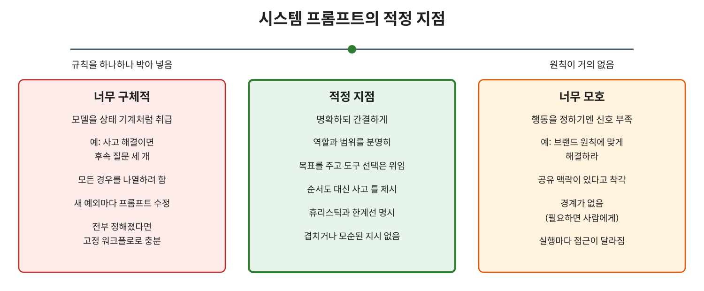

# 시스템 프롬프트와 적정 지점

이 문서는 1장의 마지막 절을 다룬다. 시스템 프롬프트(System Prompt, 에이전트의 역할과 규칙을 미리 정해 모델에 늘 함께 보내는 지시문)는 컨텍스트 엔지니어링에서 여전히 중요하다. 저자는 'X와 LinkedIn에서 천 번쯤 읽었을 만큼 흔한 조언'이 '좋은 시스템 프롬프트를 쓰라'는 말이라고 농담한다. 가장 일반적인 조언이지만, 그래서 오히려 어떻게 쓰는지가 문제다.

비유는 길 안내다. '저쪽으로 가세요'라고만 하면 상대는 어디로 갈지 모른다. 반대로 모든 길과 모퉁이를 적은 50쪽짜리 안내서를 주면 압도당해서 역시 목적지에 못 간다. 분명하고 구체적이되 목적지에 닿을 만큼만 주는 것이 좋다. 어려운 점은 그 적정선을 찾는 일이다.

---

## 1. 시스템 프롬프트는 왜 중요한가

공개 저장소 여러 곳에 유명 AI 에이전트가 쓰는 시스템 프롬프트 예시가 모여 있다. Claude Code, Cursor, Devin 같은 코딩 에이전트의 것이 많다. 원서는 이 저장소를 언급하는 목적이 각 프롬프트의 진위를 확인하려는 것이 아니라고 한다. 실제 시스템 프롬프트가 얼마나 크고 구조적이며 공들여 설계되는지를 보이려는 것이다.

이 절의 목표는 프롬프트를 하나하나 분석하는 것이 아니다. 그것만으로 책 한 권이나 강좌 하나가 된다. 저자가 전하려는 말은 시스템 프롬프트가 중요하다는 것, 그리고 계속 진화한다는 것이다. LLM이 발전하면 시스템 프롬프트도 함께 발전한다. 많은 엔지니어링 노력이 프롬프트를 다듬는 데 들어가며 이것은 반복 과정이다.

## 2. 골디락스 지대

시스템 프롬프트를 쓸 때 찾는 목표를 원서는 Anthropic이 말하는 골디락스 지대(Goldilocks zone, 너무 뜨겁지도 차갑지도 않은 딱 알맞은 상태)라고 부른다. 너무 모호하지도 너무 세세하지도 않은, 딱 알맞은 상태다. 한 줄의 눈금으로 상상하면 된다. 맨 왼쪽은 지나치게 구체적인 프롬프트, 맨 오른쪽은 지나치게 모호한 프롬프트이고, 원하는 것은 가운데다. 원서의 그림 1.5는 Anthropic의 글 'Effective Context Engineering for AI Agents'에서 가져온 것이라고 출처를 밝힌다.

## 3. 지나치게 구체적인 프롬프트의 문제

왼쪽 끝의 문제는 LLM을 지능적인 에이전트가 아니라 결정론적 상태 기계(정해진 입력에 정해진 출력을 내는 장치)로 취급한다는 점이다. 로직을 하드코딩하게 된다. 예를 들어 '사용자의 의도가 사고 해결이면 후속 질문을 세 개 하라'고 쓴다고 하자. 왜 하필 세 개인가? 두 개로 충분하면? 다섯 개가 필요하면?

또 하나는 모든 경우를 나열하려는 시도다. 예를 들어 에스컬레이션(상위 담당자에게 넘기기) 시나리오를 전부 적으려는 식이다. 이는 끝낼 수 없는 일이고, 모델을 실제 입력과 맞지 않을 수 있는 정해진 길로 몰아넣는다. 새 예외가 생길 때마다 프롬프트를 고쳐야 하니 유지보수도 악몽이 된다. 모든 것이 미리 정해져 있다면 자율 에이전트가 필요 없고 고정된 워크플로로 충분할지도 모른다는 것이 저자의 지적이다.

## 4. 지나치게 모호한 프롬프트의 문제

반대쪽 끝은 일관된 행동을 만들 신호가 부족하다. 원서의 예는 다음과 같다. 베이커리 도우미라는 역할을 주고, 회사 브랜드의 원칙과 본질에 맞게 고객 문제를 해결하고, 필요하면 사람에게 넘기라고만 쓴다. 이런 프롬프트가 문제인 이유는 이렇다.

- 실행할 수 있는 지침이 없다. '그 원칙'이 무엇인지 말하지 않는다.
- 공유된 컨텍스트가 있다는 잘못된 가정을 한다. 모델은 그 회사도 브랜드도 고객 응대 규범도 모른다.
- 경계가 정해져 있지 않다. '필요하면 사람에게 넘겨라'에서 언제가 필요한 때인지 모델이 알 수 없다.
- 문제를 체계적으로 풀 틀이 없다. 같은 문제에 실행마다 전혀 다른 접근을 하게 된다.

결국 '옳은 일을 하라'고 말하면서 '옳다'가 무엇인지 정의하지 않는 셈이다.

## 5. 알맞은 중간 지대의 프롬프트

원서는 Claude's Bakery 고객 지원 에이전트 예시를 보여 준다. 내용을 요약하면 이렇다. 먼저 역할과 범위를 준다(주문과 기본 질문을 돕는 고객 지원 담당). 주문 관리 시스템, 상품 카탈로그, 매장 정책에 접근할 수 있고 가능하면 빨리 해결하는 것이 목표라고 알린다. 해결안을 내놓기 전에 상황 전체를 이해하고, 모르면 후속 질문을 하라고 한다.

이어서 네 단계 응답 틀(Response Framework)을 준다.

1. 핵심 문제를 파악한다. 표면 불만 너머에서 고객이 실제로 원하는 것을 본다.
2. 필요한 컨텍스트를 모은다. 응답 전에 도구로 주문 정보, 재고, 정책을 확인한다.
3. 명확한 해결책을 준다. 현실적인 일정과 함께 구체적인 다음 단계를 제시한다.
4. 만족을 확인한다. 고객이 해결 내용을 이해하고 이후 문의 방법을 아는지 확인한다.

마지막으로 지침(Guidelines)이 붙는다. 해결책이 여러 개면 문제를 완전히 해결하는 가장 단순한 것을 고른다, 사용자가 주문을 언급하면 다음 단계를 제안하기 전에 주문 상태를 확인한다, 법적 문제나 건강과 알레르기 응급 상황이나 표준 정책을 넘는 금전 조정에는 사람 도움 도구를 호출한다, 사용자 어조의 불만이나 급함을 알아차리고 공감하며 응답한다.

저자가 이 예시에서 읽어 내는 장점은 네 가지다.

- 분명한 정체성과 범위로 경계를 세운다. 고객 지원이지 마케팅이나 영업이 아니고, 주문과 기본 질문이지 복잡한 사업 운영이 아니다.
- 제약하는 대신 권한을 준다. 상황마다 어떤 도구를 쓸지 정해 주지 않고 효율적이고 전문적인 해결이라는 목표를 정의한다. 필요할 때 에이전트가 알맞은 도구를 고를 것이라고 믿는 휴리스틱(heuristic, 경험에 바탕을 둔 대략의 판단 원칙)이다.
- 순서도 대신 사고 틀을 준다. 네 단계 틀은 경직된 분기 로직이 아니라 여러 시나리오에 통하는 틀이다.
- 분명한 경계와 원칙을 세운다. 해결책이 여러 개면 가장 단순한 것을 고르라는 원칙은 규칙이 아니라 휴리스틱이며, 컴퓨터과학의 탐욕 알고리즘과 비슷하다.

정리하면 지나치게 구체적인 프롬프트는 LLM 대신 생각해 주려다가 상황이 대본과 맞지 않으면 무너진다. 모호한 프롬프트는 LLM에게 줄 재료가 모자란다. 중간 프롬프트는 최신 LLM이 잘하는 일, 곧 패턴을 알아보고 일반 원칙을 구체적 상황에 적용하는 일을 활용한다. 규칙이 아니라 원칙을 가르치므로 새로운 상황을 잘 다루고, 말을 낭비하지 않아 효율적이다. 지침 하나가 여러 시나리오를 덮고, 원칙이 압축되어 있으며, 겹치거나 모순되는 지시가 없다.

 
 
 

[Agentic Coding with Claude Code](../)
