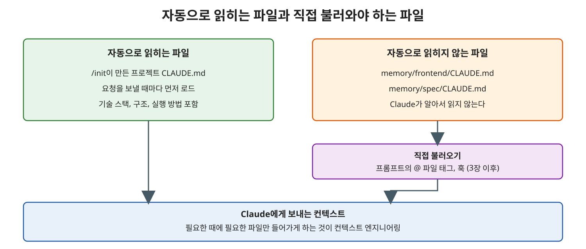

# Playwright MCP와 memory 폴더

이 문서는 2장의 가운데 부분이다. 먼저 Playwright MCP를 연결해 Claude Code가 브라우저를 열게 만들고, 이어 Cursor 규칙을 가져와 프런트엔드 전문가 역할을 담은 memory 폴더를 만든다. 두 번째 실습에서는 일부러 '기대와 다른 결과'가 나오는데, 이것이 컨텍스트 엔지니어링의 첫 교훈이 된다.

비유하면 앞의 CLAUDE.md는 직원 책상에 늘 놓여 있는 업무 안내서이고, memory 폴더는 서랍 속 참고 자료다. 서랍 속 자료는 꺼내 달라고 말해야 읽는다.

---

## 1. Playwright MCP 연결

Playwright는 브라우저 자동화 도구다. MCP(Model Context Protocol, 에이전트를 외부 도구와 연결하는 표준 규약)로 Claude Code에 연결할 수 있다. MCP는 4장에서 깊이 다루므로 지금은 Claude Code에 달아 주는 외부 능력이라고 생각하면 된다.

저자는 구글에서 Playwright MCP를 검색해 그 저장소의 연결 안내 명령을 찾아 터미널에 붙여 넣는다. 이때 쓰는 것은 Claude Code 명령줄 도구(CLI)다.

```bash
claude mcp add playwright npx @playwright/mcp@latest -s user
```

명령의 뜻은 이렇다. MCP 이름을 playwright로 정했고, `npx @playwright/mcp@latest`가 Claude Code가 저장소를 받아 실행할 코드다. 이 코드가 Claude Code에 브라우저 자동화 능력을 준다. 끝의 `-s user` 플래그는 사용자 범위(scope)로 등록하라는 뜻이어서, 앞으로 열 모든 Claude Code 인스턴스에서 이 MCP가 동작한다. 이는 Claude Code의 계층 체계를 활용하는 것이며 뒤에서 자세히 다룬다고 한다.

## 2. 연결 확인과 브라우저 열기

Claude를 다시 열어 /mcp를 입력하고 Enter를 누르면 연결된 모든 MCP 서버가 보인다. 화면에는 playwright가 보이고, 앞서 설정해 둔 context7이라는 다른 MCP도 보인다. context7은 4장 이후에 다시 나온다고 한다.

연결을 시험하려면 Claude Code에 'open browser'라는 말과 함께 cnn.com을 입력한다. 여기서 권한 시스템이 다시 나온다. Claude Code가 Playwright 도구로 해당 주소에 이동해도 되는지 도구 사용 요청을 한다. 이것은 내장 도구가 아니라 연결된 외부 도구다. 내장 도구는 파일 편집, 파일 생성, 파일 삭제 같은 것이다. 저자는 Yes를 고르고 이 도구에 대해서는 다시 묻지 않게 한다. 그러면 브라우저가 열려 cnn.com이 나타난다. UI를 테스트하거나 UI 자동화를 할 때 유용한 기능이다.

## 3. Cursor 규칙으로 프런트엔드 컨텍스트 만들기

다음은 cursor.directory 사이트다. Cursor 규칙(Cursor rules)을 모아 둔 곳으로, 마크다운 파일로 AI 코딩 도우미에게 추가 컨텍스트를 준다. 예를 들어 특정 분야의 시니어 개발자처럼 행동하라는 페르소나(persona, 맡을 역할)가 있다. 이 규칙은 Claude Code에서도 쓸 수 있다. 저자는 Next.js용 규칙을 하나 골라 복사한다.

Cursor로 돌아가 Claude가 이미 만든 CLAUDE.md 외에, 더 넓은 메모리 체계에서 추가 컨텍스트를 준다. 절차는 이렇다.

1. 프로젝트에 memory 폴더를 만든다.
2. 그 안에 frontend 하위 폴더를 만든다.
3. frontend 안에 CLAUDE.md 파일을 만들고 복사한 Cursor 규칙을 붙여 넣는다.

복사한 규칙에는 '당신은 React, Next.js, JavaScript, TypeScript, HTML, CSS 전문가인 시니어 프런트엔드 개발자다' 같은 내용이 들어 있다. 첫 CLAUDE.md는 'Next.js 기술 스택을 쓴다'고 알려 주었고, 이 새 파일은 '그 스택을 아주 잘 아는 사람'이라는 페르소나를 준다.

## 4. 기대와 다른 결과: 자동으로 읽히지 않는 파일

이제 Claude에게 '너는 무엇의 전문가인가?'(What are you expert in?)를 묻는다. 프런트엔드와 Next.js와 TypeScript 전문가라고 답할 것 같지만, 실제 응답은 일반적인 문구다. 소프트웨어 엔지니어링과 코딩 작업에 특화된 전문 AI 도우미라는 식으로, Next.js나 프런트엔드에 대한 내용이 없다. 파일이 작동하지 않는 것처럼 보인다.

하지만 이것은 의도된 동작이다. Claude는 일부 CLAUDE.md 파일만 기본으로 자동 로드한다. 방금 만든 memory 폴더 안의 파일은 자동으로 읽히지 않는다. 자동으로 읽히는 파일이 있는가 하면, 명시적으로 불러 줘야 하는 메모리 파일이 따로 있다. 언제 어떻게 불러올지 정하는 방법은 3장에서 설정한다.



이 구조가 컨텍스트 엔지니어링의 문을 연다. 프런트엔드 컨텍스트는 필요할 때만 불러오도록 설정할 수 있기 때문이다. 예를 들어 UI를 설계하고 만들 때, TypeScript 파일만 다룰 때, 특정 디렉터리에서 일할 때, 요청이 프런트엔드와 분명히 관련될 때 불러오게 할 수 있다. 저자는 훅을 쓸 수 있다는 힌트를 준다. 다른 파일의 컨텍스트를 참조하는 방법과 메모리를 다루는 여러 방법은 뒤에서 깊이 다룬다.

<br>
<br>
<br>

[Agentic Coding with Claude Code](../)
