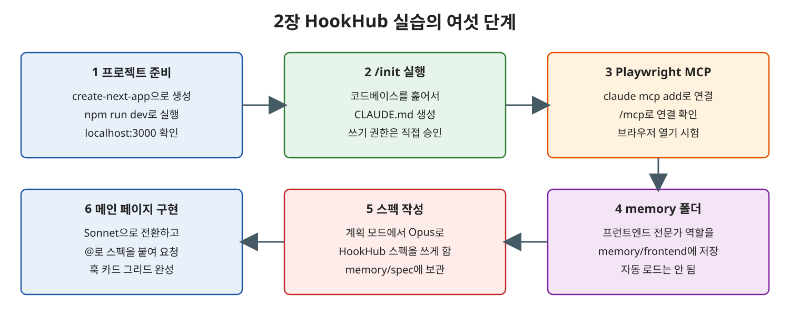

# 프로젝트 준비와 CLAUDE.md 만들기

2장은 Claude Code가 실제로 어떻게 일하는지를 따라 하며 익히는 장이다. 고급 기능으로 바로 뛰어들지 않고 시스템 자체, 쓰는 용어, 코드베이스와 상호작용하는 방식부터 이해한다. 이 문서는 그 첫 부분으로, 작은 Next.js 프로젝트를 만들어 Claude Code와 연결하고 /init으로 CLAUDE.md를 만드는 과정을 다룬다.

비유하면 새 직원이 첫 출근해 사무실을 둘러보는 단계다. 먼저 일할 자리(프로젝트)를 만들고, 직원이 자리를 훑어보고 메모(CLAUDE.md)를 남기게 하고, 무언가 바꾸려 할 때마다 우리 허락을 받게 한다.



---

## 1. 장의 목표와 HookHub 프로젝트

장 서두에 따르면 목표는 세 가지다. CLAUDE.md 파일, 권한 시스템, 컨텍스트를 의도적으로 다뤄야 하는 이유를 이해한다. MCP로 외부 도구를 연결하는 모습을 본다. 코드를 쓰기 전에 스펙을 두어 Claude의 행동을 이끄는 스펙 주도 설계를 맛본다.

이 과정에서 HookHub라는 프로젝트를 만들기 시작한다. HookHub는 오픈소스 Claude 훅을 모아 보여 주고 둘러보게 하는 사이트다. 이 장에서 만든 프로젝트는 책 전체를 통틀어 공통 기준점이 되어, 뒤의 고급 에이전트 워크플로 실습이 모두 이 위에서 이뤄진다.

## 2. Next.js 프로젝트 만들기

저자는 Next.js 프로젝트를 직접 손으로 만든다. 로컬 권한 문제와 미리 처리해야 할 설정이 있어서다. 원하면 Claude에게 올바른 Bash 명령을 줘서 시키는 것도 가능하다고 한다. 책의 예제 저장소에는 `project/hookhub` 브랜치가 있고, 실습은 이 브랜치 기준이다.

먼저 Claude Code를 설치해 둔다. 책이 쓰일 때 Claude Code는 운영체제를 감지해 알맞은 버전을 설치하는 네이티브 설치 프로그램을 제공했다. 설치와 업데이트를 알아서 처리하며, 끝나면 버전 명령으로 확인한다. 이 장의 터미널 명령은 모두 macOS에서 시연한 것이다. Windows라면 WSL(Windows Subsystem for Linux, 윈도우에서 리눅스를 돌리는 기능) 같은 유닉스형 셸 안에서 실행해야 npx, npm, claude 같은 명령이 책과 같이 동작한다.

```bash
claude --version
npx create-next-app@latest
cd hookhub
npm run dev
```

실습 중 겪을 수 있는 일은 이렇다.

- 첫 실행에서 'Need to install the following packages'(예: create-next-app 15.4.6)라며 진행해도 되는지 묻는다. 책이 쓰인 시점 기준 버전이다.
- 현재 사용자에게 전역 패키지 설치 권한이 없어 오류가 날 수 있다. 해결은 sudo로 다시 실행하거나, 관리자 권한 없이 설치되도록 npm 권한을 조정하는 두 가지다. 저자는 단순함을 위해 sudo로 다시 실행했다. 참고(노트 작성자): 보안상 가능하면 npm 권한 설정을 바로잡는 쪽이 낫다. 이것은 노트 작성자의 의견이다.
- 구성 옵션이 나오면 기본값을 고르고, 의존성 설치와 보일러플레이트(boilerplate, 기본 뼈대) 코드 생성이 끝나기를 기다린다.
- 개발 서버는 프로젝트 폴더 안에서 실행해야 한다. 엉뚱한 폴더에서 실행하면 실패한다.

개발 서버가 뜨면 브라우저에서 localhost:3000을 연다. 기본 Next.js 화면이 보이면 성공이다. 이제 프로젝트가 로컬에서 돌고 Claude Code와 연결할 준비가 되었다.

## 3. /init으로 CLAUDE.md 만들기

저자는 Cursor 연동으로 Claude Code를 연다. Claude Code를 화면 가운데에, 코드 편집기를 오른쪽에 두는 배치를 선호한다. Claude Code가 주된 운전자가 되게 하려는 것이다.

프로젝트에서 Claude Code를 쓸 때 맨 처음 할 일은 /init 명령을 실행하는 것이다. 새 프로젝트든 파일이 많은 기존 프로젝트든 마찬가지다. 실행하면 Claude가 파일을 스캔하고 내용을 확인하며 코드베이스에 대한 성찰을 만든다. 기술 스택, 주요 내용, 디렉터리 구조를 알아내 CLAUDE.md에 담는다. 이 마크다운 파일들은 나중에 프로젝트 곳곳에 퍼져 컨텍스트 엔지니어링을 뒷받침한다. 목적은 매 요청마다 질 좋은 컨텍스트를 LLM에게 보내 더 정확하고 쓸모 있는 코드를 만들게 하는 것이다.

작업 중 Claude의 상태 표시에 'Booping'이라는 글자가 나온다. 저장소를 분석하고, 디렉터리 구조를 살피고, 파일 내용을 읽는 중이라는 뜻이다. 이어 코드베이스 구조를 분석하는 작업이 만들어지고 파일을 나열하고 읽는 명령이 배치로 실행된다. 프로젝트가 크면 더 오래 걸린다. 끝나면 모은 정보로 CLAUDE.md를 만들 준비를 한다.

## 4. 권한 시스템

파일을 저장하기 전에 Claude는 권한을 묻는다. 화면에는 'Do you want to make this edit to CLAUDE.md?'라는 질문과 세 선택지가 나온다.

| 선택 | 의미 |
|---|---|
| 1. Yes | 이번 편집만 허용 |
| 2. Yes, and don't ask again this session (shift+tab) | 쓰기를 허용하고 이번 세션에서는 다시 묻지 않음 |
| 3. No, and tell Claude what to do differently (esc) | 거부하고 다르게 하라고 지시 |

이 권한 시스템은 새 파일이나 편집마다 적용된다. 저자는 이것이 안전한 에이전트형 코딩의 중요한 부분이라고 강조한다. 무제한 접근을 허락하면 의도하지 않은 파일 변경과 버그로 빠르게 이어질 수 있으므로 통제를 유지해야 안전하다. 이 실습에서는 2번을 골라 이번 세션 동안 묻지 않게 한다. 화면 문구는 책이 쓰인 시점 기준이다.

## 5. 만들어진 CLAUDE.md와 이후의 동작

CLAUDE.md에는 프로젝트 아키텍처와 구조 같은 기본 정보가 담긴다.

- 프로젝트의 목표와 해결하려는 비즈니스 문제
- 프로젝트를 실행하는 방법
- Next.js를 포함해 쓰는 프레임워크
- 폴더와 디렉터리 구조

이후 프롬프트를 보낼 때마다 Claude Code는 관련 CLAUDE.md 파일을 먼저 읽는다. 이 파일들은 프로젝트가 바뀜에 따라 동적으로 변한다. 큰 변경이 있으면 /init을 다시 돌릴 수 있고, 필요하면 CLAUDE.md를 더 추가할 수 있다. 메타데이터와 구조 정보를 더 줄수록 Claude는 더 일관되게 행동하고 더 좋은 결과를 낸다.

덧붙여 원서는 설치 문제가 생기면 설치 프로그램을 다시 실행하면 대개 해결된다고 말한다. 또 세션을 종료하고 다시 시작하면 security review라는 새 명령이 생긴다고 소개한다. 이 명령은 보안 검토와 침투 테스트를 돕는 서브에이전트를 도입하며, 코드베이스를 분석해 안전하지 않은 패턴, 잘못된 설정, OWASP Top 10에 해당하는 취약점 같은 흔한 문제를 짚어 준다. 서브에이전트는 원서에서 '3장에서 깊이 다룬다'고 하지만, 이 노트의 장 구성에서는 7장이다.

<br>
<br>
<br>

[Agentic Coding with Claude Code](../)
