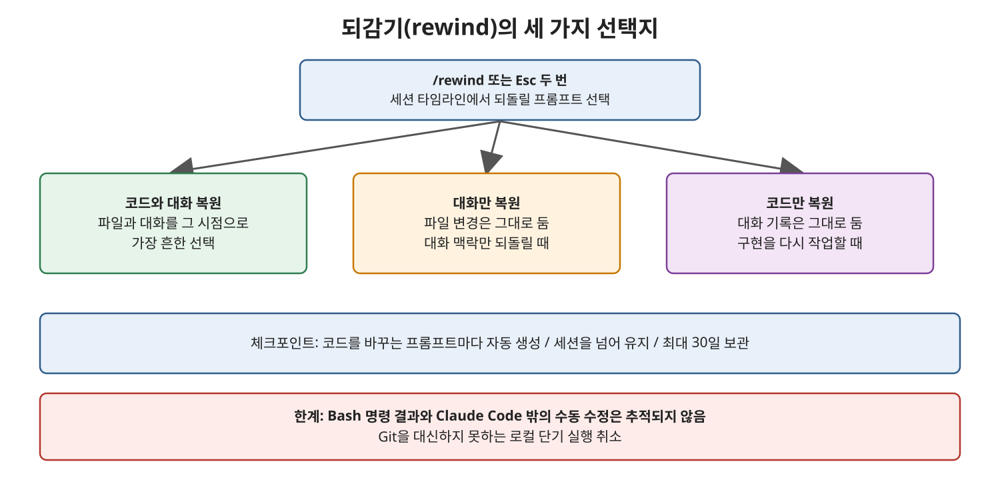

# 되감기와 사용자 지정 슬래시 명령

문서 편집기의 실행 취소(Ctrl+Z)를 떠올려 보자. 실험하다 망쳐도 한 번에 돌아갈 수 있으니 과감하게 시도할 수 있다. Claude Code의 되감기(rewind)도 같은 안전망이다. 이 문서는 되감기의 쓰임과 한계를 먼저 보고, 이어서 자주 하는 작업을 한 줄 명령으로 묶는 사용자 지정 슬래시 명령, 곧 스킬로 커밋 메시지 자동 작성을 만들어 본다.

책이 쓰인 시점의 Claude Code는 2.1 버전이고 모델은 Sonnet 4.5였다. 화면 구성과 기능 이름은 이후 달라질 수 있다.

---

## 1. 되감기(rewind)

### 1.1 무엇이고 왜 중요한가

Claude Code는 프롬프트마다 일어난 파일 수정을 자동으로 추적한다. 그래서 세션 중 원치 않는 변경을 안전하게 되돌릴 수 있다. 되감기를 실행하려면 Esc를 두 번 누르거나 `/rewind` 명령을 쓴다. 이 기능의 가치는 분명하다.

- 크고 야심 찬 변경을 시도할 때 안전망이 된다.
- 작동하는 코드를 잃지 않고 다른 구현을 탐색할 수 있다.
- 실수에서 빠르고 예측 가능하게 복구한다.
- 되돌리기가 쉬워서 AI가 만든 오류를 고치는 비용이 줄어든다.
- AI 보조 코딩에 대한 사용자의 확신이 커진다.
- 위험하다는 인식이 낮아져 도입이 늘어난다.

이 기능은 AI 복구 비용(CAIR, Cost of AI Recovery) 지표와 닿아 있다. 사용자가 AI의 오류에서 얼마나 쉽게 회복하는지를 재는 지표로, 책 뒤에서 다시 나온다. 되감기는 Claude Code 출시 몇 달 뒤에 들어왔다. 커뮤니티의 요청이 많았고, 비슷한 기능을 만든 오픈 소스 도구가 여럿 있었으나 지금은 기본 기능이다.

### 1.2 실습: 랜딩 페이지를 만들고 되돌리기

간단한 Next.js 예제로 해 본다.

1. Claude Code에 "Next.js 프로젝트를 어떻게 시작하는가"를 묻는다. 프롬프트가 로컬에서 실행되고, 끝나면 `npm run dev`로 앱을 띄워 브라우저에서 기본 Next.js 화면을 확인한다.
2. 일부러 변경을 차례로 쌓는다. UI의 품질을 평가하려는 것이 아니라 나중에 되돌려야 할지 모르는 실제 개발 흐름을 흉내 내려는 것이다. 먼저 HooksHub라는 개성 있는 스타일의 랜딩 페이지를 만들게 하고, 이어 FAQ 섹션을, 마지막으로 푸터를 추가하게 한다.
3. 각 프롬프트는 파일 수정으로 이어지고 diff 화면에 보이며 실행 중인 앱에도 바로 반영된다.
4. 푸터를 붙이고 나니 기능은 되지만 화면이 무겁고 시각적으로 너무 튄다. 직접 고치거나 보정 프롬프트를 쓰기보다 되돌리는 편이 나은 순간이다.
5. `/rewind`를 실행한다. 지금까지 낸 프롬프트의 타임라인이 열리고, 어떤 프롬프트가 파일을 바꿨는지 표시된다. 설명만 만든 프롬프트는 파일 변경 없이 나타나고, 파일을 바꾼 프롬프트는 영향받은 파일과 줄이 보인다.
6. 푸터를 추가한 마지막 프롬프트를 고르면 세 가지 선택지가 나온다.



실무에서는 코드와 대화를 모두 되돌리는 선택이 가장 흔하다. 프로젝트가 깨끗하고 일관된 상태로 돌아가기 때문이다. 코드만 되돌리는 선택은 구현을 다시 작업하면서 대화 맥락은 보존하고 싶을 때 쓴다.

실습에서는 푸터의 코드 변경만 되돌린다. 푸터가 앱에서 즉시 사라진다. 파일을 고치기 전에 Claude Code가 자동으로 체크포인트를 만들어 두기 때문에 가능하다. 코드 변경이 있는 프롬프트마다 체크포인트가 새로 생기며, 체크포인트는 세션을 넘어 유지되고 최대 30일 보관된다.

대화는 그대로 남아 있으므로 `create a footer, make it minimalistic`처럼 이어서 요청해도 Claude가 문맥을 이해한다. 훨씬 가벼운 푸터가 만들어지고, 새로고침하면 의도한 디자인에 가까워진 것을 확인한다.

### 1.3 한계

되감기는 강력하지만 한계가 있다.

- Claude Code가 실행한 Bash 명령은 추적되지 않아 되돌릴 수 없다.
- Claude Code 밖에서 사람이 직접 한 수정은 체크포인트에 잡히지 않는다.
- Git 같은 버전 관리를 대신하지 못한다.
- 체크포인트는 영구 이력이 아니라 로컬의 단기 실행 취소로 생각해야 한다.

예를 들어 Claude가 Bash로 파일을 지웠다면 되감기로는 살릴 수 없다. 그래서 Git 커밋은 여전히 습관으로 남겨야 한다. 제대로 쓰면 되감기는 실험 비용을 크게 낮추고, 탐색을 장려하며, Claude Code로 하는 반복 개발을 더 안전하고 생산적으로 만든다.

---

## 2. 사용자 지정 슬래시 명령(스킬 기반)

사용자 지정 슬래시 명령은 Claude Code를 내 방식대로 확장하게 해 주는 강력한 기능이다. 여기서는 Git 커밋 메시지를 만드는 스킬을 만든다. 더 고급 스킬은 뒤 장에서 다룬다. 책의 예는 `custom-commands` 브랜치에서 깨끗한 프로젝트로 시작한다.

### 2.1 스킬 만들기

1. 프로젝트에 `.claude` 디렉터리를 만든다(없다면). 그 안에 `skills` 디렉터리를 만든다.
2. 스킬마다 자기 디렉터리를 가진다. 예를 들어 `.claude/skills/commit-code/`다.
3. 그 안에 필수 파일 `SKILL.md`를 만든다. 스킬은 마크다운 파일이며, 맨 위에 `---`로 감싼 YAML 프론트매터로 메타데이터를 적고, 본문에 실제 프롬프트를 쓴다. 프론트매터는 프롬프트 본문보다 먼저 평가된다.
4. 파일에 제목을 단다. 이 제목이 슬래시 명령 메뉴에 나타난다.
5. 명령 프롬프트를 쓴다.

```markdown
Review the files that have changed, and create a commit with a commit
message summarizing the changes made. Always try to give short and concise
messages that convey the business logic.
```

프롬프트는 짧지만 Claude Code는 여러 작업을 알아서 추론해 수행한다. Git 명령으로 바뀐 파일을 살피고, diff를 검토하고, 커밋을 만든다. 스킬 하나가 일련의 동작을 담을 수 있다는 것을 보여 준다.

### 2.2 실행하고 개선하기

Claude Code에서 `/`를 입력하면 새 `commit-code` 명령이 목록에 나타난다. 실행하면 마크다운에 정의한 프롬프트가 돈다. `.claude` 디렉터리의 추적되지 않는 파일을 발견하면 추가할지 묻고, 승인한 결정은 `settings.local`에 저장된다. 이어 Claude가 변경 내용으로 커밋 메시지를 제안하고 해당 Git 명령을 보여 준다.

메시지가 충분히 구체적이지 않다면 진행하지 말고 스킬을 고친다. 저자는 사용자가 힌트를 줄 수 있도록 ARGUMENTS 자리표시자를 넣었다. 호출할 때 스킬 이름 뒤에 적은 내용이 이 자리에 그대로 들어간다.

```markdown
Use user hints to be the message main subject $ARGUMENTS
```

이 줄을 프롬프트 끝에 더한 뒤 `/commit-code custom code`처럼 힌트를 붙여 다시 실행하면 요청한 변경을 반영한 더 서술적인 메시지가 나온다. 승인하면 Claude가 공동 저자로 기록된 커밋이 만들어진다. 이후 `git push`로 원격의 `custom-commands` 브랜치에 올려 확인한다.

다른 스킬도 같은 순서로 만든다. 알맞은 제목으로 새 명령 파일을 만들고, 사용자 입력으로 결과를 내는 프롬프트를 정의하고, 실행 때 동적 값을 받도록 인자를 붙인다. Claude Code를 다시 시작하면 새 명령을 쓸 수 있다.

---

## 3. 컨텍스트 엔지니어링으로 커밋 메시지 개선하기

위의 단순한 스킬을 Claude Code 공식 문서에 나오는 더 견고한 예와 비교하면 컨텍스트 엔지니어링이 구체적으로 보인다. 공식 예는 대략 이런 모양이다(핵심만 줄였다).

```markdown
---
allowed-tools: Bash(git add:*), Bash(git status:*), Bash(git commit:*)
description: Create a git commit
---
## Context
- Current git status: !`git status`
- Current git diff: !`git diff HEAD`
- Current branch: !`git branch --show-current`
- Recent commits: !`git log --oneline -10`
## Your task
Based on the above changes, create a single git commit.
```

같은 일을 하지만 더 견고하고 안전하며 기능이 풍부하다. 이유는 세 가지다.

- 허용 도구 제한: 스킬 안에서는 셸과 Bash 스크립트를 실행할 수 있다. 사실상 임의의 코드를 돌릴 수 있어서 HTTP 요청이나 컨테이너 실행도 가능하다. 위 예는 `allowed-tools`로 쓸 수 있는 도구를 `git add`, `git status`, `git commit`으로 한정한다. 에이전트를 만들어 본 사람이라면 최소 권한 원칙과 같다는 것을 알 것이다. 작업에 필요한 최소한의 능력만 주는 것이다.
- 보안: 앞의 단순 스킬은 제한이 없어 Claude Code의 모든 도구를 쓸 수 있었다. 컨텍스트가 오염되면(예를 들어 악의적 입력) 의도하지 않은 동작이 시스템에서 일어날 수 있다. 공식 예가 더 안전한 이유다.
- 의도적으로 구성한 컨텍스트: 커밋 메시지를 쓰기 전에 `git status`, `git branch`, `git log` 같은 명령을 먼저 실행해 저장소 상태와 변경 내용을 정확히 가져온다.

이 흐름은 검색 증강 생성(RAG, 먼저 관련 정보를 찾아 온 뒤 답을 생성하는 방식)과 닮았다. Git 명령으로 맥락을 가져오는 검색 단계가 먼저 오고, 그 맥락으로 메시지를 만드는 생성 단계가 뒤따른다. 검색과 생성이 하나의 범위가 좁은 명령 안에 들어 있는 것이다. 컨텍스트 엔지니어링, 도구 제한, 에이전트 설계가 실무에서 하나로 만나는 사례이며, 스킬로 더 안전하고 능력 있는 워크플로를 만들 길이 넓다는 뜻이다.

참고(노트 작성자): 명령 파일(`.claude/commands/`)과 스킬(`.claude/skills/`)은 내부적으로 스킬 체계로 통합됐다. 스킬은 9장에서 본격적으로 다룬다. 원문 일부 쪽에는 스킬을 소개하는 장 번호가 3장 본문과 9장으로 엇갈려 적혀 있어, 이 노트는 심화 내용을 9장 기준으로 안내한다.

<br>
<br>
<br>

[Agentic Coding with Claude Code](../)
