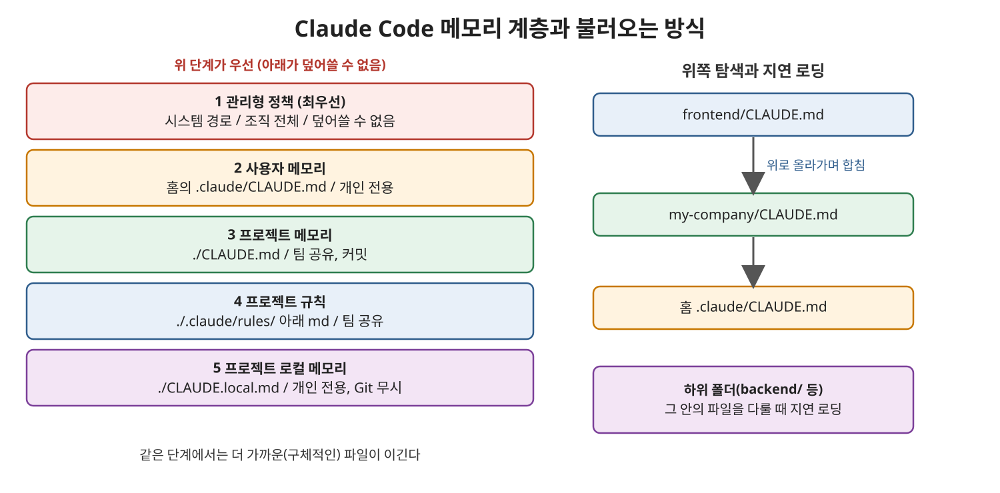

# 메모리와 CLAUDE.md

Claude Code는 대화를 닫으면 방금 한 이야기를 잊는다. 매번 처음 만난 동료에게 프로젝트를 설명하는 것은 고된 일이다. 메모리(memory)는 이 문제를 푸는 장치다. 설정, 규칙, 맥락 정보를 파일에 적어 두면 Claude Code가 세션을 시작할 때마다 읽어서 일관되게 행동한다. 신입에게 건네는 인수인계 노트를 매 출근 때 자동으로 펼쳐 주는 것과 같다.

이 문서는 메모리의 종류와 계층, Claude Code가 메모리를 찾는 방식, 추가와 편집 방법, `/init`, 그리고 기존 프로젝트로 하는 실습을 정리한다.

---

## 1. 메모리의 종류

메모리는 CLAUDE.md라는 특별한 파일로 관리한다. 여기에 지침과 선호를 적어 두면 Claude Code가 세션 시작 때 불러와 상호작용 내내 행동의 기준으로 삼는다. 목적은 작업 효율을 높이고 시간이 지나도 일관성을 지키는 것이다. 메모리는 세 수준으로 나뉜다.

- 사용자 메모리: 홈 디렉터리의 `.claude/CLAUDE.md`에 있다. 모든 프로젝트에 적용할 개인 취향을 담는다. 코딩 스타일, 자주 쓰는 작업 방식, 단축 습관 같은 것이다.
- 프로젝트 메모리: 프로젝트 디렉터리의 `./CLAUDE.md`에 있다. 팀이 공유하는 규칙과 그 프로젝트만의 맥락, 즉 코딩 표준, 아키텍처 결정, 자주 하는 작업 흐름을 담는다.
- 관리형 정책(조직 수준 메모리): IT나 DevOps 팀이 관리하는 조직 전체 지침이다. 시스템 경로에 둔다. 예를 들어 macOS는 `/Library/Application Support/ClaudeCode/CLAUDE.md`, Linux와 WSL은 `/etc/claude-code/CLAUDE.md`, Windows는 `C:\Program Files\ClaudeCode\CLAUDE.md`다. 회사 공통 코딩 표준, 보안 정책, 규정 준수 요건에 쓰며 조직의 모든 사용자에게 적용된다.

---

## 2. 메모리 계층과 우선순위

Claude Code는 메모리를 여러 단계로 나눠 두며 각 단계는 목적이 다르다. 위 단계가 우선하고 아래 단계가 덮어쓸 수 없다.

| 단계 | 이름 | 위치 | 범위 |
|---|---|---|---|
| 1 | 관리형 정책(최우선) | 시스템 관리 경로 | 조직 전체, 덮어쓸 수 없음 |
| 2 | 사용자 메모리 | 홈의 .claude/CLAUDE.md | 개인 전용 |
| 3 | 프로젝트 메모리 | ./CLAUDE.md 또는 ./.claude/CLAUDE.md | 팀 공유, 버전 관리에 커밋 |
| 4 | 프로젝트 규칙 | ./.claude/rules/ 아래 md 파일들 | 팀 공유, 커밋 |
| 5 | 프로젝트 로컬 메모리 | ./CLAUDE.local.md | 개인 전용, Git이 자동 무시 |

4단계는 큰 프로젝트에서 메모리를 주제별 규칙 파일로 쪼갤 때 쓴다. 5단계는 특정 프로젝트에서만 쓰는 개인 재정의를 위한 것이다. 같은 단계에서 충돌하면 현재 작업 디렉터리에 더 가까운, 더 구체적인 파일이 이긴다.



---

## 3. Claude Code가 메모리를 읽는 방식

### 3.1 위쪽으로 거슬러 올라가며 찾기

Claude Code는 시작할 때 현재 작업 디렉터리에서 출발해 파일 시스템 루트 쪽으로 올라가며 메모리 파일을 찾는다. 찾은 파일은 모두 세션에 불러와 합쳐 작업 컨텍스트를 만든다. 덕분에 전역 선호와 프로젝트 규칙이 공존하고, 충돌하면 더 구체적인 지침이 우선한다.

예를 들어 홈 아래에 `.claude/CLAUDE.md`가 있고, `Desktop/my-company/CLAUDE.md`와 `Desktop/my-company/frontend/CLAUDE.md`가 있다고 하자. `frontend` 디렉터리에서 Claude Code를 시작하면 다음 세 파일이 불러와진다.

- `frontend/CLAUDE.md`(현재 디렉터리)
- `my-company/CLAUDE.md`(상위 디렉터리)
- 홈의 `.claude/CLAUDE.md`(사용자 수준 메모리)

세 파일은 합쳐져 하나의 유효 컨텍스트가 된다.

### 3.2 아래쪽 파일은 지연 로딩

현재 디렉터리보다 아래에 있는 메모리 파일은 바로 불러오지 않는다. 그 하위 디렉터리의 파일에 Claude Code가 접근할 때 비로소 불러온다. 프로젝트 루트에서 시작했다면 `backend/` 안의 메모리 파일은 Claude가 그 디렉터리 파일을 다루기 시작할 때까지 로드되지 않는다. 필요할 때만 읽으니 컨텍스트가 쓸데없이 불어나지 않는다.

---

## 4. 메모리 추가와 편집

메모리를 더하는 가장 빠른 방법은 해시(#) 문자다. 입력을 `#`로 시작하면 Claude Code가 그 내용을 알맞은 메모리 파일에 저장하도록 묻는다. 내용이 많이 바뀔 때는 `/memory` 명령으로 메모리 파일을 편집기에서 직접 연다.

권장 원칙은 메모리 파일을 간결하고 구체적으로 유지하는 것이다. 모호하거나 지나치게 많은 정보를 넣으면 토큰을 낭비하고 혼란을 주며 결과 품질을 떨어뜨린다. 메모리를 잘 쓰면 반복 지시가 줄고 세션 사이의 출력이 일관된다. Cursor를 써 본 사람이라면 Cursor 규칙과 비슷한 개념으로 이해하면 된다.

`/init`은 기존 코드베이스를 바탕으로 새 CLAUDE.md를 만드는 명령이다. Claude가 프로젝트의 파일을 훑어 관련 맥락을 담은 CLAUDE.md를 생성하고, 이후 상호작용에서 이 파일이 쓰인다.

---

## 5. 실습: 기존 프로젝트에 메모리 붙이기

### 5.1 프로젝트 준비와 /init

실습 대상은 LangChain으로 만든 기존 저장소 IceBreaker다. 링크드인과 X에서 정보를 긁어 와 대화를 시작할 첫마디(아이스브레이커)를 생성하는 프로젝트이며, LangChain 에이전트로 만든 실용 예제라 Claude Code 시연에 알맞다.

1. 저장소를 새 디렉터리(책에서는 tmp3)에 복제하고 Cursor로 연다. 파이썬과 LangChain 스택 프로젝트다.
2. Claude Code를 열어 화면에 고정하고, 프로젝트 파일 접근과 분석 요청을 승인한다.
3. `/init`을 실행한다. Claude가 저장소의 모든 파일을 훑으며 기술 스택, 설치된 패키지, 필요한 환경 변수, 전체 구조를 파악한다.
4. 분석을 바탕으로 CLAUDE.md 초안이 나온다. Claude는 디렉터리를 나열하고 파일을 검색하며 패턴 매칭과 내용 검토로 빠르게 분석한다.

생성된 파일에는 pip로 의존성을 설치하는 법, 프로젝트 실행법, 스크래핑·요약·에이전트 로직 같은 주요 구성 요소의 개요가 들어 있다. 승인하면 이 파일이 프로젝트 메모리가 된다. 이때부터 Claude에 보내는 모든 프롬프트에 이 CLAUDE.md 내용이 컨텍스트로 함께 실린다.

### 5.2 메모리가 작동하는지 확인

대화 기록의 영향을 없애려고 먼저 `/clear`로 대화를 초기화한다. 그런 다음 이렇게 묻는다.

```text
What stack am I using for this project?
```

답변은 Flask 백엔드, GPT 모델을 쓰는 LangChain, 스크래핑과 트위터 API와 Tavily 검색, Pipenv, Black·isort·pylint, pytest, Pydantic 출력 파서, Flask 템플릿 프런트엔드, 파이썬 3.10 이상으로 정확하게 나온다. 도구를 호출하지 않고 답했다는 점이 핵심이다. 초기화 때 파악한 정보를 대화 기록이 아니라 저장된 메모리에서 꺼냈음을 확인한 것이다.

### 5.3 메모리 항목 추가하기

먼저 "내가 무엇을 먹기 좋아하는지"를 묻는 질문 `what do i like to eat?`을 던지면 Claude는 모른다고 답한다. 코드베이스만 보이고 음식 취향 정보는 없기 때문이다. 해시 문법으로 프로젝트 메모리에 항목을 저장한다.

```text
# I like to eat pizza
```

`/clear` 뒤 같은 질문을 하면 이번에는 피자라고 정확히 답한다. 한 항목을 더 추가하되, 이번에는 햄버거 선호를 사용자 메모리(홈의 `.claude/CLAUDE.md`)에 저장한다. 다시 `/clear`하고 물으면 Claude는 두 가지를 모두 기억해 햄버거(전역 선호)와 피자(프로젝트 메모리)를 함께 답한다.

같은 방식으로 선호하는 코딩 스타일, 자주 쓰는 도구, 반복되는 작업 규약 같은 지속 정보를 Claude가 여러 프로젝트와 세션에 걸쳐 기억하게 할 수 있다.

---

## 6. 여러 메모리 파일로 나누기

프로젝트가 커지면 CLAUDE.md 하나가 비대해져 관리가 어렵다. Claude Code는 저장소 곳곳에 여러 CLAUDE.md를 두는 것을 지원한다. Claude가 디렉터리 구조를 재귀적으로 훑으며 관련 파일을 컨텍스트에 불러온다. 서버 쪽 맥락은 한 곳에, 프런트엔드는 다른 곳에, DevOps나 Claude 전용 규칙은 또 다른 곳에 두는 식으로 메모리를 구조화하면 유지보수가 쉽고 더 목표에 맞게 쓸 수 있다.

훅과 결합하면 더 고급 동작이 가능하다. 작업 종류에 따라 다른 메모리를 붙이는 것이다. 맥락 전환 훅이 데이터베이스 코드를 다룰 때는 DB 메모리를, UI 컴포넌트를 다룰 때는 프런트엔드 맥락을, 백엔드 로직을 다룰 때는 API 메모리를 붙이게 할 수 있다. 사용자 입력과 작업 흐름에 맞춰 메모리를 동적으로 조절하는 길이 열리며, 이는 더 유연한 컨텍스트 관리 패턴으로 이어진다.

<br>
<br>
<br>

[Agentic Coding with Claude Code](../)
