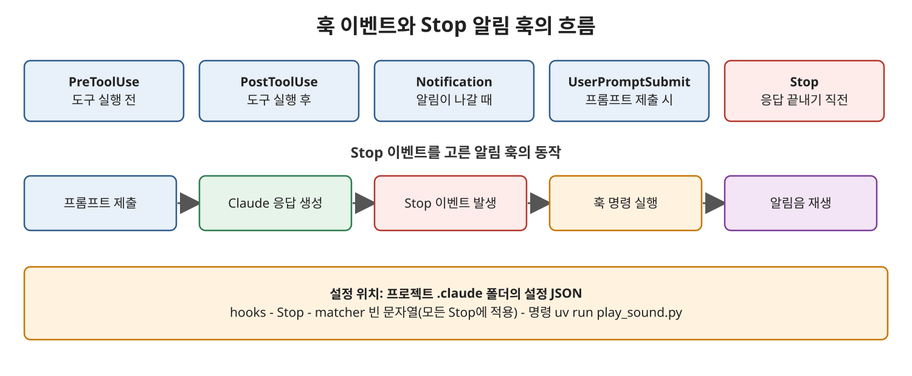

# 훅으로 알림 자동화하기

훅(hook, 정해진 시점에 자동으로 실행되는 로직)은 초인종과 비슷하다. 누가 누르는 순간 정해 둔 소리가 난다. 훅도 Claude Code가 일하는 특정 지점에 도달하면 사람이 시키지 않아도 지정한 동작이 실행된다. 이 문서는 개념을 짚은 뒤, Claude가 답변을 마칠 때 소리를 내는 알림 훅을 처음부터 만들어 본다.

---

## 1. 훅이란 무엇인가

훅은 Claude Code의 작업 흐름 중 정해진 시점에 자동으로 도는 로직이다. 도구를 쓰기 전후나 Claude가 작업을 끝냈을 때 실행되게 할 수 있다. 코드 포맷팅, 테스트 실행, 위험한 수정 차단 같은 일을 자동화하며, 사람이 일일이 챙기지 않아도 같은 동작이 일관되게 일어나도록 보장한다.

훅 설정 화면에는 보안 경고가 함께 뜬다. 훅은 내 컴퓨터에서 명령을 실행하므로 신뢰할 수 있는 것만 등록해야 한다. 책은 훅을 이후 장에서 실습으로 많이 다룰 것이라고 예고한다. 훅이 서브에이전트를 호출하게 만들 수도 있다는 점도 미리 언급한다.

사용할 수 있는 이벤트는 다섯 가지다.

| 이벤트 | 실행 시점 |
|---|---|
| PreToolUse | 도구 실행 전 |
| PostToolUse | 도구 실행 후 |
| Notification | 알림이 나갈 때 |
| UserPromptSubmit | 사용자가 프롬프트를 제출할 때 |
| Stop | Claude가 응답을 끝내기 직전 |



---

## 2. 실습: 응답 완료 알림음 훅

목표는 Claude가 출력을 마칠 때마다 소리가 나게 하는 것이다. 코드는 저장소의 `project/hooks-notification` 브랜치에 있다. 저장소를 복제하고 그 브랜치를 체크아웃해서 시작한다.

### 2.1 환경 초기화

1. 저장소에 필요한 자료가 있는지 확인한다. 소리 파일만 남기고 나머지는 지워서 처음부터 시작하는 상태로 만든다.
2. 훅이 파이썬 스크립트이므로 파이썬 환경을 만든다. 환경 관리자로 uv(Astral이 만든 빠른 파이썬 패키지·환경 관리자)를 쓴다.
3. 만들어진 메인 파일의 이름을 `play_sound.py`로 바꾸고 실행해 환경이 제대로 설정됐는지 확인한다.

```bash
uv init
uv run play_sound.py
```

uv가 없다면 공식 문서의 설치 안내를 따른다. 소리 파일은 `@ulala.wav`로 예를 들지만, 훅은 특정 파일에 의존하지 않는다. 원하는 오디오 파일을 프로젝트의 `hooks/`나 `assets/` 폴더에 두고 스크립트의 경로만 바꾸면 된다.

### 2.2 Claude에게 스크립트 작성시키기

Claude Code를 다시 열어 아직 훅이 없음을 확인한다. 프롬프트를 보내면 응답은 오지만 소리는 나지 않는다. 그다음 Claude에게 스크립트를 쓰게 한다.

```text
I want you to please write a python script that is going to play the sound
@ulala.wav, every time the script runs.
```

Claude는 변경 내용을 diff 화면으로 보여 주고 `play_sound.py` 수정 허가를 묻는다. 선택지는 세 가지다.

- 한 번만 허용
- 이 세션 동안 허용
- 거절하고 다른 지시 주기

세션 동안 허용을 고르면 로컬 설정이 갱신되어 같은 파일에 대해 다시 묻지 않는다. 이 허가 단계는 Claude Code가 파일을 직접 고치기 때문에 있는 보안 장치다.

스크립트는 오디오 재생에 pygame을 쓴다. 의존성을 설치하고 다시 실행해 소리가 나는지 확인한다.

```bash
uv add pygame
uv run play_sound.py
```

### 2.3 훅으로 등록하기

스크립트가 있어도 Claude Code는 언제 실행할지 모른다. 등록 단계가 필요하다.

1. 슬래시 메뉴에서 `/hooks`를 입력하고 목록에서 새 훅을 추가한다.
2. 이벤트로 Stop을 고른다. 응답을 끝내기 직전에 실행되므로 알림 용도에 맞는다.
3. 명령을 `uv run play_sound.py`로 정한다. 가상 환경 안에서 스크립트가 실행되도록 하는 명령이다. `hooks/` 폴더 안에 있다면 그 스크립트의 경로를 쓴다.
4. 범위로 프로젝트를 골라 이 프로젝트에만 적용한다.

그러면 `.claude` 디렉터리에 설정 파일이 생기고 훅 설정이 JSON으로 저장된다. 책의 예는 대략 다음 모양이다(경로는 책 저자의 컴퓨터 기준이라 생략했다).

```json
{
  "hooks": {
    "Stop": [
      {
        "matcher": "",
        "hooks": [
          { "type": "command", "command": "uv run play_sound.py" }
        ]
      }
    ]
  }
}
```

`matcher`가 빈 문자열이면 해당 종류의 모든 이벤트에 적용된다는 뜻이다. 여기서는 Stop이 일어날 때마다 걸러 내는 조건 없이 실행된다. 설정은 이벤트 종류, 선택 사항인 matcher, 실행할 명령으로 이뤄진다.

### 2.4 확인

새 설정을 읽도록 Claude Code를 종료하고 다시 연다. Cursor 안에서 `hello how are you?` 같은 아무 프롬프트를 보낸다. Claude가 응답을 마치면 알림음이 자동으로 나야 한다. 소리가 나면 세 가지가 확인된 것이다.

- 파이썬 환경이 올바르게 초기화됐다.
- 스크립트가 정상 실행된다.
- 훅이 등록되어 Stop 이벤트에서 실행된다.

소리가 나지 않으면 명령 경로가 맞는지 먼저 본다.

---

## 3. 훅에 대한 보충

- 이 훅은 인자를 받지 않는다. 하지만 훅은 사용자 입력, 도구 호출 같은 실행 정보를 전달받도록 설정할 수 있다. 훅은 재사용 가능한 유틸리티와 같으므로 전용 `hooks` 디렉터리에 모아 두면 좋다.
- 훅의 출력은 Claude Code의 다음 동작에 영향을 줄 수 있다. 동작을 막거나, 행동을 바꾸거나, 서브에이전트를 부를 수도 있다. 고급 사용은 책 뒤쪽에서 다룬다.
- 기존 명령과 스킬의 관계도 이 부분에서 정리된다. 명령은 이제 에이전트 스킬 개념으로 통합됐다. 기존 `.claude/commands/` 파일은 그대로 지원되고, `.claude/skills/` 아래의 같은 정의도 똑같이 동작한다. 스킬은 구조, 지원 파일, 호출 시점과 방식에 대한 더 많은 제어를 더한다.

실무 팁으로 책은 이렇게 말한다. 운영에 쓰는 훅은 가볍게 유지해야 한다. 훅은 자동으로 자주 실행되므로 무거운 스크립트는 불필요한 지연을 만든다. 단순한 알림이라면 macOS의 `afplay`나 Linux의 `aplay` 같은 시스템 명령이 파이썬 런타임과 외부 패키지를 올리는 것보다 빠를 때가 많다. 실행이 잦은 훅은 가벼운 명령을 쓰는 편이 낫다.

참고(노트 작성자): 이 실습의 요점은 소리를 내는 것이 아니라 훅의 구조를 보는 것이다. 이벤트를 고르고, 실행할 명령을 정하고, 범위를 정한 뒤, 설정 JSON에 저장된다는 흐름이 다른 훅에도 그대로 쓰인다.

<br>
<br>
<br>

[Agentic Coding with Claude Code](../)
