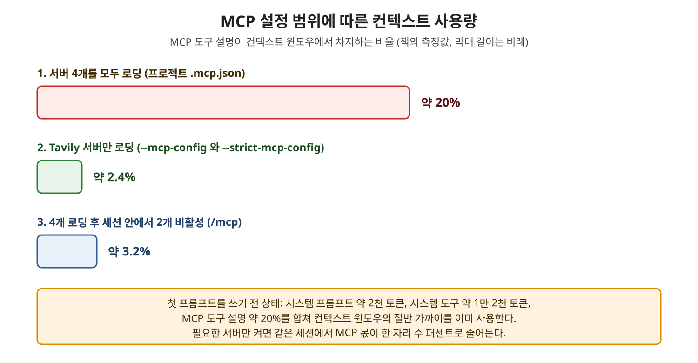

# MCP 설정과 컨텍스트 엔지니어링

MCP는 강력하지만 조용히 컨텍스트를 갉아먹는다. 이 문서는 MCP 설정이 컨텍스트 윈도우를 얼마나 쓰는지 직접 재 보고, 설정 범위를 좁히거나 세션 안에서 서버를 끄는 방법으로 줄이는 실습을 정리한다. 1장에서 다룬 컨텍스트 엔지니어링을 MCP에 적용하는 장면이다.

비유하면 이삿짐 트럭이다. 어디에 쓸지 모르는 가구까지 전부 싣고 출발하면 정작 필요한 짐을 실을 자리가 모자란다. 이번 작업에 필요한 서버만 싣는 것이 목표다.

---

## 1. 문제: 너무 일반적인 MCP 설정

원서는 컨텍스트가 에이전트 시스템, 특히 코딩 워크플로에서 가장 비싸고 한정된 자원이라고 강조한다. 컨텍스트가 나쁘면 에이전트 성능이 나쁘다. 이 절은 가격과 지연은 일부러 빼고 성능에만 초점을 둔다.

가장 조용하지만 영향이 큰 비효율의 원인이 MCP 설정이다. 서버를 너무 넓게 설정하면 에이전트는 요청을 처리하기도 전에 쓸 수 있는 모든 도구를 컨텍스트 윈도우에 올린다. 추론을 시작하기 전에 토큰이 소모되어 실제 작업에 쓸 공간이 줄어든다.

Claude Code에서는 보통 프로젝트 수준의 MCP 설정 파일에 여러 서버를 적어 둔다. 많은 설정이 하나의 범용 구성으로 모든 서버와 도구를 불러오는 식이다. 에이전트에게 필요할지 모르는 모든 것을 쥐여 주려는 의도지만, 결과적으로 모든 세션이 모든 서버와 도구를 로딩하고, 첫 프롬프트를 쓰기 전에 수만 토큰이 나갈 수 있다.

## 2. 실습 준비: 서버 네 개와 장황한 서버

원서는 책 저장소의 context-engineering-mcp 브랜치를 쓴다. 첫 커밋부터 시작해 그대로 재현할 수 있다. 저장소에는 FastMCP로 만든 verbose_mcp_server.py가 있다. 서버는 add_two_numbers, subtract_two_numbers, multiply_two_numbers 같은 산술 도구를 잔뜩 노출하고, 도구마다 설명을 길게 붙여 일부러 불필요하고 장황하게 만들었다. 설명은 클라이언트가 도구를 쓸지 판단하게 돕지만 동시에 컨텍스트 크기를 직접 키운다.

서버는 UV 패키지 매니저로 실행한다. uv.lock이 FastMCP 의존성을 정의하고 있다.

```bash
uv sync
source .venv/bin/activate
fastmcp run verbose_mcp_server.py --transport http
```

그러면 스트리밍 가능한 HTTP 방식으로 `http://127.0.0.1:8000/mcp`에서 서버가 돈다. 이 서버를 Claude Code에 붙이려고 프로젝트 수준 설정 파일 .mcp.json을 만든다(저장소의 "Add project-based MCP configuration" 커밋을 복사하고 API 키는 필요에 따라 채운다. 책의 예시 키는 가려져 있다). 이 설정에는 네 서버가 들어 있다.

- 로컬에서 도는 장황한 MCP 서버
- 앞에서 다룬 Context7
- Tavily: 인터넷 검색, 사이트 크롤링, 웹 페이지 추출
- Playwright MCP: 브라우저 자동화

프로젝트 수준이므로 프로젝트 폴더에서 Claude Code를 시작하면 네 서버가 자동으로 로딩된다. 확인 순서는 터미널을 열고, 프로젝트 폴더로 이동하고, context-engineering-mcp 브랜치인지 확인하고, Claude Code를 실행하고, `/mcp`로 네 서버가 모두 connected인지 보는 것이다.

## 3. 컨텍스트 사용량 측정

이제 `/context`로 현재 세션의 컨텍스트 사용량을 본다. 프롬프트를 한 줄도 쓰지 않았는데 이미 컨텍스트 윈도우의 절반 가까이를 쓰고 있다. 내역은 이렇다.

- Claude Code 시스템 프롬프트에 약 2천 토큰
- Claude Code 시스템 도구에 약 1만 2천 토큰
- MCP 도구 설명이 컨텍스트 윈도우의 거의 20%
- 메시지 없음, 메모리 파일 없음, 서브에이전트 설정 없음

서브에이전트가 있었다면 그 사용 시점과 방법 설명도 컨텍스트에 들어갔을 것이다. 과제에 따라 이 MCP 서버들 상당수, 특히 장황한 산술 서버의 도구는 필요 없다.

## 4. 해법 1: 설정 범위를 좁히기



첫 번째 방법은 MCP 설정을 좁히는 것이다. 절차는 다음과 같다.

1. 프로젝트 수준 .mcp.json을 치운다.
2. .mcp.json.tavily라는 새 파일을 만든다.
3. 저장소에서 Tavily 설정을 복사해 붙인다. 이제 파일에는 Tavily 서버만 있다.
4. `claude --mcp-config .mcp.json.tavily`로 시작한다. 이 플래그는 공백으로 구분한 여러 설정 파일 경로를 받는다.

그런데 `/mcp`를 열면 Tavily 외에 장황한 서버와 Context7도 보인다. 반면 Playwright는 사라졌다. Claude Code가 사용자 수준 MCP 설정에서 Context7, Tavily, 장황한 서버를 계속 불러오고 있기 때문이다. 즉 지정한 파일 외에 기본 계층의 설정이 따로 합쳐진다.

의도한 설정만 쓰려면 엄격 모드를 켠다.

```bash
claude --mcp-config .mcp.json.tavily --strict-mcp-config
```

`--strict-mcp-config`는 기본 MCP 계층을 무시하고 지정한 파일에 있는 서버만 불러오라는 뜻이다. `/mcp`에서 Tavily만 로딩된 것을 확인하고 `/context`를 다시 보면, MCP 도구가 쓰는 컨텍스트가 거의 20%에서 약 2.4%로 크게 줄어든다. 에이전트는 이번 작업(리서치)에 집중하고 불필요한 도구 컨텍스트를 끌고 다니지 않는다.

## 5. 해법 2: 세션 안에서 동적으로 관리하기

설정 파일을 만지지 않고도 세션 안에서 서버를 껐다 켤 수 있다.

1. 범용 프로젝트 수준 .mcp.json을 되살린다.
2. Claude Code를 재시작한다.
3. 장황한 MCP 서버를 비활성화한다.
4. Playwright MCP 서버를 비활성화한다.
5. `/mcp`로 두 서버가 꺼진 것을 확인한다.
6. `/context`를 실행한다.

MCP 컨텍스트 사용량은 약 3.2%가 된다. 설정 파일은 그대로 두고 CLI에서 서버를 켜고 끄는 방식이라, 팀이 공유하는 설정을 건드리지 않고 내 세션만 가볍게 만들 수 있다.

## 6. 두 방법 비교

| 방법 | 어떻게 | MCP 컨텍스트 |
|---|---|---|
| 아무 조치 없음 | 프로젝트 설정으로 서버 4개 로딩 | 약 20% |
| 범위 좁히기 | --mcp-config와 --strict-mcp-config로 Tavily만 | 약 2.4% |
| 동적 관리 | 세션 안에서 서버 2개 비활성화 | 약 3.2% |

참고(노트 작성자): 위 수치는 책 저자가 그 환경에서 잰 값이다. 서버 구성과 Claude Code 버전에 따라 달라지므로 내 환경에서는 `/context`로 직접 재 보는 것이 가장 정확하다.

<br>
<br>
<br>

[Agentic Coding with Claude Code](../)
