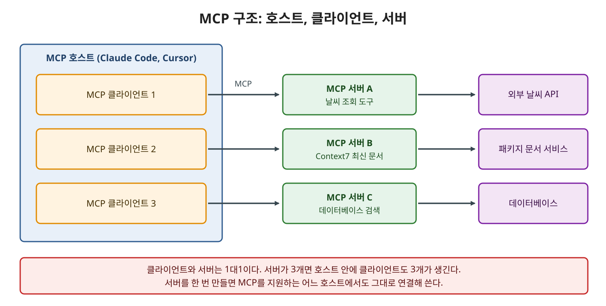

# MCP가 필요한 이유와 핵심 구조

4장은 Claude Code의 능력을 바깥으로 넓히는 두 가지 방법, MCP 서버와 플러그인을 다룬다. 이 문서는 그중 첫 부분으로, MCP(Model Context Protocol, 모델 컨텍스트 프로토콜)가 왜 생겼는지와 어떤 부품으로 이뤄졌는지를 정리한다. 책이 쓰인 시점 기준으로 MCP는 Claude Code와 Cursor 같은 여러 AI 도구가 채택한 흐름이다.

MCP는 노트북의 USB 포트와 비슷하다. 마우스, 키보드, 저장장치마다 전용 단자를 만드는 대신 하나의 규격을 정해 두면, 규격을 지키는 기기는 어디에든 꽂힌다. AI 도구와 외부 기능 사이에 그런 공통 단자를 둔 것이 MCP다.

---

## 1. 통합 문제: 에이전트마다 연결을 새로 만든다

Slack 메시지를 보내고, 이메일을 읽고, 데이터베이스를 조회하는 AI 에이전트를 만든다고 하자. 이 기능을 쓰려면 Slack API나 Gmail API를 직접 호출하는 코드를 짜서 에이전트가 쓸 도구로 감싸야 한다.

- 직접 구현이 필요한 경우가 많다. 예를 들어 이메일 연동에서 실수로 메일이 지워지지 않도록 Gmail API의 삭제 기능을 일부러 뺄 수 있다. 이런 맞춤 규칙은 손으로 넣어야 한다.
- 프레임워크가 Gmail 전체 기능을 미리 구현해 둔 도구를 줄 수도 있다. 하지만 기본 도구든 직접 만든 도구든 특정 에이전트 환경 안에 붙여야 한다는 점은 같다.
- 한 번 붙이면 그 에이전트 안에서는 잘 작동한다.

문제는 이식성이다. 이 에이전트가 Cursor 안에서 돌도록 만들어졌다고 하자. Slack, Gmail, 데이터베이스 연동은 Cursor 환경에 맞춰 짠 것이다. 같은 기능을 Claude Code에서 쓰고 싶어지면 연동 코드를 그대로 가져올 수 없고 다시 만들어야 한다. Cursor, Bolt, GitHub Copilot 같은 다른 도구로 넓힐 때마다 같은 작업이 반복된다. 기능은 같은데 환경마다 어댑터를 새로 짜는 셈이다.

## 2. 해법: 간접 계층 하나를 더 둔다

원서는 소프트웨어 공학의 오래된 격언을 인용한다. 앤드루 쾨니그(Andrew Koenig)의 말로, 어떤 문제든 간접 계층을 하나 더 두면 풀 수 있다는 뜻이다. MCP 서버가 바로 그 계층이다.

- 기능을 에이전트마다 따로 붙이지 않고 MCP 서버에 한 번만 구현한다.
- MCP를 지원하는 에이전트는 그 서버에 바로 연결한다.
- 호환성은 한 번만 만들면 된다. Cursor용으로 만든 기능이 Claude Code나 다른 MCP 지원 환경에서도 추가 작업 없이 쓰인다.

원서는 여기에 네트워크 효과를 덧붙인다. 사용자가 적은 소셜 서비스는 가치가 작지만 사람이 늘고 콘텐츠가 쌓이면 더 가치 있어지는 것처럼, MCP도 채택이 늘고 서버가 많아질수록 쓸 수 있는 연동이 늘어 프로토콜의 효용이 커진다.

## 3. MCP가 표준화하는 것

MCP는 애플리케이션이 LLM에게 컨텍스트를 제공하는 방식을 표준화한다. 여기서 컨텍스트는 프롬프트에 덧붙는 추가 정보일 수도, 호출할 도구의 명세일 수도, 프롬프트 자체일 수도 있다. 즉 모델의 응답을 좌우하는 자료와 작동 지침이 모두 컨텍스트다.

원서가 MCP 문서를 근거로 든 장점은 두 가지다.

- 폭넓은 생태계: 도구와 데이터 소스를 모듈 방식으로 LLM 앱에 붙일 수 있다. Claude Code도 구조화된 도구 연동으로 능력을 넓히는 데 MCP를 쓴다.
- 벤더 종속 감소: 핵심 기능을 도구로 만들어 MCP 서버로 노출하면 특정 LLM 공급자나 호스트 앱에 묶이지 않고 수정 없이 재사용한다.

원서는 LangChain 같은 오픈소스 프레임워크가 일부 겹치는 문제를 다루지만, 두 접근은 방식이 다르고 해법이 곧바로 겹치지는 않는다고만 짧게 언급한다.

## 4. 세 가지 구성 요소

MCP 구조는 호스트, 서버, 클라이언트 세 부품으로 이뤄진다.

### 4.1 MCP 호스트

MCP를 지원하는 AI 애플리케이션이다. Claude Desktop, Claude Code나 Cursor 같은 개발 환경, 전용 AI 에이전트가 예다. 호스트는 MCP로 자체에는 없던 도구, 데이터 소스, 제품에 연결되어 능력이 커진다.

### 4.2 MCP 서버

호스트에게 기능을 내놓는 쪽이다. 노출하는 기능은 대략 세 종류다.

- 외부 도구: 날씨 정보를 얻으려고 API를 부르는 것 같은 기능
- 데이터베이스 검색 기능
- PDF나 긴 텍스트 같은 지식 자료

서버는 도구(tools), 자원(resources), 프롬프트(prompts)를 MCP 명세에 맞게 내놓는 관문 또는 프록시 역할을 한다. 명세를 따르려면 서버는 몇 가지 메서드를 구현한다. 원서가 든 것은 listPrompts, getPrompt, listTools, callTool, listResourceTemplates, 그리고 진행 알림 방식이다. 한 번 구현하면 프로토콜을 지원하는 모든 호스트에 연결되므로 재사용성이 MCP의 핵심 장점이 된다.

### 4.3 MCP 클라이언트

호스트 안에 들어 있으면서 호스트와 서버 사이의 통신을 맡는 부품이다. 예를 들어 날씨 MCP 서버를 Claude Desktop에 연결하면, Claude Desktop 안의 MCP 클라이언트가 그 서버와의 대화를 관리한다. 둘은 정의된 프로토콜로만 소통한다.

가장 헷갈리기 쉬운 규칙은 클라이언트와 서버가 1대1이라는 점이다. 클라이언트 하나가 여러 서버와 말할 수 없다. 호스트가 서버 세 개에 붙으려면 클라이언트 세 개를 만들어야 한다. 위 그림에서 클라이언트가 서버 수만큼 늘어나는 이유다.

## 5. 한눈에 정리

| 부품 | 위치 | 하는 일 |
|---|---|---|
| 호스트 | 사용자가 쓰는 AI 앱 | 모델을 돌리고 MCP로 능력을 확장한다 |
| 클라이언트 | 호스트 안 | 서버 하나와 1대1로 프로토콜 통신을 한다 |
| 서버 | 호스트 밖(로컬 또는 원격) | 도구, 자원, 프롬프트를 규격에 맞게 내놓는다 |

참고(노트 작성자): 원서의 이 장은 지면 사정상 Cursor 예시도 함께 쓴다. 원서가 직접 밝히듯 개념은 Claude Code에 그대로 적용된다.

 
 
 

[Agentic Coding with Claude Code](../)
