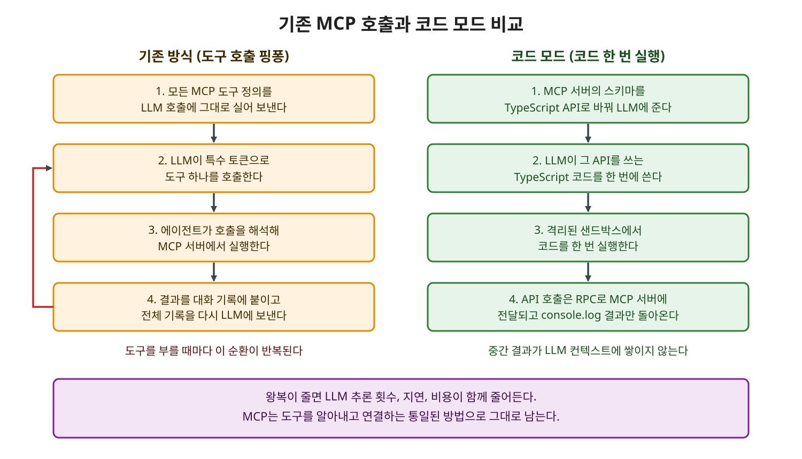

# MCP의 한계와 코드 모드

MCP는 에이전트가 데이터와 도구에 연결하는 방식을 표준화하려고 만들어졌지만, 지금의 구현에는 몇 가지 약점이 있다. 대부분 LLM 컨텍스트를 다루는 방식과 에이전트가 일을 실행하는 방식에서 나온다. 이 문서는 원서가 짚은 한계 네 가지와, 그 대안으로 소개한 클라우드플레어(Cloudflare)의 코드 모드(CodeMode)를 정리한다.

원서의 태도는 분명하다. 완벽한 프로토콜은 없고 MCP도 예외가 아니다. 그래서 MCP를 효율적으로 쓰는 법과 언제 의문을 품을지를 함께 알아야 한다.

---

## 1. MCP의 현재 한계

아래 한계들 때문에 에이전트는 의도보다 느리고, 비싸고, 덜 효과적이 될 수 있다.

### 1.1 컨텍스트 오염

가장 큰 문제다. MCP는 도구 정의를 미리 모델 컨텍스트에 올려야 한다. 필수 인자와 기대 출력을 포함한 정의가 시스템 프롬프트에 들어간다. 서버를 쓰려면 에이전트는 모든 도구의 정의를 받아야 한다.

원서의 수치 예: GitHub MCP, Slack MCP 같은 서버에서 도구가 58개인 구성은 대화를 시작하기 전에 도구 정의만으로 5만 5천 토큰을 쓴다. 어떤 경우에는 수십만 토큰까지 간다. 컨텍스트가 도구 정의로 포화되면 에이전트는 관련 없는 정보를 잔뜩 들고 있게 된다. 프런트엔드 페이지를 고치는 에이전트가 데이터베이스 유틸리티나 PDF 리더 같은 무관한 도구 설명 수천 줄을 모든 단계마다 끌고 가는 식이다.

컨텍스트가 무관한 정의로 차면 모델 성능이 떨어진다. 건초 더미에서 바늘 찾기 문제가 생겨 환각, 지시 불이행, 잘못된 도구 선택이 늘어난다. 오염이 심할수록 관련 정보를 찾기 어렵다.

### 1.2 비효율적인 실행

기존 MCP 사용은 핑퐁 패턴에 의존한다. 동작마다 왕복이 한 번 필요하다.

1. 모델이 도구를 요청한다.
2. 도구가 실행된다.
3. 결과가 대화 기록에 붙는다.
4. 갱신된 기록 전체가 다음 단계를 정하려고 모델에 다시 간다.

도구 호출이 여러 번 필요하면 빠르게 불어난다. 최종 답에 필요 없는 중간 결과도 컨텍스트에 쌓인다. 나중 단계에서 일부를 지울 수 있을 법한데, 현재 MCP 구현은 그대로 유지해서 오염을 더한다. 왕복마다 LLM 추론이 한 번씩 더 필요하므로 지연과 비용이 함께 늘고, 도구 호출이 늘수록 모델 호출 횟수도 비례해 늘어 실행이 느려지고 비싸진다.

### 1.3 모국어 문제: JSON 대 코드

MCP는 LLM이 학습한 방식과 다르게 일하게 만든다. 프로토콜은 구조화된 도구 호출 토큰과 JSON 스키마에 크게 기대는데, LLM은 주로 자연어 텍스트와 코드로 학습했고 특수한 도구 호출 구문으로 학습한 비중은 작다. 모델 공급자들이 도구 호출 신뢰도를 높이긴 했어도 이것은 모델의 본래 작동 방식이 아니다. 텍스트와 코드가 LLM에게 더 자연스러운 표현이고, 특히 코드는 JSON 기반 호출보다 학습 데이터와 능력에 가깝다. 이 불일치가 마찰을 만든다.

### 1.4 도구 정의와 스키마의 한계

MCP 도구 정의와 JSON 스키마는 도구가 어떻게 생겼는지, 곧 매개변수, 입력, 출력을 기술한다. 그러나 사용 패턴은 담지 못한다. 사용 패턴이란 언제 써야 하는지, 맥락 안에서 어떻게 써야 하는지, 언제 쓰면 안 되는지다. 구조 정의보다 깊은 개념이다. 사용 지침을 따로 줘도 스키마 자체에는 이런 행동 제약을 새길 수 없다. 프로토콜은 구조를 정의할 뿐 의도나 올바른 적용 방식은 정의하지 않는다.

## 2. 클라우드플레어 코드 모드

클라우드플레어가 블로그 글로 처음 소개한 실행 모델이다. 앞서의 약점, 특히 컨텍스트 팽창과 여러 번의 LLM 호출에서 오는 지연을 겨냥한다.

핵심 발상은 이렇다. MCP의 도구 정의, 인터페이스, 구현을 모두 가져다 TypeScript API로 바꾼다. 그리고 LLM이 도구 호출 방식으로 도구를 고르게 하는 대신, 그 API를 쓰는 코드를 생성하게 한다.

### 2.1 동작 방식

- LLM이 실행할 코드 전체를 만든다. 코드 안에는 여러 번의 도구 호출이 함수 호출로 들어 있다.
- 그 코드를 샌드박스 안에서 한 번 실행한다.
- 호출, 결과 확인, 다음 호출의 반복 왕복이 사라진다. 순서를 코드가 내부에서 처리한다.
- 코드를 한 번 쓰고 한 번 실행하므로 도구 정의를 반복해서 보낼 필요가 없어 토큰이 준다.

### 2.2 클라우드플레어의 주장

- MCP는 도구를 LLM에 직접 노출하는 방식으로 쓰여 왔다. 코드 모드에서는 도구가 TypeScript API로 바뀌고 LLM은 그 API를 부르는 코드를 쓴다.
- 보고된 결과는 에이전트가 더 많은 도구와 더 복잡한 도구를 다룬다는 것이다. 도구가 많으면 컨텍스트가 커져 비용, 지연, 성능 저하가 생기는데, 직접 정의 대신 TypeScript API로 보여 주면 성능이 좋아진다. 이유로 LLM이 실제 TypeScript는 많이 보았지만 인위적인 도구 호출 예시는 조금만 보았다는 점을 든다.
- 여러 호출을 이어 붙여야 할 때 특히 효과적이라고 한다. 기존 방식은 도구 출력을 매번 LLM에 되돌려야 하지만, 코드를 쓰면 모든 호출을 내부에서 하고 최종 결과만 돌려준다. 시간, 에너지, 토큰이 절약된다.
- 결론은 LLM이 MCP를 직접 부르는 것보다 MCP를 부르는 코드를 쓰는 데 더 능하다는 것이다.

원서가 옮긴 비유는 이렇다. 도구 호출로 일을 시키는 것은 셰익스피어에게 중국어 단기 강좌를 듣게 한 뒤 중국어로 희곡을 쓰라고 하는 것과 같다. 도구 호출은 모델의 가장 강한 영역이 아니라는 뜻이다. 그래서 MCP 서버 설계자에게는 API를 LLM이 쓰기 좋게 단순화하라는 권고가 따르지만, LLM은 복잡한 프로그래밍 API도 단순화 없이 분석하고 코드를 생성하는 데 능하다.

### 2.3 그래도 MCP는 남는다

MCP는 에이전트와 도구를 잇는 통일된 방법이라는 점에서 계속 유용하다. MCP 도구는 문서가 붙은 RPC 인터페이스이고, 대부분의 MCP 서버는 기존 전통 API를 감싼 것이다. 코드 모드는 MCP 도구를 직접 호출 가능한 도구로 노출하는 대신 프로그래밍 언어 API로 바꿀 뿐이다. 전통 API가 이미 있어도, MCP는 그 API에 연결하고 그것을 알아내는 균일한 방법을 주므로 에이전트 시스템에서 가치가 남는다.

### 2.4 통합과 실행 흐름

클라우드플레어는 Agent SDK에 코드 모드 지원을 넣었다. 보통의 AI SDK 구성은 모델에 시스템 프롬프트, 사용자 메시지, 도구를 넘긴다. 코드 모드에서는 시스템 프롬프트와 도구를 codemode 헬퍼로 감싸서 넘긴다. 원서의 코드 예시가 보여 주는 변화는 이 한 단계의 래핑뿐이고, 이후 앱은 정의된 도구(MCP 서버 포함)를 호출하는 TypeScript 코드를 생성하고 실행한다. 참고(노트 작성자): 원서의 예시 코드는 모델명을 포함해 인용 서식이 일부 깨져 있어 이 노트에는 싣지 않았다.

MCP 서버에 연결하면 Agent SDK가 서버 스키마를 받아 TypeScript API로 바꾼다. 생성된 API에는 스키마에서 파생한 타입 정의와 설명 주석이 들어 있다. 이 정의는 에이전트 컨텍스트에 올라가는데, 책이 쓰인 시점에는 API 전체를 한 번에 올리고, 앞으로는 동적 검색이나 탐색이 가능해질 수 있다고 한다. 전체를 올리면 컨텍스트가 커지지만 초기화 때 한 번뿐이고, LLM은 코드를 읽고 쓰는 데 강하므로 그 강점을 활용한다.

실행 단계에서는 에이전트에게 도구가 하나만 주어진다. TypeScript 코드를 실행하는 도구다. 코드는 인터넷과 격리된 안전한 샌드박스에서 돌고, 연결된 MCP 서버를 나타내는 TypeScript API로만 외부 시스템에 접근한다. 샌드박스 코드가 API 함수를 부르면 에이전트 루프를 거쳐 RPC로 MCP 서버에 전달된다. 결과는 console.log()로 돌려주고, 실행이 끝나면 로그가 에이전트에게 간다.

| 단계 | 기존 MCP | 코드 모드 |
|---|---|---|
| 스키마 | 서버에서 도구 스키마를 받는다 | 서버 스키마를 받아 TypeScript API로 바꾼다 |
| LLM 입력 | MCP 도구 정의를 그대로 싣는다 | TypeScript API를 싣는다 |
| LLM 출력 | 함수 호출용 특수 토큰 | API를 쓰는 TypeScript 코드 |
| 실행 | 에이전트가 호출을 해석해 실행하고 반복 | 샌드박스가 코드를 한 번 실행하고 RPC로 서버를 부른다 |

코드 모드는 LLM의 코드 생성 능력에 기대면서 MCP는 통일된 통합 계층으로 남기는 대안적 실행 모델로 소개된다.

 
 
 

[Agentic Coding with Claude Code](../)
