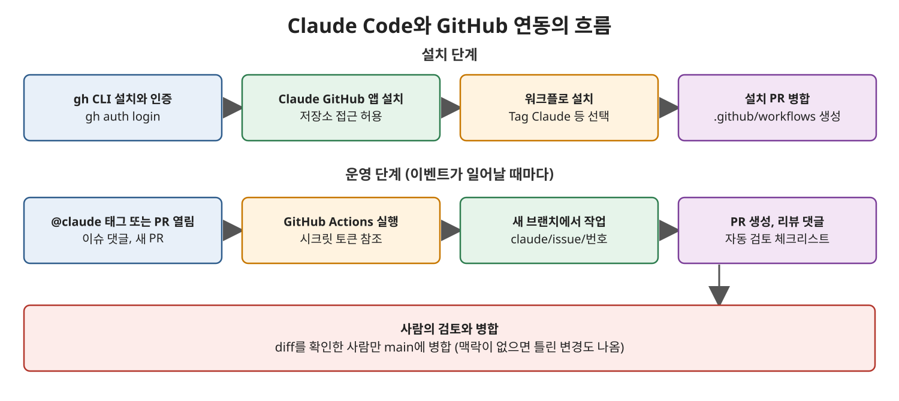

# GitHub 연동 설치와 설정

팀에 새 동료가 들어오면 먼저 저장소 접근 권한을 주고, 어떤 이벤트에 반응할지 알려 준다. Claude Code를 GitHub에 붙이는 일도 비슷하다. 설치 한 번으로 Claude가 이슈와 풀 리퀘스트(PR, 코드 변경을 팀에 제안하는 요청)에 불려 나와 코드를 검토하고 수정을 제안하는 동료가 된다. 이 문서는 연동이 어떤 구조로 돌아가는지와, `/install-github-app`으로 설치하는 전 과정을 정리한다.

---

## 1. 연동의 구조

연동에는 몇 가지 설정 단계가 필요하다. GitHub CLI를 설치하고, Claude Code와 함께 쓰도록 구성하고, Claude Code가 일할 저장소를 고르는 것이다. 설정이 끝나면 저장소 안에서 Claude Code를 곧바로 쓸 수 있다. PR과 이슈에서 Claude를 태그하면 코드를 검토하고, 수정을 제안하고, 보고된 문제를 풀도록 돕는다. PR이 열릴 때 Claude가 변경을 자동 검토하게 할 수도 있다.

이 자동화는 GitHub Actions가 돌린다. GitHub Actions는 GitHub의 서버리스 워크플로 플랫폼으로 CI/CD 같은 작업에 흔히 쓴다. 여기서는 Claude Code CLI와 Claude Code SDK에 의존하는 워크플로를 실행한다. Actions는 이벤트에 반응하는 자동화 시스템이다. 이벤트는 이슈에서 Claude를 태그하거나 새 PR을 여는 일 같은 것이고, 이벤트마다 프로젝트 요구에 맞는 워크플로를 연결한다. 워크플로 자체는 YAML 파일(GitHub 워크플로 파일)로 정의한다. 이 파일이 어떤 이벤트에 어떤 명령이나 스크립트를 실행할지 적는다.



이 연동은 이미 실제 운영에 쓰인다. 책은 Anthropic이 자사 오픈 소스 저장소에서 이슈 처리 등을 자동화하려고 Claude Code와 GitHub Actions를 쓴다고 소개하며, 공개 예시로 anthropics/skills 저장소의 Actions 워크플로를 든다.

---

## 2. 사전 준비

실습은 IceBreaker라는 오픈 소스 저장소로 진행한다. 데모용일 뿐이며 내가 가진 어떤 GitHub 저장소로 따라 해도 된다. 다만 Claude GitHub 앱 설치와 워크플로 구성에 관리자 권한이 필요하므로 내 저장소라면 관리자 접근이 있어야 한다.

Claude Code를 데스크톱에서 열고 `/git`을 입력하면 `/install-github-app` 명령이 보인다. 이 명령을 고르면 설정이 시작된다. 시작하기 전에 두 가지 전제가 충족되어야 한다.

- GitHub CLI(`gh` CLI)가 로컬에 설치되어 있어야 한다.
- GitHub CLI가 GitHub 계정으로 인증되어 있어야 한다. Claude Code는 이 인증된 세션으로 저장소와 상호작용한다.

주의할 점은 GitHub에 연결된 Git 저장소가 이미 초기화된 디렉터리에서 Claude Code를 실행해야 한다는 것이다. 그렇지 않으면 연동이 작동하지 않는다.

### 2.1 GitHub CLI 설치와 인증

새 터미널을 열고 다음 순서로 진행한다. 책의 설치 명령은 macOS의 Homebrew 기준이며, Linux나 Windows는 GitHub CLI 공식 문서의 안내를 따른다.

```bash
brew install gh
gh --help
gh auth login
```

첫 줄은 설치, 둘째 줄은 설치 확인, 셋째 줄은 인증이다. 인증 중에 연결 방식은 HTTPS를 고르고 웹 브라우저로 로그인한다. 일회용 코드가 표시되면 브라우저에 입력해 마친다. 2단계 인증을 켰다면 설정한 두 번째 요소로 승인한다. 이 과정이 끝나면 CLI 인증이 완료되고 Claude Code 연동의 사전 조건이 갖춰진다.

---

## 3. Claude GitHub 앱 설치

터미널 창을 닫고 Claude에서 안내대로 Enter를 누르면 GitHub 페이지로 이동한다. 여기서 Claude GitHub 앱을 설치한다. 이 앱이 있어야 Claude가 댓글을 달고, PR을 만들고, 이슈를 풀 수 있다. 설치(Install)를 누르면 Claude 웹 앱으로 되돌아가고, 터미널에서 다시 Enter를 눌러 이어 간다.

## 4. GitHub 워크플로 설치

연동을 마치려면 저장소에 GitHub 워크플로를 추가해야 한다. 이 워크플로가 Claude의 댓글과 동작을 처리하는 파이프라인을 돌린다. 설치 옵션은 두 가지다.

| 옵션 | 하는 일 |
|---|---|
| Tag Claude | 이슈와 PR 댓글에서 Claude를 태그하면 GitHub 워크플로로 실행한다 |
| Claude Code Review | 새 PR을 자동으로 검토한다 |

책에서는 첫 번째를 고른다. 그런데 뒤에서 보듯 실제로 만들어진 워크플로 YAML은 두 개(`claude.YAML`, `claude-code-review.YAML`)다. 선택 화면과 결과가 왜 이렇게 이어지는지는 원문이 설명하지 않는다.

### 4.1 인증 방법: 누가 토큰 비용을 내는가

Claude를 쓰면 토큰이 소비되므로 누군가 비용을 내야 한다. 선택지는 두 가지다.

- Claude 구독에 연결된 장기 토큰: 구독 범위 안에서 소규모에서 중규모 사용에 알맞다.
- Anthropic API 키: 구독 한도를 넘을 만큼 대규모이거나 호출이 잦은 워크플로에 보통 쓴다.

책에서는 구독에 연결된 장기 토큰을 고른다. 선택을 확인하고 연동을 승인하면 토큰 소비도 추적되어 Claude 구독에 연결된다.

### 4.2 자동으로 만들어지는 PR

인증이 끝나면 Claude가 저장소 정보를 가져와 PR을 자동으로 만든다. 이 PR에는 `.github` 아래의 여러 파일, 곧 워크플로를 구성하는 YAML 파일이 들어 있다.

오류가 났다면 GitHub 저장소와 연결되지 않은 디렉터리에서 연동을 시작했기 때문이다. 해결은 GitHub 저장소가 초기화되어 계정에 연결된 프로젝트 디렉터리에서 새 터미널을 여는 것이다. 책의 예에서는 앞서 설정해 둔 IceBreaker 디렉터리를 쓴다. Claude를 다시 열고 GitHub 설치 단계로 가면 현재 저장소를 제대로 감지한다. 설정 팝업에서 알맞은 계정을 고르고 저장소 접근을 허용한 뒤, CLI로 돌아가 장기 토큰으로 다시 구성한다.

---

## 5. PR 검토와 병합

만들어진 PR을 열어 검토한다. 워크플로는 Claude가 댓글과 이슈에서 태그되게 하고 GitHub Actions에서 돌게 한다. Actions가 Claude가 일하는 컴퓨팅 환경을 제공하고, 워크플로는 내 계정과 연결된 토큰을 쓰도록 구성된다.

보안 측면에서 API 키나 액세스 토큰은 GitHub Actions 시크릿으로 저장된다. 이는 구성 중에 자동으로 이뤄진다. 적절한 저장소 접근 권한이 있는 사용자만 워크플로를 실행할 수 있다. Claude가 태그되면 브랜치, 커밋, 댓글을 만들 수 있다.

병합 전에 새로 추가된 워크플로가 자동으로 돌아야 한다. GitHub의 Actions 탭에서 Claude Code 워크플로가 실행되는 모습이 보이며, 성공으로 끝나면 병합한다. 워크플로가 도는 동안 PR이 갱신된다. Claude는 자신이 추가한 `.github/workflows` 아래 YAML 두 파일을 읽고 보안 문제와 코드 품질을 살펴 피드백을 PR에 직접 남긴다. 검토를 마치면 Claude Code가 변경이 괜찮다고 보고 PR을 승인한다.

병합하면 저장소에 이전에는 없던 `.github/workflows` 디렉터리가 생기고 그 안에 `claude.YAML`과 `claude-code-review.YAML`이 있다. 첫 파일은 Claude 워크플로 설정이며 Run Claude Code라는 단계가 있다. 인증 토큰은 `CLAUDE_CODE_OAUTH_TOKEN`이라는 시크릿을 참조한다. 민감한 정보가 워크플로 파일에 직접 들어가지 않아 안전하다. 책의 단순화한 발췌(글자 간격이 깨진 부분은 읽기 쉽게 복원했다)는 다음과 같다.

```yaml
name: Claude Code
on:
  issue_comment:
    types: [created]
jobs:
  claude:
    runs-on: ubuntu-latest
    steps:
      - name: Checkout repository
        uses: actions/checkout@v4
      - name: Run Claude Code
        id: claude
        uses: anthropics/claude-code-action@beta
        with:
          claude_code_oauth_token: ${{ secrets.CLAUDE_CODE_OAUTH_TOKEN }}
```

여기까지 하면 연동은 끝난다. 이후 설정은 더 맞출 수 있다. 사용할 모델을 고르고, Claude가 쓸 수 있는 도구를 정하고, 필요에 맞게 다른 설정을 조정한다.

참고(노트 작성자): 위 YAML은 책의 발췌를 읽기 쉽게 다시 쓴 것이다. 액션 버전 표기(`@beta`, `@v4`)는 책이 쓰인 시점 기준이며 실제 적용할 때는 공식 문서의 최신 값을 확인해야 한다.

<br>
<br>
<br>

[Agentic Coding with Claude Code](../)
