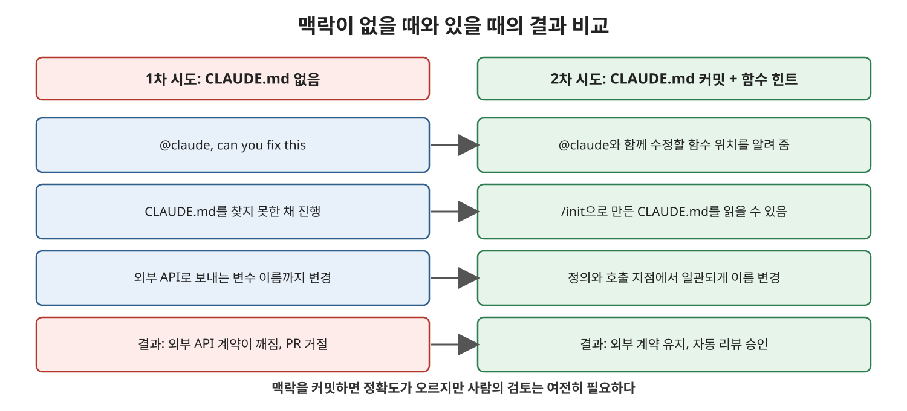

# 이슈 해결 실습과 컨텍스트의 효과

길을 모르는 택시 기사에게 "빨리 가 주세요"라고만 하면 엉뚱한 길로 간다. 목적지와 지도를 건네면 같은 기사가 정확히 간다. 이 문서의 실습이 보여 주는 바가 이것이다. Claude에게 GitHub 이슈를 맡겼더니 처음에는 외부 API 계약을 깨뜨리는 변경을 했고, 저장소 맥락을 담은 CLAUDE.md를 더하고 힌트를 주자 올바르게 고쳤다. 이 과정에서 Claude의 작업 방식(브랜치, 할 일 목록, 자동 검토)과 사람이 검토를 포기하면 안 되는 이유가 함께 드러난다.

---

## 1. 이슈에서 Claude 태그하기

연동이 끝난 저장소의 Issues 화면으로 간다. 대상은 happyLolonly라는 사용자가 연 단순한 이슈다. 변수 이름 `linkedin_username`이 실제로는 링크드인 URL을 담고 있으니 `linkedin_url`로 바꿔 읽기 쉽게 하자는 제안이다.

이슈에 댓글로 Claude를 태그해 해결을 요청한다.

```text
@claude, can you fix this
```

태그하는 순간 GitHub Action이 자동으로 시작된다. 이번에는 이름이 small rename이다. 액션을 열면 로그가 실시간으로 흐른다. 로그는 대부분 도구 호출, 도구 입력, 도구 출력을 담은 JSON이다. 깊은 디버깅에는 쓸모가 있지만 사람이 읽기 어렵고 큰 흐름을 따라가기도 힘들다. 대부분은 원시 로그 대신 이슈 화면으로 돌아가 보는 편이 낫다.

### 1.1 할 일 목록과 컨텍스트 탐색

이슈 화면에서 Claude는 할 일 목록을 만들고 진행에 따라 갱신한다. 첫 단계는 저장소에서 CLAUDE.md를 찾는 것이다. 이 파일은 추가 맥락을 준다. 기술 스택, 프로젝트 구조, 코딩 규약, 전하고 싶은 선호를 Claude가 이해하도록 돕는다. 모델이 일을 잘하도록 필요한 정보를 의도해서 공급하는 컨텍스트 엔지니어링의 일부다.

책은 미리 말해 둔다. 이 저장소에는 CLAUDE.md가 없다. 에이전트 AI 워크플로에서는 항상 올바르게 동작하지 않고 실수가 예상된다는 점을 보이려는 의도적 설정이다. 그래서 변경을 맹목적으로 받지 말고 꼼꼼히 검토하는 것이 필수다. 이 원칙은 이 예제만이 아니라 모든 에이전트 워크플로에 적용된다.

---

## 2. 첫 번째 시도: 그럴듯하지만 틀린 PR

Claude가 할 일 목록을 마치면 `linkedin.py` 파일을 수정한다. diff를 열어 보려고 PR을 만든다. PR 설명은 언뜻 그럴듯하다. 하지만 실제 코드 변경을 보면 Claude는 제3자 서비스로 보내는 API 요청의 일부인 변수를 바꿔 버렸다.

이것이 문제다. 외부 API는 페이로드가 특정 형식과 특정 변수 이름을 따를 것을 기대한다. 이름을 바꾸면 외부 엔드포인트와의 계약이 깨지고 코드가 실패한다. 그래서 이 PR은 틀렸고 받아들이면 안 된다.

예를 들어 외부 서비스가 `linkedin_username`이라는 키를 기다리는데 코드가 `linkedin_url`이라는 키로 보내면, 서비스는 값을 찾지 못한다. 겉으로는 이름만 예쁘게 바뀌었을 뿐인데 기능이 멎는다.

### 2.1 Claude의 작업 방식: 항상 새 브랜치

Claude는 변경을 자동으로 만든 새 브랜치에서 한다. 브랜치 이름은 `claude/issue/<이슈 번호>` 같은 규칙을 따른다. 이 점이 중요하다. Claude는 main 브랜치에서 직접 일하지 않는다. 검토, 수정, 병합 여부는 전적으로 사람이 쥔다.

이 브랜치 전략은 에이전트 워크플로를 확장하는 기초이기도 하다. 실제로 Claude 인스턴스 여러 개를 각자의 브랜치에서 병렬로 돌릴 수 있다. 이는 뒤에서 다룰 깃 워크트리(한 저장소에서 여러 작업 디렉터리를 동시에 쓰는 기능) 같은 고급 워크플로와 이어진다.

이 사례는 Claude Code로 이슈를 푸는 일의 힘과 한계를 함께 보여 준다. Claude는 변경을 빠르게 자동화하지만 맥락이 부족하면 깨는 변경을 낼 수 있다. 그래서 코드 검토는 여전히 필수이고, 브랜치 안에서 Claude가 어떻게 일하는지 이해하는 것이 확장의 열쇠다.

---

## 3. CLAUDE.md로 저장소 맥락 더하기

이 절의 목표는 명시적 저장소 맥락이 Claude Code의 변경을 얼마나 정확하고 믿을 만하게 만드는지 보이는 것이다. 변수 이름 이슈를 풀지 못한 이유가 저장소 맥락 부족이었다면 어떨까? 그 가정을 직접 검증한다.

### 3.1 맥락 초기화와 커밋

1. 데스크톱의 GitHub 프로젝트 디렉터리로 가서 Cursor로 열고, 최신 변경을 받아 오는 fetch를 한다. 앞 단계에서 만든 YAML 파일이 이미 들어 있다. 그다음 Claude를 연다.
2. `/init`을 실행한다. 이 명령은 기술 스택, 프로젝트 구조 같은 저장소별 맥락을 담은 CLAUDE.md를 만든다. 확인하면 Claude가 저장소 파일을 훑기 시작하며 시간은 짧게 걸린다.
3. 초기화 중 Claude는 파일 나열 같은 명령 실행 허가를 요청한다. 이를 명시적으로 허용한다. 로컬 설정 파일이 승인된 명령을 허용 목록으로 갱신하고, 이 허가는 로컬 세션 동안 유지된다. 이 승인 모델이 Claude가 할 수 있는 일을 세밀하게 통제하게 해 준다.
4. 스캔이 끝나면 Claude가 CLAUDE.md를 쓴다. 소스 디렉터리에서 파일을 찾아 내용을 검토한다. 저장소를 구조적으로 요약했고 내용이 맞아 보인다.
5. Claude에게 CLAUDE.md를 커밋하라고 지시한다. 커밋 메시지를 검토하고 수락하면 로컬에서 커밋이 만들어지고 원격 저장소로 푸시된다. 이 파일을 커밋하면 저장소 맥락이 버전 관리되고, 팀과 공유되며, GitHub Actions 같은 자동화 워크플로에서 Claude Code가 쓸 수 있다. 커밋 이력에 CLAUDE.md가 추가됐다는 항목이 보인다.

### 3.2 두 번째 시도: 힌트와 함께

이제 Claude가 앞서 풀지 못한 이슈로 돌아간다. 이슈에서 Claude를 다시 태그하며, 이번에는 바뀔 곳이 특정 함수 안이라는 힌트를 덧붙인다.

```text
@claude, can you please address this issue? Please notice that you need to edit
the function *ice_break_with**
```

원문의 함수 이름 표기는 별표가 섞여 있어 정확한 이름이 불확실하다. 아마 `ice_break_with`일 것으로 보이나 확정하지 않는다.

GitHub Actions 파이프라인이 곧바로 시작되며 Claude Code가 실행됐음을 보여 준다. 워크플로가 끝나기를 기다린다. Claude는 작업 목록을 만들고 실행한다. 추가 힌트 때문에 실험에 편향이 약간 있지만 올바른 맥락을 주는 효과를 보여 주기엔 충분하다.



워크플로가 끝나면 Claude가 만든 브랜치를 살핀다. 변수 이름이 `linkedin_username`에서 `linkedin_url`로 바뀌었고, 함수 정의와 호출 지점 양쪽에 일관되게 적용됐다. 지난 시도와 달리 이번 변경은 외부 API 계약을 지키며 연동을 깨지 않는다. 로직이 올바르다.

이제 `Renamed linkedin_username to linkedin_url`이라는 제목으로 PR을 만든다. 변경 범위를 정확히 반영한 제목이다.

---

## 4. 자동 코드 검토

PR이 열리는 즉시 Claude Code 리뷰 워크플로가 자동으로 돈다. Claude가 diff를 분석해 코드 검토를 하고 검토 단계의 체크리스트와 발견 사항을 만든다. 이 검토 체계는 완전히 설정할 수 있다. 린터, 테스트 실행, 맞춤 검증 규칙 같은 추가 검사를 필요에 따라 더할 수 있다. 이런 설정 가능성이 Claude Code가 팀 기반 엔지니어링 워크플로에서 효과를 내는 핵심 이유다.

검토는 전체 평가로 승인을 내며 기능상 문제는 발견되지 않는다. 검토가 승인됐으므로 PR을 병합할 수 있다.

참고(노트 작성자): 이 실험은 힌트가 함께 들어가 순수한 비교가 아니다. 책도 이 편향을 인정한다. 그래도 얻을 교훈은 분명하다. CLAUDE.md로 저장소 맥락을 커밋해 두면 자동화 워크플로가 그 맥락을 읽고, 결과의 정확도가 올라간다. 어느 쪽이든 사람의 검토는 빠지지 않는다.

<br>
<br>
<br>

[Agentic Coding with Claude Code](../)
