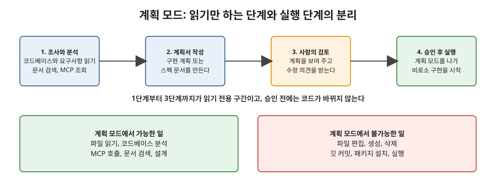

# 계획 모드와 스펙 작성

공사를 시작하기 전에 설계도부터 그리고 건축주의 승인을 받는 것과 같다. 계획 모드(plan mode)는 Claude Code가 설계도를 그리는 동안에는 벽돌 하나도 쌓지 못하게 막아 두는 읽기 전용 단계다. 승인이 나야 비로소 공사가 시작된다.

이 문서는 계획 모드의 특성과 작업 순서, 그리고 계획서를 파일로 남기는 이유를 다룬다. 이어서 책이 든 HookHub 예제로 스펙을 만들고 고치고 저장하는 과정을 따라간다. 책이 쓰인 시점 기준의 화면과 명령이다.

---

## 1. 6장의 자리

6장은 구조와 계획과 통제된 실행이 에이전트 코딩에 왜 필요한지로 시작한다. 시스템이 복잡해지고 도구와 자동화가 늘수록, 그때그때 던지는 프롬프트만으로는 의도하지 않은 변경과 예측하기 어려운 동작이 생길 위험이 커진다.

이 장은 두 가지를 보여 준다. 하나는 탐색식 프롬프트에서 스펙 주도 개발로 옮겨 가면 안전성과 예측 가능성이 좋아진다는 점이다. 다른 하나는 여러 에이전트를 조율해 같은 코드베이스를 효율적으로 다루는 방법이다. 예제는 Claude Code로 하지만 원리는 다른 에이전트 시스템에도 통한다.

책은 계획 모드의 공식 문서 위치도 알려 준다. 공식 문서의 일반 워크플로 항목에 계획 모드 사용법이 짧게 정리되어 있다.

## 2. 계획 모드의 특성

계획 모드에서 Claude Code는 읽기 전용 단계에 있다. 할 수 있는 일과 할 수 없는 일이 분명하게 나뉜다.

- 할 수 있는 일은 파일 읽기, 코드베이스 분석, MCP 호출, 문서 검색, 해법 설계다.
- 할 수 없는 일은 파일 편집, 생성, 삭제, 깃 커밋, 패키지 설치 같은 실행 수준의 모든 행동이다.

이 방식은 숙련된 소프트웨어 엔지니어의 일하는 순서를 그대로 닮았다. 먼저 맥락과 요구사항과 비즈니스 제약을 모은다. 그다음 계획을 세우고, 검토와 승인이 끝난 뒤에야 실행한다.



## 3. 계획 모드의 작업 순서

작업은 네 단계로 흘러간다.

1. Claude Code가 기존 코드베이스나 주어진 요구사항을 조사하고 분석한다.
2. 구현 계획 또는 스펙(specification, 만들 것을 적은 명세서)을 종합적으로 만든다.
3. 그 계획을 사람에게 보여 주고 검토를 받는다.
4. 승인되면 Claude Code가 계획 모드를 나가 구현을 시작한다.

전략과 실행을 이렇게 떼어 놓으면 일관성과 안전성이 생긴다. 코드베이스가 크거나 복잡할수록 효과가 크다. 읽기 전용 계획 단계가 있으면 구현 결정을 서두르지 않고 신중하게 내릴 수 있다.

## 4. 스펙 주도 개발의 이점

계획 모드는 복잡한 시스템을 설계하거나 큰 프로젝트를 이해할 때 특히 유용하다. 가장 큰 이점은 계획과 실행이 분명히 분리되어 위험이 줄고 신뢰성이 높아진다는 점이다.

실무에서는 만들어진 계획이나 스펙을 Markdown 파일로 내보내는 방법을 많이 쓴다. 이 파일은 공유하고, 함께 검토하고, 프로젝트 수명 동안 다시 쓸 수 있다. 계획 산출물이 눈에 보이고 오래 남게 되어 Claude Code의 가치가 더 커진다.

이것이 스펙 주도 개발의 한 예다. 기능을 바로 구현하는 대신 어떤 비즈니스 문제를 풀지, 무엇을 해결할지, 어떻게 풀지를 먼저 정한다. 결과가 좋아지고, 특히 서브에이전트와 함께 쓰면 전체 구현 시간도 줄어든다.

잘 쓴 스펙은 언어 모델에게 문제의 범위를 정해 준다. 경계가 분명해지니 환각(hallucination, 없는 것을 지어내는 현상)이 줄어든다. 불필요한 파일 변경이나 관련 없는 기능의 회귀 같은 부작용도 막는다.

## 5. 실습: HookHub 스펙 만들기

책은 새 Next.js 프로젝트 HookHub의 스펙을 계획 모드로 만든다. HookHub는 Claude Code 훅(hook)을 모아 보여 주는 마켓플레이스 웹 앱이다. 코드를 바로 짜지 않고 구조와 요구사항을 계획 산출물로 먼저 정의한 뒤 반복해서 다듬는 것이 목표다.

프로젝트 디렉터리에서 Claude Code를 열고 `/plan` 명령으로 계획 모드에 들어간다.

```bash
claude
/plan
```

계획 모드에서 이렇게 요청한다. 아래는 요청의 핵심이다.

```text
HookHub라는 웹 애플리케이션의 상세 스펙을 만들어 줘.
- 사용 가능한 Claude Code 훅을 보여 준다
- 훅을 카드로 렌더링한다
- 각 카드는 GitHub 저장소로 연결한다
- 훅 이벤트 유형별 필터를 지원한다
```

이 단계에서 Claude Code는 초기 작업 목록을 만들고, 관련 정보를 모으고, 스펙 문서를 낸다. 코드는 한 줄도 쓰지 않는다. 조사하고 개념을 정의하고 나중 구현을 위한 구조화된 스펙을 출력할 뿐이다.

## 6. 피드백으로 다듬기

처음 나온 스펙에는 고쳐야 할 결정이 들어 있었다. 훅을 회전식 캐러셀(carousel)로 보여 주고, 훅 이벤트 유형도 일부만 담았다.

책은 두 가지를 고쳤다. 캐러셀 방식을 없애고 모든 훅 카드를 홈 화면에 펼쳐 보이도록 바꿨다. 코드 생성 뒤에 일어나는 이벤트 같은 훅 이벤트 유형도 스펙에 더했다. 이렇게 사람이 의견을 주고 계획을 다시 쓰게 하는 반복이 계획 모드의 핵심 사용법이다.

참고(노트 작성자): 책은 이 과정에서 깊은 생각(deep thinking)을 함께 썼다고 요약하지만, 본문에서 켜는 방법은 따로 설명하지 않는다.

## 7. 스펙을 파일로 남기기

다듬기가 끝나면 완성된 스펙을 Markdown 파일로 내보낸다. 이 `.md` 파일은 저장소에 커밋해도 되고 `.claude` 디렉터리 같은 정해진 위치에 둬도 된다.

저장한 스펙은 프로젝트의 지속적인 기억이 된다. 이후 Claude Code 요청에서 맥락으로 다시 쓰이고, 구현하는 동안 Claude Code의 행동을 제한한다. 서브에이전트와 일할 때도 일관된 지침을 준다.

정리하면, 구체적인 앱 스펙을 만들고 고치고 저장하는 흐름을 보았다. 스펙이 있으면 병렬 개발 같은 고급 실행 방식도 효과적으로 쓸 수 있다. 그 실습은 다음 문서에서 다룬다.

<br>
<br>
<br>

[Agentic Coding with Claude Code](../)
