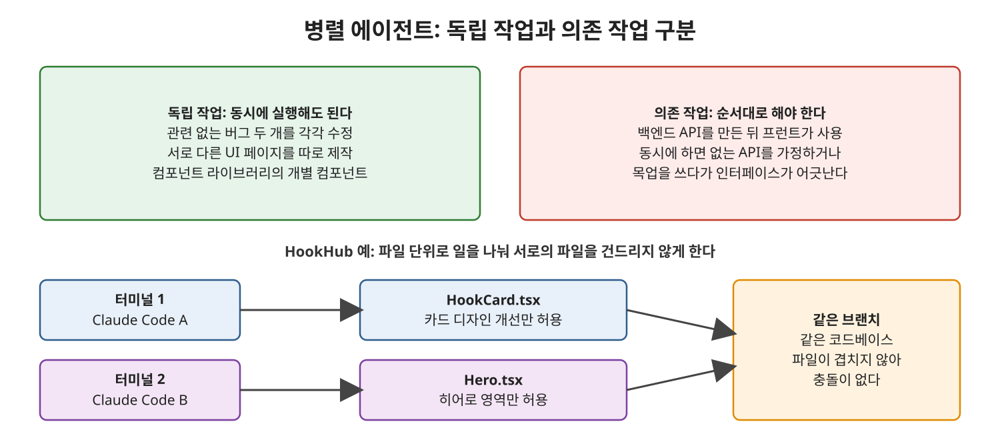

# 여러 Claude Code를 병렬로 쓰기

한 부엌에서 요리사 두 명이 각자 다른 요리를 만드는 모습을 떠올리면 된다. 서로 쓰는 도마와 재료가 겹치지 않으면 두 배로 빨라진다. 같은 도마를 함께 쓰면 부딪치고 망친다.

이 문서는 같은 프로젝트에서 Claude Code 여러 개를 동시에 돌리는 방법을 다룬다. 어떤 일을 병렬로 맡길 수 있는지, HookHub 예제에서 어떻게 나눴는지, 이 방식의 한계가 무엇인지를 순서대로 본다.

---

## 1. 병렬 에이전트의 기본 생각

Claude Code는 AI 에이전트 여러 개를 동시에 돌려 개발 속도를 높일 수 있다. 핵심은 서로 독립적인 일을 나눠 같은 시간에 더 많이 끝내는 것이다. 같은 프로젝트에서 Claude Code 인스턴스 여러 개를 실행하는 방식이다.

책은 이를 멀티 에이전트 코딩 시스템의 입문 예제로 본다. 서브에이전트를 쓰는 더 복잡한 구성도 가능하지만, 여기서는 독립된 Claude Code 두 개가 병렬로 일하는 구성을 보여 준다.

이 방식은 같은 프로젝트와 같은 깃 브랜치에서 여러 개발자가 일하는 것에 비유된다. 각 에이전트는 코드베이스 전체에 읽기와 쓰기 권한이 있다. 함께 일할 수 있지만 작업을 어떻게 나누느냐에 따라 충돌이 생길 수 있다.



## 2. 병렬로 맡길 수 있는 일

병렬 실행은 일이 서로 독립적일 때 효과가 있다. 서로 관련 없는 버그 수정, 별개의 UI 페이지 제작, 컴포넌트 라이브러리 안의 독립된 컴포넌트 만들기가 좋은 예다. 이런 일은 서로 방해하지 않고 동시에 끝낼 수 있다.

서로 의존하는 일은 병렬로 돌리면 안 된다. 대표적인 예는 백엔드 API 엔드포인트를 만들고 프런트엔드가 그것을 쓰는 풀스택 기능이다. 두 에이전트가 동시에 일하면 프런트엔드 에이전트가 아직 없는 API를 쓰려 한다. 그 결과 목업(mock, 가짜 구현)이나 최종 API와 맞지 않는 가정이 생기고 인터페이스가 어긋난다.

멀티 에이전트 작업의 핵심 기술은 어떤 일이 진짜 독립적이고 어떤 일이 순서가 있는지 가려내는 것이다. 독립 작업은 병렬로, 순차 작업은 순서대로 끝낸다. 이때 엔지니어의 역할은 직접 구현하는 사람에서 AI 에이전트의 일을 조율하고 감독하는 사람으로 옮겨 간다.

## 3. 실습 준비: 출발점 맞추기

이 실습은 앞서 만든 HookHub 스펙을 공유 기준으로 삼는다. `project/hookhub` 브랜치의 특정 커밋에서 시작하는데, 이 커밋이 에이전트들이 일을 시작하는 기준선이자 변경 범위를 정한다. 책의 커밋 해시는 자리표시자(`<commit-hash>`)로만 적혀 있어 실제 값은 알 수 없다.

시작 상태를 재현하는 명령은 다음과 같다.

```bash
git checkout project/hookhub
git reset --hard <commit-hash>
npm install
npm run dev
```

이때 화면에는 기본 히어로 영역이 있고, 훅 카드가 단순한 배치로 나오며, 시각적 다듬기는 없다. 이 화면이 병렬 작업을 나누는 맥락이 된다.

## 4. 독립 작업 찾아 나누기

현재 HookHub 화면에서 따로 개선할 수 있는 부분이 두 곳 보인다. 이 둘이 병렬 작업 후보다.

- 훅 카드 컴포넌트의 시각 디자인을 개선한다.
- 메인 페이지의 히어로 영역을 고친다.

각 작업은 별도의 Claude Code 인스턴스에 맡긴다. 한쪽에는 훅 카드 컴포넌트 파일만, 다른 쪽에는 히어로 영역만 고치라고 지시한다. 터미널 창을 둘 열어 각각 `claude`를 실행하고 프롬프트를 준다.

```text
[터미널 1]
HookCard 컴포넌트의 시각 디자인을 개선해 줘.
수정은 src/components/HookCard.tsx 만 하고 다른 파일은 건드리지 마.

[터미널 2]
히어로 영역을 다시 디자인해 줘.
수정은 src/components/Hero.tsx 만 하고 HookCard.tsx 는 건드리지 마.
```

지시문에 수정할 파일과 건드리면 안 되는 파일을 함께 적은 점이 중요하다. 이렇게 하면 두 에이전트가 서로의 영역을 침범하지 않는다.

## 5. 왜 충돌이 없었나

이 구성이 잘 돌아가는 이유는 훅 카드 컴포넌트와 히어로 영역이 서로 다른 파일에 구현되어 있기 때문이다. 두 컴포넌트가 한 파일에 같이 있었다면 동시 수정이 충돌을 일으켰을 것이다.

컴포넌트를 파일별로 나누는 것은 유지보수성, 가독성, 테스트 용이성을 높이는 일반적인 모범 사례다. 에이전트 워크플로에서는 이 습관이 특히 중요하다. 두 인스턴스는 각자 맡은 파일만 고치므로 병렬로 끝나고 파일 충돌도 생기지 않는다.

## 6. 검토하고 커밋하기

작업이 끝나면 변경 내용을 검토하고 저장소에 커밋한다. 이 예제에서는 훅 카드와 히어로 영역의 개선이 한 커밋에 담긴다.

```bash
git status
git diff
git add .
git commit -m "Refine HookCard and Hero using parallel Claude Code agents"
```

`git diff` 결과가 의도와 맞는지 확인한 뒤에 `git add`와 `git commit`을 실행한다. 이렇게 독립적이고 범위가 분명한 일이면 Claude Code 인스턴스 여러 개로 개발을 빠르게 할 수 있다.

## 7. 이 방식의 한계와 다음 단계

책은 장 끝에서 이 예제가 일부러 가장 단순한 멀티 에이전트 실행을 보여 준 것이라고 밝힌다. 같은 브랜치에서 파일을 나눠 맡는 방식은 핵심 아이디어를 이해하기에 좋다. 하지만 같은 브랜치에서 여러 에이전트를 돌리는 일은 본래 깨지기 쉽다. 겹치는 파일을 건드리거나 서로 맞지 않는 변경을 넣으면 충돌이 난다.

전문적인 개발 환경에서 병렬 작업의 업계 표준은 깃 브랜치나 깃 워크트리(git worktree, 한 저장소를 여러 작업 폴더로 펼치는 기능)로 변경을 분리하는 것이다. 워크트리를 쓰면 각 에이전트가 자기 브랜치의 자기 작업 폴더에서 독립된 코드 사본으로 일한다. 변경은 나중에 검토하고 통제된 방식으로 병합한다.

6장은 개념의 명확함과 가장 단순하게 재현되는 구성에 집중한다. 브랜치 분리와 구조적인 병합 워크플로를 포함한 더 견고한 병렬화 전략은 책의 뒷부분에서 다룬다고 한다. 다음 7장은 서브에이전트로 구조화되고 격리된 동시 워크플로를 만든다.

<br>
<br>
<br>

[Agentic Coding with Claude Code](../)
