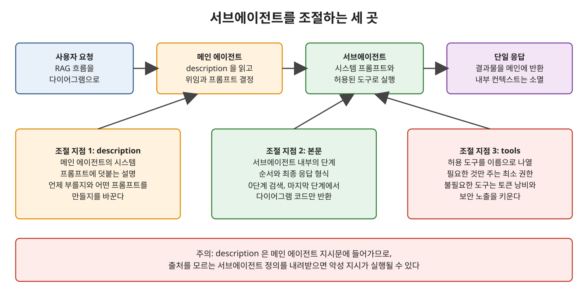

# Mermaid 서브에이전트 다듬기

심부름꾼에게 일을 시킬 때 결과를 바꾸는 길은 둘이다. 부탁하는 말투를 바꾸거나, 심부름꾼이 일하는 절차를 바꾸는 것이다. 서브에이전트도 같다. 메인 에이전트가 서브에이전트에게 건네는 프롬프트를 바꾸는 길과, 서브에이전트 내부 절차를 바꾸는 길이 있다.

이 문서는 텍스트를 Mermaid 다이어그램으로 바꿔 주는 서브에이전트를 만들고, 결과가 마음에 들지 않을 때 단계적으로 고쳐 나가는 과정이다. 책이 쓰인 시점의 도구와 화면 기준이다.

---

## 1. 목표와 만들기

이 에이전트의 목적은 글로 된 입력에서 Mermaid 다이어그램을 만드는 것이다. Mermaid는 읽기 쉬운 간단한 문법으로 다이어그램과 차트를 정의하는 자바스크립트 기반 도구다. GitHub 같은 문서 플랫폼에서 깔끔하게 렌더링된다. 여러 다이어그램 유형을 지원하고 문법이 가볍다.

새 세션을 열어 출력 스타일을 조정하고 에이전트 목록을 확인한 뒤, `/agents`에서 프로젝트 수준을 골라 Claude로 생성한다. 설명은 "내 입력을 받아 Mermaid 다이어그램을 만드는 에이전트를 만들어 줘"라고 간단히 썼다.

이 단계의 목표는 최고의 에이전트를 만드는 것이 아니다. 메인 에이전트와 서브에이전트가 어떻게 소통하는지, 무엇이 입력되고 무엇이 반환되는지를 관찰하는 것이다. 그래서 처음 프롬프트는 일부러 기본적으로 두고 나중에 다듬는다.

## 2. 도구 과잉 지급: 도구 오염

생성된 서브에이전트에 도구를 고르는데, 책은 읽기 전용, 편집, 실행 도구를 모두 켰다. 이 에이전트에게는 필요 이상으로 많은 도구다.

Mermaid 생성기의 유일한 책임은 글 입력에서 Mermaid 문법을 만드는 것이다. bash 같은 실행 도구도, 파일을 고칠 쓰기 권한도 필요 없다. 이렇게 서브에이전트에게 필요 없는 도구를 쥐여 주는 것을 도구 오염(tool pollution)이라 한다. 도구 정의 하나하나가 서브에이전트의 컨텍스트에 토큰을 더한다. 도구를 과하게 주면 컨텍스트가 커지고 불필요한 부담이 생긴다. 의도한 범위를 넘는 능력을 주므로 보안 노출도 커진다.

그래서 서브에이전트에는 정말 필요한 최소한의 도구만 줘야 한다. 최소 권한 원칙이다. 이후 Sonnet 모델과 색(청록)을 골라 저장하면 `mermaid-diagram-generator.md` 파일이 만들어진다.

## 3. description의 이중 역할

생성된 파일을 열어 보면 이름은 `mermaid-diagram-generator`이고, 설명이 Claude Code 메인 에이전트의 시스템 프롬프트에 덧붙는다는 점을 알 수 있다. 책의 설명에는 요약과 함께 입력 예와 어시스턴트의 반응 예가 들어 있고, 끝에 책이 직접 덧붙인 문장이 있다.

설명은 두 가지를 정한다. 하나는 메인 에이전트가 쓸 수 있는 서브에이전트 목록과 호출 시점이다. 다른 하나는 메인 에이전트가 서브에이전트에게 어떻게 프롬프트를 쓸지다. 서브에이전트는 격리된 컨텍스트에서 돌고 받는 정보가 메인 에이전트가 만든 프롬프트뿐이므로, 설명을 신중하게 쓰면 프롬프트의 구조와 형식과 내용을 조절할 수 있다. 서브에이전트에게 프롬프트가 건네지는 방식에 영향을 줄 수 있다는 점이 Claude Code에서 가장 강력한 면의 하나다.

YAML 머리말 아래는 서브에이전트의 내부 로직, 즉 시스템 프롬프트다. 특정 작업에 맞는 지침을 단계별로 쓰고 응답 형식도 정할 수 있다. 서브에이전트가 실행을 마치면 내부 컨텍스트가 지워지고 응답 하나만 메인 에이전트에게 돌아간다. 그 응답만 남는 산출물이다. 메인 에이전트가 처리하기 쉽도록 응답의 내용과 형식을 정할 수 있다.

## 4. 첫 실행과 아쉬운 결과

설정을 마치고 검색 증강 생성(RAG, 외부 자료를 찾아 답에 덧붙이는 방식) 흐름을 그려 달라고 요청한다. 메인 에이전트가 이 요청을 Mermaid 서브에이전트에 위임한다. 호출 내용을 살펴보면 서브에이전트에 전달된 프롬프트를 정확히 볼 수 있다. 벡터 데이터베이스, 임베딩 모델, 문서 청킹, 검색, 질의 처리, LLM 생성기를 포함한 전형적인 RAG 흐름의 Mermaid 다이어그램을 만들라는 내용이다.

서브에이전트는 격리된 컨텍스트에서 실행되고, 끝나면 Claude Code가 최종 응답을 메인 에이전트에게 전달한다. 응답에는 보통 Mermaid 문법과 설명이 담긴다. 이 문법을 복사해 Mermaid를 지원하는 도구로 렌더링한다. 책은 무료인 Excalidraw에 붙여 넣었다.

다이어그램은 생성됐지만 만족스럽지 않을 때도 있다. 한눈에 이해하기 어렵거나 정리가 안 되어 있거나 압도적으로 보인다. RAG를 잘 알아도 구성 요소의 상호작용이 바로 드러나지 않았다. 서브에이전트 설정을 다듬어야 한다는 신호다.

## 5. 1차 개선: description 조정

설명에 문장을 추가한다. 다이어그램의 세부를 단순하게 하는 것이 목표이므로 다음 취지의 문장을 넣었다.

```text
메인 에이전트는 항상 개념을 핵심(GIST)으로 단순화해야 한다.
개념을 나타내는 아스키 그림도 서브에이전트에게 써서 보내라.
```

의도는 메인 에이전트가 서브에이전트용 프롬프트를 만드는 방식을 바꾸는 것이다. 개념을 시각적으로 표현하라는 문장도 넣고 코드는 덜 중요하게 두라고 명시했다. 이 단계의 초점은 오직 메인 에이전트가 서브에이전트에게 만들어 주는 프롬프트를 빚는 것이다. `description` 필드를 바꾸면 메인 에이전트가 서브에이전트에게 프롬프트를 쓰는 방식을 조작할 수 있다.

파일을 저장하고 Claude Code를 다시 열어 비슷한 요청을 하면 서브에이전트에게 간 프롬프트에 핵심만 간추리라는 지시가 들어 있다. 메인 에이전트가 바뀐 설명의 영향을 받았다는 확인이다. 이 프롬프트가 서브에이전트가 받는 전체이자 유일한 맥락이다. 결과는 앞의 것보다 구조가 정돈되고, 색인과 검색 부분을 한눈에 알아보기 쉬워진다. 새 다이어그램은 더 단순하고 단계가 적어 따라가기 쉽다.

이 방식에는 보안 주의가 있다. 설명이 메인 에이전트의 시스템 프롬프트에 덧붙기 때문에, 출처가 불분명한 서브에이전트 정의에는 악의적 지시가 들어 있을 수 있다. 해로운 설명이 든 서브에이전트를 복제해 쓰면 로컬 컴퓨터에서 의도치 않은 위험한 동작이 일어날 수 있다. 설명 수준의 제어가 강력하다는 데서 나오는 중요한 함의다. 책은 메인 에이전트에게 API 호출 같은 동작을 시킬 수도 있다고 덧붙인다.

## 6. 2차 개선: 서브에이전트 내부 로직

지금까지는 메인 에이전트가 서브에이전트에 보내는 프롬프트를 바꿨다. 그것만으로는 충분하지 않다. 다음은 프롬프트 다듬기를 넘어 서브에이전트 자체의 내부 로직과 실행 흐름을 바꾸는 것이다.



한계가 하나 드러났다. 메인 에이전트에게 돌아온 최종 응답에는 Mermaid 코드가 직접 보이지 않고, 한 일의 요약만 있다. 코드는 서브에이전트 출력을 펼쳐 수동으로 복사해야 보인다. 서브에이전트는 내부 컨텍스트를 비우고 응답 하나만 돌려주는데, 그 응답에 원하는 산출물이 없었다. 그래서 설정을 고쳐 아무 군더더기 없이 실제 다이어그램을 반환하도록 명시한다. 이것이 에이전트의 일곱째이자 마지막 단계가 된다.

또한 0단계를 추가한다. 이미 만들어진 다이어그램이 온라인에 있는지 조사해 영감을 얻으라는 지시다. 일반 다이어그램을 가리키고 Mermaid로 한정하지 않았지만, 서브에이전트에 웹 검색 도구가 있어서 동작한다. 해법을 단순하게 두고 싶다면 설명에 그렇게 명시하고, 최소한으로 유지하라는 알림도 덧붙여야 한다.

이 부분은 서브에이전트의 내부 로직을 정하며 서브에이전트에만 적용된다. 메인 에이전트에는 영향이 없다. 변경을 저장하고 같은 프롬프트로 다시 요청한다.

## 7. 개선 결과와 한계

작업은 예상대로 서브에이전트에게 위임된다. 호출 내용을 보면 메인 에이전트가 서브에이전트에게 건넨 전체 프롬프트, 곧 서브에이전트가 가진 전체 컨텍스트를 확인할 수 있다. 검색에 시간이 꽤 걸리지만 결국 서브에이전트의 실행 흐름에 영향을 줬음이 확인된다. 서브에이전트가 처음 한 행동이 지시대로 웹 검색이다.

실행이 끝나도 서브에이전트는 다시 원본 코드가 아닌 요약을 반환한다. 에이전트 하니스(harness, 에이전트를 감싸 실행하는 틀)가 서브에이전트 응답을 노출하는 방식의 현재 한계라고 책은 설명한다. 전체 Mermaid 문법은 내부에서 생성되지만 메인 스레드에 직접 표시되지 않아, 출력을 펼쳐 복사해 도구에 붙여 넣어야 한다. 렌더링 중에는 처리 상자 스타일 관련 구문 오류가 났고, 스타일을 지우자 정상적으로 그려졌다.

결과 다이어그램은 이전보다 훨씬 정돈됐다. 두 흐름이 보인다. 검색 쪽은 사용자 질의를 임베딩하고, 벡터 저장소에서 유사도 검색을 하고, 상위 K개 문서를 가져와 프롬프트를 증강한다. 가져온 맥락을 프롬프트에 덧붙여 언어 모델로 보낸다. 색인 쪽은 문서를 불러와 전처리하고, 청킹하고, 임베딩해 벡터 데이터베이스에 저장한다. 전체적으로 더 단순하고 구조적이며 한눈에 이해하기 쉬워졌다.

고친 설정은 수정한 파일과 함께 저장소에 커밋하고 푸시해 `subagents` 브랜치에서 쓸 수 있게 했다.

| 개선 단계 | 건드린 곳 | 효과 |
|---|---|---|
| 1차 | description에 핵심 단순화와 아스키 그림 요청 | 서브에이전트에 가는 프롬프트가 단순해진다 |
| 2차 | 본문에 0단계 검색과 7단계 코드만 반환 | 실행 흐름과 최종 응답 형식이 바뀐다 |

<br>
<br>
<br>

[Agentic Coding with Claude Code](../)
