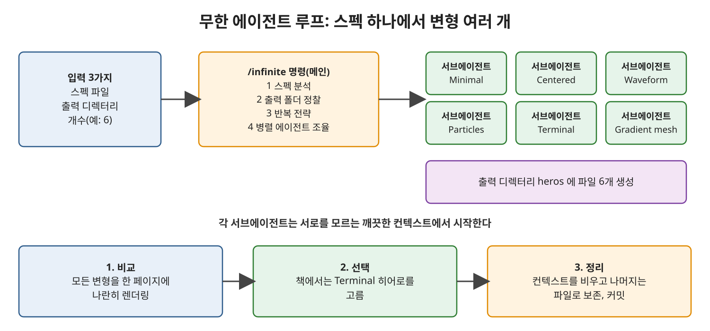

# 동시 서브에이전트로 변형 만들기

같은 주제로 디자이너 여섯 명에게 시안을 동시에 맡기고, 완성된 시안을 한 벽에 붙여 놓고 가장 좋은 것을 고르는 장면을 떠올려 보자. 한 사람이 여섯 번 그리는 것보다 빠르고 다양하다. 이 문서의 주제가 바로 이 방식이다.

앞에서는 서브에이전트 하나를 다뤘다. 여기서는 여러 서브에이전트를 동시에 띄워 각자 구현을 만들게 하고, 결과를 비교해 가장 강한 것을 고른다. 책이 쓰인 시점의 저장소와 도구 기준이다.

---

## 1. 접근 방식과 출처

이 절의 구현은 IndieDevDan이 만든 Infinite Agentic Loop 저장소를 바탕으로 한다. IndieDevDan은 에이전트 코딩을 다루는 유튜버로, 책은 이 저장소와 관련 영상을 장과 함께 참고하라고 소개한다. 에이전트 패턴과 멀티 에이전트 워크플로가 궁금하다면 그의 작업을 살펴볼 만하다고 한다.

이 방식은 여러 구현을 병렬로 만든 뒤 평가하고 통합하는 소프트웨어 엔지니어링 모델이다. 다만 토큰 사용 면에서 비용이 커질 수 있다. 서브에이전트를 여럿 띄우면 각자 독립적으로 돌며 자기 컨텍스트와 실행 단계만큼 토큰을 쓴다. 각 에이전트가 코드를 만들고, 평가하고, 추가 추론까지 할 수 있어서 전체 사용량이 크게 늘 수 있다. 책은 일부러 비용 추정치를 주지 않는다. 가격은 자주 바뀌고, 사용량은 코드베이스 크기와 에이전트 수와 작업의 복잡도에 따라 크게 달라지기 때문이다. 이 패턴을 쓸 때는 사용량을 주의 깊게 관찰해야 한다.

## 2. 환경 준비

앞의 HookHub 프로젝트에서 이어서 작업한다. 책의 저장소를 로컬에 복제하고, Claude Code 속성 과정 디렉터리의 `project/hookhub` 브랜치로 옮긴다. 커밋 목록에서 "Merge pull request #1 from emarco177/claude/add-anthropic-footer-..." 라는 제목의 커밋을 골라 해시를 복사해 체크아웃한다. 이것이 이 절에서 쓰는 커밋이다.

환경 설정은 이렇게 한다. 의존성은 `npm install`로 설치하고, 취약점이 보이면 `npm audit fix --force`로 고친다. 이후 개발 서버를 켠다. 책은 에디터로 Cursor를 사용한다.

```bash
git clone https://github.com/PacktPublishing/Agentic-Coding-with-Claude-Code
git checkout -b project/hookhub<commit-hash>
npm install
npm audit fix --force
npm run dev
```

그러면 Anthropic 테마의 HookHub 앱이 정상적으로 실행된다. 환경이 준비되어 여러 에이전트를 병렬로 조율할 수 있다. 참고(노트 작성자): `--force` 옵션은 호환성을 깨는 업데이트를 강행할 수 있으므로 실습용 저장소에서만 쓰는 편이 안전하다. 책의 체크아웃 명령은 해시 앞에 공백 없이 붙어 적혀 있어 오타로 보인다.

## 3. 사전 정리: Hero 컴포넌트 분리

저장소의 `infinite` 슬래시 명령을 쓸 것이다. 이 명령은 입력을 세 개 받는다. 스펙 파일, 출력 디렉터리, 숫자다. 스펙 파일을 읽어 구현할 기능을 파악하고, 지정한 수만큼 에이전트를 띄워 동시에 일하게 한다. 각 에이전트가 산출물을 하나씩 만들어 출력 디렉터리에 저장한다. 작은 배치용 가벼운 버전으로도, 거의 무한 루프에 가까운 큰 규모로도 설계되어 있다. 책은 가벼운 버전으로 시작한다.

예제는 서브에이전트들에게 Hero 컴포넌트의 변형을 구현시키는 것이다. 현재 앱의 컴포넌트 디렉터리에는 푸터와 훅 카드만 있고 독립된 Hero 컴포넌트가 없다. Hero 구현은 `page` 파일 안에 있다. 그래서 먼저 스펙을 만들기 전에 그것을 컴포넌트 디렉터리로 빼서 저장소를 정리한다.

1. page 파일의 Hero 구현을 꺼내 컴포넌트 디렉터리에 새 컴포넌트로 만들게 한다. page의 import도 새 컴포넌트를 가리키도록 바뀐다.
2. 그 `hero.tsx` 파일을 `components` 아래의 hero 디렉터리로 옮기게 한다. 이때 파일을 명시적으로 태그(@)해야 올바른 파일이 수정된다.
3. 옮긴 뒤 page의 원래 Hero 구현이 지워진다. 여러 서브에이전트의 산출물을 담을 `heros` 디렉터리도 만든다.

이제 프로젝트 구조가 깔끔해지고 스펙을 쓸 준비가 된다.

## 4. 스펙 파일 만들기와 명령 설치

`hero.tsx`를 바탕으로 스펙 파일을 쓰게 한다. 프롬프트는 이 컴포넌트가 무엇을 해야 하는지, 목표가 무엇인지, 구체 지침이 무엇인지를 설명하는 스펙을 만들어 달라는 것이다. 여러 변형을 구현할 것이라고 알린다. 생성된 스펙은 `specs` 디렉터리에 `hero.spec.md`로 저장된다. Hero 컴포넌트는 HookHub의 주 랜딩 영역으로, 제품의 가치 제안과 목표와 배경 레이어를 즉시 전달하도록 설계됐다.

다음은 `.claude` 디렉터리를 만드는 일이다. 새 브랜치라서 Claude가 이 사본에서 초기화된 적이 없어 디렉터리가 없다. 그 안에 `commands` 폴더를 만들고, Infinite Agentic Loop 저장소의 `infinite.md` 슬래시 명령을 복사해 넣는다. 이 명령이 여러 서브에이전트의 동시 실행을 조율한다. 내부 구현은 일단 분석하지 않고 쓰는 데 집중한다.

## 5. /infinite 실행하기

새 슬래시 명령을 읽도록 Claude를 종료했다가 다시 시작하면 `/infinite` 명령을 쓸 수 있다. 저장소 설명에 따르면 입력이 셋 필요하다. 책의 예에서는 스펙 파일이 hero.spec, 출력 디렉터리가 heros, 개수가 여섯이다.

```text
/infinite @../specs/hero.spec.md @../src/components/heros/ 6
```

참고(노트 작성자): 책에 실린 명령줄에는 개수 인자가 보이지 않으나, 본문은 여섯 개를 쓴다고 말한다. 위 예는 본문에 맞춰 개수를 덧붙인 것이다.

메인 에이전트가 먼저 스펙 파일을 읽는다. 읽고 나면 구현할 내용의 전체 맥락을 갖게 된다. Claude Code가 서로 다른 Hero 변형을 만드는 서브에이전트 여섯을 병렬로 띄운다. 할 일 목록이 갱신되고 서브에이전트가 동시에 돌기 시작한다.

비용은 이 지점에서 비싼 편이다. 각 에이전트가 독립적으로 돌며 자기 코드를 만들고 스스로 시험도 한다. Max 요금제 대신 Anthropic API 키를 쓴다면 토큰 사용량을 지켜봐야 한다. 서브에이전트는 로컬 컴퓨터에서 돈다. 에이전트를 100개처럼 훨씬 늘리려면 여러 기계로 확장해야 하고, Claude의 클라우드 서비스를 쓸 수 있다고 책은 말한다.

에이전트들이 끝나면 `heros` 디렉터리에 출력 파일이 생기고, 결국 여섯 개 구현이 만들어진다. 파일 생성 중 로컬 환경 때문에 문제가 생기면 Claude Code가 복구를 시도한다.



## 6. 비교하고 하나 고르기

여섯 구현이 모두 있으니 슬래시 명령과 별개의 새 프롬프트를 낸다. 모든 Hero 구현을 메인 랜딩 페이지에 차례로 보여 줘서 비교하고 가장 좋은 것을 고르게 해 달라는 요청이다. 각 서브에이전트가 격리된 자기 컨텍스트에서 돌았고, 서로를 모르며 깨끗한 상태에서 시작했다는 점을 기억해야 한다. 컨텍스트를 효율적으로 관리하는 방법이다.

메인 페이지가 각 Hero 변형을 import해 순서대로 렌더링하도록 바뀐다. diff를 보면 새 import가 더해지고 각 Hero가 차례로 렌더링된다. 앱에는 여섯 변형이 나타난다. Minimal, Centered, Waveform, Particles, Terminal, Gradient mesh다. 페이지에서 각각 눈으로 볼 수 있고, 책은 터미널 Hero를 선택한다.

고른 뒤에는 정리한다. 컨텍스트 윈도우가 앞선 작업 때문에 크게 부풀었는지 확인하고 컨텍스트를 비운 다음 새 프롬프트를 낸다. page 파일에는 터미널 Hero만 남기고 다른 Hero는 메인 페이지에서 지우되, heros 디렉터리의 파일은 그대로 두라는 요청이다. 두 대상을 명시적으로 태그한다. 컨텍스트가 깨끗해서 실행도 빠르다. 메인 페이지는 터미널 Hero만 렌더링하고 나머지 컴포넌트는 `heros` 디렉터리에 보존된다.

커밋은 변경을 `git add`로 올리고 `git status`로 확인한 뒤 커밋 메시지를 요청한다. 메시지에는 메인 페이지의 Hero 변경과 여러 서브에이전트를 돌리는 슬래시 명령 추가가 담겨야 한다. Claude가 diff를 읽고 메시지를 만들며 커밋과 푸시가 이뤄진다. 저장소를 새로 고치면 "Add hero component system and infinite agent slash command" 비슷한 메시지가 보인다.

## 7. 지금까지 한 일

`/infinite`로 서브에이전트를 병렬로 띄웠고, 각자 독립적으로 변형을 구현했다. 모든 변형이 만들어진 뒤 나란히 렌더링해 눈으로 평가하고 가장 좋은 구현을 골랐다. 이 방식은 컴퓨팅으로 확장하게 해 준다. 얼마나 많은 토큰을 쓰기로 하느냐가 감당할 병렬 탐색의 폭을 결정한다. 이 방식이 내부에서 어떻게 도는지는 다음 문서에서 본다.

<br>
<br>
<br>

[Agentic Coding with Claude Code](../)
