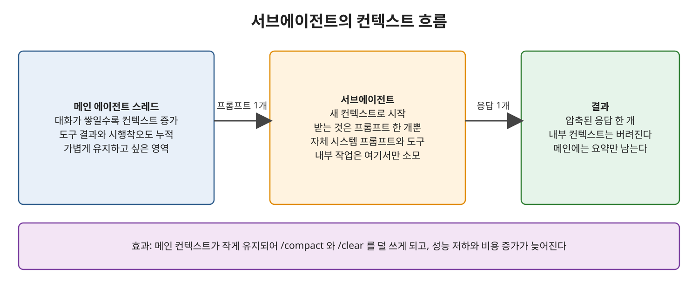

# 서브에이전트와 컨텍스트 흐름

회의록을 생각해 보자. 팀장이 모든 회의에 들어가 기록을 다 쌓아 두면 서류가 금세 산더미가 된다. 대신 담당자가 회의에 다녀와서 한 장짜리 보고서만 올리면 팀장의 책상은 가볍게 유지된다. 서브에이전트가 이 방식으로 컨텍스트 윈도우를 아껴 준다.

이 문서는 메인 에이전트와 서브에이전트 사이에 컨텍스트가 어떻게 오가는지, 그리고 왜 이것이 서브에이전트의 핵심인지를 다룬다. 토큰 수치는 책이 든 예시이며 실제 값은 작업마다 다르다.

---

## 1. 메인 스레드에서 컨텍스트가 커지는 모습

메인 에이전트 스레드는 메인 대화를 뜻하며, 이 스레드에서 메시지를 보낼 때마다 컨텍스트의 토큰 크기가 커진다. 대형 언어 모델에는 토큰 한도가 있어서 보낼 수 있는 토큰 수에 제약이 있다.

20만 토큰짜리 모델을 쓸 수도 있고, 100만 토큰짜리를 쓸 수도 있다. 앞으로는 200만이나 1000만 토큰짜리도 나올 것이라고 책은 말한다. 그래도 한도는 유한하다. 한도를 넘으면 요청이 실패한다. 그 전부터도 컨텍스트가 크면 비용이 늘어난다. 토큰마다 가격이 있기 때문이다. 응답도 느려져 지연이 커진다.

더 중요한 문제는 한도에 가까워질수록 컨텍스트 오염(context pollution)이 생기기 쉽다는 것이다. 쌓인 컨텍스트가 너무 많으면 대부분이 당면한 일과 상관없어지고 결과의 질이 떨어진다. 그래서 컨텍스트를 가능한 한 가볍게 유지하고 싶다.

책은 예를 든다. Claude Code와의 상호작용에서는 턴과 메시지마다 토큰이 쓰이고 컨텍스트 윈도우에 쌓인다. 첫 턴에 10K 토큰이 더해지고, 둘째 턴에 컨텍스트가 30K가 되고, 다섯째 턴에는 100K에 이를 수 있다.

## 2. 한 인스턴스의 한계

Claude Code 인스턴스 하나만 쓰면 언젠가 쌓인 컨텍스트가 너무 커서 다루기 어려운 시점이 온다. 그러면 `/compact`로 컨텍스트를 압축하거나, 컨텍스트를 아예 비우거나, 새 Claude Code 인스턴스를 열어 처음부터 시작해야 한다. 한도가 있는 컨텍스트 윈도우 안에서 일하는 데서 오는 자연스러운 결과다.

핵심은 컨텍스트가 유한하고 Claude Code 인스턴스 하나가 영원히 모든 것을 감당할 수 없다는 점이다. 이 한도가 Claude Code와 상호작용하는 방식을 직접 제약한다.

## 3. 서브에이전트가 푸는 방법

서브에이전트는 이 한계를 우아하게 우회한다. 서브에이전트를 쓸 때마다 자기만의 컨텍스트 윈도우에서 돌고, 거기서 쓴 토큰은 메인 Claude 에이전트의 컨텍스트에 포함되지 않는다.

메인 에이전트가 서브에이전트를 쓰기로 하면 새 프롬프트를 만든다. 이 프롬프트가 서브에이전트에게 전달되고, 실행 중에 서브에이전트가 받는 유일한 컨텍스트다. 서브에이전트는 앞서 있었던 전체 대화를 알지 못하고, 메인 에이전트가 만든 프롬프트만 가진다.

서브에이전트의 실행 품질은 이 프롬프트에 전적으로 달려 있다. 유일하게 제공되는 컨텍스트이기 때문이다. 우리는 이 프롬프트에 영향을 줄 수 있다. 메인 에이전트가 서브에이전트에게 프롬프트를 쓰는 방식을 조절하면, 일을 수행하기 쉬워지고 결과도 좋아진다.

서브에이전트는 독립적으로 일하며 필요한 도구를 부르고 통합도 수행하고, 압축된 응답 하나만 돌려준다. 새 서브에이전트를 띄울 때마다 생성된 프롬프트만 든 새 컨텍스트로 시작한다.

## 4. 결과: 가벼운 메인 스레드

이 구조 덕에 메인 스레드는 가볍게 유지된다. 많은 컨텍스트를 서브에이전트에 넘기면 서브에이전트는 격리된 채 일하고, 결과물만 메인 에이전트에 돌아온다. 메인 대화의 컨텍스트 윈도우를 작게 유지할 수 있다.

메인 에이전트에 컨텍스트가 쌓일수록 성능이 떨어지므로, 이 접근은 `/compact`나 `/clear` 같은 명령을 쓸 필요를 줄여 준다. 메인 컨텍스트를 가볍게 두면 성능과 안정성이 유지된다.

서브에이전트가 일을 마치면 15K나 20K 토큰쯤 되는 응답 하나를 돌려준다. 요약이나 코드 변경이 담길 수 있다. 중요한 점은 서브에이전트의 내부 컨텍스트 전체가 메인 대화에 쌓이지 않는다는 것이다.

요약하면 메인 에이전트가 서브에이전트에 입력 하나를 보내고, 서브에이전트가 일하고 출력 하나를 돌려준다. 진행은 계속하면서 컨텍스트는 압축하는 효과적인 방법이다. 각 서브에이전트는 자기 시스템 프롬프트를 가진 별도의 곁가지 체인(side chain)으로 돌며 특정 작업에 맞춰 전문화된다. 이 전문화 덕에 메인 에이전트 혼자보다 일을 더 잘 풀 수도 있다.

| 구분 | 메인 에이전트 | 서브에이전트 |
|---|---|---|
| 컨텍스트 | 대화 전체가 누적 | 받은 프롬프트 한 개로 시작 |
| 끝난 뒤 | 계속 남아 쌓임 | 내부 컨텍스트가 지워짐 |
| 남기는 것 | 모든 메시지 | 응답 하나 |

## 5. 정리

컨텍스트와 책임을 분리하는 것이 서브에이전트의 핵심 아이디어다. 단순하지만 매우 강력하다. 지금까지는 서브에이전트가 컨텍스트를 격리하고 압축된 결과를 돌려주는 방식에 집중했다. 다음 단계는 서브에이전트의 동작을 더 의도적으로 빚는 방법으로, 다음 문서에서 Mermaid 다이어그램 서브에이전트로 다룬다.

 
 
 

[Agentic Coding with Claude Code](../)
