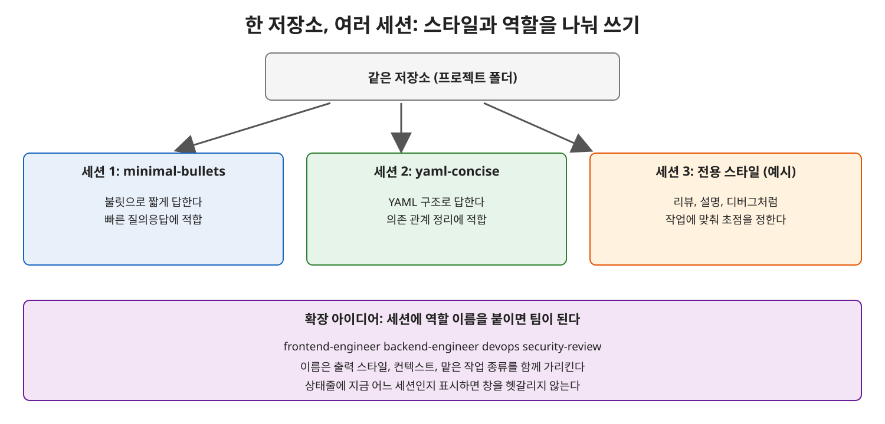

# HTML 출력 스타일과 병렬 세션

앞 절의 스타일은 답의 모양을 바꾸는 데 그쳤다. 이 문서의 스타일은 한 걸음 더 나간다. 답을 완성된 HTML 페이지로 내놓게 하고, 파일 저장과 브라우저 열기까지 스타일 안에 넣어 자동화한다. 그다음 같은 저장소에서 서로 다른 스타일의 Claude Code를 동시에 띄우는 방법을 본다.

비유하자면 신입에게 "보고서는 항상 이 양식으로, 다 쓰면 저장하고 공유 폴더에 올려라"라고 업무 규칙을 한 장에 적어 주는 일이다. 매번 같은 말을 반복하지 않아도 된다.

---

## 1. 레트로 ASCII 블로그 스타일 정의

프로젝트 범위 파일 `.claude/output-styles/retro-ASCII_blog.md`를 만든다. 목적은 응답을 ASCII 아트로 꾸민 복고풍 블로그 페이지, 즉 HTML로 내놓는 것이다. 완성본은 책의 예제 저장소에 있다(접근 방법은 머리말의 예제 코드 내려받기 절을 따른다).

본문은 네 영역으로 나뉜다.

| 영역 | 내용 |
|---|---|
| HTML 구조 | 완전한 HTML5 문서. DOCTYPE, head, body와 header, main, section 같은 시맨틱 요소, 내용을 반영한 title |
| ASCII 아트 스타일 | 상자 그리기 문자(═, ║, ╔ 등)와 -, +, * 로 만든 머리글, 구분선, 배너. 고정폭 글꼴 |
| CSS 요구사항 | style 태그에 직접 넣기. 어두운 배경에 밝은 글자, 초록 또는 호박색 단말기 느낌, 은은한 글로 효과 |
| 콘텐츠 구조 | 블로그 글처럼 구역을 나누고 ASCII 구분선, 머리글, 장식 바닥글을 둠 |

마지막에는 "가독성을 유지하면서 복고풍을 살려라, 옛 게시판이나 초기 웹 블로그를 보는 느낌이어야 한다"는 당부가 붙는다.

이 스타일은 단순한 터미널 서식을 넘어선다. 불릿이나 YAML 대신 완성된 HTML 문서를 만든다. 이 모든 동작이 마크다운 파일 하나로 정의되고 코드나 플러그인은 필요 없다.

## 2. 스타일 사용해 보기

스타일을 고르고 이렇게 묻는다.

```text
What are output styles? Provide an elaborate answer.
Show me which output styles I have right now.
```

응답은 HTML로 나온다. 이 마크업은 터미널에 그대로 찍히므로 읽기 어렵다. 이 시점에는 브라우저에서 열 파일도 없고 생성된 마크업이 화면에만 있다.

그래서 HTML을 파일로 저장하라고 따로 지시한다. 책에서는 `output-styles-guide.HTML`이라는 파일이 만들어졌고, 브라우저로 열자 출력 스타일을 설명하는 블로그형 페이지가 보였다. 페이지에는 설정된 출력 스타일들이 나열된다.

저자는 이 HTML이 세련될 필요는 없다고 말한다. 목적은 무엇을 생성할지에 완전한 자유가 있음을 보이는 것이다. 예를 들어 스타일을 Next.js 같은 큰 애플리케이션에 페이지를 쓰도록 확장하면, 응답마다 앱에 새 페이지가 하나씩 생기게 할 수도 있다. 미리 정해진 템플릿의 제한은 없고, 구조와 동작은 전부 설정이 정한다.

## 3. 파일 생성 자동화

매번 "HTML을 파일로 저장해 줘"라고 쓰는 것은 번거롭다. 그래서 이 동작을 스타일 정의에 넣는다. `retro-ASCII_blog.md`에 워크플로 항목을 덧붙인다.

```markdown
## Workflow
Save the HTML file after writing it, it should have a descriptive
name ending with .html
OPEN the generated file in the default web browser.
```

복잡한 로직은 없다. 프롬프트는 짧은 채로 두고 파일 생성 단계는 스타일의 지시가 맡는다. 스타일을 저장한 뒤 "What are output styles?" 한 줄만 물으면 `output-styles-quick-guide.html`이 자동으로 만들어진다. 기본 브라우저에서 열어도 되는지 확인을 요청하고, 승인하면 렌더링된 HTML이 바로 보인다.

이제 이 스타일 아래에서 나오는 모든 응답이 브라우저에서 열 수 있는 HTML 파일로 저장된다. 출력 스타일이 말투뿐 아니라 일하는 순서, 곧 워크플로 규칙까지 담을 수 있다는 점이 요점이다.

참고(노트 작성자): 원서 본문에 "deault"라는 오타가 있는데, 위 코드에서는 default로 고쳐 적었다. 또 위 스타일 본문은 분량 때문에 핵심 지침만 줄여서 옮겼다.

## 4. 여러 출력 스타일을 동시에 쓰기

스타일 하나는 특정 목적에 맞춘 서식을 보여 준다. 이를 더 확장하면 서로 다른 스타일을 가진 Claude Code 인스턴스를 여러 개 동시에 돌릴 수 있다. 같은 저장소에서 작업별로 서식을 나눠 쓰는 방식이다.

절차는 이렇다.

1. 저장소 안에서 새 터미널을 열고 Claude Code를 시작한다. 새 세션이므로 아직 스타일은 정해지지 않았다.
2. `/output-style`로 minimal-bullets를 고른다. 이제 이 세션은 불릿 형식으로 답한다.
3. 같은 저장소에서 두 번째 터미널을 열고 Claude Code를 다시 시작한다.
4. 이 세션에서는 yaml-concise를 고른다.

두 인스턴스가 동시에 떠 있고, 각자 자기 스타일을 유지한다. 같은 질문을 던져도 한쪽은 불릿으로, 다른 쪽은 YAML로 답한다.



그림의 아래쪽 역할 이름(frontend-engineer 등)은 이 장의 마지막 문서에서 다루는 확장 아이디어다.

## 5. 특화된 스타일 워크플로

두 세션을 나란히 놓으면 각 세션이 자기만의 서식 동작을 유지한다. 하나의 거대한 환경 대신, 세션 하나하나가 특정 작업에 맞춘 전용 AI 비서가 된다.

저자가 드는 쓰임새는 다음과 같다.

- 리뷰 전용 세션은 코드 차이, 보안 취약점, 아키텍처 우려에 초점을 둔다.
- 설명 전용 세션은 교육적 통찰이나 문서 생성에 맞춘다.
- 디버그 전용 세션은 오류 분석과 문제 해결에 집중하고, 출력도 그에 맞춘다.

출력 스타일은 작업에 맞게 AI의 인지 초점을 조율한다고 책은 표현한다.

다만 한계도 있다. 터미널 창을 오갈 때 지금 어떤 스타일이 켜져 있는지 눈에 띄게 보이지 않는다. 세션이 여러 개가 되면 이 점이 불편해진다. 이를 해결하는 것이 다음 문서의 상태줄이다.

이 절의 마무리로 저자는 검증된 설정을 버전 관리에 커밋한다. 스타일 파일이 프로젝트 안에 있으므로 팀과 공유하고 이력을 남길 수 있다는 뜻이다.

정리하면, 이 문서에서는 프로젝트 범위 스타일로 구조화된 HTML 출력을 만들고, 파일 저장과 브라우저 열기를 자동 워크플로로 넣고, 스타일이 서로 다른 세션을 병렬로 운용하는 법을 봤다. 스타일은 응답이 어떻게 보이는지뿐 아니라 어떻게 실행되는지까지 정한다.

<br>
<br>
<br>

[Agentic Coding with Claude Code](../)
