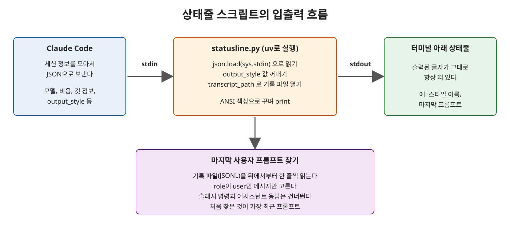

# 상태줄 사용자 지정

세션이 여러 개일 때 지금 어느 스타일인지 모른다는 문제가 앞 문서에서 나왔다. 이를 해결하는 도구가 상태줄(Status line, 터미널 아래쪽에 항상 떠 있는 한 줄짜리 정보 표시 영역)이다. 자동차 계기판처럼 지금 상태를 계속 보여 준다.

상태줄은 스크립트가 만든다. Claude Code가 세션 정보(모델, 컨텍스트 사용량, 비용, 깃 정보)를 JSON으로 스크립트에 넘기면, 스크립트가 출력한 글자가 그대로 화면 아래에 뜬다. 이 문서는 현재 출력 스타일을 보여 주는 상태줄을 만들고, 마지막 사용자 프롬프트까지 표시하도록 확장한다.

---

## 1. 상태줄이란 무엇인가

설정은 홈 디렉터리의 `.claude/settings.json`에서 `statusLine` 키가 스크립트를 가리키게 하면 된다. 더 쉬운 방법도 있다. `/statusline` 슬래시 명령에 자연어로 원하는 모습을 설명하면 Claude Code가 상태줄을 자동으로 만들어 준다.

상태줄이 실행할 수 있는 것은 셸 명령, 셸 스크립트, 파이썬 파일, Node.js 파일이다. 사실상 어떤 실행 로직이든 가능하다. 책은 파이썬을 골랐는데 저자가 익숙하기 때문이다.

## 2. 현재 출력 스타일을 보여 주는 상태줄 만들기

다음 프롬프트로 시작한다.

```text
/statusline I want you to create a statusline that displays the
current used output-style.
You should implement it in python and run it through uv
```

요구사항은 두 가지다. 파이썬으로 구현할 것, UV 패키지 관리자로 실행할 것이다.

명령을 실행하면 Claude Code가 서브에이전트를 하나 띄워 상태줄 제작을 돕게 한다. 이 서브에이전트가 먼저 하는 일은 홈 디렉터리의 `.claude/settings.json`을 열어 기존 상태줄 항목이 있는지 찾는 것이다. 책의 경우 항목이 없어서 파일을 새로 고친다.

이 settings.json에는 기본 모델이 `sonnet`으로 지정되어 있었고, 거기에 상태줄 항목이 추가된다. 대표 예시는 다음과 같다.

```json
{
  "model": "sonnet",
  "statusline": {
    "type": "command",
    "command": "uv run <HOME>/.claude/statusline.py"
  }
}
```

`type`은 command이고, command는 uv로 `statusline.py`를 실행하라는 뜻이다. 스크립트는 기본적으로 홈 디렉터리의 `.claude/statusline.py`에 생기며(`<HOME>`은 홈 디렉터리를 뜻하는 표기다), 실행 경로만 맞게 적으면 어디에 둬도 된다.

참고(노트 작성자): 본문 설명은 `statusLine` 키를, 코드 예시는 `statusline`을 쓴다. 두 표기가 달라 글자 수준에서는 어느 쪽이 맞는지 이 책만으로 확정할 수 없다. 실제 적용 전에 설치한 버전의 문서를 확인해야 한다.

## 3. 상태줄 로직 구현

`statusline.py`가 무엇을 보여 줄지 결정한다. Claude Code는 실행 정보를 표준 입력(stdin)으로 스크립트에 보낸다. 스크립트는 `json.load`로 이 입력을 딕셔너리에 읽어 모든 정보에 접근한다. 최소 구현은 네 줄이다.

```python
import json
import sys

input_data = json.load(sys.stdin)
style = input_data.get("output_style", "default")
print(style)
```

입력에 들어 있는 키 중 `output_style`이 현재 켜진 스타일 이름이다. 스타일이 정의되어 있지 않으면 "default"를 보여 준다. 스크립트가 표준 출력(stdout)에 쓴 내용을 Claude Code가 읽어 상태줄에 표시한다. 스타일을 바꾸면 stdin으로 들어오는 값이 바뀌므로 상태줄도 따라 바뀐다.



## 4. 색상과 확장

상태줄은 ANSI 색상 서식을 지원한다. 파이썬 print에 이스케이프 시퀀스를 넣으면 글자 색과 굵기를 바꿀 수 있다.

```python
print(f"\033[1;32m{style}\033[0m")
```

숫자 시퀀스는 터미널 서식을 제어하는 ANSI 코드이며, 위 예시는 굵은 초록색으로 보이게 한다. 로직이 스크립트이므로 현재 설정과 서식 조정이 바로 상태줄에 반영된다.

스크립트가 실행 파일이기 때문에 실행 환경에서 얻을 수 있는 어떤 정보든 보여 줄 수 있다. 책은 외부 시스템의 데이터, 주식 시세, 뉴스 피드 같은 동적 정보도 가능하다고 말한다. 요컨대 상태줄은 출력 형식을 넘어 개발 환경 자체를 코드로 빚는 수단이다.

## 5. 고급 상태줄: 마지막 사용자 프롬프트 표시

다음 목표는 상태줄에 현재 세션에서 사용자가 보낸 마지막 프롬프트를 띄우는 것이다. 먼저 대화 기록이 어디에 저장되는지 알아야 한다.

- 홈 디렉터리의 `.claude` 아래 `projects` 폴더에 프로젝트마다 하위 폴더가 있다. 폴더 이름은 프로젝트 경로에서 `/` 같은 구분자를 `-`로 바꾼 모양이다.
- 각 폴더에는 UUID로 이름 붙은 JSONL 파일이 있고 세션의 전체 메시지가 들어 있다.
- 파일의 한 줄이 JSON 객체 하나다. 사용자가 "hello"를 보내면 role은 user, content는 hello인 항목이 덧붙고, 이어서 어시스턴트의 응답이 붙는다.

상태줄 스크립트가 받는 입력에는 `transcript_path`가 들어 있고, 현재 세션의 JSONL 기록 파일을 가리킨다. 스크립트는 이 경로의 파일에서 가장 최근의 진짜 사용자 메시지를 찾는다. 어시스턴트 응답과 슬래시 명령 호출은 제외해야 한다. 구현은 기존 `statusline.py` 안에서만 하며 별도 스크립트는 만들지 않는다.

책이 쓴 `/statusline` 지시문은 이렇다.

```text
/statusline I want you to display also the last prompt from the
user in the current session.
You should get the prompt from the file example in the
transcript_path. /path/to/transcript.jsonl
Remember the user prompt will be a message with role="user".
Remember no commands at all responses, just user prompts.
```

찾기 함수의 동작 순서는 다음과 같다.

1. 기록 파일 경로가 존재하는지 확인한다.
2. JSONL 파일을 열어 읽는다.
3. 줄을 하나씩 돌며 JSON으로 해석한다.
4. 각 항목의 message 키를 본다.
5. message 안의 role이 user인지 확인한다.
6. user이면 content를 꺼낸다.

핵심 부분을 줄여 옮기면 다음과 같다.

```python
def get_last_user_prompt(transcript_path):
    if not os.path.exists(transcript_path):
        return "No transcript found"
    with open(transcript_path, "r") as f:
        lines = f.read().strip().split("\n")
    for line in reversed(lines):
        try:
            entry = json.loads(line)
            if entry.get("type") == "message" and entry.get("role") == "user":
                content = entry.get("message", {}).get("content", "")
                if content.startswith("/"):
                    continue  # 슬래시 명령은 건너뜀
                return content
        except json.JSONDecodeError:
            continue
    return "No user prompt found"
```

뒤에서부터 읽으므로 처음 걸리는 유효한 사용자 프롬프트가 가장 최근 것이다. 슬래시로 시작하는 명령과 어시스턴트 응답은 건너뛴다.

참고(노트 작성자): 원서 코드는 들여쓰기가 깨져 있어 복원했고, 빈 기록 처리와 예외 처리 부분은 줄였다. 코드는 type과 role을 최상위에서 확인하지만 본문 설명은 message 안의 role을 본다고 해서 둘이 완전히 일치하지 않는다. 실제 기록 형식은 버전에 따라 다를 수 있으니 직접 열어 확인하는 것이 좋다.

## 6. 검증과 마무리

기능을 만든 뒤에는 의도대로 동작하는지 확인한다. 새 메시지를 보낼 때마다 JSONL에 새 항목이 붙는다. 어시스턴트의 응답이 기록된 후 상태줄이 새 프롬프트로 바뀐다. 이 과정을 반복해 보면 세 가지가 확인된다.

- 메시지마다 JSONL 항목이 하나씩 늘어난다.
- 표시되는 프롬프트가 그에 맞춰 갱신된다.
- 스크립트가 늘 가장 최근의 유효한 사용자 프롬프트를 가져온다.

마지막으로 출력 스타일을 yaml-concise 등으로 바꿔도 마지막 프롬프트 표시가 정상인지 본다. 책의 시연에서는 문제가 없었다. 원서에는 "출력 레이블 갱신(Updating the output label)"이라는 소절 제목이 있지만, 그 아래 내용은 지금까지의 요약과 다음 절(전문 에이전트 팀)로 넘어가는 안내문이다.

<br>
<br>
<br>

[Agentic Coding with Claude Code](../)
