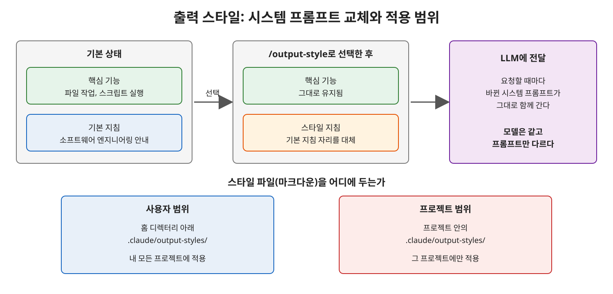

# 출력 스타일 만들기와 동작 원리

출력 스타일(Output Style, Claude Code가 답을 어떤 모양과 말투로 내놓을지 정해 두는 설정 파일)은 8장의 출발점이다. 저자는 이것을 "사용자와 모델 사이의 소통 규약을 바꾸는 장치"라고 부르고, 가장 강력하면서도 저평가된 기능 중 하나라고 말한다.

식당에 비유하면 이렇다. 주방(모델)은 그대로인데 메뉴판의 형식과 서빙 방식만 바꾸는 일이다. 같은 모델이 다른 시스템 프롬프트(모델에게 처음 주는 역할 지침)를 받아 다른 모양으로 답한다. 이 문서는 스타일 파일을 만들고 적용하고, 원리를 이해하고, YAML 형식 스타일로 확장하는 과정을 따라간다.

---

## 1. 기본 스타일과 스타일 파일의 위치

`/output-style` 명령을 실행하면 현재 켜진 스타일과 기본 스타일 목록이 나온다. 책이 쓰인 시점 기준으로 기본 스타일은 세 가지다.

- `Default`: 평소 모습 그대로의 스타일이다.
- `Explanatory`: 설명을 풍부하게 곁들이는 스타일이다.
- `Learning`: 배우는 사람에게 맞춘 스타일이다.

Explanatory와 Learning은 Anthropic 팀이 미리 만들어 둔 것이다. 직접 만들 수도 있다. 설치한 버전에 따라 기본 스타일이 더 늘어나 있을 수 있다고 책은 덧붙인다.

스타일 파일은 마크다운 한 개이며 놓는 위치에 따라 적용 범위가 달라진다.

| 범위 | 위치 | 적용 대상 |
|---|---|---|
| 사용자 범위 | 홈 디렉터리 아래 `.claude/output-styles/` | 내 모든 프로젝트 |
| 프로젝트 범위 | 프로젝트 안의 `.claude/output-styles/` | 해당 프로젝트만 |

파일 구조는 서브에이전트 정의와 비슷하다. 맨 위에 YAML 프런트매터(파일 머리에 `---`로 감싸 두는 메타데이터)가 있고 그 아래에 마크다운 본문이 온다.

## 2. 첫 번째 스타일 만들기: minimal-bullets

저자가 보여 주는 첫 예시는 사용자 범위 파일 `minimal-bullets.md`다. 핵심만 불릿으로 답하게 하는 스타일이다.

```markdown
---
description: Concise bullet-point responses with direct communication
---
# Communication Style
- Use bullet points for all responses
- Be direct and to the point
- No unnecessary language or filler

# Response Format
- Lead with the answer
- Use nested bullets for hierarchy
- Skip preamble and transitions

# Tone
- Professional and concise
- No hedging or qualifications
```

파일은 네 부분으로 읽힌다. 한 줄 설명(description), 소통 방식, 응답 형식, 어조 지침이다. 모두 "이렇게 말하라"는 자연어 지시일 뿐 코드는 없다.

스타일이 생성되면 Claude Code가 이 정의를 디스크에 쓴다. `/output-style` 목록을 다시 열어 minimal-bullets를 고르면 현재 스타일이 바뀌고, 목록에서 선택된 표시가 붙는다. 이후 질문에는 군더더기 없이 결론부터 불릿으로 답한다.

## 3. 출력 스타일은 어떻게 동작하나

스타일을 고르면 Claude Code의 시스템 프롬프트 일부가 스타일의 지침으로 바뀐다. 구체적으로는 기본 소프트웨어 엔지니어링 지침이 빠지고 그 자리에 선택한 스타일의 지침이 들어간다.

중요한 점이 두 가지 있다.

- 파일 읽기나 스크립트 실행 같은 핵심 기능은 어떤 스타일에서도 그대로 쓸 수 있다.
- 바뀐 시스템 프롬프트는 요청할 때마다 LLM에 그대로 전달된다. 즉 모델은 같고 시스템 프롬프트만 다르다.

`/output-style`로 스타일을 바꾸면 Claude Code는 내부의 시스템 프롬프트 틀을 갱신하고, 그 틀을 이후의 모든 호출에 적용한다. 프로젝트 범위 스타일은 그 프로젝트 안에서만 적용된다.



참고(노트 작성자): 기본 지침이 빠진다는 말은 코딩 관련 안내가 약해질 수 있다는 뜻이다. 스타일을 만들 때 필요한 작업 방식을 본문에 직접 적어 두는 편이 안전하다. 원서에는 이 부분에 대한 별도 경고가 없어 노트 작성자의 해석임을 밝힌다.

## 4. 왜 YAML 형식인가

저자는 이어서 응답을 YAML로 내놓는 스타일을 만든다. 이유는 형식 자체가 의미를 실어 나르기 때문이다. 설명을 문장으로 풀어 쓰는 대신 들여쓰기, 키 이름, 순서가 구조를 말해 준다.

YAML은 계층을 표현하므로 복잡한 코딩 작업과 잘 맞는다. 의존 관계는 부모와 자식으로, 우선순위는 나열 순서로, 범위는 중첩 깊이로 나타난다. 순서대로 나열한 단계 목록이 아니라 문제의 논리 구조 자체를 담는다는 것이 저자의 주장이다.

책은 YAML 스타일이 켜졌을 때 실제로 나온 응답을 보여 준다. 과제는 "인증 버그 수정"이다.

```yaml
Task: "Fix authentication bug"
Priority: "Urgent high"
Complexity: "Medium"
approach:
  investigate:
    auth_flow: &flow
      - login_endpoint
      - token_validation
      - session_middleware
  debugging:
    logs: "./auth.log"
    reproduce: "invalid_token_scenario"
fix:
  dependencies: [*flow]
  files_to_modify:
    auth.js:
      scope: "token refresh logic"
      risk: "low"
verify:
  tests: ["auth_integration", "token_expiry"]
  manual_check: "login flow end-to-end"
metadata:
  estimated_time: "2 hours"
  rollback_plan: "revert commits"
```

참고(노트 작성자): 원서 코드는 쪽 변환 과정에서 들여쓰기가 모두 사라져 있어 구조를 보고 복원했다. 지면 관계로 두 번째 파일(middleware.js)과 monitoring 항목은 생략했다.

각 부분의 역할은 다음과 같다. task는 맥락을 세우고, approach는 조사 경로와 디버깅 자료를 담는다. fix는 의존 관계와 파일 단위 범위를 적고, verify는 검증 수단을, metadata는 운영상 고려사항을 담는다. `&flow`와 `*flow`는 YAML의 앵커와 참조로, 조사한 흐름을 수정 단계가 다시 가리키게 한다.

핵심은 사고방식의 변화다. YAML은 "다음에 무엇을 하나"가 아니라 "무엇이 무엇에 연결되나"를 생각하게 만든다. 출력 스타일이 있으면 단일하고 고정된 소통 방식에서 벗어나 소통 규약 자체를 설계할 수 있다. 저자는 이것이 에이전틱 코딩의 본질, 곧 AI가 정보를 표현하고 협업하는 방식을 사용자가 직접 빚는 일이라고 정리한다.

## 5. 프로젝트 범위 YAML 스타일 만들기

이번에는 프로젝트 범위로 `yaml-concise` 스타일을 만든다. 프로젝트 안에 `.claude/output-styles/yaml-concise.md` 파일을 둔다.

```markdown
---
description: Concise YAML-formatted responses for structured communication
---
# Response Format
- All responses must be formatted as valid YAML
- Use hierarchy and nesting to express relationships
- Keep values concise, no full sentences unless necessary

# Structure
- Use top-level keys to represent major sections
- Nest subconcepts under their parent context
- Use lists for enumerations and sequences
- Use key-value pairs for properties and attributes

# Tone
- No prose, no filler, no transitional language
- Let the YAML structure carry the meaning
```

파일을 만들면 `/output-style` 목록에 yaml-concise가 나타난다. 이를 고른 뒤 "Claude Code 출력 스타일이 무엇인지 자세히 답해 줘"라고 물으면 문단이나 불릿이 아니라 YAML이 돌아온다.

응답 예시를 보면 정의(definition)와 용도(purpose)가 최상위 키가 된다. 위치(location) 아래에 global은 `.claude/output-styles/`, project는 프로젝트의 같은 경로로 나뉘고 "프로젝트가 전역을 덮어쓴다(precedence)"는 우선순위도 구조 안에 들어 있다. 기능(functionality) 아래에는 응답 형식, 어조, 정보 밀도, 작업 접근법, 워크플로 동작이 한 묶음으로 모인다.

이런 구조는 쿠버네티스나 도커 컴포즈 같은 설정 시스템이 YAML을 쓰는 방식과 닮았다. 읽기 쉬우면서 의미의 계층이 보존된다. 프로젝트 범위 YAML 스타일을 켜 두면 응답이 늘 이 모양으로 나오고, 순차적인 서술보다 구조적 사고가 강화된다.

참고(노트 작성자): 원서는 이 절에서 YAML 스타일 생성을 도와 주는 output-style-setup 서브에이전트가 프롬프트를 보강한다고 요약하지만, 그 동작 화면은 본문에 자세히 나오지 않는다.

<br>
<br>
<br>

[Agentic Coding with Claude Code](../)
