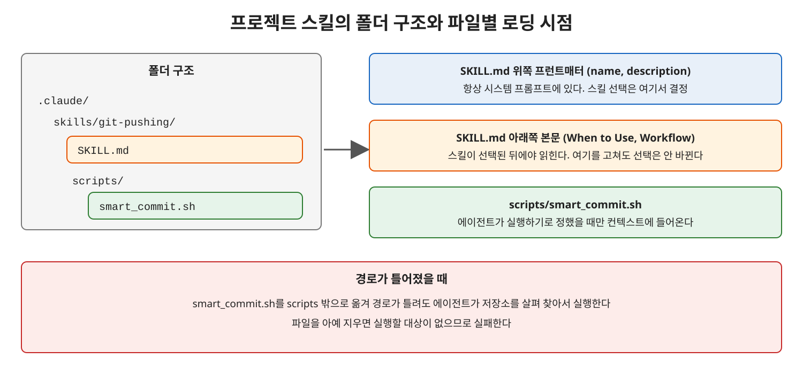

# 마켓플레이스 스킬 분석과 프로젝트 스킬 만들기

앞 문서에서는 공식 예제 스킬을 설치해 쓰기만 했다. 이번에는 온라인 저장소에 있는 스킬을 뜯어보고, 그것을 내려받아 우리 프로젝트에 직접 심는다. 이 과정에서 스킬이 단순한 참고 자료가 아니라 "이 일은 이 방식으로 하라"는 의견이 담긴 워크플로를 담을 수 있음이 드러난다.

사내 위키의 업무 절차서를 생각하면 된다. 절차서에 "배포는 반드시 이 스크립트로 한다"고 적혀 있으면 직원은 임의로 명령을 조합하지 않는다. 스킬이 에이전트에게 그런 절차서 역할을 한다.

---

## 1. claude-skills-marketplace 둘러보기

살펴볼 저장소는 claude-skills-marketplace(github.com/mhattingpete/claude-skills-marketplace)이며 Apache 2.0 라이선스다. 이곳에는 Claude Code 스킬 모음이 있어서 내려받아 Claude Code나 스킬을 지원하는 다른 에이전트 환경(Claude Desktop, LangChain DeepAgents 등)에 통합할 수 있다. 책은 이런 스킬 저장소가 여럿 있다고 말한다. 앞 절에서 본 것처럼 플러그인 시스템으로 이 저장소를 마켓플레이스로 추가할 수도 있다.

Engineering Workflows 아래에 `git-pushing`이라는 스킬이 있다. GitHub로 코드를 올리는 일을 돕는 스킬이다. 이 스킬의 SKILL.md는 맨 위 프런트매터와 그 아래 본문으로 나뉜다. 프런트매터는 이런 모양이다.

```markdown
---
name: git-pushing
description: Stage, commit, and push git changes with conventional
  commit messages. Use when user wants to commit and push changes,
  mentions pushing to remote, or asks to save and push their work.
  Also activates when user says "push changes", "commit and push",
  "push this", "push to github", or similar git workflow requests.
---
```

설명은 두 부분이다. 하는 일(변경 사항을 스테이징하고, 관례적인 커밋 메시지로 커밋하고, 푸시한다)과 쓸 때(사용자가 커밋과 푸시를 원하거나 원격 푸시를 언급하거나 작업 저장을 요청할 때, 그리고 위 문구들을 말할 때)다.

이 프런트매터만 Claude Code 에이전트의 시스템 프롬프트에 올라간다. 파일의 나머지는 스킬이 실행을 위해 선택될 때만 읽힌다.

## 2. 의견이 담긴 워크플로

본문의 구성은 다음과 같다.

- 제목과 한 줄 설명: 모든 변경을 스테이징하고 관례적 커밋을 만들어 원격 브랜치로 푸시한다.
- When to Use: 에이전트가 자동으로 활성화될 상황을 적는다. 푸시를 명시적으로 요청할 때("push this", "commit and push"), 원격 저장을 언급할 때("save to github"), 기능을 끝내고 공유하려 할 때, "let's push this up" 같은 말을 할 때다.
- Workflow: 여기에 핵심 규칙이 있다. 수동 깃 명령을 쓰지 말고 항상 스크립트를 쓰라고 지시한다.

```bash
bash skills/git-pushing/scripts/smart_commit.sh
bash skills/git-pushing/scripts/smart_commit.sh "feat: add feature"
```

위가 기본 실행이고 아래는 메시지를 직접 줄 때다. 스크립트가 스테이징, 관례적 커밋 메시지, Claude 푸터, `-u` 옵션을 쓴 푸시를 처리한다고 적혀 있다.

스크립트에는 실제 깃 로직이 들어 있다. `git add`, `git status`, `git commit` 같은 동작이다. 스킬 작성자는 메인 에이전트가 깃 명령을 날것으로 내리지 못하게 의도적으로 제한하고, 지정한 스크립트를 쓰게 만들었다.

여기서 핵심 개념이 나온다. 스킬은 의견이 담긴 워크플로(opinionated workflow)를 담는다. 팀이 커밋을 특정 구조나 절차로 만들고 싶다면, 그 논리를 스킬에 포장할 수 있다. 에이전트는 통제된 방식으로 그 능력을 얻는다.

## 3. 스크립트 살펴보기

`scripts` 디렉터리에 `smart_commit.sh`가 있다. 깃 실행 흐름을 정의하며 스테이징, 상태 확인, 특정 메시지로 커밋하는 명령을 순서대로 돌린다. 에이전트는 이 스크립트를 실행할 수 있지만, 그것은 git-pushing 스킬을 쓰기로 결정했을 때뿐이다.

중요한 점은 에이전트가 이 스크립트의 존재를 해당 스킬을 쓰기로 정한 뒤에야 안다는 것이다. 스크립트는 스킬이 선택된 다음에야 사용 가능한 컨텍스트의 일부가 된다.

앞서 본 brand-guidelines 스킬은 참고 내용을 주는 데 가까웠다. 이 스킬은 한 걸음 더 나가서, 작업(여기서는 커밋과 GitHub 푸시)을 돕기 위해 에이전트가 실행할 수 있는 보조 스크립트를 가진다. 결정적 코드로 정의하고 싶은 워크플로를 스킬 안에 담아 두면, 에이전트는 수동 명령 순서를 즉흥적으로 만드는 대신 그 스크립트를 실행한다.

MCP와 비슷해 보일 수 있지만 메커니즘이 다르다. MCP는 API 호출과 외부 서비스와의 통신을 가능하게 한다. 스킬은 구조화된 컨텍스트를 주입하고, 선택적으로 스크립트를 노출한다.

## 4. 프로젝트 수준 스킬 만들기

이제 이 스킬을 우리 프로젝트에 복제한다. `project/skills` 브랜치로 전환한다. 프로젝트 수준 스킬은 `.claude` 디렉터리 아래에 정의해서 이 저장소에만 적용되게 한다. 구조는 다음과 같다.

```text
.claude/
  skills/git-pushing/
    scripts/
      smart_commit.sh
    SKILL.md
```

이 구조는 마켓플레이스 스킬의 구조와 같다. GitHub 저장소의 `SKILL.md`와 `smart_commit.sh` 내용을 로컬의 대응 파일에 복사한다. SKILL.md가 `scripts/smart_commit.sh`를 참조하므로 디렉터리 구조를 같게 유지해야 호환된다. 이 단계에서 스킬이 로컬에 완전히 복제된다.



플러그인 시스템으로 설치할 수도 있었지만, 손으로 복사하면 커스터마이징을 온전히 통제할 수 있다. 이 선택이 다음 문서의 실험(트리거 문구 수정, 스크립트 개조, 구조 훼손)의 바탕이 된다.

참고(노트 작성자): 책의 두 그림 9.4와 9.5는 폴더 구조 화면과 SKILL.md 화면이며, 이 노트에서는 원서 화면 대신 위 코드 블록과 새로 그린 그림으로 설명한다.

## 5. 이 문서의 요점

- 스킬은 폴더 하나다. SKILL.md와 보조 스크립트, 자료가 같은 디렉터리에 있다.
- 에이전트가 항상 보는 것은 프런트매터의 name과 description뿐이다.
- 본문과 스크립트는 스킬이 선택된 뒤에야 컨텍스트에 들어온다.
- 스킬로 에이전트의 행동을 제한할 수 있다. git-pushing은 수동 깃 명령 대신 지정된 스크립트를 쓰게 한다.
- 프로젝트 수준 스킬은 `.claude/skills/` 아래에 두며, 적용 범위가 그 저장소로 한정된다.

<br>
<br>
<br>

[Agentic Coding with Claude Code](../)
