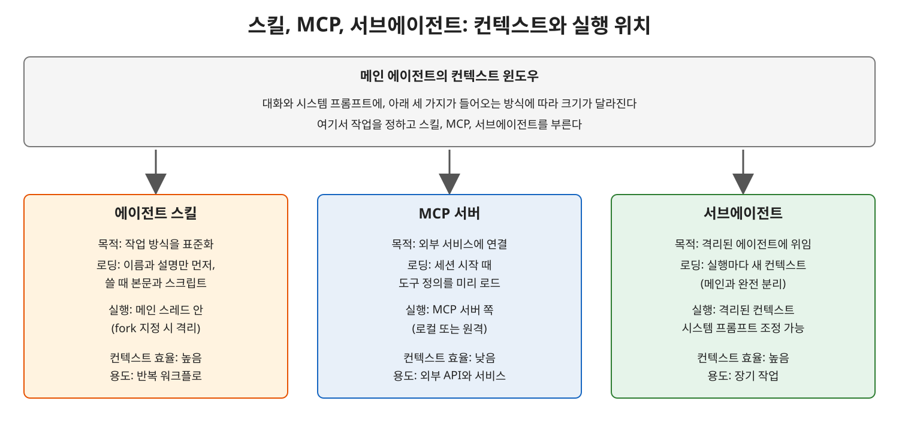

# 스킬과 MCP, 서브에이전트 비교

스킬을 이해했다면 이제 비슷해 보이는 다른 구성 요소와 구분할 차례다. 에이전트에게 능력을 더하는 방법은 스킬만이 아니다. MCP 서버, 서브에이전트, 메모리, 슬래시 명령도 있다. 저자는 이들을 컨텍스트 관리, 컨텍스트 엔지니어링, 실행 흐름의 관점에서 비교한다.

연장통에 비유하면 이렇다. 스킬은 작업 절차서, MCP는 외부 업체와 연결된 전화선, 서브에이전트는 따로 일하는 외주 팀이다. 모두 일을 돕지만 어느 층에서 어떤 비용으로 일하는지가 다르다.

---

## 1. 스킬과 MCP

둘 다 현대 에이전트 도구 상자의 핵심이지만 푸는 문제가 다르고 컨텍스트 구조의 서로 다른 층에서 동작한다.

스킬은 절차적 지식의 컨테이너다. 에이전트에게 전문 작업을 일관되게 하는 법을 가르치는 지침, 스크립트, 자료가 든 폴더다. 핵심어는 일관성이다. 워크플로를 포장해 에이전트에게 주면 정해진 방식대로 작업을 수행한다. 컨텍스트 엔지니어링 관점에서 스킬은 점진적 공개에 기반한다.

세션이 시작되면 에이전트는 사용 가능한 스킬의 이름과 짧은 설명만 불러온다. 이 단계의 컨텍스트 비용은 낮아서, 스킬 하나당 보통 100 내지 200토큰 정도이며 스킬 내부가 아무리 복잡해도 같다. 스킬이 작업과 관련되면, 그 판단은 에이전트가 하는데, SKILL.md의 전체 지침이 컨텍스트에 로드된다. 에이전트가 스크립트를 실행하기로 정했을 때만 그 스크립트가 로드된다. 스킬에 스크립트가 여러 개여도 쓰지 않는 것은 로드되지 않는다. 이런 점진적 로딩 덕분에 스킬은 컨텍스트 효율이 높다.

MCP는 구조가 다르다. 도구 정의와 서버 명세가 대화 시작 시점에 미리 제공된다. 이것이 컨텍스트 효율에 영향을 준다. 책의 예로 MCP 서버 다섯 개가 첫 프롬프트를 보내기도 전에 5만 토큰을 쓸 수 있다. MCP가 푸는 문제는 에이전트를 외부 자원에 연결하는 일이다. 스킬은 에이전트가 전문 작업을 일관되게 하게 만드는 일을 푼다. 둘 다 에이전트 구성 요소지만 시스템의 다른 층을 다룬다.

참고(노트 작성자): 100 내지 200토큰이나 5만 토큰은 원서가 든 예시 수치이고, 책이 쓰인 시점 기준의 대략적 값이다.

슬래시 명령으로만 스킬을 발동시키고 Claude Code가 자동으로 부르지 못하게 하려면 프런트매터에 `disable-model-invocation: true`를 넣는다.

## 2. 호출과 실행의 차이

스킬과 MCP 도구 모두 에이전트의 판단으로 호출된다. 각각의 설명을 보고 쓸지 정한다. 호출 메커니즘은 비슷하다. 둘 다 에이전트가 그 능력이 작업과 관련 있는지 평가한다.

흥미로운 실험이 하나 제안된다. 같은 기능을 스킬과 MCP 서버의 도구로 두 번 구현해 놓고 에이전트가 실제로 어느 쪽을 고르는지 관찰하는 것이다. 에이전트가 이 구성 요소들을 어떻게 추론하는지 드러난다.

실행은 다르다. MCP는 MCP 서버 안에서 실행되며 서버는 로컬이나 클라우드에 있을 수 있다. 스킬은 보통 메인 에이전트 스레드 안에서 로컬로 실행된다. 스킬 안의 스크립트는 에이전트의 주 실행 흐름의 일부로 돈다. 단 프런트매터에 `context: fork`가 있으면 스킬이 메인 에이전트가 아니라 격리된 서브에이전트 컨텍스트에서 돈다. 이 실행 위치의 차이가 아키텍처를 따질 때 중요하다.

## 3. 스킬과 서브에이전트

공통점은 특정 작업을 위한 전용 지침을 정의할 수 있다는 것이다. 스킬은 구조화된 지침과 선택적 스크립트를 담고, 서브에이전트도 자기 지침을 가질 수 있다.

핵심 차이는 컨텍스트 격리다. 서브에이전트는 자기만의 새롭고 격리된 컨텍스트 윈도우에서 일한다. 그대로 두면 메인 에이전트의 컨텍스트 윈도우를 크게 키울 장기 작업에 알맞다. 반면 스킬은 메인 에이전트의 컨텍스트 안에서 동작한다. 호출되면 지침이 별도 윈도우가 아니라 기존 윈도우로 로드된다.

둘 다 메인 에이전트가 호출한다. 서브에이전트에 위임할지 스킬로 실행할지는 메인 에이전트가 정한다.

유연성과 통제 면에서는 서브에이전트가 앞선다. 서브에이전트에서는 시스템 프롬프트를 필요에 맞게 동적으로 조정할 수 있다. 스킬에서는 시스템 프롬프트가 메인 에이전트의 것으로 남는데, 그것은 보통 벤더가 관리하며 쉽게 바꿀 수 없다.

경험칙은 다음과 같다.

- 작업이 무겁고 메인 컨텍스트 윈도우를 부풀릴 위험이 있으면 서브에이전트가 알맞다.
- 반복 작업에서 에이전트에게 자동으로 전문성을 주거나 특정 방법론을 강제하고 싶다면 스킬이 낫다.

둘 다 가치 있는 구성 요소지만 컨텍스트와 실행 모델이 다르다. 기본적으로 스킬은 메인 에이전트 안에서 인라인으로 돌고 서브에이전트는 격리 컨텍스트에서 돈다. 하지만 스킬이 `context: fork`를 지정하면 서브에이전트와 비슷한 가벼운 격리 컨텍스트에서 돌 수 있다. 다만 설정 통제는 서브에이전트보다 적다.

## 4. 에이전트 구성 요소 비교표

책은 스킬과 서브에이전트를 Claude Code 전체 모델에 놓기 위해 MCP 서버, 슬래시 명령과 함께 표로 비교한다(표 9.1). 원서 표는 열이 네 개이고 항목이 많아, 여기서는 두 표로 나눠 옮긴다.

| 항목 | 스킬 | MCP | 서브에이전트 |
|---|---|---|---|
| 목적 | 작업 수행 방식을 표준화 | 외부 서비스에 연결 | 격리된 에이전트에 일 위임 |
| 컨텍스트 로딩 | 프런트매터 먼저, 쓸 때 전체 | 세션 시작 시 도구 로드 | 실행마다 새 컨텍스트 |
| 트리거 | 에이전트 판단 | 에이전트 판단 | 에이전트 위임 |
| 실행 위치 | 메인 에이전트 스레드 | MCP 서버(로컬 또는 원격) | 격리된 서브에이전트 컨텍스트 |

슬래시 명령의 앞쪽 항목은 표 열에 맞지 않아 글로 적는다. 목적은 사용자가 직접 부르는 단축 동작이고, 컨텍스트 로딩은 전체 프롬프트 주입이며, 트리거는 사용자가 `/명령`을 실행하는 것이고, 실행 위치는 메인 에이전트 스레드다.

| 항목 | 스킬 | MCP | 서브에이전트 | 슬래시 명령 |
|---|---|---|---|---|
| 컨텍스트 격리 | 메인과 공유 | 외부에서 실행 | 완전 격리 | 메인과 공유 |
| 스크립트 | 있음 | 없음 | 있음 | 없음 |
| 실패 처리 | 에이전트가 추론으로 복구 | 에이전트가 서버 오류 처리 | 메인이 재시도나 조정 | 없음 |
| 적합한 용도 | 반복 워크플로 | 외부 API나 서비스 | 장기 작업 | 빠른 동작 |
| 컨텍스트 효율 | 높음(지연 로딩) | 낮음(미리 로드) | 높음(작업 분리) | 낮음(매번 전체 프롬프트) |
| 맞춤 정도 | 완전한 통제 | 서버가 정의 | 유연 | 제한적 |

참고(노트 작성자): 원서 표 9.1은 쪽 변환 과정에서 열이 어긋나 일부 칸(슬래시 명령의 목적, 트리거, 컨텍스트 로딩 등)이 깨져 읽혔다. 슬래시 명령 열은 "사용자가 `/명령`을 실행하고 전체 프롬프트가 주입되며 메인 스레드에서 돈다"는 취지의 원문을 정리했다. 표의 컨텍스트 격리 열에서 MCP 칸은 원문이 "External execution"으로 읽혀 위처럼 "외부에서 실행"으로 옮겼고, 서브에이전트의 스크립트 칸이 "Yes"로 나오는 것은 원문 그대로이니 의미는 직접 확인하기를 권한다.

## 5. 장 정리

장 요약은 이렇다. 이 장은 에이전트 스킬을 실용과 아키텍처 양면에서 살펴봤다. 에이전트에 직접 프롬프트로 시키는 방식과 스킬로 구조화된 행동을 캡슐화하는 방식을 손으로 비교하며 시작했다. HookHub 예제로 스킬이 점진적 컨텍스트 로딩을 가능하게 해 메인 컨텍스트 윈도우를 부풀리지 않고 필요한 지침만 동적으로 주입함을 봤다. 이어 프로젝트 수준 커스텀 스킬을 만들고, 보조 스크립트를 통합하고, 동작을 고치고, Claude CLI를 호출하도록 개선했다. 그 과정에서 스킬이 의견이 담긴 워크플로를 포장하고, 결정적 실행과 AI 생성 출력을 결합하며, 스크립트가 실패해도 대체 동작을 허용함을 확인했다. 마지막으로 MCP와 서브에이전트와 비교해 각 구성 요소의 컨텍스트 구조, 실행 흐름, 통제 방식을 정리했다.

저자의 마무리는 이렇다. 이제 스킬을 쓸 줄 아는 데 그치지 않고, 내부에서 어떻게 작동하는지 분명한 정신 모델을 가졌고, 더 유능하고 컨텍스트 효율적인 에이전트 시스템을 설계할 때 언제 적용할지도 알게 됐다. 다음 장은 데스크톱 앱에서 Claude Code를 쓰는 법이다.

 
 
 

[Agentic Coding with Claude Code](../)
