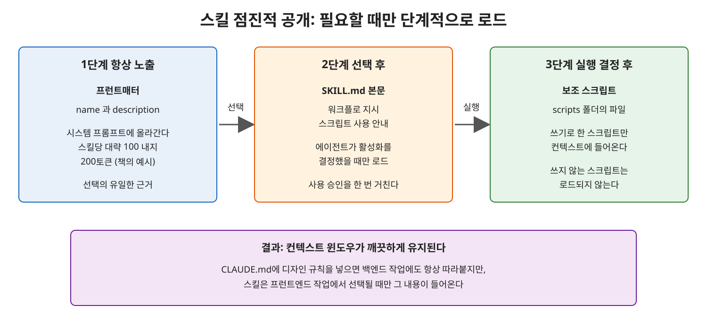

# 스킬의 핵심 개념과 첫 체험

에이전트 스킬(Agent Skills, 작업 방법과 스크립트를 폴더 하나로 묶어 에이전트에게 주는 확장 단위)은 Anthropic 팀이 2025년 10월에 소개했다. 맞춤 워크플로와 작업별 지침을 구조화된 단위로 포장해서, 에이전트가 일반적인 추론만으로는 어려운 복잡한 일을 해내게 하려는 장치다. Claude는 대화 맥락이 스킬의 description 필드와 맞아떨어지면 스킬을 자동으로 불러 쓴다.

요리사의 레시피 카드에 비유할 수 있다. 요리사가 모든 레시피를 머릿속에 늘 들고 있지 않고, 주문이 들어오면 해당 카드만 꺼내 읽는다. 이 장의 중심 개념인 점진적 공개(progressive disclosure, 필요할 때만 정보를 단계적으로 불러오는 방식)가 바로 그것이다. 이 문서에서는 스킬이 없을 때와 있을 때를 같은 작업으로 비교하며 그 차이를 확인한다.

---

## 1. 장의 구성과 핵심 아이디어

9장은 세 단계로 진행된다. 먼저 스킬의 기본 개념과 Claude Code 같은 환경에서의 실제 사용을 본다. LangChain DeepAgents 같은 다른 도구에서도 스킬을 쓸 수 있다고 책은 언급한다. 다음으로 스킬이 호출될 때 에이전트 안에서 컨텍스트가 어떻게 흐르는지 속을 들여다본다. 마지막으로 실제 에이전트에 스킬을 구현해 지금까지의 시각을 하나로 묶는다. 장의 세 주제는 다음과 같다.

- 에이전트 스킬의 핵심
- 에이전트 스킬 깊이 들어가기
- 에이전트 스킬과 다른 에이전트 구성 요소 비교

핵심 아이디어는 스킬이 에이전트의 활성 컨텍스트에 항상 올라가 있지 않다는 점이다. 작업과 관련될 때만 스킬을 불러오므로 불필요한 지침이 작업 맥락에 끼어들지 않고, 추론이 흐려지지 않는다. 이 동적 로딩은 장 뒤쪽에서 자세히 본다.

## 2. 출발점 복원하기

실습 소재는 앞 장들에서 만든 HookHub 앱이다. 저장소에서 hookhub 브랜치로 가서 "improved hookcard and hero with multiagent working"이라는 제목의 커밋을 출발점으로 삼는다. 이후 커밋이 더 쌓여 브랜치 이력이 앞으로 가 있을 수 있으므로 반드시 이 커밋에서 시작해야 한다.

해시를 복사해 IDE에서 해당 브랜치와 커밋으로 전환한다.

```bash
git switch project/hookhub c125545ca118f51c07eb6defe61ba727dbf05788
cd hookhub
npm install
npm run dev
```

전환하면 hookhub 디렉터리가 나타나고, 거기에 앞 장까지 만든 코드가 있다. 의존성을 설치하고 개발 서버를 켜면 앱이 로컬 3000번 포트에서 돈다. 이것으로 시연에 필요한 정확한 기준 상태가 복원된다.

참고(노트 작성자): 위 git switch 명령은 원서 표기를 그대로 옮겼다. 일반적인 git switch는 커밋 해시를 바로 받지 않으므로, 실제로는 책의 저장소 안내에 맞춰 확인해야 한다.

## 3. 시나리오 1: 스킬 없이 스타일 입히기

앱의 화면은 일부러 단순하게 만들어져 있다. 여기에 Anthropic의 디자인 언어를 그대로 입히고 싶다고 하자. 스킬이 없으면 직접 이렇게 요청한다.

```text
Make this web app Anthropic style.
```

이 시점에 저장소에는 Anthropic 브랜드 가이드라인에 대한 자료가 없다. 에이전트는 프로젝트 파일을 훑고 anthropic.com에서 정보를 가져와 디자인 언어를 즉석에서 도출해 구현을 시작한다. 이 방식은 잘 작동한다. 배경색, 서체, 세부 시각 요소가 바뀌어 결과는 Anthropic 느낌에 꽤 가깝다.

그러나 반복을 생각해야 한다. 같은 작업을 할 때마다 에이전트가 같은 디자인 언어를 다시 가져와 다시 도출한다. 워크플로가 자주 반복되면 중복된 컨텍스트 수집이 매번 생긴다.

해결책으로 디자인 언어를 CLAUDE.md에 넣는 방법이 있다. 하지만 그러면 그 내용이 모든 프롬프트에 붙는다. 디자인과 무관한 백엔드 작업에도 따라붙어서 컨텍스트가 불필요하게 커지고 결국 품질이 떨어진다.

## 4. 시나리오 2: 스킬로 스타일 입히기

스킬이 더 우아한 해법이다. Anthropic 테마의 디자인 언어를 담은 스킬을 만들어 두면, 프런트엔드 작업을 할 때마다 Claude Code가 그 스킬을 골라 필요한 디자인 맥락을 동적으로 불러온다.

공식 예제 저장소(github.com/anthropics/skills)에서 스킬은 각자 폴더를 가진다. 그중 `brand-guidelines` 폴더의 `SKILL.md`를 열어 본다. 알아 둘 점이 두 가지다.

- 스킬은 마크다운만 담지 않는다. 스크립트, 실행 파일, 구조화된 자료도 넣을 수 있다.
- SKILL.md는 맨 위에 프런트매터가 있다. 스킬이 선택될 때 시스템 프롬프트에 주입되는 부분은 이 프런트매터뿐이다. 상세한 브랜드 가이드가 든 나머지 본문은 스킬이 활성화될 때만 프롬프트에 들어간다.

이는 앞서 서브에이전트에서 본 선택적 로딩과 닮았다. 컨텍스트가 전역이 아니라 조건부로 주입된다. 책은 이 장의 예제 일부가 Anthropic Skills 저장소(Apache License 2.0)에서 가져와 고친 것이고, 구현과 동작이 바뀔 수 있다고 밝힌다. 공식 Claude Code 마켓플레이스의 스킬은 새 상위 버전이 있으면 시작할 때 자동 업데이트되며, 서드파티 스킬은 `/plugin`에서 수동 업데이트나 자동 업데이트 설정이 필요할 수 있다고도 한다.

## 5. Claude Code에 스킬 설치하기

에이전트에 스킬을 장착하려면 Anthropic 스킬 저장소를 마켓플레이스 플러그인으로 추가한다.

```text
/plugin add marketplace anthropic/skills
```

Claude Code가 저장소를 로컬의 `.claude/plugins`에 복제한다. `/plugins`로 설치를 확인하고 플러그인을 둘러보면 두 범주가 보인다.

- 문서 스킬(Document skills): 엑셀과 파워포인트 같은 문서 처리 능력
- 예제 스킬(Example skills): 앞에서 본 브랜드 가이드라인 스킬 등

예제 스킬을 설치한 뒤 Claude Code를 다시 시작해 "Which skills do you have?"라고 묻는다. 에이전트가 사용 가능한 스킬 목록을 보여 주고 거기에 `brand-guidelines`가 들어 있다.

참고로 Claude(앱)가 슬라이드와 문서 만들기 기능을 선보였을 때 스킬 지원이 함께 발표됐다. 그 기능들이 내부적으로 에이전트 스킬로 만들어져 있기 때문이다. 문서와 프레젠테이션 생성 능력도 이 장에서 다루는 스킬 메커니즘 위에서 돈다.

## 6. 스킬을 켜고 스타일링하기

컨텍스트를 비우고 새 Claude 인스턴스를 시작해 이렇게 묻는다.

```text
Can you make sure that the logo is according to Anthropic brand?
```

에이전트가 저장소를 훑은 뒤 `brand-guidelines` 스킬 사용 권한을 요청하고 스킬 설명이 표시된다. 승인하면 Claude가 brand-guidelines 디렉터리를 동적으로 컨텍스트에 불러오는데, 관련된 마크다운 파일만 주입된다. 이 추가 맥락으로 공식 브랜드 정의에 맞춰 디자인을 바꾼다.

변경이 끝나면 `npm run build`로 빌드하고 `npm run dev`로 개발 서버를 다시 켠다. 서체 조정과 브랜드에 맞춘 스타일 같은 미세한 개선이 보인다. 이 시연의 목표는 시각적 차이가 아니라 스킬을 통한 통제된 컨텍스트 주입을 보여 주는 것이다.



핵심 관찰은 이 컨텍스트가 동적으로 로드되고 모든 프롬프트에 영구적으로 붙지 않는다는 것이다. 이렇게 컨텍스트를 점진적으로 불러오면 작업 컨텍스트 윈도우(모델이 한 번에 볼 수 있는 글의 양)가 깨끗하고 효율적으로 유지된다. 이 절차를 점진적 공개라고 부른다.

스킬을 슬래시 명령으로만 부르고 싶다면 스킬 프런트매터에 `disable-model-invocation: true`를 넣는다.

## 7. 스크립트를 가진 스킬

스킬이 정적인 마크다운 자료만 주는 것은 아니다. 일부는 실행 스크립트를 담는다. 예제 스킬 `skill-creator`의 디렉터리에는 파이썬 스크립트가 여럿 있고, SKILL.md에서 에이전트에게 이 스크립트들을 실행할 수 있다고 알려 준다.

스크립트는 파이썬, 배시, 자바스크립트 등 환경이 지원하는 어떤 언어로든 쓸 수 있다. 스킬 정의에 동작이 분명히 적혀 있으면 에이전트가 이를 결정적(deterministic, 같은 입력에 항상 같은 결과가 나오는) 도구로 쓴다. 어떤 절차를 결정적 스크립트로 만들 수 있다면, 스킬을 통해 상위 수준 능력으로 조립된다. 에이전트는 스크립트 순서를 실행하고 출력을 묶어 복잡한 작업을 해낸다.

<br>
<br>
<br>

[Agentic Coding with Claude Code](../)
