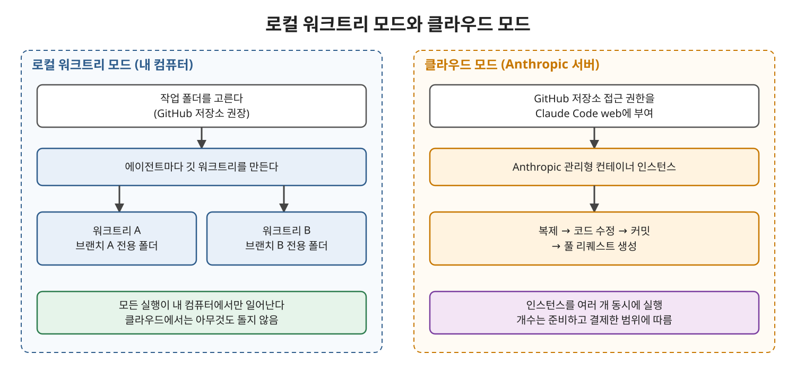

# 데스크톱 통합과 실행 모드, 깃 워크트리

이 문서는 10장의 앞부분을 다룬다. Claude Code가 Claude 데스크톱 앱과 모바일 앱 안으로 들어온 모습, 작업 위치를 로컬과 클라우드 중에서 고르는 방법, 그리고 로컬 모드의 바탕이 되는 깃 워크트리(Git Worktree, 한 저장소의 여러 브랜치를 서로 다른 폴더에 동시에 꺼내 두는 깃 기능)를 설명한다.

비유하면 이렇다. 책상 하나에서 서류를 번갈아 펴 놓고 일하면 매번 치워야 한다. 책상을 여러 개 놓고 일마다 다른 책상을 쓰면 서로 섞이지 않는다. 워크트리는 에이전트마다 책상을 하나씩 주는 장치다.

---

## 1. 데스크톱 통합과 백그라운드 에이전트

Anthropic은 Claude Code를 Claude 데스크톱 앱과 모바일 앱 안에 직접 넣었다. 개발 작업과 일상적인 대화형 추론이 같은 환경에서 이뤄지므로 도구를 오가는 부담이 줄고 흐름이 매끄러워진다.

여기에 클라우드에서 도는 백그라운드 에이전트(Background Agent, 내 화면을 점유하지 않고 Anthropic 서버에서 따로 작업하는 에이전트)가 처음부터 따라온다. 저자는 이 조합 덕분에 기능을 순서대로가 아니라 동시에 개발할 수 있게 됐다고 말한다. 데모를 준비하면서 작업 방식이 달라졌다는 점이 바로 느껴졌다고 한다.

저자는 이 장의 시연이 여러 작업을 동시에 벌이는 형태라서 독자가 한 단계씩 따라 하기는 현실적이지 않다고 밝힌다. 그래서 장의 목표는 따라 치기가 아니라 개념을 이해하고 통합이 실제로 어떻게 돌아가는지 관찰하는 것이다.

## 2. 데스크톱 앱의 Code 탭

Claude 데스크톱 앱에는 Code 탭이 있다. 이 탭은 Claude Code를 그래픽 인터페이스로 실행한다. 터미널 버전과 같은 엔진과 같은 설정을 공유한다. CLAUDE.md, MCP 서버, 훅 같은 구성이 그대로 적용된다는 뜻이다.

Code 탭을 열면 작업 공간이 나타나고, 프로젝트 폴더를 고른 뒤 코드베이스와 대화를 시작한다. 책은 이 부분을 스크린샷으로 보여 주며, 이 노트는 그림 대신 글로 옮겼다.

참고(노트 작성자): 탭 이름, 선택기 모양, 아이콘 같은 화면 요소는 책이 쓰인 시점 기준이다. 앱 업데이트로 바뀔 수 있다.

## 3. 두 가지 실행 모드

작업 방식 선택기에서 두 모드를 고른다. 책이 설명하는 차이는 아래 표와 같다.

| 구분 | 로컬 워크트리(Local worktree) | 클라우드(웹, 기본값) |
|---|---|---|
| 실행 위치 | 내 컴퓨터. 클라우드에서는 아무것도 돌지 않음 | Anthropic 인프라의 관리형 컨테이너 |
| 준비물 | 작업 폴더(가능하면 GitHub 저장소) | GitHub 저장소 접근 권한 |
| 격리 방식 | 에이전트마다 깃 워크트리 생성 | 에이전트마다 별도 컨테이너 |
| 동시 실행 수 | 내 컴퓨터가 감당하는 만큼 | 구독과 결제 범위에 따라 결정 |

### 3.1 로컬 워크트리 모드

먼저 폴더를 고른다. 이 폴더가 Claude Code가 일하는 작업 공간이 된다. 보통은 코드 저장소가 들어 있고 GitHub 저장소라면 더 좋다. 책의 시연에서는 Agentic-Coding-with-Claude-Code 디렉터리를 열었다.

중요한 점은 "저장소가 아니라 폴더를 고른다"는 것이다. 로컬에서 워크트리를 만들고 관리하려면 에이전트가 쓸 디렉터리가 필요하기 때문이다. 이 모드에서는 모든 일이 내 컴퓨터에서 일어난다.

### 3.2 클라우드 모드(Claude Code web)

기본 옵션은 구름 아이콘이 붙은 클라우드 모드다. 이 모드에서는 Claude Code가 Anthropic 서버의 관리형 인스턴스로 돈다. 책은 이것을 Claude Code web, 원격 워커, 백그라운드 에이전트라고 부른다.

컨테이너로 도는 인스턴스가 내 코드를 읽으려면 접근권이 필요하다. 그래서 GitHub 저장소에 대한 권한을 Claude Code web에 준다. 권한이 주어지면 프롬프트를 보낸 뒤 다음 순서로 일이 흘러간다.

1. Anthropic이 Claude Code 인스턴스를 띄운다.
2. 인스턴스가 저장소를 복제한다.
3. 코드를 직접 고친다.
4. 변경을 커밋한다.
5. 풀 리퀘스트를 만들 수 있다.

저장소 접근권이 있으므로 이 인스턴스는 프로젝트의 다른 개발자와 똑같이 움직인다. 이 구조의 장점은 규모다. 작업마다 인스턴스를 따로 띄워 여러 개를 동시에 돌릴 수 있다. 몇 개까지 되는지는 준비하고 결제한 범위에 달려 있다.

## 4. 깃 워크트리가 병렬 개발을 가능하게 하는 이유

로컬 워크트리 모드에서 Claude Code는 깃 워크트리를 쓴다. 평소에는 브랜치를 바꾸려면 작업 중인 변경을 치우고 체크아웃해야 한다. 워크트리를 쓰면 같은 저장소의 여러 브랜치를 각각 다른 디렉터리에 동시에 꺼내 둘 수 있고, 저장소를 여러 번 복제할 필요도 없다.

에이전트 여러 개가 동시에 일할 때 특히 유용하다. 각 에이전트가 자기 브랜치와 자기 폴더에서 일하므로 변경을 임시 보관(stash)하거나 브랜치를 오갈 필요가 없다. 분리는 파일 시스템의 독립된 디렉터리가 맡는다.

저자는 이 흐름을 쓰는 데 워크트리를 깊이 알 필요는 없다고 한다. 여러 브랜치가 동시에 살아 있게 해 주고, Claude Code가 그 성질로 병렬 개발을 지원한다는 점만 알면 충분하다.

## 5. Claude Code가 워크트리를 쓰는 순서

병합으로 넘어가기 전에 원리를 한 번 짚는다. Claude Code가 워크트리를 만들고 작업하는 순서는 다음과 같다.

1. 새 브랜치를 가진 워크트리를 만든다. 이름은 자동 생성된다(예: vigilant feistel).
2. 모든 코드와 변경이 워크트리 디렉터리 안에서 일어난다.
3. 커밋하면 그 커밋은 워크트리 브랜치에 쌓인다.
4. 원래 브랜치인 project/hookhub는 전혀 건드려지지 않는다.
5. 결과가 마음에 들면 병합한다.
6. 마음에 들지 않으면 워크트리와 브랜치를 지우면 흔적이 남지 않는다.

여러 워크트리가 동시에 있을 때는 에디터에 평소의 hookhub 디렉터리와 함께 추가 디렉터리 두 개가 보인다. 각 디렉터리에는 원래 브랜치 코드의 정확한 사본이 들어 있다. 폴더 구조가 같아도 깃 브랜치는 서로 다르다. 책의 예에서 vigilant feistel과 zealous jemison은 project/hookhub와 구별되는 별도 브랜치다.

그래서 Claude 인스턴스마다 완전히 다른 브랜치에서, 원본 코드의 새 사본으로 작업할 수 있다. 다만 여러 에이전트를 쓰려면 오케스트레이션(orchestration, 여러 작업 맥락과 브랜치와 과제를 조율하는 일)이 필요하다. 워크트리는 이 조율을 편하게 해 주는 수단이다.

참고(노트 작성자): 원서는 워크트리 이름을 vigilant feistel, vigilant fiestal, vigilant-fiestel처럼 철자를 달리 적는다. 자동 생성 이름이라 같은 대상을 가리키는 표기 흔들림으로 보이며, 이 노트에서는 문맥에 맞춰 옮겼다.

 
 
 

[Agentic Coding with Claude Code](../)
