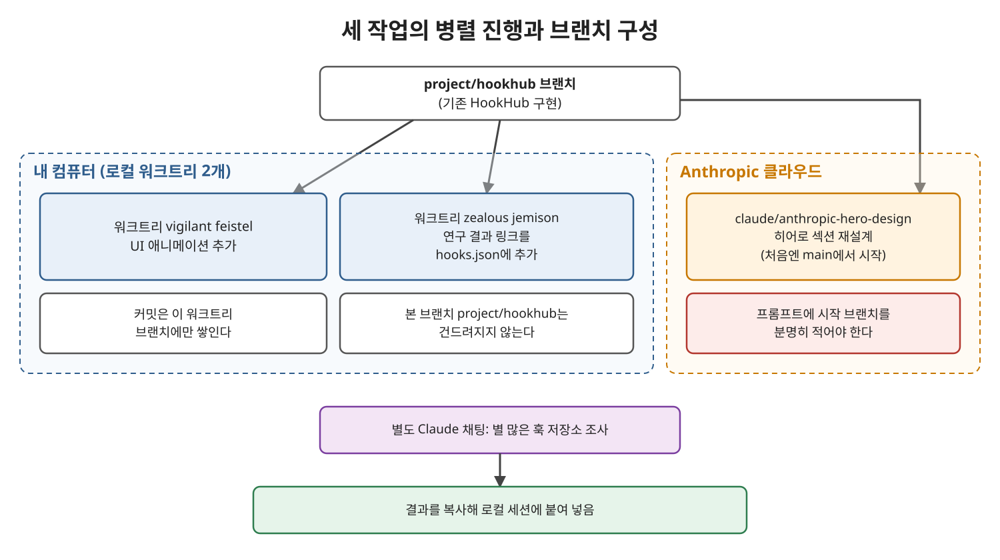

# 로컬과 클라우드 에이전트 병렬 실행

이 문서는 10장의 시연 부분을 다룬다. 저자는 앞서 만든 HookHub(Claude Code 훅 저장소를 모아 보여 주는 Next.js 웹 앱)를 대상으로 세 가지 일을 동시에 벌인다. 연구 작업 하나, 로컬 세션 하나, 클라우드 에이전트 하나다. 각각이 어디서 돌고 어떤 브랜치를 쓰는지가 이 문서의 핵심이다.

비유하면 주방장 한 명이 세 가지 요리를 동시에 주문하는 장면이다. 하나는 옆 가게에서 재료를 알아보게 하고, 하나는 자기 주방에서 직접 만들고, 하나는 외부 주방에 맡긴다. 마지막에 접시를 한 상에 모으는 일이 남는다.

---

## 1. 출발 상태와 로컬 실행

작업 디렉터리는 Agentic-Coding-with-Claude-Code 저장소로 지정돼 있고, 현재 브랜치는 기존 구현이 들어 있는 hookhub 계열이다. 이 단계의 작업은 모두 로컬에서 돈다.

먼저 Claude Code에게 Next.js 앱을 로컬에서 실행하라고 시킨다. 작업 디렉터리가 이미 정해져 있어 복제는 일어나지 않는다. Claude Code는 디렉터리 구조를 살피고 hookhub 폴더를 찾아 들어가 파일 목록을 본다. package.json이 있으므로 Next.js 프로젝트라고 판단한다.

그다음 실행 순서를 스스로 정한다.

```bash
npm install
npm run dev
```

개발 서버는 백그라운드에서 돈다. 일부 출력은 화면에 보이지 않지만 과정은 성공한다. 3000번 포트가 이미 쓰이고 있어 앱은 3001번 포트로 자동 배정되어 뜬다.

## 2. 세 가지 작업의 동시 진행

이제 같은 기능 개발을 로컬과 클라우드에 나눠 맡긴다.

### 2.1 연구 작업(별도 채팅)

Claude Code 탭에서 Claude 앱으로 옮겨 새 채팅을 연다. 이 채팅은 로컬 Claude Code 세션과 독립된 연구 환경이다. 여기에 "Claude Code 훅을 구현한 온라인 저장소 중 GitHub 별이 많은 것을 찾아라"는 탐색 과제를 준다. 결과는 나중에 Claude Code에 넘겨 HookHub 데이터에 넣을 계획이다.

### 2.2 로컬 세션: 애니메이션 추가

연구가 클라우드에서 도는 동안 로컬 Claude Code 세션으로 돌아와 "애플리케이션에 애니메이션을 추가해 줘"라고 요청한다. 이 세션은 전적으로 내 컴퓨터에서 돈다. 새 인스턴스를 만들고 저장소를 고른 뒤 로컬 코드베이스에 직접 구현한다.

### 2.3 클라우드 세션: 히어로 섹션 개선

작업이 진행되는 동안 인스턴스를 하나 더 만든다. 이번에는 기본값인 클라우드 옵션을 그대로 둔다. 그러면 Anthropic 클라우드에서 백그라운드 에이전트가 활성화된다. 프롬프트는 "project/hookhub 브랜치에 훨씬 멋진 히어로를 추가하고 Anthropic 스타일로 만들어라"였다.

이 프롬프트가 명시한 것은 세 가지다. project/hookhub 브랜치에서 작업할 것, 히어로 섹션을 크게 개선할 것, Anthropic풍으로 꾸밀 것이다.



이 시점에 세 작업이 로컬과 클라우드에서 동시에 돈다.

- 클라우드 연구: 별이 많은 Claude Code 훅 저장소 찾기
- 로컬 Claude Code 세션: UI에 애니메이션 추가(워크트리 vigilant fiestal)
- 원격 백그라운드 에이전트: 특정 브랜치에서 히어로 섹션 재설계(브랜치 이름은 claude/anthropic-hero-design 뒤에 임의 식별자가 붙음)

둘은 로컬에서, 하나는 Anthropic 클라우드에서 실행되는 셈이다.

## 3. 변경 승인과 브랜치 문제

로컬 인스턴스가 애니메이션 작업을 마치면 승인이 필요한 변경을 제안한다. 허용하면 구현이 이어지고 UI에 애니메이션이 반영된다.

### 3.1 클라우드 에이전트의 브랜치 실수

원격 에이전트는 Anthropic 클라우드에서 새 브랜치를 만든다. 처음에는 project/hookhub가 아니라 main에서 체크아웃한다. 저자는 이 점이 중요하다고 짚는다. 기능은 project/hookhub 위에서 구현해야 하는데 main에서 개발이 이어지면 나중에 병합할 때 불일치가 생기기 때문이다.

곧 에이전트가 스스로 바로잡는다.

```bash
git checkout origin/project/hookhub
```

관련 코드를 가져오고 프로젝트 파일을 다시 나열해 맥락을 회복한 뒤 히어로 재설계를 계속한다. 참고(노트 작성자): 이 사례가 주는 실무 교훈은 프롬프트에 시작 브랜치를 분명히 적는 것이다. 책 끝의 체크리스트에도 같은 항목이 나온다.

### 3.2 연구 결과 반영

Claude 데스크톱의 연구 작업이 끝나면 별이 많은 훅 저장소 목록이 나온다. 결과에는 GitHub 저장소 링크가 여럿 들어 있다. 이 URL 묶음을 복사해 새 로컬 워크트리 세션에 붙여 넣고, HookHub 목록에 추가하라고 시킨다.

워크트리를 쓰므로 이 수정은 해당 브랜치에 묶인 별도 작업 디렉터리에서 일어난다. 에이전트는 저장소 정보를 매핑해 hooks.json 파일에 새 항목을 넣는다. 변경이 만들어지면 검토하고 수락한다.

이 단계에서 확인할 상태는 다음과 같다.

- 애니메이션 기능이 로컬에서 끝나 UI에 보인다.
- 데이터베이스 업데이트 작업이 hooks.json에 새 저장소 링크를 추가했다.
- 원격 클라우드 에이전트는 project/hookhub로 올바르게 옮긴 뒤 히어로 섹션을 작업 중이다.

## 4. 워크트리 배치와 병합 준비

워크트리가 쓰이므로 서로 다른 활성 브랜치가 서로 다른 디렉터리에 놓인다. 원래 저장소 디렉터리는 그대로 있고, 그 옆에 Claude Code가 자동 이름을 붙인 워크트리 디렉터리(예: zealous-jemison)가 브랜치 하나씩을 맡는다. 병렬 작업마다 자기 워크트리 안에서 움직이므로 기능 구현끼리 간섭하지 않는다.

결과적으로 독립된 기능 세 개가 동시에 개발됐다.

| 기능 | 위치 | 하는 일 |
|---|---|---|
| UI 애니메이션 | 로컬 워크트리 | 앱 전체에 움직임 추가 |
| 훅 저장소 데이터 | 로컬 워크트리 | hooks.json에 새 링크 추가 |
| 히어로 재설계 | 클라우드 원격 브랜치 | Anthropic풍 히어로 섹션 |

남은 과제는 이 산출물을 합치는 일이다. 원격 브랜치 하나와 로컬 워크트리 브랜치 둘을 하나의 일관된 코드베이스로 병합해야 한다. 하나는 원격에, 나머지는 워크트리를 통해 로컬에 있으므로 병합에는 명시적인 조율이 필요하다.

다음 단계로 Claude Code에게 모든 산출물을 하나의 통합 브랜치로 합치라고 지시한다. 책에 실린 프롬프트는 "Merge all the commits here to branch project/hookub"인데, 브랜치 이름이 hookub로 한 글자 빠진 오타로 보인다. 이 병합 과정은 다음 문서에서 다룬다.

<br>
<br>
<br>

[Agentic Coding with Claude Code](../)
