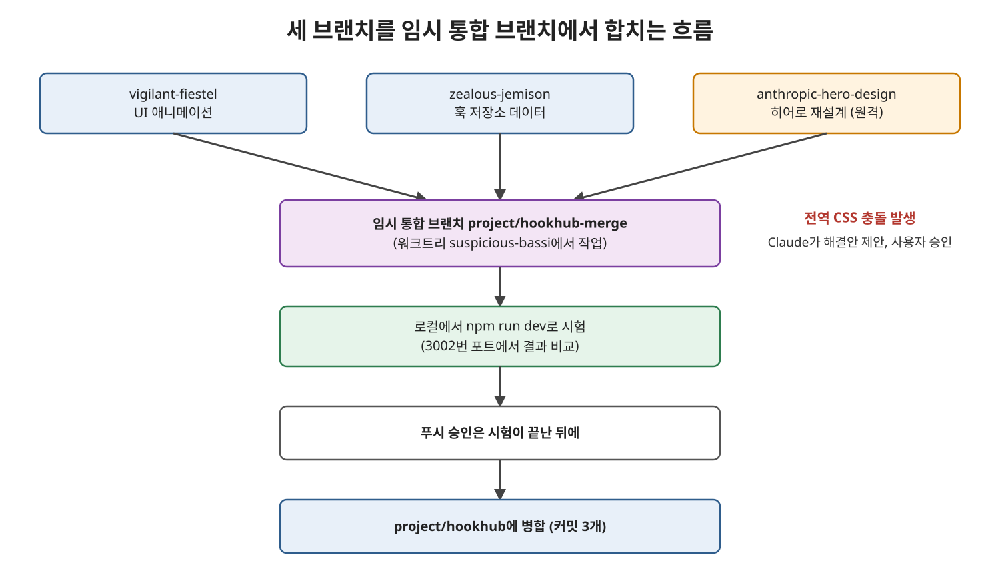

# 병렬 브랜치 병합과 검증

이 문서는 따로 자란 브랜치 세 개를 project/hookhub 하나로 모으는 과정을 다룬다. 핵심은 "병합을 에이전트에게 맡기되 바로 본 브랜치에 넣지 않고, 임시 통합 브랜치에서 합치고 시험한 뒤 승인한다"는 흐름이다.

비유하면 세 팀이 각자 쓴 원고를 편집장이 합치는 일과 같다. 편집장은 완성본 대신 임시 사본에서 먼저 합쳐 읽어 보고, 문제가 없을 때만 최종본에 반영한다.

---

## 1. 워크트리에서 커밋하면 어디로 가는가

로컬 인스턴스는 애니메이션을 vigilant feistel 디렉터리에서 구현했다. 이 디렉터리는 메인 저장소에 연결된 워크트리이고 다른 브랜치가 체크아웃돼 있다. 목표 브랜치는 project/hookhub지만 실제 작업은 전부 이 디렉터리에서 일어났다. 워크트리가 원래 이렇게 동작한다.

이제 이 코드를 커밋한다. Claude에게 커밋을 만들되 메시지에 "Claude Code Desktop으로 생성한 변경"이라고 밝히라고 지시한다. Claude가 스테이징 명령을 준비해 승인을 요청하면 승인한다.

승인 직후 중요한 사실이 보인다. 활성 브랜치가 project/hookhub가 아니라 vigilant-fiestel이다. 워크트리 안에서 만든 커밋은 원래 브랜치가 아니라 그 워크트리의 브랜치에 들어간다는 것이 확인됐다.

같은 시간에 다른 로컬 인스턴스는 별도 워크트리 zealous jemison에서 JSON 파일로 GitHub URL을 갱신하고 있었다. 두 인스턴스는 서로 독립적으로 움직였다.

## 2. 워크트리 브랜치 푸시

이제 원격으로 올린다. zealous jemison 워크트리로 옮기면 그 브랜치에는 이미 커밋이 있으므로 푸시한다. Claude가 푸시 권한을 요청한다. 이 브랜치는 hooks.json에 새 Claude Code 저장소 항목을 넣은 데이터 갱신이다. vigilant-fiestel도 같은 방식으로 푸시하며, 이쪽은 랜딩 페이지 히어로의 UI 애니메이션이다.

둘 다 승인해도 project/hookhub에는 새 커밋이 보이지 않는다. 책은 이것이 정상이라고 설명한다. 워크트리마다 자기 브랜치를 따로 유지하기 때문이다.

세 번째 브랜치는 원격 Claude Code 인스턴스가 만든 claude/anthropic-hero-design 계열이다. 이 브랜치의 변경은 이미 모두 커밋되어 원격에 올라가 있다. 저장소를 새로 고치면 새 브랜치 세 개가 보인다.

- vigilant fiestel(UI 애니메이션)
- zealous jemison(훅 저장소 데이터)
- Anthropic Hero Design(히어로 재설계)

각 브랜치는 독립적으로 개발된 기능 하나씩을 뜻한다.

## 3. 임시 통합 브랜치로 병합

이제 세 구현을 project/hookhub에 모은다. 브랜치를 하나씩 체크아웃해 직접 병합하는 대신 Claude Code에게 맡긴다. 브랜치 이름을 알려 주고 모든 커밋을 project/hookhub로 병합하라고 지시한다.



Claude는 로컬에서 시작해 suspicious-bassi라는 워크트리를 하나 더 만든다. 그리고 project/hookhub에 바로 병합하지 않고 임시 통합 브랜치 project/hookhub-merge를 만든다. 주 개발 브랜치를 건드리기 전에 먼저 합쳐 보는 안전장치다.

### 3.1 병합 충돌 처리

병합을 시작하자 충돌이 나타난다. 충돌 대상은 전역 CSS 파일이다. Claude는 해결 계획을 세운다.

1. anthropic-hero-design의 충돌을 해결한다.
2. vigilant-fiestel을 병합한다.
3. zealous-jemison을 병합한다.
4. 모두 project/hookhub로 푸시한다.

Claude가 편집안을 제안하고 사용자가 승인하면 병합 커밋이 만들어진다. 이어서 아래 명령이 차례로 실행된다.

```bash
git merge vigilant-fiestel
git merge zealous-jemison
```

병합 커밋을 승인 요청 화면에서 확인하면 모든 기능 브랜치가 project/hookhub-merge에 모인 상태가 된다.

## 4. 푸시 전에 로컬에서 시험하기

Claude가 병합 결과를 project/hookhub로 푸시해도 되느냐고 묻는다. 책은 여기서 "아직 승인하지 말라"고 강조한다. 푸시 전에 로컬에서 먼저 시험하기 때문이다.

Claude에게 개발 서버를 시작하라고 한다. 처음에는 "npm is not found" 오류가 날 수 있다. Claude는 .zshrc 설정 파일을 불러와 환경을 로드하고 다시 시도한다. 그러다 의존성이 빠졌다고 판단해 npm install을 실행한다. 한동안 npm install과 npm run dev 두 프로세스가 함께 돈다.

설치가 끝나면 개발 서버가 3002번 포트에서 정상 기동한다. 병합된 구현이 로컬에서 돌아가는 상태다.

## 5. 통합 결과 검증

3002번 포트의 앱을 열어 원래 구현과 비교한다. 새 히어로 섹션에는 다음이 들어 있다.

- 격자 배경
- 배너 요소
- 구불구불한 선
- 저장소 통계
- 움직이는 효과

저장소 목록은 전보다 항목이 많다. Claude Code가 조사해 추가한 것이다. 애니메이션은 일부 컴포넌트에만 있지 않고 사이트 전체에 적용되어, 처음의 정적인 버전과 달리 동적인 느낌이 난다. 책의 결론은 독립적으로 개발한 세 기능이 모두 올바르게 공존한다는 것이다.

## 6. 병합 마무리와 시사점

검증이 끝나면 푸시를 승인한다. Claude가 project/hookhub-merge를 project/hookhub로 병합한다. 저장소를 새로 고치면 이 브랜치에 커밋 세 개가 생겼다. 각 커밋은 서로 다른 워크트리에서 나온 브랜치를 병합한 것이고, 각 브랜치는 독립적으로 구현된 기능 하나다.

저자는 이것이 개발이 확장되는 방식의 중요한 변화라고 본다. 로컬 인스턴스 둘과 원격 인스턴스 하나, 기능 세 개가 동시에 개발되어 한 브랜치로 수렴했다. 병렬 기능 구현을 맡김으로써 개발자 자신을 늘린 셈이다.

또 하나 눈여겨볼 점이 있다. 이 과정에는 프런트엔드 경험이 거의 쓰이지 않았다. 구현을 맡은 Claude Code의 모델이 프런트엔드 작업을 처리했고 필요한 코드를 만들어 냈다.

참고(노트 작성자): 병합의 안전 수칙을 정리하면 임시 브랜치에서 합치고, 푸시 전에 실행해 보고, 그 뒤에 승인한다는 세 줄이다. 시험 중 나온 환경 오류(npm 미발견, 의존성 누락)도 에이전트가 스스로 풀었지만, 승인은 사람이 쥐고 있다는 점이 흐름의 요점이다.

<br>
<br>
<br>

[Agentic Coding with Claude Code](../)
