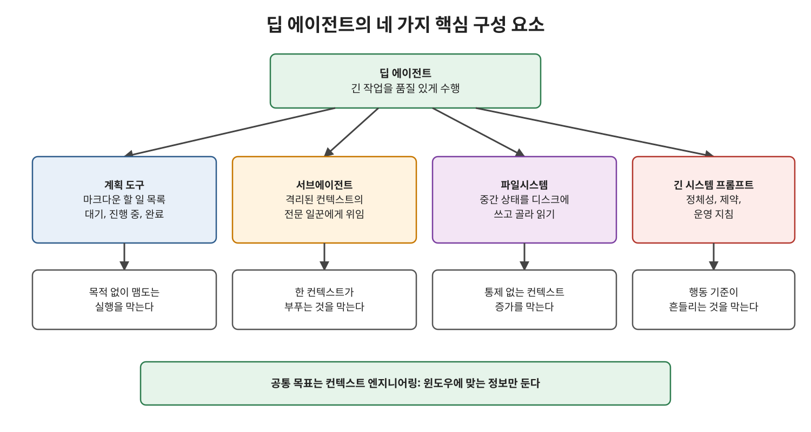

# 계획 도구와 서브에이전트 위임

이 문서는 11장의 중간 부분이다. 딥 에이전트를 깊게 만드는 공통 아이디어 네 가지를 먼저 소개하고, 그중 계획 도구와 서브에이전트(Subagent, 자기 프롬프트와 도구와 컨텍스트를 따로 가지는 전문 일꾼 에이전트)를 자세히 본다. 나머지 둘인 파일시스템과 시스템 프롬프트는 다음 문서에서 다룬다.

비유하면 큰 공사를 맡은 현장 소장과 같다. 소장은 공정표를 벽에 붙여 두고(계획 도구), 전문 기술자에게 세부 공사를 맡기고(서브에이전트), 자재와 도면은 창고에 두고 필요할 때 꺼낸다(파일시스템). 현장 규칙은 처음에 한 번 정해 둔다(시스템 프롬프트).

---

## 1. 무엇이 에이전트를 깊게 만드는가

저자는 딥 에이전트에 엄밀한 형식적 정의는 없다고 말한다. 실무에서는 복잡하고 오래 걸리는 작업을 품질과 신뢰성 있게 해낼 수 있으면 깊다고 본다. 그러려면 컨텍스트가 부풀고 쌓이는 문제를 다루는 능력이 필요하다. 핵심 과제는 컨텍스트 엔지니어링과 똑똑한 컨텍스트 관리다. 이게 없으면 장기 실행이 무너진다.

대부분의 딥 에이전트가 공통으로 구현하는 아이디어는 네 가지다.

| 요소 | 하는 일 | 막아 주는 문제 |
|---|---|---|
| 계획 도구 | 단계를 실행하기 전에 할 일을 계획 | 목적 없이 맴도는 실행 |
| 서브에이전트 | 격리된 컨텍스트에서 일하는 전문 일꾼을 띄움 | 한 컨텍스트의 비대화 |
| 중간 상태용 파일시스템 | 중간 결과와 공유 상태를 디스크에 기록 | 통제 없는 컨텍스트 증가 |
| 긴 시스템 프롬프트 | 지시, 제약, 운영 지침을 상세히 담음 | 행동 기준의 흔들림 |

현대 딥 에이전트 구현을 살펴보면 이 네 아이디어가 어떤 형태로든 보인다고 한다.

## 2. 계획 도구

딥 에이전트라는 말은 일반적이지만, LangChain 팀이 여러 딥 에이전트 구현을 분석한 뒤 이를 분명하게 정리했다. 모든 딥 에이전트에는 계획 도구가 들어 있다. 도구를 실행하면 할 일 목록이 보인다. 일부는 이미 끝났고, 하나는 진행 중일 수 있고, 나머지는 대기 중이다.

여기서 보이는 것은 모델 내부의 생각의 사슬(chain-of-thought)이 만드는 암묵적인 계획이 아니다. 딥 에이전트는 명시적인 계획 도구에 기댄다.

### 2.1 마크다운 할 일 목록

이 계획 장치는 대개 마크다운 형식의 할 일 목록으로 구현된다. 실행 단계 사이에서 에이전트가 이 계획을 적극적으로 검토하고 갱신한다. 계획은 동적이다. 작업은 대기(pending), 진행 중(in progress), 완료(completed)로 표시된다. 작업이 실패해도 원래 ReAct 순환처럼 맹목적으로 재시도하지 않는다. 계획 도구가 실행을 더 통제된 방향으로 이끈다.

계획은 계속 갱신되고 사용자도 할 일 목록에 영향을 줄 수 있다.

### 2.2 Claude Code의 TodoWrite와 TodoRead

Claude Code에서 계획 도구 자체는 내부 구현이라 직접 접근할 수 없다. 실제로는 TodoWrite와 TodoRead 동작이 호출된다. TodoWrite는 할 일 목록을 만들고 갱신하며 `{todos: Todo[]}` 매개변수를 받는다. TodoRead는 현재 목록을 읽는다. 이 호출이 목록을 갱신하면서 실행 계획의 변화를 반영한다. 내부 추론은 보이지 않아도, 이런 동작이 에이전트가 작업 중에 계획을 어떻게 조정하는지 엿볼 창이 된다.

딥 에이전트가 이 목록을 계속 갱신하면 신뢰성이 오르고 복잡한 작업을 끝낼 가능성이 높아진다. 개념은 직관적이다. 복잡한 일을 맡으면 우리는 작은 작업으로 쪼개고 시간에 따라 진행을 추적한다. 계획 도구는 이 패턴을 에이전트 구조 안에 형식화한 것이다.

참고(노트 작성자): 도구 이름은 책이 쓰인 시점 기준이며, 이후 버전에서 달라졌을 수 있다. 이 책의 계획 모드(6장) 설명과 달리 여기서는 에이전트 안에서 할 일 목록을 쓰는 도구를 가리킨다.

## 3. 서브에이전트와 계층적 위임

딥 에이전트의 또 다른 특징이 서브에이전트 능력이다. 딥 에이전트는 서브에이전트로 계층적 위임을 한다. 메인 에이전트는 자기 자신의 새 인스턴스를 띄울 수 있고, 그 인스턴스는 한 가지 일에 집중하도록 전문화돼 있다. 각 서브에이전트는 자기 시스템 프롬프트, 자기 설명, 자기 도구 집합으로 동작한다.

### 3.1 현실의 위임과 닮은 구조

이 설계는 현실의 위임을 닮았다. 일을 맡길 때는 일만 던져서는 부족하다. 맡는 쪽이 올바른 기술과 올바른 도구를 갖춰야 하고, 무엇을 해야 하는지도 분명히 전해야 한다.

예를 들어 집의 구조 문제를 고치는 일처럼 특정한 장인 기술이 필요한 작업이 있다고 하자. 그 전문성이 없으면 적절한 기술과 도구를 가진 사람에게 맡겨야 한다. 그 사람은 자기 장비를 들고 와 독립적으로 일하고 최종 결과를 넘긴다. 중간 과정의 세부는 맡긴 사람에게 보이지 않는다. 중요한 것은 최종 결과다.

### 3.2 컨텍스트 격리

이 비유가 서브에이전트에도 맞는다. 메인 에이전트는 분명한 설명을 주고 일을 맡긴다. 서브에이전트는 자기 도구와 내부 지침으로 독립적으로 일해 결과를 돌려준다. 실행하는 동안 서브에이전트는 격리돼 있어 메인 에이전트는 중간 추론 단계를 모두 보지 못하고 최종 출력만 받는다.

시스템 관점에서 서브에이전트는 자기만의 컨텍스트 윈도우에서 돈다. 메인 에이전트의 컨텍스트를 오염시키지 않는다. 서브에이전트마다 시스템 프롬프트와 도구 집합을 전문 분야에 맞게 다르게 줄 수 있어, 책임을 좁게 나누면 규모를 키우고 품질을 높일 수 있다.

내부에서는 서브에이전트도 자기 도구 호출 순환을 돌리며 ReAct 방식의 주기를 포함한다. 끝나면 중간 관찰의 전체 사슬이 아니라 최종 응답만 돌려준다. 이 위임 패턴은 컨텍스트 격리를 이루고, 전문 작업이 메인 컨텍스트를 부풀리지 못하게 하며, 작업을 병렬로 실행하게 해 준다. 그 결과 효율과 깊이가 함께 오른다.

### 3.3 Claude Code의 실제 사례

책은 Claude Code가 인증 패턴을 찾기 위해 탐색 에이전트(exploration agent)를 띄우는 장면을 보여 준다. 이 탐색 에이전트는 동시에 돌면서 자기 검색을 수행하고, 메인 에이전트가 실행을 이어 가는 동안 독립적으로 움직인다. 서브에이전트와 계층적 위임이 내장 지원된다는 것을 보여 주는 예다.

여기까지는 구현 세부보다 개념 구조에 초점을 둔 설명이며, 일상 워크플로의 도구와 연결 짓는 것이 목적이다. 7장에서 서브에이전트가 컨텍스트 비대화를 막고, 컨텍스트 격리를 지키며, 결국 더 나은 결과로 이어진다는 점을 이미 살폈다. 이 설명은 그 논의를 그대로 잇는다.

 
 
 

[Agentic Coding with Claude Code](../)
