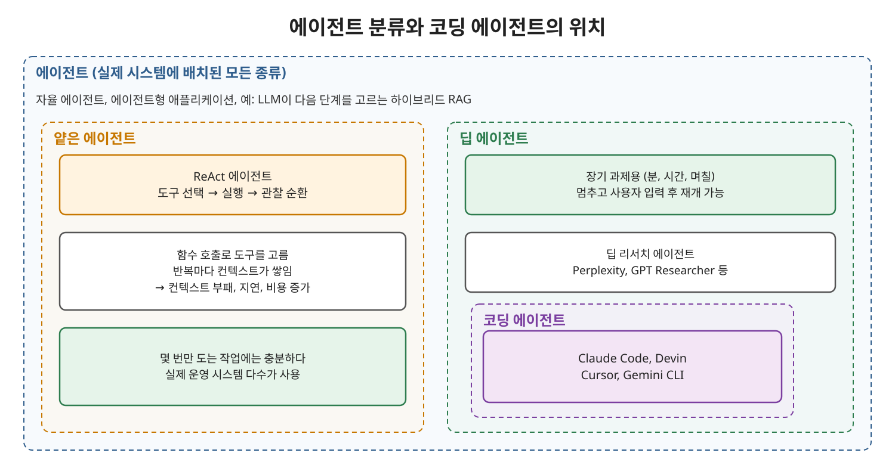

# 에이전트 분류와 얕은 에이전트의 한계

11장은 Claude Code 같은 코딩 에이전트가 왜 긴 작업을 해낼 수 있는지를 구조 차원에서 풀어 준다. 이 문서는 앞부분을 다룬다. 저자가 현장의 에이전트를 어떻게 나눠 보는지, ReAct 에이전트가 왜 "얕다"고 불리는지, 그리고 딥 에이전트(Deep Agent, 분, 시간, 심지어 며칠 걸리는 긴 작업을 품질 있게 수행하는 에이전트)가 무엇인지를 설명한다.

비유하면 이렇다. 얕은 에이전트는 메모지 한 장으로 일하는 직원이다. 일이 길어지면 메모지가 빽빽해져 뭐가 중요한지 잃는다. 딥 에이전트는 할 일 목록, 보조 인력, 서류함을 갖춘 직원이다.

---

## 1. 에이전트 분류

저자는 현업에서 쓰이는 에이전트의 지형을 자기 방식으로 단순화해 설명한다. 가장 바깥에는 "에이전트" 영역이 있다. 실제 시스템에 배치된 모든 종류가 여기 들어간다. 완전 자율 에이전트도 있고 에이전트형 애플리케이션도 있다.

대표 예는 하이브리드 RAG 구조다. RAG(Retrieval-Augmented Generation, 검색한 자료를 모델에 붙여 답하게 하는 방식)의 흐름 중에서 다음에 무엇을 할지를 LLM이 정한다. 검색을 할지, 검색 전에 질문을 다시 쓸지, 다른 작업을 할지를 모델이 고른다. 미리 정해진 워크플로 안에서 LLM이 다음 행동을 지휘하는 모양이다.

## 2. ReAct 에이전트

이 영역 안에 ReAct(Reason and Act, 추론하고 행동하는) 에이전트가 있다. 동작은 이렇다.

1. LLM이 도구를 쓸지 정한다.
2. 도구를 고르면 시스템이 실행하고 결과를 관찰(observation)로 돌려준다.
3. LLM이 최종 답을 낼 만큼 정보가 충분한지 판단한다.
4. 부족하면 다시 도구를 고르고 관찰을 받는 순환을 이어 간다.

저자는 이 ReAct 순환이 에이전트라는 패러다임을 연 시작점이라고 본다. 오늘날 대부분의 에이전트 구조가 이 알고리즘에서 갈라져 나왔다. 출처는 "ReAct: Synergizing Reasoning and Acting in Language Models"라는 논문(arXiv 2210.03629)이다.

## 3. 얕은 에이전트와 그 한계

저자는 이 분류에서 ReAct 에이전트를 얕은 에이전트(Shallow Agent)로 묶는다. 쓸모가 없다는 뜻이 아니라 깊이 들어가는 능력이 부족하다는 뜻이다. 철저하고 긴 조사가 필요한 과제를 떠올려 보자. 검색 도구나 위키 도구, Tavily 같은 도구를 줘도 충분히 깊은 조사를 해내기는 어렵다. 한계는 구조 설계와 현재 LLM의 현실 양쪽에 뿌리를 둔다.

이 에이전트는 함수 호출(function calling)에 의존한다. 매 결정 시점에 LLM이 함수를 호출해 실행할 도구를 고른다. 함수 호출 자체에 문제가 있는 것은 아니고 장단점이 있을 뿐이다. 핵심 한계는 컨텍스트 윈도우다.

순환이 돌 때마다 컨텍스트에 정보가 더해진다. LLM이 결정하고, 도구가 실행되고, 결과가 프롬프트에 들어가고, 이것이 반복된다. 한두 번은 괜찮지만 횟수가 늘면 컨텍스트가 점점 커진다.

이 성장은 컨텍스트 부패(context rot)로 이어진다. 컨텍스트 혼란, 컨텍스트 모순, 컨텍스트 오염이 나타나고 시간이 지날수록 성능이 떨어져 에이전트가 궤도를 벗어날 수 있다.

기능 구현, 한 주제의 깊은 조사, 계속 추론하고 정보를 모아야 하는 다단계 작업에서 이 한계가 치명적이다. 항공권 예약 같은 단순 요청과는 성격이 다르다. 품질 저하에 더해 비용도 오른다. 호출마다 토큰이 늘어 더 무거워지고, 토큰이 많을수록 지연과 비용이 커진다.

그렇다고 얕은 에이전트가 나쁜 것은 아니다. 반복이 몇 번 안 되는 작업에는 매우 효과적이고, 실제 운영 시스템 다수가 이 구조로 성공하고 있다. 많은 현실 사례에서 이 패턴이면 충분하고 추가적인 복잡도는 필요 없다.

## 4. 딥 에이전트

분류도로 돌아와 얕은 에이전트에서 딥 에이전트로 넘어간다. 딥 에이전트는 장기 과제(long-horizon task)를 위해 설계됐다. 복잡하고, 반복이 많고, 추론과 처리가 많이 드는 작업이다. 오래 도는 시스템이라 몇 분, 몇 시간, 심지어 며칠씩 실행되기도 한다. 실행을 멈추고 사용자 입력을 요청한 뒤, 입력이 오면 다시 이어 갈 수 있다.

### 4.1 딥 리서치 에이전트

흔한 예가 딥 리서치 에이전트다. Perplexity는 딥 리서치 기능을 열어 딥 에이전트 실행을 일으킨다. 여러 업체가 비슷한 연구 기능을 내놓았다. 저자에 따르면 Claude Code와 ChatGPT에도 리서치 옵션이 있다. 각각 딥 에이전트 구현을 작동시키지만 내부 설계는 업체마다 다르다.

오픈소스 딥 리서치 에이전트도 있다. GPT Researcher가 이 분야에서 가장 인기 있는 오픈소스 중 하나다. 저자는 이에 관한 강의를 만들었다고 소개한다.

### 4.2 코딩 에이전트도 딥 에이전트

딥 에이전트의 또 다른 큰 부분집합이 코딩 에이전트다. Claude Code, Devin, Cursor, Gemini CLI가 예다. 딥 에이전트가 얼마나 효과적이고 널리 쓰이는지 보여 주는 가장 강한 사례이며 수백만 명의 개발자가 쓴다. 이 책은 책이 쓰인 시점에 가장 인기 있는 코딩 에이전트의 하나인 Claude Code에 초점을 뒀다.

이런 에이전트에게 앱이나 기능을 구현하라고 시킬 수 있다. 코드만 만들지 않는다. 테스트를 돌리고, 애플리케이션을 실행하고, 브라우저를 열고, 스크린샷을 찍는 등 소프트웨어 엔지니어가 손으로 하던 단계를 상당수 수행한다. 그래서 코딩 에이전트는 소프트웨어 개발 워크플로에 맞춘 딥 에이전트의 특화된 부분집합이다.

## 5. 응용 계층의 혁신과 에이전트 하니스

저자는 딥 에이전트가 이 분야 혁신의 상당 부분을 이끈다고 본다. LLM은 계속 좋아지지만 개선은 점진적이다. 추론 품질이 오르고 능력이 늘지만 기하급수적이지는 않다. 반면 LLM 위에 쌓는 응용 계층은 빠르게 발전하고 있다. 에이전트 위에 추상화를 겹쳐 쌓고 시스템 안에서 에이전트를 조합하면, 복잡한 인간 추론 작업을 자동화하는 능력 있는 기계를 만들 수 있다. 이 응용 계층을 흔히 에이전트 하니스(Agent Harness)라 부른다.

책의 노트가 정의하는 에이전트 하니스는 AI 에이전트를 만들기 위한 바로 쓸 수 있는 환경이다. 에이전트를 실행하는 도구와 시스템 위에 얹히고, 기본 프롬프트, 도구 처리, 계획, 파일 접근 같은 것이 미리 구성돼 있다. 프레임워크는 날것의 구성 요소를 주고, 런타임은 실행을 관리하며, 하니스는 무거운 일을 대신해 처음부터 다 갖추지 않고 시작하게 해 준다.

5년 전에는 AI 시스템이 사람의 개입 없이 기능하고 보기 좋은 앱을 처음부터 만든다는 생각이 비현실적으로 보였을 것이다. 지금은 그 능력이 존재한다. 저자는 핵심 동력이 기반 모델의 개선만이 아니라 개발자가 모델을 얼마나 잘 다루는가(하니스 엔지니어링)에 있다고 말한다. 혁신은 응용 계층에서, 곧 딥 에이전트를 구현하고 조율하는 방식에서 일어난다.

참고(노트 작성자): 이 장에서 말하는 얕다와 깊다는 에이전트의 우열이 아니라 맡을 수 있는 일의 길이에 대한 구분이다. 몇 단계로 끝나는 일에는 ReAct 에이전트로 충분하다.

 
 
 

[Agentic Coding with Claude Code](../)
