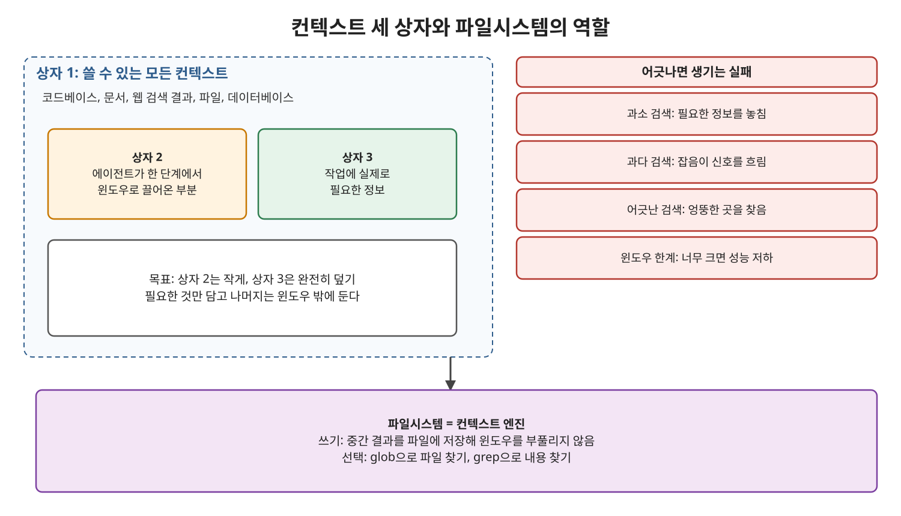

# 파일시스템과 시스템 프롬프트

이 문서는 11장의 뒷부분이다. 딥 에이전트의 세 번째 요소인 파일시스템이 왜 컨텍스트 엔지니어링의 엔진인지, 그리고 네 번째 요소인 시스템 프롬프트를 어떻게 써야 하는지를 다룬다. 끝에는 LangChain 딥 에이전트의 기본 시스템 프롬프트가 소개된다.

비유하면 파일시스템은 책상 옆 서류 캐비닛이다. 책상(컨텍스트 윈도우)에는 지금 필요한 서류만 올려 두고, 나머지는 캐비닛에 넣어 둔다. 필요하면 라벨과 키워드로 찾아 꺼낸다.

---

## 1. 딥 에이전트의 파일시스템 접근

딥 에이전트는 파일시스템에 접근한다. 파일을 찾고, 읽고, 고치고, 지우는 도구를 갖추고 파일시스템 전반을 통제한다. 이 능력은 장기 작업의 컨텍스트 관리에서 중심 역할을 한다.

Claude Code에서는 파일 작업 도구 묶음으로 나타난다.

- Read: 파일 내용을 읽는다.
- Write: 파일을 만들거나 덮어쓴다.
- Edit: 정확한 문자열 치환을 한다.
- Glob: 패턴으로 파일을 찾는다.
- Grep: 파일 안의 내용을 검색한다.

LangChain의 딥 에이전트 문서에도 비슷한 파일시스템 인터페이스가 보인다.

```text
ls, read_file, write_file, edit_file, glob, grep
```

딥 에이전트는 특정 구현이 아니라 인터페이스를 노출한다. 그래서 밑바탕의 저장소는 달라질 수 있다. 예를 들어 파일시스템이 Google Cloud의 Firestore나 AWS의 DynamoDB로 뒷받침될 수 있다. 인터페이스는 같고 구현은 유연하다.

## 2. 왜 긴 작업에 파일시스템이 중요한가

앞서 봤듯이 대화가 길어지면 컨텍스트 윈도우도 커진다. 이것이 여러 문제를 낳아 결국 컨텍스트 부패로 이어진다. 부패는 LLM 응답의 품질 저하를 부르며, 원인은 컨텍스트 모순, 컨텍스트 혼란, 프롬프트의 과도한 잡음일 수 있다.

저자는 LangChain 블로그의 그림에서 영감을 받은 도식으로 에이전트 컨텍스트 엔지니어링의 핵심 과제를 설명한다. 상자 세 개를 떠올리면 된다.

| 상자 | 뜻 |
|---|---|
| 상자 1(큰 파란 사각형) | 쓸 수 있는 모든 컨텍스트. 코드베이스, 문서, 웹 검색 결과, 파일, 데이터베이스. 크고 지저분할 수 있음 |
| 상자 2 | 에이전트가 한 단계를 위해 컨텍스트 윈도우로 끌어온 부분집합. 읽거나 검색하기로 고른 것 |
| 상자 3 | 작업을 끝내는 데 실제로 필요한 정보 |

상자 2(빨간 원)가 상자 3(초록 원)과 제대로 겹치지 않으면 여러 실패 유형이 나타난다.

- 과소 검색(under-retrieval): 필요한 정보 일부만 가져오고 나머지를 놓친다.
- 과다 검색(over-retrieval): 상자 2가 너무 커져 잡음이 신호를 흐린다.
- 어긋난 검색(misaligned retrieval): 엉뚱한 곳을 찾아 상자 1과 상자 2가 전혀 겹치지 않는다.
- 컨텍스트 윈도우 한계: 보라색 상자는 유한하다. 모든 것을 담을 수 없고 너무 커지면 성능이 떨어진다.



컨텍스트 엔지니어링의 목표는 빨간 원을 가능한 한 작게 하면서 초록 원을 완전히 덮는 것이다. 이 선택은 에이전트 반복마다 거의 매번 일어나며, 각 단계에서 무엇을 윈도우에 넣을지 최적화해야 한다.

그래서 정보를 어떻게 구조화하고, 가져오고, 우선순위를 매기느냐가 프롬프트 자체보다 더 중요할 때가 많다. 에이전트의 품질은 맞는 정보가 컨텍스트 윈도우에 있느냐에 묶여 있다. 추론이 강한 모델도 컨텍스트가 틀리거나 불완전하면 틀린 결과를 내거나 작업을 끝내지 못한다.

## 3. 컨텍스트 엔진으로서의 파일시스템

여기서 딥 에이전트의 파일시스템이 결정적이 된다. 파일시스템은 에이전트가 올바른 컨텍스트에 닿게 하는 엔진이다. 개념적으로 전체 파일시스템이 정보 풀인 파란 사각형에 해당한다. 역할은 두 가지다.

1. 쓰기: 에이전트가 컨텍스트를 영구 저장소에 기록한다. 임시 결과, 중간 산출물, 가져온 정보를 파일로 두면 컨텍스트 윈도우를 부풀리지 않고 외부에 보관된다.
2. 선택: 관련 컨텍스트를 고르는 수단을 준다. glob은 패턴으로 파일을 찾고 grep은 정규식으로 내용을 검색한다. 이 도구로 다음 단계에 필요한 것만 정확히 꺼낸다.

이로써 파일시스템은 1장에서 다룬 컨텍스트 엔지니어링의 두 원칙, 곧 컨텍스트를 영구 저장소에 쓰기와 관련 컨텍스트를 선택적으로 가져오기를 구현한다. 이 두 가지를 모두 가능하게 하는 장치이며, 딥 에이전트가 컨텍스트 비대화 없이 장기 작업을 다루는 방식의 근본이다.

## 4. 시스템 프롬프트

AI 공학에서 "시스템 프롬프트가 중요하다"는 말은 다소 상투적이다. 그러나 업계 선두의 실제 관행을 보면 이 요소가 얼마나 중요한지 드러난다. 수백 줄에 이르고, 크게 주입된 도구 설명이 덧붙은 시스템 프롬프트가 보인다.

기업들은 LLM이 발전함에 따라 이 프롬프트를 반복해서 다듬고 갱신하는 데 큰 공학 자원을 쓴다. 딥 에이전트에게 시스템 프롬프트는 추론과 정체성과 경계의 근본 구조다.

### 4.1 좋은 시스템 프롬프트의 특징

효과적인 시스템 프롬프트는 최신 LLM이 본래 잘하는 일, 곧 패턴 인식과 일반 규칙을 새로운 상황에 적용하는 일을 활용한다. 책은 잘 쓴 프롬프트가 다섯 가지를 이룬다고 정리한다.

| 특징 | 뜻과 예 |
|---|---|
| 정체성과 범위를 분명히 함 | 에이전트가 무엇이고 무엇이 아닌지 정한다. 예: "기본 주문 고객지원이고, 영업이나 마케팅은 아니다" |
| 제약보다 권한을 줌 | 언제 어떤 도구를 쓸지 지시하지 않고 목표(예: 효율적 해결)를 정해 도구 선택을 맡긴다 |
| 순서도가 아니라 추론 틀을 줌 | 경직된 if/then 대신 반복 가능한 틀(핵심 문제 파악, 맥락 수집, 해결책 제시, 만족 확인)을 준다 |
| 휴리스틱 경계를 씀 | 빠짐없는 목록 대신 압축된 원칙을 쓴다. 예: "항상 가장 단순한 해법을 골라라"는 수많은 경계 사례를 아우르는 탐욕 알고리즘식 지침 |
| 말을 아낌 | 반복이나 겹치는 지시를 피해 LLM의 혼란과 모순 행동을 막는다 |

### 4.2 LangChain 딥 에이전트의 기본 프롬프트

책은 LangChain 딥 에이전트의 내장 시스템 프롬프트를 싣는다. 공식 저장소의 base_prompt.md에서 볼 수 있고 MIT 라이선스로 제공된다. 원문을 옮기는 대신 구성을 우리말로 요약한다.

- 정체성: 도구로 사용자가 일을 끝내도록 돕는 딥 에이전트이며, 텍스트와 도구 호출로 응답한다. 사용자는 응답과 도구 출력을 실시간으로 본다.
- 핵심 행동: 간결하고 직접적으로 말한다. 불필요한 서두("물론이죠!" 같은 말)와 "이제 X를 하겠습니다" 같은 예고를 하지 않고 바로 한다. 요청이 모호하면 행동 전에 묻고, 접근 방식을 물으면 먼저 설명한 뒤 행동한다.
- 전문적 객관성: 사용자의 믿음을 맞춰 주기보다 정확성을 우선하고, 틀렸으면 정중하게 반박한다. 과한 칭찬이나 감정적 호응은 피한다.
- 관례 따르기: 고치기 전에 파일을 읽고, 기존 스타일과 이름 규칙과 패턴을 따라 한다.
- 일하는 순서: 먼저 이해하고(관련 파일과 기존 패턴 확인), 행동하고(빠르되 정확하게 구현), 검증한다(자기 출력이 아니라 요청받은 것과 대조, 첫 시도는 거의 틀리니 반복). 끝날 때까지 계속하고, 일이 끝났거나 정말 막혔을 때만 사용자에게 넘긴다. 같은 방식이 반복해 실패하면 멈추고 이유를 분석하며, 막히면 상황을 알리고 지침을 구한다.
- 도구 사용: 셸 명령보다 전용 도구를 우선(예: cat 대신 read_file, sed 대신 edit_file)하고, 독립적인 호출은 한 응답에 묶어 병렬로 낸다.
- 파일 읽기 요령: 큰 파일은 페이지로 나눠 읽어 컨텍스트 넘침을 막는다. limit=100으로 구조를 훑고, offset과 limit로 필요한 부분만 읽고, 고칠 때만 전체를 읽는다.
- 진행 보고: 긴 작업에서는 적당한 간격으로 지금까지 한 일과 다음 할 일을 한 문장으로 알린다.

저자는 이 프롬프트를 두고 시스템 프롬프트가 인지의 기준선이라고 평한다. 지나치게 구체적인 하드코딩에 기대면 모델의 추론 능력이 깨지고, 모호한 지시에 기대면 일관성 없는 혼란이 생긴다.

## 5. 장 요약

이 장은 현업 에이전트의 분류를 세우고, 얕은 에이전트가 컨텍스트 비대화와 장기 워크플로 앞에서 갖는 한계를 짚고, 에이전트가 "깊다"는 것이 무엇인지 정의했다. 깊은 실행을 가능하게 하는 구성 요소는 명시적 계획(동적 할 일 목록), 격리된 컨텍스트의 전문 서브에이전트를 통한 계층적 위임, 영구 상태와 정밀한 컨텍스트 선택을 위한 파일시스템 접근이다. 이 요소를 Claude Code와 LangChain DeepAgents 하니스 같은 실제 시스템에 연결해 구체적 구현으로 뒷받침했다.

참고(노트 작성자): 이 장은 마지막 장이며, 이어지는 12장은 책 구매 혜택 안내라 이 노트에서는 다루지 않는다. 시스템 프롬프트의 세부 문구와 파일 경로는 책이 쓰인 시점의 저장소 기준이다.

<br>
<br>
<br>

[Agentic Coding with Claude Code](../)
