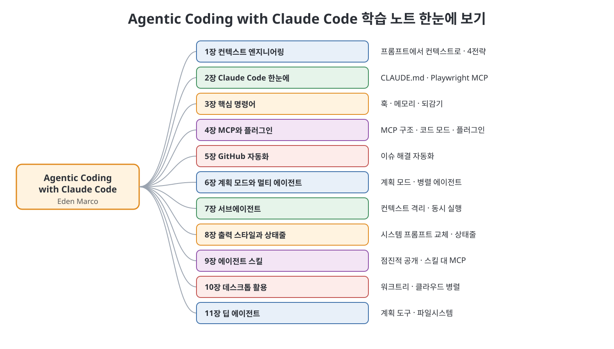

# **Agentic Coding with Claude Code 학습 노트**
(Agentic Coding with Claude Code: The everyday developer's guide to agentic coding with Claude Code, 장별 정리 노트)
<br>

<p align="center"></p>
<br>
<br>

이 문서는 Eden Marco의 『Agentic Coding with Claude Code: The everyday developer's guide to agentic coding with Claude Code』(Packt)를 장별로 정리한 한국어 학습 노트입니다. 원문을 번역한 것이 아니라 내용을 우리말로 풀어서 다시 설명했고, 처음 나오는 용어에는 쉬운 풀이를 붙였습니다. 책은 프롬프트 엔지니어링에서 컨텍스트 엔지니어링으로 옮겨 가는 관점에서 출발해, Claude Code의 명령어, 메모리, 훅, MCP 서버와 플러그인, GitHub 자동화, 계획 모드, 서브에이전트, 출력 스타일, 에이전트 스킬, 데스크톱과 클라우드 병렬 실행, 딥 에이전트까지 3개 부 11개 장으로 안내합니다. 이 노트는 책의 장 구성을 그대로 따라 장마다 폴더 하나로 정리했고, 이해를 돕기 위해 표와 직접 그린 그림을 넣었습니다.

<p align="center"></p>

> **이 노트를 읽을 때 유의할 점**
> - 이 노트는 원서의 **요약·해설본**이며 원서를 대신하지 않습니다. 명령, 설정, 코드, 가격처럼 정확성이 필요한 내용은 반드시 원서와 공식 문서에서 확인하세요.
> - 원서의 코드와 프롬프트는 핵심만 옮겼습니다. PDF 추출 과정에서 글자나 서식이 깨진 곳은 문맥으로 복원했고, 해당 문서에 그 사실을 적었습니다.
> - 책에 없는 보충 설명은 `참고(노트 작성자)`로 따로 표시했습니다.
> - 원서의 스크린샷은 싣지 않고 글과 표로 풀어 설명했습니다. 그림은 본문 내용을 바탕으로 새로 그렸고, 표지 이미지만 책 소개용으로 넣었습니다.
> - 책이 소개하는 요금제, 모델 이름, 메뉴 문구, 도구 버전은 책이 쓰인 시점 기준입니다. 지금과 다를 수 있습니다.
<br>

---

## 목차

- [00. 머리말과 이 책에 대하여](00.%20%EB%A8%B8%EB%A6%AC%EB%A7%90%EA%B3%BC%20%EC%9D%B4%20%EC%B1%85%EC%97%90%20%EB%8C%80%ED%95%98%EC%97%AC/Readme.md) — 책의 목적, 저자와 감수자, 3개 부 11개 장 구성, 예제 코드 준비

### 1부 컨텍스트 엔지니어링과 Claude Code 기초

- [01. 컨텍스트 엔지니어링](01.%20%EC%BB%A8%ED%85%8D%EC%8A%A4%ED%8A%B8%20%EC%97%94%EC%A7%80%EB%8B%88%EC%96%B4%EB%A7%81/Readme.md) — 프롬프트에서 컨텍스트로, 네 가지 컨텍스트 전략, 시스템 프롬프트의 적정 지점
  - [Claude Code의 네 가지 컨텍스트 전략](01.%20%EC%BB%A8%ED%85%8D%EC%8A%A4%ED%8A%B8%20%EC%97%94%EC%A7%80%EB%8B%88%EC%96%B4%EB%A7%81/Claude%20Code%EC%9D%98%20%EB%84%A4%20%EA%B0%80%EC%A7%80%20%EC%BB%A8%ED%85%8D%EC%8A%A4%ED%8A%B8%20%EC%A0%84%EB%9E%B5.md)
  - [시스템 프롬프트와 적정 지점](01.%20%EC%BB%A8%ED%85%8D%EC%8A%A4%ED%8A%B8%20%EC%97%94%EC%A7%80%EB%8B%88%EC%96%B4%EB%A7%81/%EC%8B%9C%EC%8A%A4%ED%85%9C%20%ED%94%84%EB%A1%AC%ED%94%84%ED%8A%B8%EC%99%80%20%EC%A0%81%EC%A0%95%20%EC%A7%80%EC%A0%90.md)
  - [컨텍스트 엔지니어링이란 무엇인가](01.%20%EC%BB%A8%ED%85%8D%EC%8A%A4%ED%8A%B8%20%EC%97%94%EC%A7%80%EB%8B%88%EC%96%B4%EB%A7%81/%EC%BB%A8%ED%85%8D%EC%8A%A4%ED%8A%B8%20%EC%97%94%EC%A7%80%EB%8B%88%EC%96%B4%EB%A7%81%EC%9D%B4%EB%9E%80%20%EB%AC%B4%EC%97%87%EC%9D%B8%EA%B0%80.md)
  - [요약과 핵심 개념](01.%20%EC%BB%A8%ED%85%8D%EC%8A%A4%ED%8A%B8%20%EC%97%94%EC%A7%80%EB%8B%88%EC%96%B4%EB%A7%81/%EC%9A%94%EC%95%BD%EA%B3%BC%20%ED%95%B5%EC%8B%AC%20%EA%B0%9C%EB%85%90.md)
- [02. Claude Code 한눈에 보기](02.%20Claude%20Code%20%ED%95%9C%EB%88%88%EC%97%90%20%EB%B3%B4%EA%B8%B0/Readme.md) — Next.js 실습, CLAUDE.md, Playwright MCP, 스펙 주도 설계로 메인 페이지 구현
  - [Playwright MCP와 memory 폴더](02.%20Claude%20Code%20%ED%95%9C%EB%88%88%EC%97%90%20%EB%B3%B4%EA%B8%B0/Playwright%20MCP%EC%99%80%20memory%20%ED%8F%B4%EB%8D%94.md)
  - [스펙 주도 설계로 메인 페이지 구현](02.%20Claude%20Code%20%ED%95%9C%EB%88%88%EC%97%90%20%EB%B3%B4%EA%B8%B0/%EC%8A%A4%ED%8E%99%20%EC%A3%BC%EB%8F%84%20%EC%84%A4%EA%B3%84%EB%A1%9C%20%EB%A9%94%EC%9D%B8%20%ED%8E%98%EC%9D%B4%EC%A7%80%20%EA%B5%AC%ED%98%84.md)
  - [프로젝트 준비와 CLAUDE.md 만들기](02.%20Claude%20Code%20%ED%95%9C%EB%88%88%EC%97%90%20%EB%B3%B4%EA%B8%B0/%ED%94%84%EB%A1%9C%EC%A0%9D%ED%8A%B8%20%EC%A4%80%EB%B9%84%EC%99%80%20CLAUDE.md%20%EB%A7%8C%EB%93%A4%EA%B8%B0.md)
  - [요약과 핵심 개념](02.%20Claude%20Code%20%ED%95%9C%EB%88%88%EC%97%90%20%EB%B3%B4%EA%B8%B0/%EC%9A%94%EC%95%BD%EA%B3%BC%20%ED%95%B5%EC%8B%AC%20%EA%B0%9C%EB%85%90.md)
- [03. Claude Code 시작하기 핵심 명령어 둘러보기](03.%20Claude%20Code%20%EC%8B%9C%EC%9E%91%ED%95%98%EA%B8%B0%20%ED%95%B5%EC%8B%AC%20%EB%AA%85%EB%A0%B9%EC%96%B4%20%EB%91%98%EB%9F%AC%EB%B3%B4%EA%B8%B0/Readme.md) — 요금제와 인증, 슬래시 명령, 훅, 메모리 계층, 되감기
  - [되감기와 사용자 지정 슬래시 명령](03.%20Claude%20Code%20%EC%8B%9C%EC%9E%91%ED%95%98%EA%B8%B0%20%ED%95%B5%EC%8B%AC%20%EB%AA%85%EB%A0%B9%EC%96%B4%20%EB%91%98%EB%9F%AC%EB%B3%B4%EA%B8%B0/%EB%90%98%EA%B0%90%EA%B8%B0%EC%99%80%20%EC%82%AC%EC%9A%A9%EC%9E%90%20%EC%A7%80%EC%A0%95%20%EC%8A%AC%EB%9E%98%EC%8B%9C%20%EB%AA%85%EB%A0%B9.md)
  - [메모리와 CLAUDE.md](03.%20Claude%20Code%20%EC%8B%9C%EC%9E%91%ED%95%98%EA%B8%B0%20%ED%95%B5%EC%8B%AC%20%EB%AA%85%EB%A0%B9%EC%96%B4%20%EB%91%98%EB%9F%AC%EB%B3%B4%EA%B8%B0/%EB%A9%94%EB%AA%A8%EB%A6%AC%EC%99%80%20CLAUDE.md.md)
  - [요금제와 인증, 슬래시 명령, IDE 연동](03.%20Claude%20Code%20%EC%8B%9C%EC%9E%91%ED%95%98%EA%B8%B0%20%ED%95%B5%EC%8B%AC%20%EB%AA%85%EB%A0%B9%EC%96%B4%20%EB%91%98%EB%9F%AC%EB%B3%B4%EA%B8%B0/%EC%9A%94%EA%B8%88%EC%A0%9C%EC%99%80%20%EC%9D%B8%EC%A6%9D%2C%20%EC%8A%AC%EB%9E%98%EC%8B%9C%20%EB%AA%85%EB%A0%B9%2C%20IDE%20%EC%97%B0%EB%8F%99.md)
  - [훅으로 알림 자동화하기](03.%20Claude%20Code%20%EC%8B%9C%EC%9E%91%ED%95%98%EA%B8%B0%20%ED%95%B5%EC%8B%AC%20%EB%AA%85%EB%A0%B9%EC%96%B4%20%EB%91%98%EB%9F%AC%EB%B3%B4%EA%B8%B0/%ED%9B%85%EC%9C%BC%EB%A1%9C%20%EC%95%8C%EB%A6%BC%20%EC%9E%90%EB%8F%99%ED%99%94%ED%95%98%EA%B8%B0.md)
  - [요약과 핵심 개념](03.%20Claude%20Code%20%EC%8B%9C%EC%9E%91%ED%95%98%EA%B8%B0%20%ED%95%B5%EC%8B%AC%20%EB%AA%85%EB%A0%B9%EC%96%B4%20%EB%91%98%EB%9F%AC%EB%B3%B4%EA%B8%B0/%EC%9A%94%EC%95%BD%EA%B3%BC%20%ED%95%B5%EC%8B%AC%20%EA%B0%9C%EB%85%90.md)

### 2부 확장: 프로토콜, 자동화, 구조화된 워크플로

- [04. MCP 서버와 플러그인으로 Claude Code 확장하기](04.%20MCP%20%EC%84%9C%EB%B2%84%EC%99%80%20%ED%94%8C%EB%9F%AC%EA%B7%B8%EC%9D%B8%EC%9C%BC%EB%A1%9C%20Claude%20Code%20%ED%99%95%EC%9E%A5%ED%95%98%EA%B8%B0/Readme.md) — MCP 구조와 서버 연결, 설정 범위, 한계와 코드 모드, 플러그인
  - [MCP 서버 연결 실습과 범위](04.%20MCP%20%EC%84%9C%EB%B2%84%EC%99%80%20%ED%94%8C%EB%9F%AC%EA%B7%B8%EC%9D%B8%EC%9C%BC%EB%A1%9C%20Claude%20Code%20%ED%99%95%EC%9E%A5%ED%95%98%EA%B8%B0/MCP%20%EC%84%9C%EB%B2%84%20%EC%97%B0%EA%B2%B0%20%EC%8B%A4%EC%8A%B5%EA%B3%BC%20%EB%B2%94%EC%9C%84.md)
  - [MCP 설정과 컨텍스트 엔지니어링](04.%20MCP%20%EC%84%9C%EB%B2%84%EC%99%80%20%ED%94%8C%EB%9F%AC%EA%B7%B8%EC%9D%B8%EC%9C%BC%EB%A1%9C%20Claude%20Code%20%ED%99%95%EC%9E%A5%ED%95%98%EA%B8%B0/MCP%20%EC%84%A4%EC%A0%95%EA%B3%BC%20%EC%BB%A8%ED%85%8D%EC%8A%A4%ED%8A%B8%20%EC%97%94%EC%A7%80%EB%8B%88%EC%96%B4%EB%A7%81.md)
  - [MCP가 필요한 이유와 핵심 구조](04.%20MCP%20%EC%84%9C%EB%B2%84%EC%99%80%20%ED%94%8C%EB%9F%AC%EA%B7%B8%EC%9D%B8%EC%9C%BC%EB%A1%9C%20Claude%20Code%20%ED%99%95%EC%9E%A5%ED%95%98%EA%B8%B0/MCP%EA%B0%80%20%ED%95%84%EC%9A%94%ED%95%9C%20%EC%9D%B4%EC%9C%A0%EC%99%80%20%ED%95%B5%EC%8B%AC%20%EA%B5%AC%EC%A1%B0.md)
  - [MCP의 한계와 코드 모드](04.%20MCP%20%EC%84%9C%EB%B2%84%EC%99%80%20%ED%94%8C%EB%9F%AC%EA%B7%B8%EC%9D%B8%EC%9C%BC%EB%A1%9C%20Claude%20Code%20%ED%99%95%EC%9E%A5%ED%95%98%EA%B8%B0/MCP%EC%9D%98%20%ED%95%9C%EA%B3%84%EC%99%80%20%EC%BD%94%EB%93%9C%20%EB%AA%A8%EB%93%9C.md)
  - [플러그인으로 설정 묶어 공유하기](04.%20MCP%20%EC%84%9C%EB%B2%84%EC%99%80%20%ED%94%8C%EB%9F%AC%EA%B7%B8%EC%9D%B8%EC%9C%BC%EB%A1%9C%20Claude%20Code%20%ED%99%95%EC%9E%A5%ED%95%98%EA%B8%B0/%ED%94%8C%EB%9F%AC%EA%B7%B8%EC%9D%B8%EC%9C%BC%EB%A1%9C%20%EC%84%A4%EC%A0%95%20%EB%AC%B6%EC%96%B4%20%EA%B3%B5%EC%9C%A0%ED%95%98%EA%B8%B0.md)
  - [요약과 핵심 개념](04.%20MCP%20%EC%84%9C%EB%B2%84%EC%99%80%20%ED%94%8C%EB%9F%AC%EA%B7%B8%EC%9D%B8%EC%9C%BC%EB%A1%9C%20Claude%20Code%20%ED%99%95%EC%9E%A5%ED%95%98%EA%B8%B0/%EC%9A%94%EC%95%BD%EA%B3%BC%20%ED%95%B5%EC%8B%AC%20%EA%B0%9C%EB%85%90.md)
- [05. Claude Code와 GitHub로 개발 워크플로 자동화](05.%20Claude%20Code%EC%99%80%20GitHub%EB%A1%9C%20%EA%B0%9C%EB%B0%9C%20%EC%9B%8C%ED%81%AC%ED%94%8C%EB%A1%9C%20%EC%9E%90%EB%8F%99%ED%99%94/Readme.md) — GitHub 연동 설치, 이슈 해결 실습과 컨텍스트 효과
  - [GitHub 연동 설치와 설정](05.%20Claude%20Code%EC%99%80%20GitHub%EB%A1%9C%20%EA%B0%9C%EB%B0%9C%20%EC%9B%8C%ED%81%AC%ED%94%8C%EB%A1%9C%20%EC%9E%90%EB%8F%99%ED%99%94/GitHub%20%EC%97%B0%EB%8F%99%20%EC%84%A4%EC%B9%98%EC%99%80%20%EC%84%A4%EC%A0%95.md)
  - [이슈 해결 실습과 컨텍스트의 효과](05.%20Claude%20Code%EC%99%80%20GitHub%EB%A1%9C%20%EA%B0%9C%EB%B0%9C%20%EC%9B%8C%ED%81%AC%ED%94%8C%EB%A1%9C%20%EC%9E%90%EB%8F%99%ED%99%94/%EC%9D%B4%EC%8A%88%20%ED%95%B4%EA%B2%B0%20%EC%8B%A4%EC%8A%B5%EA%B3%BC%20%EC%BB%A8%ED%85%8D%EC%8A%A4%ED%8A%B8%EC%9D%98%20%ED%9A%A8%EA%B3%BC.md)
  - [요약과 핵심 개념](05.%20Claude%20Code%EC%99%80%20GitHub%EB%A1%9C%20%EA%B0%9C%EB%B0%9C%20%EC%9B%8C%ED%81%AC%ED%94%8C%EB%A1%9C%20%EC%9E%90%EB%8F%99%ED%99%94/%EC%9A%94%EC%95%BD%EA%B3%BC%20%ED%95%B5%EC%8B%AC%20%EA%B0%9C%EB%85%90.md)
- [06. Claude Code 계획 모드와 멀티 에이전트 워크플로](06.%20Claude%20Code%20%EA%B3%84%ED%9A%8D%20%EB%AA%A8%EB%93%9C%EC%99%80%20%EB%A9%80%ED%8B%B0%20%EC%97%90%EC%9D%B4%EC%A0%84%ED%8A%B8%20%EC%9B%8C%ED%81%AC%ED%94%8C%EB%A1%9C/Readme.md) — 계획 모드와 스펙, 여러 Claude Code 병렬 사용
  - [계획 모드와 스펙 작성](06.%20Claude%20Code%20%EA%B3%84%ED%9A%8D%20%EB%AA%A8%EB%93%9C%EC%99%80%20%EB%A9%80%ED%8B%B0%20%EC%97%90%EC%9D%B4%EC%A0%84%ED%8A%B8%20%EC%9B%8C%ED%81%AC%ED%94%8C%EB%A1%9C/%EA%B3%84%ED%9A%8D%20%EB%AA%A8%EB%93%9C%EC%99%80%20%EC%8A%A4%ED%8E%99%20%EC%9E%91%EC%84%B1.md)
  - [여러 Claude Code를 병렬로 쓰기](06.%20Claude%20Code%20%EA%B3%84%ED%9A%8D%20%EB%AA%A8%EB%93%9C%EC%99%80%20%EB%A9%80%ED%8B%B0%20%EC%97%90%EC%9D%B4%EC%A0%84%ED%8A%B8%20%EC%9B%8C%ED%81%AC%ED%94%8C%EB%A1%9C/%EC%97%AC%EB%9F%AC%20Claude%20Code%EB%A5%BC%20%EB%B3%91%EB%A0%AC%EB%A1%9C%20%EC%93%B0%EA%B8%B0.md)
  - [요약과 핵심 개념](06.%20Claude%20Code%20%EA%B3%84%ED%9A%8D%20%EB%AA%A8%EB%93%9C%EC%99%80%20%EB%A9%80%ED%8B%B0%20%EC%97%90%EC%9D%B4%EC%A0%84%ED%8A%B8%20%EC%9B%8C%ED%81%AC%ED%94%8C%EB%A1%9C/%EC%9A%94%EC%95%BD%EA%B3%BC%20%ED%95%B5%EC%8B%AC%20%EA%B0%9C%EB%85%90.md)
- [07. Claude Code 서브에이전트 활용](07.%20Claude%20Code%20%EC%84%9C%EB%B8%8C%EC%97%90%EC%9D%B4%EC%A0%84%ED%8A%B8%20%ED%99%9C%EC%9A%A9/Readme.md) — 서브에이전트 구조, 컨텍스트 흐름, 동시 실행, 인피니트 프롬프트
  - [Mermaid 서브에이전트 다듬기](07.%20Claude%20Code%20%EC%84%9C%EB%B8%8C%EC%97%90%EC%9D%B4%EC%A0%84%ED%8A%B8%20%ED%99%9C%EC%9A%A9/Mermaid%20%EC%84%9C%EB%B8%8C%EC%97%90%EC%9D%B4%EC%A0%84%ED%8A%B8%20%EB%8B%A4%EB%93%AC%EA%B8%B0.md)
  - [동시 서브에이전트로 변형 만들기](07.%20Claude%20Code%20%EC%84%9C%EB%B8%8C%EC%97%90%EC%9D%B4%EC%A0%84%ED%8A%B8%20%ED%99%9C%EC%9A%A9/%EB%8F%99%EC%8B%9C%20%EC%84%9C%EB%B8%8C%EC%97%90%EC%9D%B4%EC%A0%84%ED%8A%B8%EB%A1%9C%20%EB%B3%80%ED%98%95%20%EB%A7%8C%EB%93%A4%EA%B8%B0.md)
  - [서브에이전트와 컨텍스트 흐름](07.%20Claude%20Code%20%EC%84%9C%EB%B8%8C%EC%97%90%EC%9D%B4%EC%A0%84%ED%8A%B8%20%ED%99%9C%EC%9A%A9/%EC%84%9C%EB%B8%8C%EC%97%90%EC%9D%B4%EC%A0%84%ED%8A%B8%EC%99%80%20%EC%BB%A8%ED%85%8D%EC%8A%A4%ED%8A%B8%20%ED%9D%90%EB%A6%84.md)
  - [서브에이전트의 개념과 구조](07.%20Claude%20Code%20%EC%84%9C%EB%B8%8C%EC%97%90%EC%9D%B4%EC%A0%84%ED%8A%B8%20%ED%99%9C%EC%9A%A9/%EC%84%9C%EB%B8%8C%EC%97%90%EC%9D%B4%EC%A0%84%ED%8A%B8%EC%9D%98%20%EA%B0%9C%EB%85%90%EA%B3%BC%20%EA%B5%AC%EC%A1%B0.md)
  - [인피니트 프롬프트 해부](07.%20Claude%20Code%20%EC%84%9C%EB%B8%8C%EC%97%90%EC%9D%B4%EC%A0%84%ED%8A%B8%20%ED%99%9C%EC%9A%A9/%EC%9D%B8%ED%94%BC%EB%8B%88%ED%8A%B8%20%ED%94%84%EB%A1%AC%ED%94%84%ED%8A%B8%20%ED%95%B4%EB%B6%80.md)
  - [첫 서브에이전트 만들고 시험하기](07.%20Claude%20Code%20%EC%84%9C%EB%B8%8C%EC%97%90%EC%9D%B4%EC%A0%84%ED%8A%B8%20%ED%99%9C%EC%9A%A9/%EC%B2%AB%20%EC%84%9C%EB%B8%8C%EC%97%90%EC%9D%B4%EC%A0%84%ED%8A%B8%20%EB%A7%8C%EB%93%A4%EA%B3%A0%20%EC%8B%9C%ED%97%98%ED%95%98%EA%B8%B0.md)
  - [요약과 핵심 개념](07.%20Claude%20Code%20%EC%84%9C%EB%B8%8C%EC%97%90%EC%9D%B4%EC%A0%84%ED%8A%B8%20%ED%99%9C%EC%9A%A9/%EC%9A%94%EC%95%BD%EA%B3%BC%20%ED%95%B5%EC%8B%AC%20%EA%B0%9C%EB%85%90.md)
- [08. 출력 스타일과 상태줄 사용자 지정](08.%20%EC%B6%9C%EB%A0%A5%20%EC%8A%A4%ED%83%80%EC%9D%BC%EA%B3%BC%20%EC%83%81%ED%83%9C%EC%A4%84%20%EC%82%AC%EC%9A%A9%EC%9E%90%20%EC%A7%80%EC%A0%95/Readme.md) — 출력 스타일 만들기, 병렬 세션, 상태줄, 전문 에이전트 팀
  - [HTML 출력 스타일과 병렬 세션](08.%20%EC%B6%9C%EB%A0%A5%20%EC%8A%A4%ED%83%80%EC%9D%BC%EA%B3%BC%20%EC%83%81%ED%83%9C%EC%A4%84%20%EC%82%AC%EC%9A%A9%EC%9E%90%20%EC%A7%80%EC%A0%95/HTML%20%EC%B6%9C%EB%A0%A5%20%EC%8A%A4%ED%83%80%EC%9D%BC%EA%B3%BC%20%EB%B3%91%EB%A0%AC%20%EC%84%B8%EC%85%98.md)
  - [상태줄 사용자 지정](08.%20%EC%B6%9C%EB%A0%A5%20%EC%8A%A4%ED%83%80%EC%9D%BC%EA%B3%BC%20%EC%83%81%ED%83%9C%EC%A4%84%20%EC%82%AC%EC%9A%A9%EC%9E%90%20%EC%A7%80%EC%A0%95/%EC%83%81%ED%83%9C%EC%A4%84%20%EC%82%AC%EC%9A%A9%EC%9E%90%20%EC%A7%80%EC%A0%95.md)
  - [전문 에이전트 팀이라는 미래](08.%20%EC%B6%9C%EB%A0%A5%20%EC%8A%A4%ED%83%80%EC%9D%BC%EA%B3%BC%20%EC%83%81%ED%83%9C%EC%A4%84%20%EC%82%AC%EC%9A%A9%EC%9E%90%20%EC%A7%80%EC%A0%95/%EC%A0%84%EB%AC%B8%20%EC%97%90%EC%9D%B4%EC%A0%84%ED%8A%B8%20%ED%8C%80%EC%9D%B4%EB%9D%BC%EB%8A%94%20%EB%AF%B8%EB%9E%98.md)
  - [출력 스타일 만들기와 동작 원리](08.%20%EC%B6%9C%EB%A0%A5%20%EC%8A%A4%ED%83%80%EC%9D%BC%EA%B3%BC%20%EC%83%81%ED%83%9C%EC%A4%84%20%EC%82%AC%EC%9A%A9%EC%9E%90%20%EC%A7%80%EC%A0%95/%EC%B6%9C%EB%A0%A5%20%EC%8A%A4%ED%83%80%EC%9D%BC%20%EB%A7%8C%EB%93%A4%EA%B8%B0%EC%99%80%20%EB%8F%99%EC%9E%91%20%EC%9B%90%EB%A6%AC.md)
  - [요약과 핵심 개념](08.%20%EC%B6%9C%EB%A0%A5%20%EC%8A%A4%ED%83%80%EC%9D%BC%EA%B3%BC%20%EC%83%81%ED%83%9C%EC%A4%84%20%EC%82%AC%EC%9A%A9%EC%9E%90%20%EC%A7%80%EC%A0%95/%EC%9A%94%EC%95%BD%EA%B3%BC%20%ED%95%B5%EC%8B%AC%20%EA%B0%9C%EB%85%90.md)

### 3부 심화 에이전트와 시스템 설계

- [09. 에이전트 스킬 이해하기](09.%20%EC%97%90%EC%9D%B4%EC%A0%84%ED%8A%B8%20%EC%8A%A4%ED%82%AC%20%EC%9D%B4%ED%95%B4%ED%95%98%EA%B8%B0/Readme.md) — 에이전트 스킬의 점진적 공개, 스킬 대 MCP 대 서브에이전트
  - [마켓플레이스 스킬 분석과 프로젝트 스킬 만들기](09.%20%EC%97%90%EC%9D%B4%EC%A0%84%ED%8A%B8%20%EC%8A%A4%ED%82%AC%20%EC%9D%B4%ED%95%B4%ED%95%98%EA%B8%B0/%EB%A7%88%EC%BC%93%ED%94%8C%EB%A0%88%EC%9D%B4%EC%8A%A4%20%EC%8A%A4%ED%82%AC%20%EB%B6%84%EC%84%9D%EA%B3%BC%20%ED%94%84%EB%A1%9C%EC%A0%9D%ED%8A%B8%20%EC%8A%A4%ED%82%AC%20%EB%A7%8C%EB%93%A4%EA%B8%B0.md)
  - [스킬 동작 바꿔 보기와 실행 방식](09.%20%EC%97%90%EC%9D%B4%EC%A0%84%ED%8A%B8%20%EC%8A%A4%ED%82%AC%20%EC%9D%B4%ED%95%B4%ED%95%98%EA%B8%B0/%EC%8A%A4%ED%82%AC%20%EB%8F%99%EC%9E%91%20%EB%B0%94%EA%BF%94%20%EB%B3%B4%EA%B8%B0%EC%99%80%20%EC%8B%A4%ED%96%89%20%EB%B0%A9%EC%8B%9D.md)
  - [스킬과 MCP, 서브에이전트 비교](09.%20%EC%97%90%EC%9D%B4%EC%A0%84%ED%8A%B8%20%EC%8A%A4%ED%82%AC%20%EC%9D%B4%ED%95%B4%ED%95%98%EA%B8%B0/%EC%8A%A4%ED%82%AC%EA%B3%BC%20MCP%2C%20%EC%84%9C%EB%B8%8C%EC%97%90%EC%9D%B4%EC%A0%84%ED%8A%B8%20%EB%B9%84%EA%B5%90.md)
  - [스킬의 핵심 개념과 첫 체험](09.%20%EC%97%90%EC%9D%B4%EC%A0%84%ED%8A%B8%20%EC%8A%A4%ED%82%AC%20%EC%9D%B4%ED%95%B4%ED%95%98%EA%B8%B0/%EC%8A%A4%ED%82%AC%EC%9D%98%20%ED%95%B5%EC%8B%AC%20%EA%B0%9C%EB%85%90%EA%B3%BC%20%EC%B2%AB%20%EC%B2%B4%ED%97%98.md)
  - [요약과 핵심 개념](09.%20%EC%97%90%EC%9D%B4%EC%A0%84%ED%8A%B8%20%EC%8A%A4%ED%82%AC%20%EC%9D%B4%ED%95%B4%ED%95%98%EA%B8%B0/%EC%9A%94%EC%95%BD%EA%B3%BC%20%ED%95%B5%EC%8B%AC%20%EA%B0%9C%EB%85%90.md)
- [10. Claude Code 데스크톱 활용](10.%20Claude%20Code%20%EB%8D%B0%EC%8A%A4%ED%81%AC%ED%86%B1%20%ED%99%9C%EC%9A%A9/Readme.md) — 깃 워크트리, 로컬과 클라우드 병렬 실행, 브랜치 병합과 검증
  - [데스크톱 통합과 실행 모드, 깃 워크트리](10.%20Claude%20Code%20%EB%8D%B0%EC%8A%A4%ED%81%AC%ED%86%B1%20%ED%99%9C%EC%9A%A9/%EB%8D%B0%EC%8A%A4%ED%81%AC%ED%86%B1%20%ED%86%B5%ED%95%A9%EA%B3%BC%20%EC%8B%A4%ED%96%89%20%EB%AA%A8%EB%93%9C%2C%20%EA%B9%83%20%EC%9B%8C%ED%81%AC%ED%8A%B8%EB%A6%AC.md)
  - [로컬과 클라우드 에이전트 병렬 실행](10.%20Claude%20Code%20%EB%8D%B0%EC%8A%A4%ED%81%AC%ED%86%B1%20%ED%99%9C%EC%9A%A9/%EB%A1%9C%EC%BB%AC%EA%B3%BC%20%ED%81%B4%EB%9D%BC%EC%9A%B0%EB%93%9C%20%EC%97%90%EC%9D%B4%EC%A0%84%ED%8A%B8%20%EB%B3%91%EB%A0%AC%20%EC%8B%A4%ED%96%89.md)
  - [모바일 클라우드 실행과 병렬 에이전트의 한계](10.%20Claude%20Code%20%EB%8D%B0%EC%8A%A4%ED%81%AC%ED%86%B1%20%ED%99%9C%EC%9A%A9/%EB%AA%A8%EB%B0%94%EC%9D%BC%20%ED%81%B4%EB%9D%BC%EC%9A%B0%EB%93%9C%20%EC%8B%A4%ED%96%89%EA%B3%BC%20%EB%B3%91%EB%A0%AC%20%EC%97%90%EC%9D%B4%EC%A0%84%ED%8A%B8%EC%9D%98%20%ED%95%9C%EA%B3%84.md)
  - [병렬 브랜치 병합과 검증](10.%20Claude%20Code%20%EB%8D%B0%EC%8A%A4%ED%81%AC%ED%86%B1%20%ED%99%9C%EC%9A%A9/%EB%B3%91%EB%A0%AC%20%EB%B8%8C%EB%9E%9C%EC%B9%98%20%EB%B3%91%ED%95%A9%EA%B3%BC%20%EA%B2%80%EC%A6%9D.md)
  - [요약과 핵심 개념](10.%20Claude%20Code%20%EB%8D%B0%EC%8A%A4%ED%81%AC%ED%86%B1%20%ED%99%9C%EC%9A%A9/%EC%9A%94%EC%95%BD%EA%B3%BC%20%ED%95%B5%EC%8B%AC%20%EA%B0%9C%EB%85%90.md)
- [11. 딥 에이전트 이해하기](11.%20%EB%94%A5%20%EC%97%90%EC%9D%B4%EC%A0%84%ED%8A%B8%20%EC%9D%B4%ED%95%B4%ED%95%98%EA%B8%B0/Readme.md) — 에이전트 분류, 계획 도구, 서브에이전트 위임, 파일시스템
  - [계획 도구와 서브에이전트 위임](11.%20%EB%94%A5%20%EC%97%90%EC%9D%B4%EC%A0%84%ED%8A%B8%20%EC%9D%B4%ED%95%B4%ED%95%98%EA%B8%B0/%EA%B3%84%ED%9A%8D%20%EB%8F%84%EA%B5%AC%EC%99%80%20%EC%84%9C%EB%B8%8C%EC%97%90%EC%9D%B4%EC%A0%84%ED%8A%B8%20%EC%9C%84%EC%9E%84.md)
  - [에이전트 분류와 얕은 에이전트의 한계](11.%20%EB%94%A5%20%EC%97%90%EC%9D%B4%EC%A0%84%ED%8A%B8%20%EC%9D%B4%ED%95%B4%ED%95%98%EA%B8%B0/%EC%97%90%EC%9D%B4%EC%A0%84%ED%8A%B8%20%EB%B6%84%EB%A5%98%EC%99%80%20%EC%96%95%EC%9D%80%20%EC%97%90%EC%9D%B4%EC%A0%84%ED%8A%B8%EC%9D%98%20%ED%95%9C%EA%B3%84.md)
  - [파일시스템과 시스템 프롬프트](11.%20%EB%94%A5%20%EC%97%90%EC%9D%B4%EC%A0%84%ED%8A%B8%20%EC%9D%B4%ED%95%B4%ED%95%98%EA%B8%B0/%ED%8C%8C%EC%9D%BC%EC%8B%9C%EC%8A%A4%ED%85%9C%EA%B3%BC%20%EC%8B%9C%EC%8A%A4%ED%85%9C%20%ED%94%84%EB%A1%AC%ED%94%84%ED%8A%B8.md)
  - [요약과 핵심 개념](11.%20%EB%94%A5%20%EC%97%90%EC%9D%B4%EC%A0%84%ED%8A%B8%20%EC%9D%B4%ED%95%B4%ED%95%98%EA%B8%B0/%EC%9A%94%EC%95%BD%EA%B3%BC%20%ED%95%B5%EC%8B%AC%20%EA%B0%9C%EB%85%90.md)

---

## 읽는 순서 제안

| 목적 | 추천 경로 |
|------|-----------|
| Claude Code를 처음 쓰고 기본기를 익히고 싶다 | 1장 → 2장 → 3장 |
| MCP, 플러그인, GitHub 연동으로 확장하고 싶다 | 4장 → 5장 |
| 계획 모드와 서브에이전트로 일을 나누고 싶다 | 6장 → 7장 |
| 출력과 상태줄을 내 방식으로 바꾸고 싶다 | 8장 |
| 스킬과 병렬 에이전트, 딥 에이전트까지 보고 싶다 | 9장 → 10장 → 11장 |
| 전체를 빠르게 복습하고 싶다 | 각 장의 Readme와 요약과 핵심 개념 |

## 용어 몇 가지

| 용어 | 쉬운 설명 |
|------|-----------|
| 컨텍스트 엔지니어링 | AI가 일하는 데 필요한 정보를 설계해 넣어 주는 일. 프롬프트 한 줄을 다듬는 것보다 넓다. |
| CLAUDE.md | Claude Code가 먼저 읽는 프로젝트 지침 파일. |
| 서브에이전트 | 독립된 컨텍스트로 일을 맡아 처리하는 하위 에이전트. |
| MCP 서버 | AI가 외부 도구와 데이터에 접근하도록 연결하는 표준 방식의 서버. |
| 훅 | 특정 시점에 자동으로 실행되도록 걸어 두는 동작. |
| 에이전트 스킬 | 필요할 때만 불러 쓰는 재사용 가능한 작업 방법 묶음. |
| 깃 워크트리 | 한 저장소를 여러 작업 폴더로 나눠 동시에 작업하는 기능. |

---

## 이 노트를 만든 방법과 사용한 프롬프트

이 노트는 AI 코딩 도구(Claude Code)에 원서 PDF와 기존 노트 형식을 주고 작성하게 한 결과물입니다. 작성에 쓴 지시문을 아래에 정리합니다. 원문 텍스트는 PDF에서 추출했고, 장 단위로 나눠 작성한 뒤 파일명과 링크, 그림 파일, 코드 블록, 비밀 값 유무를 기계적으로 점검했습니다.

### 1. 최초 요청

> 'Agentic Coding with Claude Code (Eden Marco)' PDF를 'ideaic-alex/Repo-books' 저장소의 다른 작성된 폴더와 md 파일들을 참고해서 'tech' 폴더에 문서를 작성합니다. 이해를 위해 표, 그림, 다이어그램을 넣습니다.

### 2. 추가 요청

> 표지도 넣습니다.

같은 저장소의 다른 책 폴더가 `images/cover.jpg`를 책 소개 맨 위에 두는 관례를 따라, PDF 1쪽을 이미지로 변환해 `images/cover.jpg`로 넣었습니다.

### 3. 작업 방식

| 단계 | 내용 |
|---|---|
| 형식 조사 | 같은 저장소의 기존 책 폴더(머리말, 장 폴더, 장 Readme, 요약과 핵심 개념, 표지 이미지)를 견본으로 삼았다. |
| 원문 추출 | PDF 377쪽의 텍스트와 목차(북마크)를 추출해 장별 쪽 범위를 정했다. |
| 장별 작성 | 장을 6개 묶음으로 나눠 각각 별도 작성자(에이전트)가 같은 규격서에 따라 동시에 작성했다. |
| 그림 | 장마다 본문 내용을 근거로 구조도와 흐름도를 SVG로 새로 그리고, 헤드리스 브라우저로 렌더링해 글자 겹침을 확인했다. |
| 점검 | 문서 링크와 실제 파일명 일치, 그림 파일 존재, 금지 문자, 코드 블록 짝, 비밀 값을 점검했다. |

| 담당 묶음 | 장 | PDF 쪽 범위 |
|---|---|---|
| 1 | 머리말, 1장, 2장 | 5-69쪽 |
| 2 | 3장, 5장 | 70-105쪽, 166-179쪽 |
| 3 | 4장 | 108-165쪽 |
| 4 | 6장, 7장 | 180-245쪽 |
| 5 | 8장, 9장 | 246-305쪽 |
| 6 | 10장, 11장 | 306-363쪽 |

### 4. 공통 작성 프롬프트(요지)

```text
역할: 영문 기술서 한 권을 한국어 학습 노트(마크다운 문서 묶음)로 정리하는 작성자다.
      담당 범위만 작성하고 저장소에는 올리지 않는다. 모든 문장은 한국어로 쓴다.
입력: 책 정보, PDF 추출 텍스트(쪽 구분), 담당 장과 쪽 범위, 출력 폴더명, 견본 문서.
      담당 쪽 범위를 처음부터 끝까지 읽는다.
형식: 장 폴더 = Readme.md(소개, 핵심 요점, 문서 목록) + 주제 문서 + 요약과 핵심 개념.md.
      견본 문서의 형식과 어조(평서문, 쉬운 설명)를 따른다.
내용 규칙:
  1. 번역이 아니라 이해한 뒤 우리말로 다시 설명한다. 개념, 절차, 수치, 사례, 주의점의
     정보량은 줄이지 않는다.
  2. 실습은 단계별로 무엇을 만들고 어떤 결과가 나오는지 설명한다.
     코드와 명령은 핵심만 문서당 25줄 이내로 싣는다.
  3. 영어 용어는 처음 나올 때 한국어 풀이를 붙이고, 제품명, 명령, 경로는 영어 그대로 둔다.
  4. 원문에 없는 보충은 참고(노트 작성자)로 표시하고, 없는 사실을 지어내지 않는다.
     가격, 모델명, 메뉴 문구는 책이 쓰인 시점 기준임을 밝힌다.
  5. 비밀 값은 자리표시자만 쓰고, 원서 스크린샷은 싣지 않는다.
  6. 표는 문서당 1~3개, 틸드 범위 표기와 금지 파일명 문자를 쓰지 않는다.
그림: 장마다 1개 이상의 구조도나 흐름도를 SVG로 새로 그린다(폭 1500, 흰 배경, 글자 19px 이상).
      본문에 이미지로 삽입하고, 렌더링해서 글자 겹침과 넘침을 확인한다.
보고: 작성 파일 목록과 글자 수, 복원한 부분, 다루지 못한 부분만 간결히 보고한다.
```

### 5. 이 프롬프트로 작성할 때의 한계

- 일부 절은 원서 분량이 짧아 문서가 짧습니다. 원문에 없는 내용을 채우지 않았습니다.
- PDF 텍스트 추출본은 코드의 들여쓰기, 표의 열, 목록 기호가 깨져 있어 문맥으로 복원한 부분이 있습니다.
- 정확한 명령과 설정은 원서와 공식 문서에서 대조하세요.

---

## 이 노트에 대하여

- 각 장 폴더는 Readme.md, 주제별 문서, 요약과 핵심 개념으로 구성됩니다.
- 같은 저장소의 다른 학습 노트와 같은 형식을 따릅니다.
