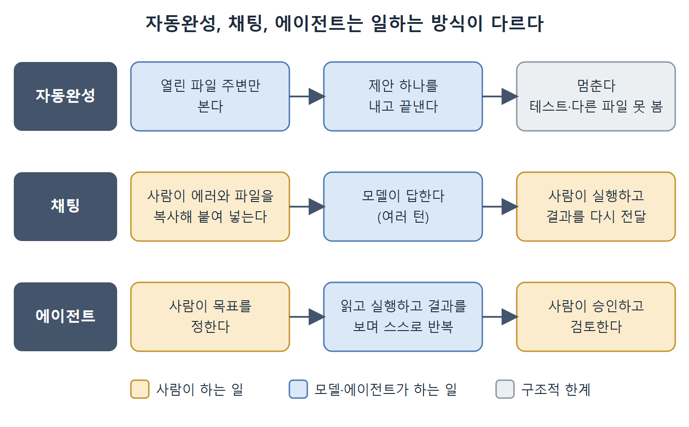

# 자동완성의 한계와 에이전트 방식

자동완성에서 채팅으로, 채팅에서 에이전트로 넘어간 이유는 모델이 똑똑해져서만이 아니다. 모델이 일하는 방식, 즉 인터페이스가 바뀌었기 때문이다. 이 문서는 자동완성의 구조적 한계가 무엇이고, 에이전트 방식이 그 한계를 어떻게 없애는지 정리한다.

---

## 1. 모델 문제가 아니라 인터페이스 문제

자동완성은 한 시점에 하나의 컨텍스트 윈도 안에서만 일한다. 모델은 지금 열려 있는 코드를 보고 제안 하나를 내고 멈춘다. 그래서 다음 일들을 할 수 없다.

- 테스트를 돌려 실패를 확인하고 제안을 고치는 일
- 다른 파일을 열어 타입 정의와 맞는지 확인하는 일
- CI 로그를 읽고 빌드가 왜 깨졌는지 파악하는 일

이것은 모델의 능력이 모자라서 생기는 문제가 아니다. 여러 파일로 이루어진 시스템을 추론하고 테스트 피드백을 반영할 만한 모델이어도, 인터페이스가 "파일 하나, 시점 하나, 완성 하나"만 허용하면 그 능력을 쓸 수 없다. 이 한계는 모델이 아무리 좋아져도 완전히 해결되지 않는 구조적인 한계다. 그래서 뒤에 나온 에이전트 도구는 "더 좋은 자동완성"이 아니라 아예 다른 종류의 물건이다.

## 2. 채팅이 도운 부분과 남은 부분

채팅은 여러 턴에 걸친 추론을 허용하므로 자동완성보다 낫다. 그래도 사람이 중간에서 다리 노릇을 해야 한다. 에러 메시지를 복사해 붙이고, 관련 파일 내용을 찾아 넘기고, 테스트 결과를 전달해야 한다. 이 다리는 마찰을 만들고, 한 세션에서 모델이 끝낼 수 있는 일의 양을 제한한다.

## 3. 에이전트 방식: 다리를 없앤다

에이전트 방식은 정보를 중계하는 다리를 없앤다. 모델에게 환경에 직접 접근하는 도구를 쥐여 준다. 이 파일을 읽어라, 이 명령을 실행해라, 이 결과를 써라, 이 변경을 커밋해라 같은 도구다. 그러면 모델은 여러 단계의 작업을 처음부터 끝까지 해낼 수 있다.

예를 들어 실패하는 테스트를 읽고, 구현 코드를 찾고, 버그를 고치고, 테스트를 다시 돌리고, 통과하면 커밋하는 일을 단계마다 사람이 끼어들지 않고 진행한다.

그림은 세 방식에서 사람과 모델이 각각 맡는 일을 나란히 보여 준다. 자동완성은 제안 하나에서 멈추고, 채팅은 사람이 중간에서 정보를 나르며, 에이전트는 사람이 목표와 승인만 맡고 그 사이를 에이전트가 직접 반복한다.

## 4. '에이전틱'이 뜻하는 것

여기서 에이전틱(agentic)이란 모델에게 에이전시, 곧 실제 환경에서 행동할 수 있는 능력이 있다는 뜻이다. 사람이 따라 할 텍스트를 제안하는 데서 그치지 않는다. 에이전틱 도구는 파일을 읽고, 셸 명령을 실행하고, 출력을 관찰하고, 다음에 할 일을 스스로 정한다. 이 모두가 하나의 세션 안에서 일어난다. 목표는 사람이 정하고, 그것을 추구하는 것은 에이전트다.

### 주의: 자율과 무감독은 다르다

'에이전틱'이 곧 '감독 없이 알아서 한다'는 뜻은 아니다. Codex CLI는 여러 가지 승인 모드를 지원한다. 쓰기나 명령 실행 전에 사용자의 확인을 받는 대화형 모드도 있다. 에이전트 방식은 모델에게 환경에 접근할 능력을 주는 것이지, 사람의 감독을 고리에서 빼는 것이 아니다. 승인 모드는 뒤의 장에서 자세히 다룬다.

---

## 5. 세 방식 비교

| 구분 | 자동완성 | 채팅 | 에이전트 |
|---|---|---|---|
| 모델이 보는 범위 | 열린 파일 주변 | 사용자가 붙여 넣은 내용 | 저장소와 환경 전체(도구로 직접 접근) |
| 테스트 실행 | 못 한다 | 사람이 돌려서 결과를 전달한다 | 스스로 돌리고 결과를 읽는다 |
| 사람의 역할 | 제안을 받거나 무시한다 | 정보를 중계하는 다리 | 목표를 정하고 승인과 검토를 한다 |
| 적합한 일 | 상용구, 잘 알려진 패턴 | 설명, 단발성 수정, 아이디어 탐색 | 여러 파일에 걸친 수정, 테스트 반복, 커밋까지 이어지는 작업 |

 
 
 

[Agentic Coding with OpenAI Codex CLI](../)
