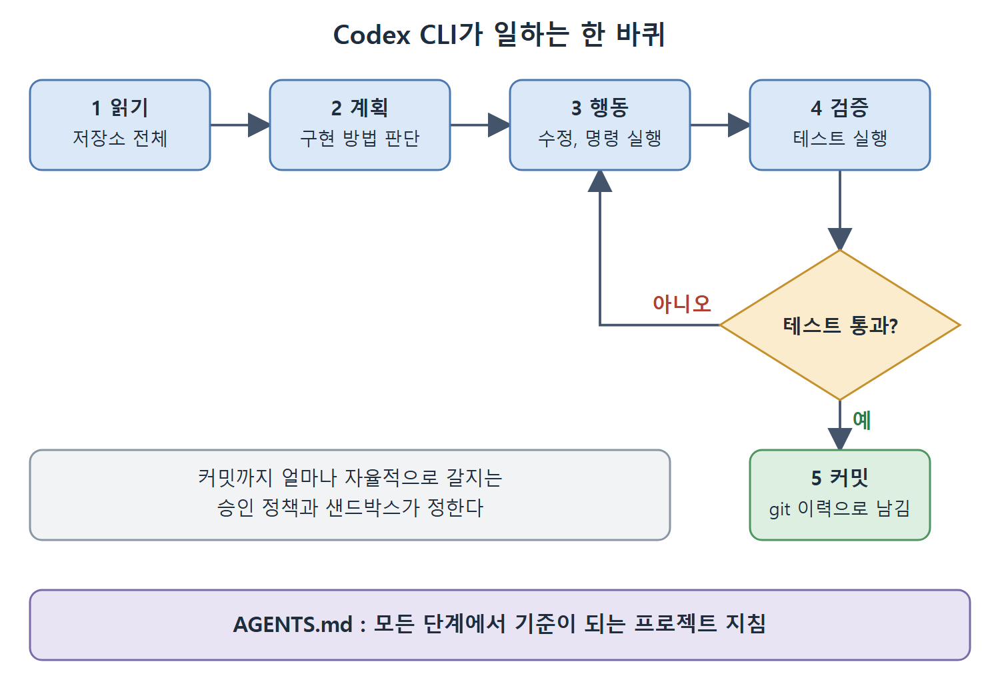

# 핵심 제안 네 가지

Codex CLI가 하는 일은 문장 하나로 줄일 수 있다. 작업을 설명하면 에이전트가 저장소를 읽고, 테스트를 돌리고, 커밋을 만들고, 끝나면 알려 준다는 것이다. 이 네 가지 능력이 자동완성 시대, 채팅 기반 보조, 더 단순한 에이전트 도구와 Codex CLI를 구별 짓는다. 이 문서는 네 가지를 하나씩 풀어 설명한다.

---

## 1. 저장소 전체를 읽는다

에이전트는 열려 있는 파일에 갇히지 않는다. 컨텍스트 윈도가 크기 때문에 대부분의 프로젝트 코드베이스는 한 컨텍스트에 들어간다. 한 파일에서 타입 정의를, 다른 파일에서 구현 패턴을, 또 다른 파일에서 테스트 픽스처를 읽고, 그 모두를 함께 놓고 요청을 어떻게 구현할지 판단한다.

이 능력은 리팩터링에서 가장 크게 빛난다. 한 파일의 올바른 수정은 수십 개의 다른 파일에 흩어진 사용 패턴에 달려 있기 때문이다. 자동완성은 그 패턴을 볼 수 없고, 채팅은 사용자가 손으로 붙여 넣어야 한다. Codex CLI는 스스로 찾는다.

## 2. 테스트를 돌린다

에이전트는 테스트 스위트를 실행하고, 출력을 관찰하고, 실패 정보를 바탕으로 다음 행동을 정한다. 코드를 쓰고, 테스트를 돌리고, 실패를 보고, 고치는 이 피드백 루프는 경험 있는 개발자가 일하는 방식 그대로다. Codex CLI는 이 루프에 자율적으로 참여한다.

테스트 실행기는 AGENTS.md에 적어 두거나 저장소 구조에서 추론한다. 에이전트는 사용자가 터미널에서 칠 것과 같은 명령을 실행하고, 출력을 수집해 분석한 뒤 다음 행동에 반영한다.

## 3. 커밋을 만든다

허락을 받으면 에이전트는 작업을 git에 커밋한다. 결과물은 의미 있는 커밋 메시지가 붙은, 검토 가능한 정식 이력이다. 편집기에 저장 안 된 변경이나 복사해서 옮겨야 하는 diff가 아니다. 커밋과 이력은 진짜이고, 다른 변경과 마찬가지로 `git log`나 `git diff`로 검토한다.

에이전트가 커밋까지 얼마나 자율적으로 할 수 있는지는 설정한 승인 정책과 샌드박스가 정한다.

| 승인 정책 | 동작 |
|---|---|
| `on-request` | 에이전트가 명령과 편집을 제안하고, 사용자가 승인해야 실행된다 |
| `untrusted` | 더 엄격하다. 거의 모든 것을 사용자 확인으로 올린다 |
| `never` | `workspace-write` 샌드박스와 함께 쓰며 CI 파이프라인과 신뢰하는 환경용이다. 중단 없이 끝까지 진행한다 |

## 4. AGENTS.md를 따른다

에이전트는 AGENTS.md 파일의 지침을 읽고 따른다. 이것은 참고용 힌트가 아니라, 에이전트가 자기 작업 컨텍스트의 일부로 다루는 구속력 있는 지침이다.

- pip 대신 uv를 쓰라고 적으면 uv를 쓴다.
- pytest 대신 `just test`를 쓰라고 적으면 `just test`를 실행한다.
- 배포 스크립트에 알려진 함정이 있다고 경고하면 그것을 피한다.

팀이 쌓아 온 제도적 지식을 에이전트의 행동에 심는 방법이 이것이다. 에이전트는 코드베이스의 역사, 팀의 결정, 조직의 관례를 우리가 적어 주기 전에는 모른다. 그것을 적는 자리가 AGENTS.md다.

### 구체적일수록 효과가 크다

AGENTS.md의 가치는 구체성에 비례한다. '깔끔한 코드를 써라' 같은 일반론은 에이전트의 행동에 측정할 만한 영향을 주지 못한다. 반대로 눈에 띄지 않는 구체적인 도구 지침은 크고 안정적인 효과를 낸다. 예를 들어 "`uv run pytest`를 쓰고 pytest를 직접 부르지 말 것, 가상 환경이 자동으로 활성화되지 않는다" 같은 것이다. 무엇을 AGENTS.md에 넣고 넣지 말지는 4장에서 다룬다.

---

## 5. 네 가지를 한 루프로 보면

저장소를 읽고, 계획하고, 행동(수정, 실행)하고, 테스트로 검증한 뒤 커밋한다. AGENTS.md는 그 모든 단계에서 기준이 되는 지침이다. 연습 문제 1-4는 이 흐름을 읽기, 계획, 실행, 검증 네 단계로 나누어 자기 프로젝트에 대입해 보라고 한다.

그림은 이 루프를 순서대로 보여 준다. 테스트가 통과하지 못하면 다시 행동 단계로 돌아가 고치고, 통과하면 커밋으로 마무리하며, AGENTS.md는 모든 단계의 기준이 된다.

 
 
 

[Agentic Coding with OpenAI Codex CLI](../)
