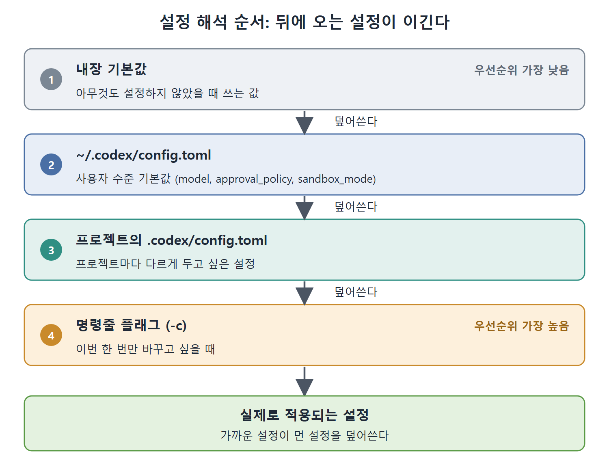

# 설정 위치와 환경 변수

Codex CLI는 설정을 여러 곳에서 읽고, 겹치는 값은 나중에 읽은 쪽이 앞의 값을 덮어쓴다. 이 문서는 사용자 설정 파일, Codex가 시작할 때 읽는 환경 변수, 그리고 설정이 적용되는 우선순위를 정리한다.

---

## 1. 사용자 수준 설정 파일

`~/.codex/config.toml`은 사용자 수준의 기본값을 담는다. 모델, 승인 모드, 샌드박스 설정 같은 것이다. 원문의 예시는 다음과 같다.

```
model = "gpt-5.5"
approval_policy = "on-request"
sandbox_mode = "workspace-write"
```

- `model`은 기본으로 쓸 모델이다.
- `approval_policy`는 에이전트가 어떤 경우에 사람에게 승인을 구할지 정한다. 여기서는 `on-request`다.
- `sandbox_mode`는 에이전트가 파일 시스템 등에서 어디까지 할 수 있는지 정한다. 여기서는 `workspace-write`다.

각 값의 의미와 선택지는 5장에서 본격적으로 다룬다. 이 장에서는 설정이 이런 모양으로 존재한다는 것만 알면 된다.

## 2. 시작할 때 읽는 환경 변수

Codex는 시작할 때 다음 환경 변수를 읽는다.

| 변수 | 용도 |
|---|---|
| `CODEX_HOME` | Codex 상태의 루트 경로. 설정, 인증, 로그, 세션, 스킬이 여기에 모인다 |
| `CODEX_API_KEY` | 비대화형 `codex exec` 한 번의 실행에 쓰는 API 키 |
| `CODEX_ACCESS_TOKEN` | 신뢰할 수 있는 자동화에 쓰는 ChatGPT 또는 Codex 액세스 토큰 |
| `CODEX_CA_CERTIFICATE` | 회사가 TLS 트래픽을 가로채는(검사하는) 환경을 위한 PEM 형식 CA 번들 |
| `RUST_LOG` | CLI와 앱 서버의 로그 필터링과 상세 수준 |

사용처를 풀어 보면 이렇다.

- 설정 파일과 인증 정보가 놓일 위치를 옮기고 싶으면 `CODEX_HOME`을 쓴다.
- CI 같은 곳에서 `codex exec`를 한 번 돌릴 때는 `CODEX_API_KEY`로 키를 넘긴다.
- 사내망에서 TLS 검사 장비가 인증서를 바꿔치기해서 연결이 실패한다면 `CODEX_CA_CERTIFICATE`로 회사 CA 번들을 지정한다.
- 동작을 추적하고 싶을 때 `RUST_LOG`로 로그를 조절한다.

Codex가 인식하는 환경 변수의 전체 목록은 OpenAI 개발자 문서의 environment-variables 페이지에 있다.

## 3. 해석 순서

설정은 아래 순서로 해석되고, 뒤에 오는 것이 이긴다.

1. 내장 기본값
2. `~/.codex/config.toml` (사용자 수준)
3. 프로젝트의 `.codex/config.toml`
4. 명령줄 플래그



그림은 네 단계의 설정이 위에서 아래로 차례로 덮어쓰이며, 맨 아래의 명령줄 플래그가 가장 높은 우선순위를 갖는다는 것을 보여 준다.

그래서 프로젝트마다 다른 설정을 두고 싶으면 프로젝트 안의 `.codex/config.toml`에 쓰면 되고, 한 번만 바꾸고 싶으면 플래그(예: `-c`)로 넘기면 된다. 요약에서는 이것을 "가까운 설정이 먼 설정을 덮어쓴다"고 표현한다.

## 4. 인증 관련 설정과의 관계

앞서 인증 방법에서 본 `~/.codex/config.toml` 기반 기업 설정, `requirements.toml`을 통한 관리자 강제 설정, `-c` / `--config` 플래그 덮어쓰기도 이 우선순위 체계 위에서 동작한다. 일회성 변경은 플래그, 고정 설정은 설정 파일이라는 식으로 역할이 나뉜다.

<br>
<br>
<br>

[Agentic Coding with OpenAI Codex CLI](../)
