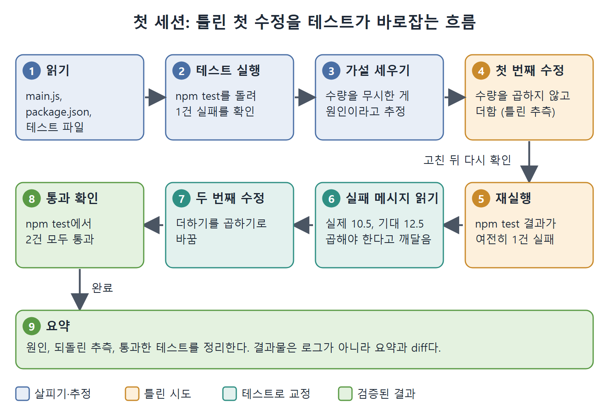

# 첫 세션 미리보기

설치 방법을 보기 전에, 설치하고 나면 무엇을 보게 되는지부터 짚는다. 이 문서는 책이 실제 저장소에서 돌린 첫 세션을 따라가며, 출력이 쭉 흘러갈 때 무엇에 집중하고 무엇을 흘려도 되는지 설명한다. 아직 직접 실행할 수는 없으니, 읽으면서 감을 잡는 용도다.

첫 세션 예시는 터미널 출력 형태의 글로 실려 있어서, 아래에 그 흐름을 단계별로 풀어 두었다.

---

## 1. 예시 상황

대상은 아주 작은 프로젝트다. 테스트가 하나 실패하고 있고, 코드 어딘가에 버그가 있다. 프롬프트(에이전트에게 주는 지시문)에 넣는 과제는 한 문장이다.

```
Find the bug in main.js and fix it. Run the tests before and after to
confirm the fix.
```

해석하면 "main.js의 버그를 찾아 고치고, 고치기 전과 후에 테스트를 돌려서 확인하라"는 뜻이다. 눈여겨볼 점은 지시문 안에 '테스트를 돌려라'가 들어 있다는 것이다. 에이전트가 스스로 결과를 확인할 기준을 같이 준 셈이다.

## 2. 단계별 흐름

Codex CLI는 바로 답을 내놓지 않는다. 먼저 살펴보고, 하는 일을 말로 중계한다.

1. **읽기.** main.js, package.json, test/main.test.js를 읽는다.
2. **테스트 실행.** npm test를 돌린다. 장바구니 합계를 계산하는 calculateCartTotal이 "가격에 수량을 곱해야 한다"는 테스트에서 1건이 실패한다.
3. **가설 세우기.** 에이전트가 소리 내어 추론한다. 합계에서 item.price만 더하고 item.quantity를 아예 무시하고 있다고 보고, 수량을 합계에 넣겠다고 한다.
4. **첫 번째 수정.** 그런데 이 수정은 `total + item.price + item.quantity`, 즉 수량을 곱하지 않고 더하는 방식이었다.
5. **재실행.** npm test를 다시 돌리니 여전히 1건 실패한다.
6. **실패 메시지 다시 읽기.** 실제 값은 10.5인데 기대 값은 12.5다. 테스트 이름에 "multiplies(곱한다)"라고 적혀 있으니, 수량은 더하는 게 아니라 곱해야 한다는 걸 깨닫는다.
7. **두 번째 수정.** `+ item.quantity`를 `* item.quantity`로 바꾼다.
8. **통과 확인.** npm test를 돌리면 2건이 통과한다.
9. **요약.** 무엇을 했는지 정리하고 끝낸다. 수량을 무시한 합계가 원인이었고, 더하기라는 잘못된 추측을 되돌렸으며, 테스트 2건이 모두 통과했다는 내용이다.

전체 소요 시간은 20~40초 정도이고, 모든 도구 호출이 세션 로그에 실시간으로 보인다.



그림은 아홉 단계를 순서대로 보여 준다. 첫 수정이 틀려 테스트가 다시 실패해도, 에이전트가 실패 메시지를 읽고 스스로 고쳐 통과로 가는 과정이다.

## 3. 대화형 도구와 무엇이 다른가

일반 대화형 도구라면 첫 번째 수정안을 건네주고 끝났을 것이다. 그러면 틀린 코드를 사람이 받아서 직접 확인해야 한다. Codex CLI는 테스트를 돌려 빨간불을 보고 멈추지 않고 계속 진행했다. 이게 1장에서 본 에이전트 루프, 곧 계획하고, 실행하고, 관찰하고, 조정하는 순환이다.

책이 강조하는 말이 있다. 잘못된 첫 추측은 시연이 실수한 게 아니라 시연의 핵심이라는 것이다. 자기 테스트를 직접 돌리는 에이전트는 첫 시도에서 틀려도 괜찮다. 틀린 걸 잡아 주는 건 사람의 코드 리뷰가 아니라 테스트 실행이기 때문이다.

## 4. 공식 퀵스타트가 말해 주지 않는 세 가지

공식 퀵스타트 문서는 저장소를 클론해서 실행하는 방법만 보여 준다. 책은 화면에 보이는 추론 과정이 소음이 아니라 핵심이라고 하면서, 문서가 빠뜨린 세 가지를 짚는다.

### 4-1. 첫 수정은 정답이 아니라 탐침일 때가 많다

에이전트는 검증을 하기 때문에 틀려도 된다. 중간 수정 하나하나를 최종 답으로 읽으면 속이 터진다. 키 입력(편집 하나하나)을 보지 말고 테스트 결과를 보라는 조언이다.

### 4-2. 에이전트는 바꾸기 전에 먼저 테스트를 돌린다

프로젝트에 테스트가 없거나, 느리거나, 가끔 실패하는(flaky) 테스트라면 에이전트는 의존하던 피드백을 잃는다. 그러면 첫 추측이 마지막 추측이 될 가능성이 훨씬 커진다. 그래서 저장소에서 가장 효과가 큰 투자는 빠른 테스트 명령어 하나라고 책은 말한다.

### 4-3. 결과물은 스크롤이 아니라 마지막 요약이다

흘러가는 도구 호출 로그는 실시간 추적(trace)일 뿐 보고서가 아니다. 돌아가는 동안에는 슬쩍 보고, 끝난 뒤에는 최종 요약과 diff(변경 내용)를 꼼꼼히 읽는 습관을 들이라는 것이다.

## 5. 정리

| 보이는 것 | 읽는 법 |
|---|---|
| 흘러가는 읽기, 수정, 테스트 로그 | 실시간 추적일 뿐이다. 가볍게 훑는다 |
| 틀린 첫 수정 | 탐침이다. 테스트가 잡아 줄 것을 기대한다 |
| 실행 전 테스트 | 에이전트가 피드백을 얻는 출발점이다 |
| 마지막 요약과 diff | 진짜 산출물이다. 꼼꼼히 읽는다 |

<br>
<br>
<br>

[Agentic Coding with OpenAI Codex CLI](../)
