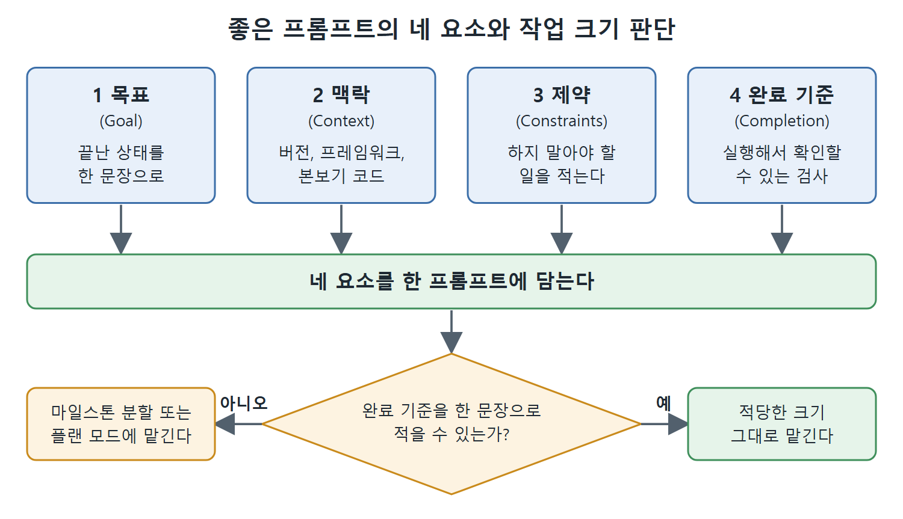

# 에이전트 프롬프트의 특징과 네 요소

Codex CLI에 일을 시키는 프롬프트(prompt, 모델에 주는 지시문)는 검색창에 단어를 넣는 일과 다르다. 코드베이스를 읽고, 명령을 실행하고, 몇 분씩 혼자 돌아가는 도구에 지시하는 일이라서, 열쇠를 건네기 전에 외주 개발자에게 업무를 설명하는 일에 더 가깝다.

이 문서는 왜 에이전트(agent, 스스로 도구를 호출하며 일하는 AI)에게는 모호한 지시가 비싼지, 좋은 프롬프트에 공통으로 들어 있는 네 요소가 무엇인지, 한 번에 맡길 작업의 크기는 어느 정도가 좋은지 정리한다.

---

## 1. 이 장에서 얻을 것

3장은 효과를 좌우하는 두 가지 기술 중 첫째인 프롬프트 작성을 다룬다. 둘째 기술인 AGENTS.md는 4장에서 다룬다. 3장을 마치면 다음을 할 수 있어야 한다.

- 목표, 맥락, 제약, 완료 기준을 담은 프롬프트를 쓴다.
- 세션(session, 한 번 켜서 끝낼 때까지의 작업 단위)이 바뀌어도 남는 맥락을 AGENTS.md 파일에 담아 둔다.
- 실행을 낭비하게 만드는 프롬프트 안티패턴(anti-pattern, 흔한 나쁜 습관)을 알아보고 고친다.
- Codex CLI로 프로젝트 문서를 만들고 관리한다.

여기서 말하는 프롬프트 작성은 프롬프트 엔지니어링 이론이 아니다. 코드를 읽고 명령을 실행하는 에이전트형 도구에서 실제로 통하는 구체적인 패턴을 말한다.

## 2. 왜 Codex CLI 프롬프트는 다른가

프롬프트 하나가 도구 호출의 사슬을 일으킬 수 있다. 파일을 읽고, 테스트를 돌리고, 코드를 쓰는 과정이 몇 분 동안 이어진 뒤에야 검토할 결과가 나온다. 모호한 지시가 문제로 드러날 즈음에는 이미 파일 열두어 개를 건드렸을 수 있다. 원서는 이 자율적인 다단계 도구 호출 루프의 배경으로 ReAct 논문(Yao 등, 2022, arXiv:2210.03629)을 각주로 든다.

그래서 명확함의 경제성이 달라진다.

- 대화형 AI에서는 모호하게 말해도 괜찮다. 다시 물어보면 되니까 싸게 고칠 수 있다.
- 에이전트형 AI에서는 모호함이 비싸다. 틀린 방향으로 한참 달린 뒤에 되돌려야 한다.
- 더 곤란한 점은, Codex CLI가 기술적으로는 타당하지만 우리 프로젝트에는 틀린 선택을 자신 있게 한다는 것이다. 이 프로젝트에서 무엇이 옳은지 알려 준 적이 없기 때문이다.

결국 좋은 프롬프트는 실행이 시작되기 전에 모호함을 줄이는 일이다.

## 3. 모호한 프롬프트의 비용

원서는 두 프롬프트를 나란히 비교한다.

```text
# 프롬프트 A
Improve the order processing code.

# 프롬프트 B
Refactor src/orders/process.ts to replace the nested callback chains with
async/await. Do not change the public function signatures. Run npm test
after each file change and only continue if all tests pass.
```

A는 '개선'이 무슨 뜻인지, 어느 파일을 건드릴지, 언제 멈출지를 모두 에이전트에게 떠넘긴다. B는 이 세 가지를 모두 정해 준다. 차이는 몇 분의 낭비된 연산과, 원치 않는 수십 개의 파일 변경으로 나타난다.

## 4. 효과적인 프롬프트의 네 요소

좋은 결과를 내는 프롬프트에는 거의 항상 네 요소가 들어 있다.

| 요소 | 담을 내용 | 예 |
|---|---|---|
| 목표(Goal) | '끝난 상태'를 구체적인 한 문장으로 쓴다. add, fix, migrate, replace 같은 결과 동사를 쓴다. | /api/posts 엔드포인트에 페이지네이션을 추가한다 |
| 맥락(Context) | 언어 버전, 프레임워크, 본보기가 될 비슷한 코드를 알려 준다. | src/api/users.ts의 패턴을 따른다 |
| 제약(Constraints) | 하지 말아야 할 일을 적는다. | 새 의존성 금지, 데이터베이스 스키마 변경 금지, src/legacy/ 파일 수정 금지 |
| 완료 기준(Completion criteria) | 실행해서 확인할 수 있는 검사를 적는다. | GET /api/posts?page=2&limit=20이 올바른 JSON을 돌려주고 npm test가 종료 코드 0으로 끝난다 |

네 요소를 모두 갖춘 실제 예시는 다음과 같다.

```text
Goal: Add pagination to the /api/posts endpoint.
Context: Express.js app, PostgreSQL via pg-pool, follows the existing
pattern in src/api/users.ts (cursor-based pagination).
Constraints: Do not modify the database schema. Do not add new npm
packages. Do not change the /api/users endpoint.
Completion: GET /api/posts?cursor=<id>&limit=20 returns the correct
page and a next_cursor field. Existing tests still pass. Run npm test.
```

예시 하나는 추상적인 설명 한 문단보다 값어치가 크다. 프롬프트에 구체적인 예시나 기존 파일 경로를 하나 넣어 두면, 에이전트가 '이 프로젝트에서의 옳음'을 추측하지 않고 따라 할 수 있다.

## 5. 작업 크기는 어느 정도가 좋은가

네 요소를 갖춘 프롬프트는 자연스럽게 작업 범위를 정한다. 적당한 크기는 동료 한 사람이 오후 한나절이면 끝낼 수 있고, 시작 전과 끝난 뒤의 상태가 분명한 작업이다.

- 이보다 작은 작업에는 구조화된 프롬프트의 준비 비용이 아깝다. 한 줄이면 된다.
- 이보다 큰 작업은 마일스톤(milestone, 중간 목표)으로 쪼개거나 플랜 모드에 맡긴다. 플랜 모드는 이 장의 뒷부분에서 설명한다.

정리하면 네 요소는 한 번에 맡길 일의 크기를 가늠하는 기준이기도 하다. 완료 기준을 한 문장으로 적을 수 없다면 작업이 너무 크거나 아직 정리되지 않았다는 신호다.



그림은 목표, 맥락, 제약, 완료 기준을 한 프롬프트에 담은 뒤, 완료 기준을 한 문장으로 적을 수 있으면 그대로 맡기고 적을 수 없으면 마일스톤으로 쪼개거나 플랜 모드에 맡기는 판단 흐름을 보여 준다.

## 6. 원서의 그림에 대해

이 장의 원서 본문에는 표와 코드 예시만 있고, 텍스트 추출본에서 확인되는 그림 캡션이나 그림 설명이 없다. 별도로 추출해 둔 원서 이미지 폴더에도 이 장에 해당하는 그림 파일이 없다. 그래서 이 노트의 그림은 원서 그림을 옮긴 것이 아니라, 본문 내용을 바탕으로 새로 그린 것이다. 원서의 표 두 개(추론 강도, 공식 레시피)는 내용을 새로 구성해 표로 옮겼다.

<br>
<br>
<br>

[Agentic Coding with OpenAI Codex CLI](../)
