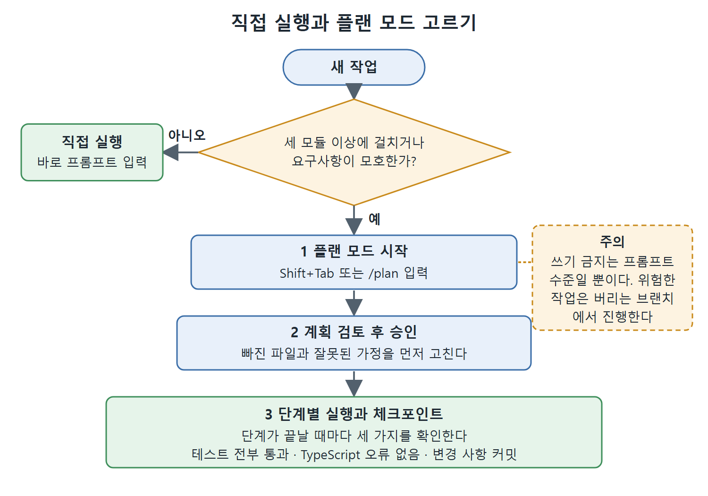

# 추론 강도와 플랜 모드

작업이 복잡해질수록 프롬프트 문장만으로는 한계가 있다. 모델이 얼마나 깊이 생각할지 정하는 추론 강도, 코드를 바꾸기 전에 계획부터 세우게 하는 플랜 모드, 몇 시간짜리 작업을 이어 가는 PLANS.md, 긴 작업에 검증 지점을 넣는 체크포인트 패턴이 그 도구들이다.

이 문서는 네 가지를 언제 어떻게 쓰는지 정리한다.

---

## 1. 추론 강도(reasoning effort)

Codex CLI에서는 모델이 행동하기 전에 얼마나 깊이 생각할지를 조절할 수 있다. 설정 키는 model_reasoning_effort이다. 이 값은 응답 속도(지연)와 토큰 비용을 깊은 추론과 맞바꾼다.

높다고 항상 좋은 것은 아니다.

- 한 줄짜리 이름 바꾸기에 high를 쓰면 토큰만 태운다.
- 모듈을 가로지르는 리팩터링에 low를 쓰면 변경이 얕아서 구조에 미치는 영향을 놓친다.

| 단계 | 설정 값 | 잘 맞는 작업 |
|---|---|---|
| minimal | model_reasoning_effort = "minimal" | 대량으로 돌리는 단순 변환. 포매터, 일괄 이름 변경, CI에서 파일 템플릿 만들기 |
| low | model_reasoning_effort = "low" | 간단한 수정, 이름 바꾸기 |
| medium (기본값) | model_reasoning_effort = "medium" | 대부분의 대화형 코딩 작업 |
| high | model_reasoning_effort = "high" | 복잡한 알고리즘, 여러 영역에 걸친 리팩터링 |
| xhigh | model_reasoning_effort = "xhigh" | 아키텍처 결정, 보안 검토 |

### 설정하는 곳

추론 강도는 ~/.codex/config.toml에 사용자 전체 기본값으로 둘 수 있고, 프로필(profile, 이름 붙여 저장해 두는 설정 묶음)별로 지정할 수도 있다. 세션 도중에는 /model 명령으로 바꾼다.

```toml
# ~/.codex/config.toml — user-wide default
model_reasoning_effort = "medium"

# ~/.codex/refactor.config.toml — a profile that raises effort
model_reasoning_effort = "high"
```

프로필은 `codex --profile refactor`로 켠다. 어려운 일을 할 때만 강도를 올리는 프로필을 따로 만들어 두면, 매번 설정을 고치지 않아도 된다.

## 2. 플랜 모드

모호하거나 여러 단계로 이뤄진 작업은 먼저 플랜 모드로 시작한다. Shift+Tab으로 모드를 전환하거나 /plan을 입력해서 켠다.

```text
/plan Propose a migration strategy for moving our auth from sessions to JWT
```

플랜 모드에 들어가면 Codex CLI는 맥락을 모으는 자세로 바뀐다. 코드베이스를 읽고, 모호한 부분을 찾아내고, 파일을 하나도 바꾸기 전에 구조화된 계획을 내놓는다.

### 직접 실행과 플랜 모드 고르기

| 상황 | 선택 |
|---|---|
| 파일 하나, 요구사항이 분명한 변경 | 직접 실행 |
| 세 모듈 이상에 걸친 변경 | 플랜 모드 |
| 요구사항이 모호함 | 플랜 모드 |
| 빠르게 오가는 디버깅 | 직접 실행 |

### 주의할 점

플랜 모드의 '쓰기 금지'는 프롬프트 수준에서만 지켜진다. 런타임 샌드박스(sandbox, 실행 범위를 가두는 격리 장치)가 강제하는 제약이 아니다. 따라서 위험도가 높은 작업이라면 버리는 브랜치를 따로 만들어 그 위에서 진행하는 편이 안전하다.



그림은 세 모듈 이상에 걸치거나 요구사항이 모호한 작업은 플랜 모드에서 계획을 검토하고 승인한 뒤 단계별 체크포인트로 실행하고, 그렇지 않은 작업은 직접 실행하는 흐름을 보여 준다.

## 3. 몇 시간짜리 작업을 위한 PLANS.md

몇 시간, 혹은 여러 세션에 걸치는 작업이라면 PLANS.md를 만들어 두고 AGENTS.md에서 참조하게 한다. 원서가 제시하는 ExecPlan 뼈대는 다음과 같다.

```markdown
# ExecPlan: <Feature Name>
## Purpose / Big Picture
## Progress
- [ ] Step 1 --- description (started: 2026-03-27T09:14Z)
- [x] Step 2 --- description (completed: 2026-03-27T09:32Z)
## Decision Log
| Date | Decision | Rationale |
## Concrete Steps
## Validation and Acceptance
```

섹션의 역할은 이렇다. 목적과 큰 그림, 진행 상황(시작·완료 시각 기록), 결정 기록(날짜·결정·근거), 구체적인 단계, 검증과 수락 기준이다.

가장 중요한 성질은 자기완결성이다. ExecPlan만 읽어도 외부 맥락 없이 기능을 처음부터 끝까지 구현할 수 있어야 한다. 이 방식을 마일스톤 기반 계획을 코드보다 먼저 PLANS.md에 쓰는 PLANS.md 기법으로 체계화할 수 있다. 자세한 내용은 4장에서 다룬다.

## 4. 체크포인트 패턴

긴 프롬프트는 중간중간 검증 단계를 넣어 구조화한다. 매 단계가 끝날 때마다 확인할 조건을 못 박아 두면, 어느 단계에서 틀어졌는지 바로 알 수 있다.

```text
Migrate the legacy authentication module to the new auth service.
After each step: (1) all tests pass, (2) no TypeScript errors, (3) changes
committed.

Steps:
1. Extract token validation logic to src/auth/validate.ts
2. Update the middleware to use the new module
3. Remove src/auth/legacy.js
4. Update all imports across the codebase
```

이 예시에서 단계마다 요구하는 조건은 세 가지다. 테스트 전부 통과, TypeScript 오류 없음, 변경 사항 커밋이다. 커밋이 쌓이므로 중간에 문제가 생겨도 직전 단계로 쉽게 돌아갈 수 있다.

<br>
<br>
<br>

[Agentic Coding with OpenAI Codex CLI](../)
