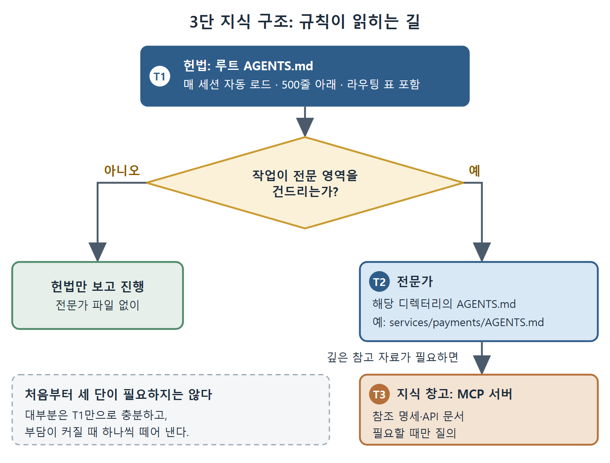

# 3단 지식 구조

AGENTS.md 하나로 시작하는 것은 자연스럽다. 하지만 코드베이스가 커지면 파일 하나에 모든 것을 담기 어려워진다. 이 문서에서는 규칙을 헌법, 전문가, 지식 창고의 세 단으로 나누는 방법을 정리한다. 각 단은 Codex CLI가 이미 가진 기능에 그대로 대응한다.

---

## 1. 언제 쪼개야 하나

평평한 AGENTS.md 하나는 작거나 중간 규모의 프로젝트에서 잘 작동한다. 코드베이스가 대략 2만 줄을 넘기면 파일 하나가 감당하기 힘들게 커지는 경우가 생긴다. 원문은 이때 쓸 수 있는 3단 지식 구조를 소개하고, 출처로 Vasilopoulos(2026)의 "Codified Context" 논문(arXiv:2602.20478)을 든다.

| 단 | 역할 | Codex CLI에서의 대응 | 읽히는 때 |
|---|---|---|---|
| T1 헌법 | 어길 수 없는 규칙과 안내표(라우팅 표) | AGENTS.md | 매 세션 |
| T2 전문가 | 특정 영역의 깊은 전문 지식 | 영역별 전용 AGENTS.md | 작업 종류에 따라 |
| T3 지식 창고 | 참고 명세, API 문서 | MCP 서버 | 필요할 때 질의 |



그림은 헌법에서 출발해 작업 성격에 따라 전문가 파일이나 지식 창고로 읽기가 넓어지는 순서를 보여 준다. 전문 영역을 건드리지 않는 작업은 T1만으로 끝나고, 필요한 단만 읽으므로 컨텍스트 윈도가 가볍게 유지된다.

## 2. T1 헌법: 짧고 단단하게

1단은 지금까지 설명한 AGENTS.md 그 자체다. 500줄 아래로 가볍게 유지하고, 모든 세션에 필요한 것만 담는다. 코딩 표준, 아키텍처 경계, 금지 패턴, 그리고 무엇보다 에이전트가 전문가 파일에게 일을 넘길 때를 알려 주는 라우팅 규칙이 들어간다. 라우팅 표를 헌법 안에 두면 위임 기준이 분명해진다.

```markdown
## Specialist routing
| If the task touches | Read first |
|---|---|
| Payment flow, Stripe, refunds | `services/payments/AGENTS.md` |
| Auth, sessions, JWT | `services/auth/AGENTS.md` |
| Database migrations | `infra/db/AGENTS.md` |
| Anything else | (no specialist; proceed with this file) |
```

표의 마지막 줄이 중요하다. 어느 전문 영역에도 해당하지 않으면 헌법만 보고 진행하라고 명시해서, 에이전트가 불필요하게 헤매지 않게 한다.

## 3. T2 전문가: 해당 디렉터리의 AGENTS.md

2단에는 헌법에 그대로 넣으면 부피만 키울 깊은 도메인 지식이 들어간다. 전문가 파일은 해당 하위 디렉터리에 놓는 AGENTS.md다. 원문의 결제 서비스 예시는 이렇다.

```markdown
# services/payments/AGENTS.md
## Scope
PCI-DSS in scope. All code here is audited annually.
## Hard rules
- Never log full PANs or CVVs; mask to last four digits.
- All amounts in minor units (pence); never floats.
- New endpoints must add a fixture under `tests/pci/`.
## Tooling
- Use `pnpm run test:pci` (not `pnpm test`)
```

세 가지를 읽어 낼 수 있다. 범위를 먼저 밝힌다(PCI-DSS 적용 대상이고 코드는 매년 감사받는다). 어기면 안 되는 규칙을 적는다(카드번호 전체와 CVV는 로그에 남기지 않고 끝 네 자리만 남긴다, 금액은 최소 단위인 펜스로 다루고 부동소수점은 쓰지 않는다, 새 엔드포인트는 `tests/pci/`에 픽스처를 추가한다). 도구도 적는다(`pnpm test`가 아니라 `pnpm run test:pci`를 쓴다. PCI 테스트는 샌드박스 네트워크가 필요하기 때문이다).

## 4. T3 지식 창고: MCP 뒤로 보내기

3단은 가끔만 필요한 참고 자료를 MCP 서버 뒤에 둔다. 그러면 컨텍스트 윈도가 가벼워지고, 에이전트는 필요할 때만 질의해서 가져온다. MCP는 8장에서 자세히 다룬다.

## 5. 처음부터 세 단을 다 만들 필요는 없다

원문은 분명히 말한다. 첫날부터 3단을 모두 갖출 필요가 없고, 대부분의 프로젝트는 1단만으로 충분히 잘 지낸다. 파일이 감당하기 어려워지는 신호가 보일 때 하나씩 떼어 내면 된다. 다만 1단에 이미 넣은 규칙을 어떻게 덜어낼지는 [흔한 실수와 정리](%ED%9D%94%ED%95%9C%20%EC%8B%A4%EC%88%98%EC%99%80%20%EC%A0%95%EB%A6%AC.md) 문서의 점검표를 참고하면 된다.

<br>
<br>
<br>

[Agentic Coding with OpenAI Codex CLI](../)
