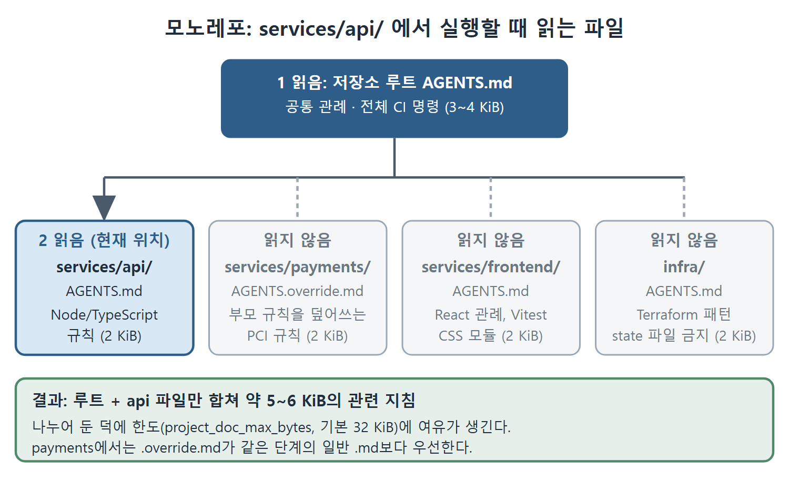

# 모노레포와 CI 설정

여러 서비스가 한 저장소에 들어 있으면 모든 규칙을 루트 파일 하나에 몰아넣기 어렵다. 이 문서에서는 디렉터리마다 AGENTS.md를 두는 계층 구조, 크기 제한이 만드는 함정, CI/CD 파이프라인에서 임시 override 파일을 쓰는 방법, 그리고 AGENTS.md가 Codex CLI만의 것이 아니라는 점을 정리한다.

---

## 1. 권장 구조

원문이 보여 주는 모노레포 구조는 다음과 같다. 크기는 원문이 제시한 대략의 목표치다.

| 위치 | 파일 | 크기 | 담는 내용 |
|---|---|---|---|
| 저장소 루트 | `AGENTS.md` | 3~4 KiB | 저장소 구성, 전체 CI 명령, 공통 관례 |
| `services/api/` | `AGENTS.md` | 2 KiB | Node/TypeScript 규칙, API 패턴 |
| `services/payments/` | `AGENTS.override.md` | 2 KiB | 부모의 느슨한 규칙을 덮어쓰는 PCI 규칙 |
| `services/frontend/` | `AGENTS.md` | 2 KiB | React 관례, Vitest 설정, CSS 모듈 |
| `infra/` | `AGENTS.md` | 2 KiB | Terraform 패턴, 건드리면 안 되는 state 파일 |



그림은 `services/api/`에서 Codex CLI를 실행했을 때 저장소 루트와 현재 위치의 파일만 읽히고 나머지 서비스의 파일은 제외되는 모습을 보여 준다. 그래서 관련 있는 지침만 합쳐 약 5~6 KiB로 유지된다.

Codex CLI가 `services/api/`에서 일하면 저장소 루트 파일과 `services/api/AGENTS.md`를 읽는다. 합쳐서 대략 5~6 KiB 정도의 관련 있는 지침이다. Terraform 규칙이나 결제 서비스의 PCI 제약은 보지 않는다. 결제 디렉터리에는 일반 `.md`가 아니라 `.override.md`를 쓴 점도 눈여겨볼 만하다. 같은 단계에서 override가 우선하므로 위쪽 규칙이 느슨해도 PCI 규칙이 이긴다.

## 2. 길이 제한과 조용한 잘림

Codex CLI는 불러온 AGENTS.md 전체의 합계 크기를 제한한다. 이 값은 `project_doc_max_bytes` 설정 키로 조절하고 기본값은 32 KiB다. 한도를 넘는 부분은 터미널에도 로그에도 경고 없이 잘린다. 이 동작은 Codex CLI 이슈 트래커에 문서화되어 있다고 원문은 밝힌다.

가장 큰 방어책은 앞에서 본 계층 구조다. 지침을 나눠 놓으면 실행할 때마다 관련된 일부만 불러온다. 또 조용히 잘리는 이상, 큰 파일의 아래쪽에 있는 규칙은 읽히지 않을 수 있다. 가장 중요한 제약은 파일 아래가 아니라 위에 둔다.

## 3. CI/CD 파이프라인용 override 파일

자동화 파이프라인에서는 임시 override 파일을 만들어서 쓴다. 원문의 흐름은 세 단계다. 임시 파일을 만들고, `codex exec`를 실행하고, 끝나면 파일을 지운다.

```bash
cat > .codex/AGENTS.override.md << 'EOF'
## CI Mode
- Never ask clarifying questions---make your best judgment and proceed
- Always run the full test suite before completing any task
- If tests fail, explain the failure and stop; do not attempt a fix
- Do not make commits; only propose changes as diffs
EOF
codex exec "$TASK" --sandbox workspace-write
rm .codex/AGENTS.override.md
```

사람이 없는 환경이라 되묻는 질문이 필요 없고, 테스트가 실패했을 때 마음대로 고치지 않고 멈추며, 커밋은 하지 않고 diff 제안만 하도록 못박은 것이 포인트다. 이렇게 하면 팀이 평소 쓰는 AGENTS.md는 그대로 두고 CI에서만 행동을 바꿀 수 있다.

## 4. 개방 표준으로서의 AGENTS.md

AGENTS.md는 Codex CLI 전용이 아니다. 이 규격은 리눅스 재단 산하 Agentic AI Foundation(AAIF)에 기증되었다. 30개가 넘는 에이전트 제품이 AGENTS.md를 기본으로 읽는다. 원문이 꼽은 제품은 GitHub Copilot, Cursor, Gemini CLI, Jules, Windsurf, Amp, Devin, Aider, JetBrains Junie, Zed, Warp, Factory다.

그래서 커뮤니티에서는 80/20 규칙을 권한다. 지침의 80퍼센트는 AGENTS.md에 쓰고, 도구 고유 기능이 꼭 필요한 부분에만 도구별 파일을 따로 관리하라는 것이다. 여러 도구를 오가는 팀일수록 중복 관리의 부담이 줄어든다.

<br>
<br>
<br>

[Agentic Coding with OpenAI Codex CLI](../)
