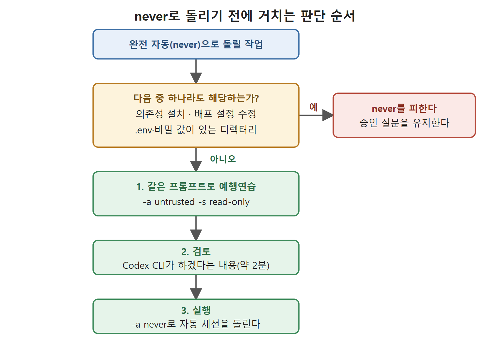

# 승인 모드 세 가지

`--ask-for-approval` 플래그는 값을 세 가지 받는다. 신뢰의 사다리라고 생각하면 이해하기 쉽다. 가장 조심스러운 untrusted에서 시작해 on-request, never 순으로 올라간다. 이 문서는 각 값이 어떻게 동작하는지, 특히 never를 어디에 써도 되고 어디에 쓰면 안 되는지를 정리한다. 마지막에는 리뷰를 건너뛰라는 업계 분위기에 대한 저자의 경고도 옮긴다.

---

## 1. untrusted: 최대한 조심

`-a untrusted`는 가장 엄격한 설정이다. 안전하다고 알려진 읽기 작업은 자동으로 실행된다. 반면 상태를 바꾸는 모든 단계, 곧 파일 쓰기, 명령 실행, 네트워크 요청은 Codex CLI가 진행하기 전에 명시적인 승인을 받아야 한다.

처음 보는 코드베이스를 탐색하면서 Codex CLI가 무엇을 하겠다고 제안하는지 실행 전에 하나하나 보고 싶을 때 맞는 모드다.

예를 들어 한 번도 본 적 없는 레거시 모노레포를 받아 와서 Codex CLI에게 마이그레이션 계획을 세워 보게 한다고 하자. 제안 내용을 끝까지 검토하기 전에는 파일이 하나도 바뀌면 안 된다. 이럴 때 아래 명령이 그 보장을 준다.

```bash
codex -a untrusted -s read-only "analyze the authentication module and draft a refactoring plan"
```

## 2. on-request: 현실적인 기본값

`-a on-request`는 대화형 세션의 기본값이다. Codex CLI는 샌드박스 경계 안에서는 거침없이 일하고, 경계를 넘어야 할 때만 멈춰서 묻는다. 작업 트리 밖의 디렉터리에 쓰려 할 때, 또는 네트워크가 꺼져 있는데 접근하려 할 때가 그런 경우다. 대부분의 대화형 개발에서는 번거로움과 안전 사이의 균형이 가장 잘 맞는 지점이다.

## 3. never: 완전 자동 파이프라인

`-a never`는 승인 질문을 아예 끈다. 다만 샌드박스를 따로 끄지 않았다면 샌드박스는 계속 작동한다. 샌드박스 경계 안에서는 사람의 입력을 기다리며 멈추는 일이 없다. 응답해 줄 사람이 없는 CI/CD 파이프라인에 적합하다.

주의할 점이 있다. 운영 디렉터리에서 네트워크 접근까지 켠 채로 never를 쓰는 것은 정말 위험한 구성이다. 작업 디렉터리에 배포 스크립트, 인프라 매니페스트, 자격 증명이 들어 있고 네트워크도 열려 있다면, 잘못 향한 실행 한 번이 실제 시스템에 실제 변경을 만들 수 있다.

## 4. never를 써도 되는 경우와 안 되는 경우

never가 어울리는 작업은 다음과 같다.

1. 네트워크 없이 소스 트리 범위로만 돌리는 포매팅과 린트
2. 테스트가 독립적으로 구성된 모듈의 테스트 생성
3. 소스 주석으로부터 문서 생성
4. 실서비스 자격 증명 없이 하는 데이터베이스 마이그레이션 파일 생성(애플리케이션 쪽이 아니라 마이그레이션 쪽)

never를 피해야 하는 경우는 다음과 같다.

1. 의존성 설치가 필요할 수 있는 작업. 네트워크가 열려 있고 승인도 없으면 공격당할 수 있는 지점이 크게 넓어진다.
2. 배포 대상을 정하는 설정 파일을 건드리는 리팩터링
3. `.env` 파일, API 키, 비밀 값이 있는 디렉터리에서 하는 모든 세션

완전 자동 세션을 돌리기 전에는 같은 프롬프트로 `-a untrusted -s read-only` 시험 실행을 먼저 해 보고, Codex CLI가 하겠다고 말하는 내용을 검토하라고 저자는 권한다. 이 예행연습은 2분이면 되고, 많은 엔지니어가 뜻밖의 사고를 피하게 해 주었다고 한다.



그림은 never를 쓰기 전에 거치는 판단 순서를 보여 준다. 피해야 할 경우에 하나라도 해당하면 승인 질문을 유지하고, 해당하지 않을 때만 예행연습과 검토를 거쳐 never로 실행한다.

## 5. 리뷰를 건너뛰라는 업계의 압력

AI 코딩 에이전트는 사람이 쓰거나 리뷰하는 속도보다 몇 배나 빠르게 코드를 만든다. 여기서 구조적인 문제가 생긴다. 프롬프트를 쓴 개발자가 결과물을 의미 있게 리뷰하기가 어려워진다는 것이다. 이를 리뷰를 강화해야 한다는 신호로 읽지 않고, 풀 리퀘스트를 AI 산출물의 속도를 늦추는 병목으로 보는 조직도 나오기 시작했다.

현재 업계의 대응은 에이전트를 더 쌓는 것이다. 에이전트가 만든 코드를 에이전트 리뷰어가 보고, 에이전트 테스터가 테스트하는 식이다. 원문은 GitHub 시니어 엔지니어였던 한 사람의 말을 인용한다. 불완전한 시스템을 불완전한 시스템 위에 쌓는다고 완벽에 수렴하지는 않는다는 취지다.

저자의 결론은 작업에 따라 다르다는 것이다. 비밀 값이 없는 모듈의 포매팅 같은 일이라면 자동 승인도 괜찮다. 하지만 의료 시스템, 금융 플랫폼, 수백만 명이 의존하는 인프라를 건드리는 일이라면 승인 단계는 병목이 아니다. 마지막 방어선이다.

<br>
<br>
<br>

[Agentic Coding with OpenAI Codex CLI](../)
