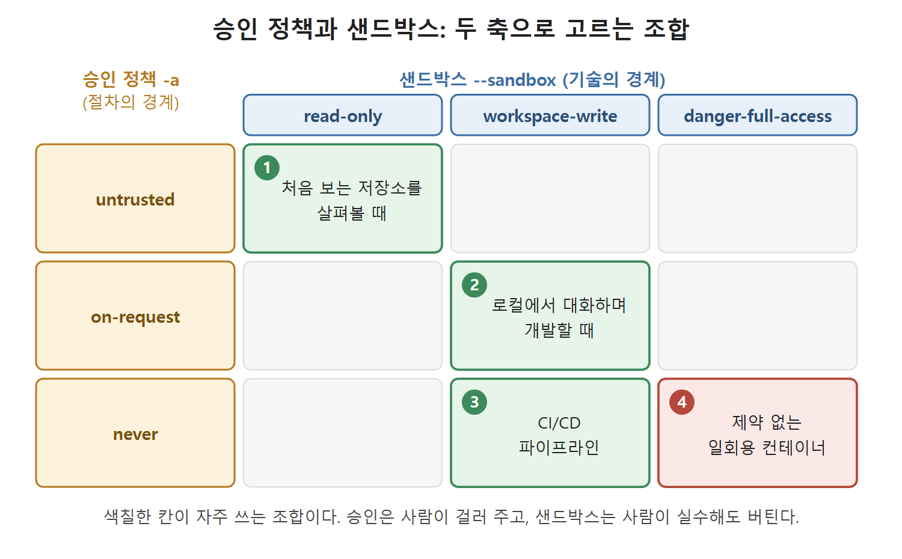

# 신뢰 모델과 두 가지 제어

4장에서 다룬 AGENTS.md는 에이전트의 행동을 부드럽게 유도하는 지침이다. 지침은 어디까지나 권유라서, 에이전트가 의도하지 않은 일을 하려 할 때 막아 주지는 못한다. 이 장은 그보다 단단한 제약, 곧 강제력이 있는 장치를 다룬다.

Codex CLI가 무엇을 시도할 수 있는지, 에이전트가 밀어붙여도 운영체제가 무엇을 허용하는지는 두 설정이 정한다. 승인 정책(approval policy)과 샌드박스 모드(sandbox mode)다. 이 둘이 합쳐져 읽기 전용 점검부터 완전 자동 실행까지 조절할 수 있는 신뢰 모델이 된다. 상황에 맞는 조합과 위험한 조합을 가려내는 일은 에이전트를 쓰는 데 필요한 기본 운영 능력이다.

---

## 1. 이 장의 학습 목표

이 장을 읽고 나면 다음을 할 수 있어야 한다.

- 작업 종류와 신뢰 수준에 맞는 승인 모드(approval mode)를 고른다.
- config.toml에서 파일 시스템 범위, 네트워크 허용, 세분화된 승인 항목을 설정한다.
- 승인 모드 사다리를 따라, 확신이 쌓이는 만큼 Codex CLI의 자율성을 단계적으로 넓힌다.

## 2. Codex CLI가 건드릴 수 있는 것

Codex CLI의 모든 행동은 두 부류로 나뉜다. 하나는 세상을 관찰하는 행동이다. 파일 읽기, 디렉터리 나열, 문서 가져오기가 여기에 든다. 다른 하나는 세상을 바꾸는 행동이다. 파일 쓰기, 셸 명령 실행, 네트워크 요청이 여기에 든다. 신뢰 모델이 답하려는 질문은 "바꾸는 행동 중 어떤 것은 내가 직접 허락해야 하고, 어떤 것은 내 허락과 상관없이 운영체제가 아예 막아야 하는가"이다.

## 3. 서로 독립인 두 제어

Codex CLI는 이 질문을 서로 독립인 두 제어로 나눠 푼다.

- `--ask-for-approval`(짧게 `-a`)은 절차의 경계를 정한다. Codex CLI가 언제 멈추고 사람의 확인을 받아야 하는지를 결정한다.
- `--sandbox`(짧게 `-s`)는 기술의 경계를 정한다. 승인을 구했는지, 받았는지와 무관하게 운영체제가 무엇을 허용하는지를 결정한다.

핵심은 이 둘이 따로 논다는 점이다. 샌드박스만 있고 승인 질문이 없을 수도 있고, 승인 질문만 있고 샌드박스가 없을 수도 있다. 둘 다 켜거나 둘 다 끌 수도 있다. 이렇게 분리해 두면 보안을 두 축으로 따로 따져 볼 수 있다. 승인은 사람이 걸러 주는 장치이고, 샌드박스는 사람이 실수해도 버텨 주는 장치다.

아래 표는 자주 쓰는 조합이다.

| 상황 | --ask-for-approval | --sandbox |
|---|---|---|
| 처음 보는 저장소를 살펴볼 때 | untrusted | read-only |
| 로컬에서 대화하며 개발할 때 | on-request | workspace-write |
| CI/CD 파이프라인 | never | workspace-write |
| 제약 없는 일회용 컨테이너 | never | danger-full-access |

그림은 승인 정책을 세로축, 샌드박스 모드를 가로축에 놓고 위 표의 네 조합이 어느 칸에 놓이는지 보여 준다. 두 제어가 서로 독립이므로 어느 칸이든 고를 수 있고, 색칠한 칸이 자주 쓰는 조합이다.

각 값의 뜻은 다음 문서(승인 모드)와 그다음 문서(샌드박스)에서 하나씩 풀어 본다.

## 4. 다음 장과의 연결

승인 정책과 샌드박스 모드는 에이전트가 무엇을 시도해도 되는지만 정한다. 어떤 모델이 시도하는지, 그 모델이 행동하기 전에 얼마나 깊이 생각하는지는 정하지 않는다. 그 부분은 6장의 모델 선택과 추론 강도(reasoning effort)에서 다룬다. 6장의 두 설정은 지금 정한 경계 안에서 매 단계의 품질, 지연 시간, 비용을 좌우한다.

 
 
 

[Agentic Coding with OpenAI Codex CLI](../)
