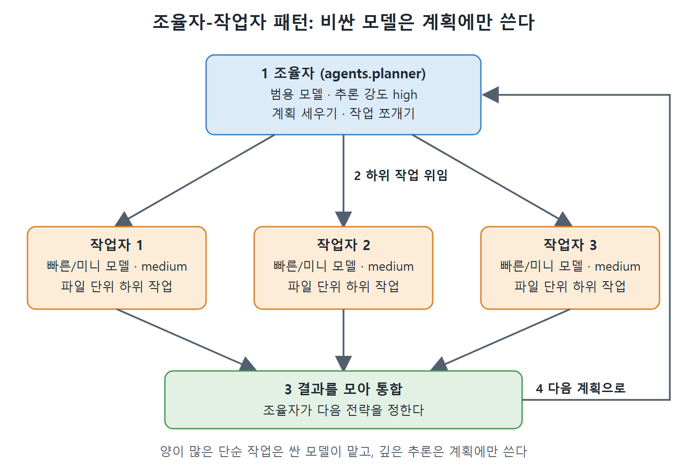

# 모델 라우팅과 다중 모델 워크플로

모델이 여러 개 있으면 작업마다 어떤 모델을 쓸지 고르는 일이 설계 결정이 된다. 이 문서는 모델을 고르는 판단 순서(라우팅 결정 트리), 잘못 고를 때의 비용, 그리고 모델을 단계별·역할별로 섞어 쓰는 두 가지 패턴을 정리한다.

---

## 1. 모델 라우팅 결정 트리

모델 라우팅은 작업 성격에 맞는 모델로 길을 나눠 보내는 일이다. 결정 트리는 위에서부터 질문을 읽고, 처음으로 "예"가 나오는 곳에서 멈추면 된다. 네 질문이 모두 "아니오"라면 기본값인 범용 모델을 쓴다.

그림의 흐름을 글로 풀면 다음과 같다.

| 순서 | 질문 | "예"일 때 |
|---|---|---|
| 1 | 복잡한 추론이나 최고 수준의 능력이 필요한가 | 플래그십 모델 |
| 2 | 도구를 쓰는 일반 개발 작업인가 | 범용 모델 |
| 3 | 서브에이전트나 일괄 작업인가 | 빠른/미니 모델 |
| 4 | 대량의 코딩 파이프라인인가 | 코딩 특화 모델 |
| 모두 아니오 | 해당 없음 | 범용 모델(기본값) |

순서가 중요하다. 가장 비싼 모델이 필요한 경우를 먼저 걸러 내고, 그다음에 일반 개발, 위임·일괄 작업, 코딩 파이프라인 순으로 내려간다.

## 2. 잘못된 라우팅의 비용

개발자 열 명이 하루에 세션을 다섯 번씩 돌린다고 하자. 모든 작업을 플래그십 모델로 보내는 경우와 일상 작업을 빠른 모델로 보내는 경우의 차이는 한 달에 수천 달러가 될 수 있다고 원서는 말한다. 그래서 모델 라우팅은 섣부른 최적화가 아니라 규모가 커질수록 필요해지는 비용 관리다.

판단을 돕는 경험칙이 하나 있다.

- 숙련 개발자가 손으로 하면 5분 안에 끝날 일이면 빠른/미니 모델로 충분하다.
- 여러 파일을 읽고 종합해서 판단해야 하거나 설계 결정이 들어가면 범용 또는 플래그십 모델을 쓴다.

## 3. 다중 모델 워크플로

가장 비용 효율이 좋은 방식은 작업 단계마다 다른 모델을 쓰는 것이다. 원서는 두 가지 패턴을 소개한다.

### 조율자-작업자 패턴

범용 모델을 조율자(orchestrator)로 두어 계획 세우기, 작업 쪼개기, 결과 합치기를 맡긴다. 빠른 모델은 작업자(worker)로 두어 범위가 정해진 하위 작업과 파일 단위 수정을 맡긴다. 이렇게 여러 에이전트를 나누어 맡기고 조율하는 일을 오케스트레이션이라 부른다.

서브에이전트는 `agents.<이름>.config_file` 키로 자기만의 Codex 설정 파일을 가리키고, 그 파일에 모델과 추론 강도가 들어 있다. 원서의 예시는 설명용이며, 전체 서브에이전트 설정 방식은 11장에서 다룬다고 밝힌다.

```toml
[agents.planner]
config_file = "~/.codex/subagents/planner.toml"
# planner.toml 안: model = "gpt-5.5", model_reasoning_effort = "high"

[agents.worker]
config_file = "~/.codex/subagents/worker.toml"
# worker.toml 안: model = "gpt-5.4-mini", model_reasoning_effort = "medium"
```

조율자는 전체 접근 방식을 고민하고 구현을 맡길 작업자를 띄운다. 작업자는 좁은 범위 안에서 일하는데, 이 범위가 빠른 모델이 가장 잘하는 영역이다. 조율자는 결과를 모아 통합하고 다음 전략을 정한다. 깊이 생각하는 비싼 호출은 계획에만 쓰고, 양이 많은 단순 작업은 싼 모델로 처리하는 셈이다.



그림은 조율자가 계획을 세워 작업자들에게 하위 작업을 맡기고, 결과를 모아 통합한 뒤 다음 계획으로 돌아가는 순환을 보여 준다. 높은 추론 강도는 조율자에게만 쓰고, 작업자는 빠른 모델과 중간 강도로 좁은 범위의 일을 처리한다.

### 세션 단계별 라우팅

한 대화형 세션 안에서도 지금 하는 일의 단계에 맞춰 추론 강도(필요하면 모델까지)를 바꾼다.

1. 탐색: 낮은 강도, 빠른 모델. 파일을 읽고 구조를 파악하고 질문한다.
2. 계획: 높은 강도, 플래그십 모델. 접근법을 설계하고 위험을 찾는다.
3. 구현: 중간 강도, 범용 모델. 코드를 쓰고 테스트를 돌린다.
4. 리뷰: 높은 강도, 범용 모델. 정확성을 확인하고 경계 조건을 점검한다.

단계를 옮길 때는 `Alt+,` / `Alt+.` 단축키로 강도를, `/model` 명령으로 모델을 바꾼다.

그림은 이 단계가 상태 전이로 이어지는 모습을 보여 준다. 세션은 탐색에서 시작해 계획, 구현, 리뷰 순으로 흘러간다. 리뷰에서 문제가 나오면 "수정(fixes)" 화살표를 따라 구현으로 돌아간다. 새 작업이 생기면 "새 작업(new task)" 화살표로 처음의 탐색 단계로 돌아가고, 문제가 없으면 세션이 끝난다.

## 4. 정리

- 결정 트리는 위에서 아래로 읽고, 처음 "예"가 나온 모델을 쓴다. 전부 "아니오"면 범용 모델이다.
- 5분 안에 끝날 일은 빠른/미니 모델, 여러 파일 추론이나 설계는 범용 이상을 쓴다.
- 조율자는 범용 모델로 계획을, 작업자는 빠른 모델로 좁은 구현을 맡기는 구성이 비용 효율이 좋다.
- 한 세션 안에서도 탐색, 계획, 구현, 리뷰 단계마다 강도와 모델을 바꾼다.

<br>
<br>
<br>

[Agentic Coding with OpenAI Codex CLI](../)
