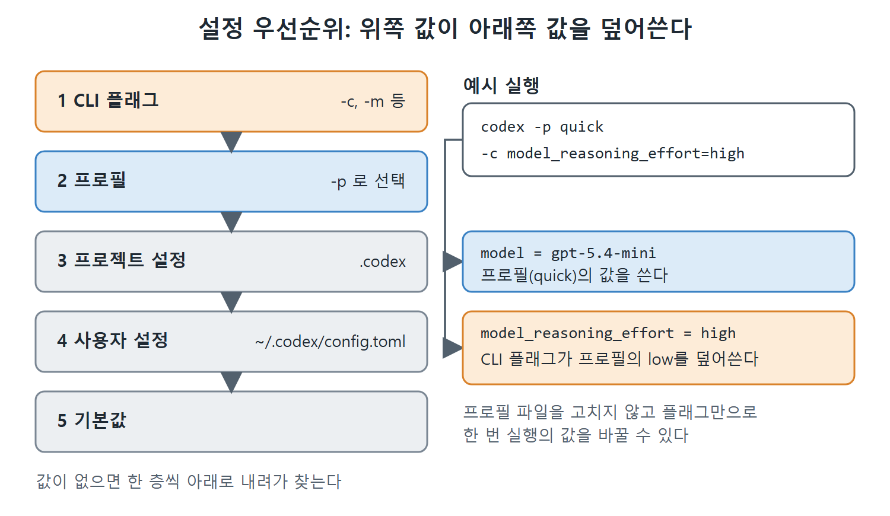

# 프로필로 설정 묶기

매번 모델과 추론 강도, 승인 정책, 샌드박스를 따로 지정하면 번거롭고 실수하기 쉽다. 프로필(profile)은 이런 설정을 한 묶음으로 만들어 이름 하나로 불러오게 해 준다. 이 문서는 프로필 파일의 구조와 실제 예시, 그리고 설정이 겹칠 때 무엇이 이기는지를 정리한다.

---

## 1. 프로필이란

프로필은 모델, 추론 강도, 그 밖의 세션 설정을 재사용 가능한 구성으로 묶은 것이다. 5장에서 본 대로 프로필은 각자 자기 파일을 가진다. 경로는 `~/.codex/<이름>.config.toml`이고, 파일 안의 설정은 최상위 키로 적는다.

`--profile <이름>`으로 실행하면 Codex는 먼저 `~/.codex/config.toml`을 읽고, 그 위에 해당 프로필 파일을 덧씌운다. 그래서 프로필에는 기본값과 다른 항목만 적어도 된다.

## 2. 프로필 예시 네 가지

원서는 일상용, 깊은 조사용, 쿼터 절약용, CI용 구성을 예로 든다.

```toml
# ~/.codex/config.toml  (기본값)
model = "gpt-5.5"
model_reasoning_effort = "medium"
```

```toml
# ~/.codex/deep.config.toml
model = "gpt-5.5"
model_reasoning_effort = "high"
approval_policy = "untrusted"
sandbox_mode = "read-only"
```

```toml
# ~/.codex/quick.config.toml
model = "gpt-5.4-mini"
model_reasoning_effort = "low"
```

```toml
# ~/.codex/ci.config.toml
model = "gpt-5.5"
model_reasoning_effort = "medium"
approval_policy = "never"
sandbox_mode = "workspace-write"
```

각 프로필의 성격은 다음과 같다.

| 프로필 | 모델과 강도 | 권한 설정 | 쓰임새 |
|---|---|---|---|
| 기본 | gpt-5.5, medium | 따로 없음 | 매일 쓰는 기본 구성 |
| deep | gpt-5.5, high | untrusted, read-only | 코드를 고치지 않고 깊게 조사하거나 감사할 때 |
| quick | gpt-5.4-mini, low | 따로 없음 | 린트 경고 수정 같은 가벼운 일, 쿼터 절약 |
| ci | gpt-5.5, medium | never, workspace-write | 사람이 승인할 수 없는 자동화 파이프라인 |

deep 프로필은 모델과 강도를 올리는 동시에 승인 정책을 `untrusted`, 샌드박스를 `read-only`로 묶었다. 깊게 생각하는 조사 작업은 읽기만 하면 되기 때문에, 생각하는 힘을 키우면서 쓰기 권한은 막아 둔 구성이다. ci 프로필은 반대로 승인 질문 없이(`never`) 작업 폴더 안에서만 쓸 수 있게(`workspace-write`) 한다.

### 프로필로 실행하기

```bash
codex --profile deep "audit this module for security vulnerabilities"
codex -p quick "fix all lint warnings"
codex -p ci "run the migration and verify tests pass"
```

`--profile`은 `-p`로 줄여 쓸 수 있다. 플래그 하나로 모델, 강도, 권한이 한꺼번에 바뀐다는 점이 핵심이다.

## 3. 설정 우선순위

프로필 값은 사용자 수준 설정을 덮어쓰지만, 명령줄에서 직접 준 플래그에는 덮어쓰인다. 전체 우선순위는 왼쪽이 가장 세다.

> CLI 플래그 > 프로필 > 프로젝트 설정 > 사용자 설정 > 기본값

예를 들어 `codex -p quick -c model_reasoning_effort=high "..."`처럼 실행하면 quick 프로필의 모델은 그대로 쓰되 추론 강도만 명령줄 값인 high가 적용된다. 반대로 프로필이 정한 값을 일시적으로 바꾸고 싶을 때도 파일을 고칠 필요 없이 플래그만 덧붙이면 된다.



그림은 CLI 플래그가 가장 위, 기본값이 가장 아래인 다섯 층을 보여 준다. 오른쪽 예시처럼 모델은 프로필 값을, 추론 강도는 CLI 플래그 값을 쓰게 되는 과정을 함께 확인할 수 있다.

## 4. 정리

- 프로필 하나는 `~/.codex/<이름>.config.toml` 파일 하나다.
- `--profile` 또는 `-p`로 고르면 기본 `config.toml` 위에 프로필이 덧씌워진다.
- 일상, 깊은 조사, 쿼터 절약, CI처럼 목적별 프로필을 만들어 두면 플래그 하나로 전환할 수 있다.
- 우선순위는 CLI 플래그, 프로필, 프로젝트 설정, 사용자 설정, 기본값 순이다.

<br>
<br>
<br>

[Agentic Coding with OpenAI Codex CLI](../)
